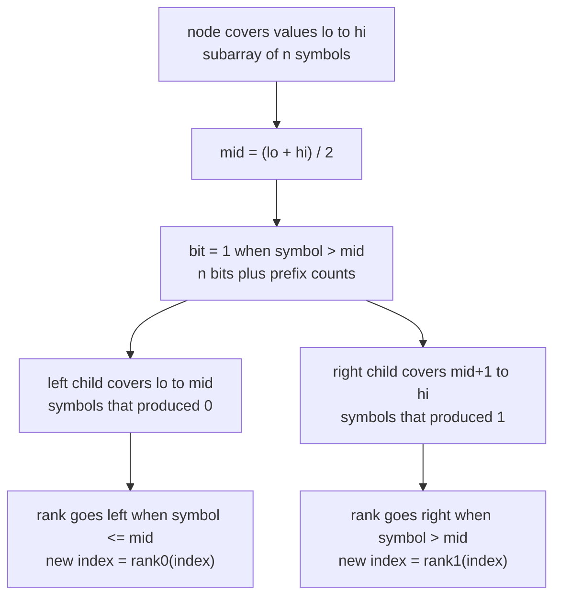
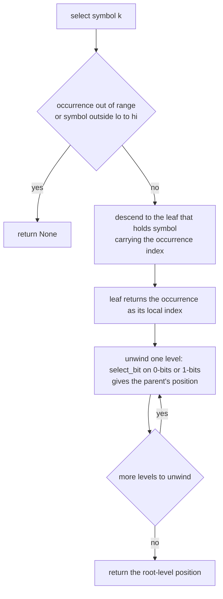
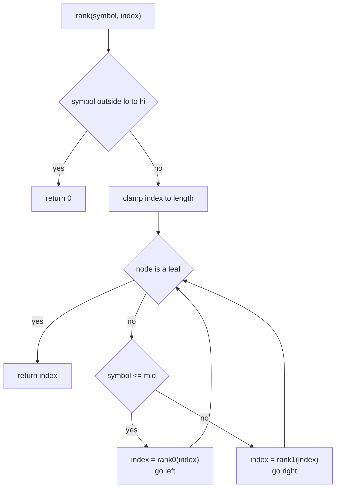
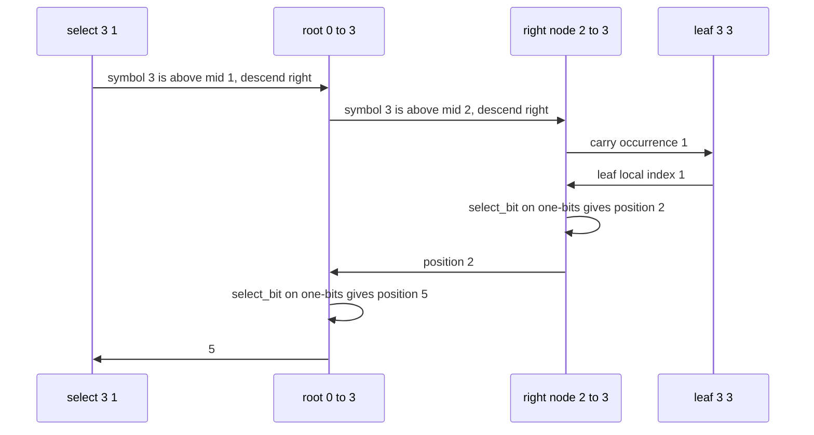

# 579 — Implement wavelet tree for strings (rank/select).

> **Tier:** Advanced · **CTCI chapter:** Beyond — Advanced Data Structures & Algorithms
> **Task spec:** [579-implement-wavelet-tree-for-strings-rank-select.md](../../../tasks/advanced/579-implement-wavelet-tree-for-strings-rank-select.md)
> **Solutions:** [Python](../../../solutions/python/advanced/579-implement-wavelet-tree-for-strings-rank-select/solution.py) ·
> [Java](../../../solutions/java/advanced/579-implement-wavelet-tree-for-strings-rank-select/Solution.java) ·
> [JavaScript](../../../solutions/javascript/advanced/579-implement-wavelet-tree-for-strings-rank-select/solution.js) ·
> [C#](../../../solutions/csharp/advanced/579-implement-wavelet-tree-for-strings-rank-select/Solution.cs)

## 1. Problem restatement

**Input:** a string of bytes, given either as a symbol sequence with an explicit alphabet `(lo, hi)`
or with the alphabet derived from the data as `(min, max)`.

**Output:** a wavelet tree that answers four queries, all of them by descending one level per step:

| Query | Contract in the code |
| --- | --- |
| `access(i)` | the symbol at index `i`; raises `IndexError` when `i` is out of range |
| `rank(symbol, i)` | occurrences of `symbol` in `symbols[:i]`; `i` is **clamped** at the length |
| `select(symbol, k)` | position of the `k`-th (zero-based) occurrence, or `None` when there is none |
| `count(symbol, start, end)` | occurrences in the half-open range `[start, end)`, i.e. `rank(symbol, end) - rank(symbol, start)` |

Each node covers a symbol range `[lo, hi]`, stores one bit per symbol of its subarray (`1` when the
symbol is above the midpoint) plus the prefix counts of those bits, and splits its subarray between
the two children — so the tree has at most `log2(256) = 8` levels and `n` bits per level.

The spec is one line; the contract comes from the assertions the four solutions ship with:

| Call | Result | Why |
| --- | --- | --- |
| `rank(ord('a'), 0)` | `0` | an empty prefix |
| `rank(ord('a'), len(s))` | `s.count(ord('a'))` | the whole string |
| `rank(ord('a'), 1000)` | the same total | the index clamps at the end instead of failing |
| `rank(ord('z'), 5)` on a lowercase string | `0` | a symbol above `hi` counts zero |
| `select(c, position_of(c, k))` | `k` occurrences before that position | `rank(select(c, k)) == k` |
| `select(c, len(spots))`, `select(c, -1)`, `select(absent, 0)` | `None` | out of range, not an exception |
| `count(c, 200, 200)` / `count(c, 0, 0)` | `0` / `0` | empty ranges |
| `access(i)` for every `i` of a 256-symbol string | `i` | the all-distinct case |
| `levels()` and `bit_count()` on that string | `8` and `length * 8` | the documented `n` bits per level |
| `access(length)` | raises `IndexError` | out of range is an error, unlike `rank` |

Two independent references are used for verification: plain string scanning, and per-symbol position
lists queried with `bisect` — so `rank` and `select` are compared against results they were not
derived from, over 400 random half-open ranges.

## 2. Intuition

`rank` is the query that makes a wavelet tree worth building. A naive implementation scans the prefix
`symbols[:i]`, which is `O(i)`; a per-symbol position list answers in `O(log n)` but only for one
symbol at a time and costs `O(n)` integers of storage. The wavelet tree answers the same question in
`O(log sigma)` steps and, because it stores one bit per symbol per level, its memory is counted in
bits.

The trick is that a node's bit vector answers two questions at once. If the node splits its value
range at `mid`, then the number of `1`-bits in the first `i` positions is `prefix[i]` — that is
`rank1(i)` — and the number of `0`-bits is `i - prefix[i]`, which is `rank0(i)`. Descending to the
child of the symbol's side therefore rewrites the index in the child's coordinate system:

```
symbol <= mid   →   i' = rank0(i), descends left
symbol >  mid   →   i' = rank1(i), descends right
```

At the leaf the index *is* the answer, because every symbol in the leaf's subarray equals `lo`. That
one line is the whole of `rank`, and `access` is the same walk in the opposite direction: read the
bit at the current index to choose the child, then rewrite the index for that child.



`select` is harder because it asks for a **position**, and positions are only known at the root: a
child's index must be lifted back to the parent's coordinate system by finding where the `k`-th
`0`-bit (or `1`-bit) sits in the parent's bit vector. The shipped code does that recursion
bottom-up: resolve the occurrence inside the child first, then ask the parent where that bit is. The
documented simplification is how the parent answers.

> `select_bit` finds the `k`-th bit by binary search over the prefix counts. A production wavelet tree
> stores block-wise counts instead, which turns this into a constant number of steps; the binary
> search is the honest simple version and is documented rather than glossed over.



## 3. Algorithm

Every operation is a walk over the same two primitives, `rank1(i) = prefix[i]` and
`rank0(i) = i - prefix[i]`, exactly as in the prefix-count structure of
[578-implement-dynamic-orthogonal-range-counting-with-wavelet-tree-co.md](../../../tasks/advanced/578-implement-dynamic-orthogonal-range-counting-with-wavelet-tree-co.md).

1. **Construction.** For a node over `[lo, hi]`: if `lo == hi`, store an all-zero prefix table of
   length `size + 1` and stop. Otherwise set `mid = (lo + hi) / 2`, walk the subarray counting symbols
   strictly greater than `mid`, and recurse on `symbols <= mid` and `symbols > mid`.
2. **`access(i)`.** While the node is not a leaf, read `bit(i)`; if it is `1` set `i = rank1(i)` and
   go right, otherwise set `i = rank0(i)` and go left. Return `node.lo`.
3. **`rank(symbol, i)`.** Clamp `i` to the length, return `0` when the symbol is outside `[lo, hi]`,
   then while the node is not a leaf descend left with `rank0` when `symbol <= node.mid` and right
   with `rank1` otherwise. Return the index at the leaf.
4. **`select(symbol, k)`.** Return `None` when the symbol is outside the alphabet or `k` is negative
   or `k >= rank(symbol, n)`. Otherwise recurse to the child on the symbol's side, then map the
   child's local index back with `select_bit(node, index, 0)` or `select_bit(node, index, 1)`.
5. **`count(symbol, start, end)`.** Two `rank` calls, one subtraction.
6. **`select_bit(node, k, bit)`.** Binary search for the smallest position `p` whose count of `bit`s
   in `node.prefix[:p + 1]` reaches `k + 1`; that position is the answer.

```text
function rank(node, symbol, index)
    if symbol < node.lo or symbol > node.hi then
        return 0
    end
    index ← min(index, length(symbols))
    while node.lo != node.hi do
        if symbol <= node.mid then
            index ← rank0(node, index)
            node ← node.left
        else
            index ← rank1(node, index)
            node ← node.right
        end
    end
    return index
end
```

```text
function select(node, symbol, occurrence)
    if node.lo == node.hi then
        return occurrence                       # the leaf's local index is the answer
    end
    if symbol <= node.mid then
        return select_bit(node, select(node.left, symbol, occurrence), 0)
    end
    return select_bit(node, select(node.right, symbol, occurrence), 1)
end

function select_bit(node, k, bit)
    target ← k + 1
    low ← 0
    high ← node.size
    while low < high do
        middle ← (low + high) / 2
        count ← rank1(node, middle + 1) if bit == 1 else rank0(node, middle + 1)
        if count >= target then
            high ← middle
        else
            low ← middle + 1
        end
    end
    return low
end
```



## 4. Worked example

Build the tree on `symbols = [1, 0, 3, 2, 1, 3, 0, 0]` with the alphabet `(0, 3)`. The root's
midpoint is `mid = 1`, so a symbol contributes a `1` bit when it is `2` or `3`:

| Node | Value range | Subarray | Bits | Prefix counts |
| --- | --- | --- | --- | --- |
| root | `[0, 3]`, `mid = 1` | `1 0 3 2 1 3 0 0` | `0 0 1 1 0 1 0 0` | `0 0 0 1 2 2 3 3 3` |
| left | `[0, 1]`, `mid = 0` | `1 0 1 0 0` | `1 0 1 0 0` | `0 1 1 2 2 2` |
| right | `[2, 3]`, `mid = 2` | `3 2 3` | `1 0 1` | `0 1 1 2` |
| left-left | `[0, 0]` leaf | `0 0 0` | — | `0 0 0 0` |
| left-right | `[1, 1]` leaf | `1 1` | — | `0 0 0` |
| right-right | `[3, 3]` leaf | `3 3` | — | `0 0 0` |

`access(5)` should return `3`. The walk reads one bit per level and never looks at a symbol:

| Step | Node | Index in | Bit at index | Map | Index out | Child |
| --- | --- | --- | --- | --- | --- | --- |
| 1 | root `[0, 3]` | 5 | `prefix[6] - prefix[5] = 3 - 2 = 1` | `rank1(5) = prefix[5] = 2` | 2 | right `[2, 3]` |
| 2 | right `[2, 3]` | 2 | `prefix[3] - prefix[2] = 2 - 1 = 1` | `rank1(2) = prefix[2] = 1` | 1 | right-right `[3, 3]` leaf |
| 3 | leaf `[3, 3]` | 1 | — | — | — | return `lo = 3` |

`rank(3, 7)` should count the `3`s in `[1, 0, 3, 2, 1, 3, 0]`, which is `2`:

| Step | Node | Index | Branch | Map | New index |
| --- | --- | --- | --- | --- | --- |
| 1 | root `[0, 3]` | 7 | `symbol 3 > mid 1`, go right | `rank1(7) = prefix[7] = 3` | 3 |
| 2 | right `[2, 3]` | 3 | `symbol 3 > mid 2`, go right | `rank1(3) = prefix[3] = 2` | 2 |
| 3 | leaf `[3, 3]` | 2 | — | — | return `2` |

And `count(3, 2, 5) = rank(3, 5) - rank(3, 2)`. The first walk gives `rank1(5) = 2` then
`rank1(2) = 1`, so it returns `1`; the second walk starts at index `2`, and at the root
`rank1(2) = prefix[2] = 0` sends the count straight to `0`. The answer `1` matches the single `3` at
index 2.

`select` walks the same tree in the opposite direction. `select(3, 1)` asks for the second `3`, which
sits at index `5`:

| Step | Node | Local index in | Action | Local index out |
| --- | --- | --- | --- | --- |
| 1 | root `[0, 3]` | — | descend right because `3 > 1` | resolved by step 2 |
| 2 | right `[2, 3]` | — | descend right because `3 > 2` | resolved by step 3 |
| 3 | leaf `[3, 3]` | `1` | return the occurrence itself | `1` |
| 4 | right `[2, 3]` | `1` | `select_bit(node, 1, 1)`: the 2nd one-bit sits at position `2` | `2` |
| 5 | root `[0, 3]` | `2` | `select_bit(node, 2, 1)`: the 3rd one-bit sits at position `5` | `5` |

The binary search in step 5 is the documented simplification: it probes the prefix table for the
smallest position whose one-count reaches `3`, landing on `5`. Every `select`/`rank` pair is checked
as an inverse (`select(c, rank(c, p)) == p` at each occurrence, and `rank(c, select(c, k)) == k`), and
the whole battery is also compared against per-symbol position lists queried with `bisect`.




## 5. Complexity

Let `n` be the string length and `sigma = hi - lo + 1` the alphabet size.

| Measure | Bound | Why it holds |
| --- | --- | --- |
| Construction | O(n log sigma) | one pass per level appending one bit per symbol, and `ceil(log2 sigma)` levels |
| `access` | O(log sigma) | one bit read and one prefix lookup per level |
| `rank` | O(log sigma) | the same descent; the clamp and the alphabet check are `O(1)` |
| `count` | O(log sigma) | two `rank` calls |
| `select` | O(log sigma · log n) as written | each unwinding level binary-searches the prefix table (`select_bit` is `O(log n)`); a block-wise bit vector makes each level `O(1)` |
| Stored bits | `n` per level, so `O(n log sigma)` | asserted exactly for the full alphabet: `levels() == 8`, `bit_count() == length * 8` |
| Naive `rank` alternative | O(i) per query | scanning `symbols[:i]` |
| Position-list alternative | O(log n) per query, O(n) integers | one sorted list per symbol, queried with `bisect`; used as a reference implementation, not as the answer |


## 6. Pitfalls and edge cases

- **`rank` clamps, `access` raises.** `rank(ord('a'), 1000)` returns the total count of `a` while
  `access(length)` raises `IndexError`; a prefix beyond the end is a meaningful "everything".
- **`select` returns `None` rather than raising.** Out-of-range occurrence, a negative occurrence and a
  symbol outside the alphabet all give `None`, which the files assert.
- **The alphabet comes from the data.** With no explicit range, `lo = min` and `hi = max`, so a symbol
  below `lo` or above `hi` counts `0` immediately and the recursion never sees an empty value range.
- **Equal symbols go left.** The split is `symbol > mid` for the right child, so `symbol == mid` descends
  left; using `>=` would move a whole class of symbols and break the rank/select inverses.
- **Leaf tables and `bit`.** A leaf stores `size + 1` zeros and `bit(index)` is only ever called on
  internal nodes, which is what the loop condition guarantees.
- **`levels()` versus `bit_count()`.** `levels()` derives `ceil(log2(hi - lo + 1))` from the alphabet while
  `bit_count()` sums internal subarray sizes; for the full alphabet they agree as `8` and `length * 8`.

## 7. Variants and follow-ups

- **Range counting over values.** Replacing the per-symbol query with "how many values lie in
  `[low, high]`" needs the two-threshold descent of
  [578-implement-dynamic-orthogonal-range-counting-with-wavelet-tree-co.md](../../../tasks/advanced/578-implement-dynamic-orthogonal-range-counting-with-wavelet-tree-co.md),
  which also adds the block-decomposed update path this static structure does not have.
- **Range *k*-th order statistic.** The same descent answers "which value is the `k`-th smallest in the
  window" by choosing the side that contains rank `k`; the persistent segment tree of
  [429-implement-range-kth-order-statistic-using-persistent-segtree.md](../../../tasks/advanced/429-implement-range-kth-order-statistic-using-persistent-segtree.md)
  is the versioned alternative.

## 8. Check yourself

1. Why does `rank` return the index itself at a leaf instead of counting anything?

<details><summary>Show answer</summary>

Because a leaf covers a single symbol value: every symbol in its subarray equals `node.lo`. The
descent has been rewriting the index in each child's coordinates, so by the time the walk reaches the
leaf, the index counts exactly the occurrences of that symbol in the original prefix — that is, the
answer. The leaf's prefix table is all zeros and is never consulted.

</details>

2. What do `rank1(i)` and `rank0(i)` mean in terms of the prefix table, and why is `rank0` free?

<details><summary>Show answer</summary>

`rank1(i) = prefix[i]`, the number of symbols among the first `i` that went to the right child, and
`rank0(i) = i - prefix[i]`, the number that went left. `rank0` is free because a stored bit is either
`0` or `1`: the zeros in a prefix are the prefix length minus the ones. That is why the descent can
map a window through either child in constant time.

</details>

3. `select(3, 1)` returned `5` in the worked example. Which direction does the recursion resolve, and
   why can it not go top-down?

<details><summary>Show answer</summary>

The occurrence index is resolved at the bottom and lifted upwards: the leaf returns the occurrence as
its local index, and each ancestor answers "where is that local index's bit in my vector" with
`select_bit`. It cannot go top-down because the parent only knows the rank of a child position, not its
inverse — the position in the parent's coordinates is exactly what the child index does not carry.

</details>

4. Why is `select` the only operation whose complexity is worse than `O(log sigma)`?

<details><summary>Show answer</summary>

Because of the documented simplification: `select_bit` binary-searches the prefix counts, `O(log n)`,
instead of using block-wise super-blocks. The descent itself is still one level per step, so `select`
is `O(log sigma · log n)` as written. A production wavelet tree stores block counts and resolves each
level in a constant number of steps.

</details>

5. What does the file assert for the string that contains all 256 distinct bytes, and why is that the
   interesting test?

<details><summary>Show answer</summary>

That `levels() == 8`, `bit_count() == length * 8`, `access(i) == i`, every `rank` is `1` and every
`select` is `0` or `None`. It is the deepest possible tree (`ceil(log2(256)) = 8` levels) and the case
where every child split is perfectly even, so it exercises the level bookkeeping and the bit budget
bound in the most extreme shape the alphabet allows.

</details>