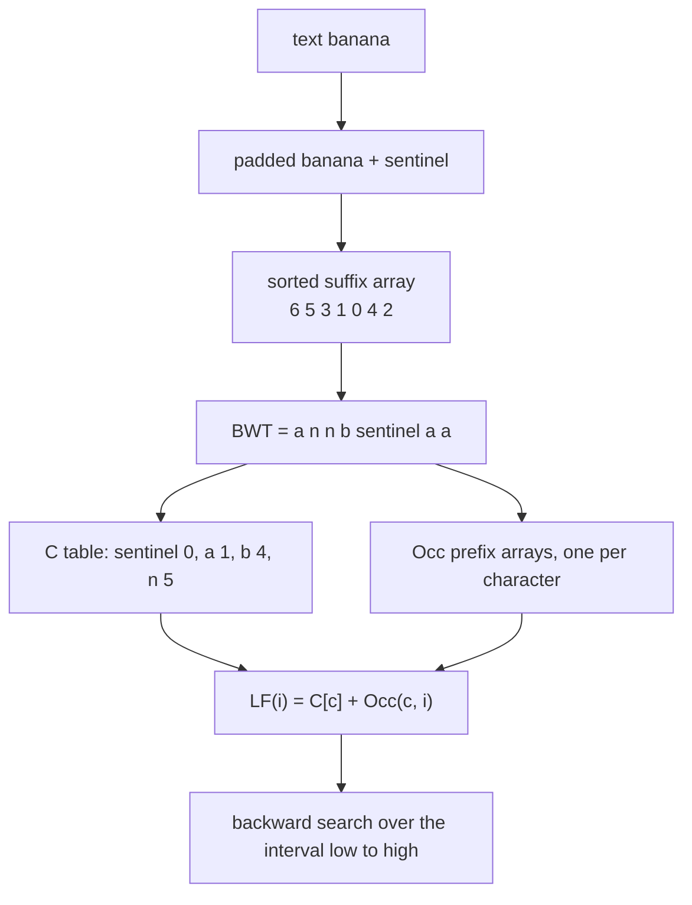
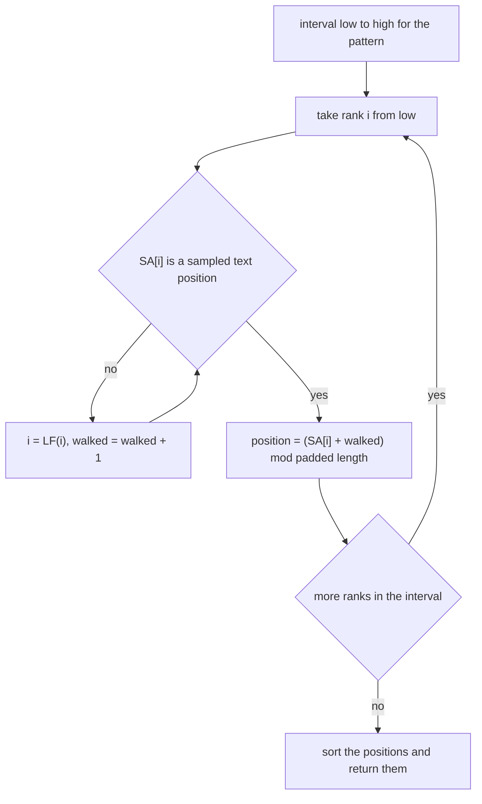
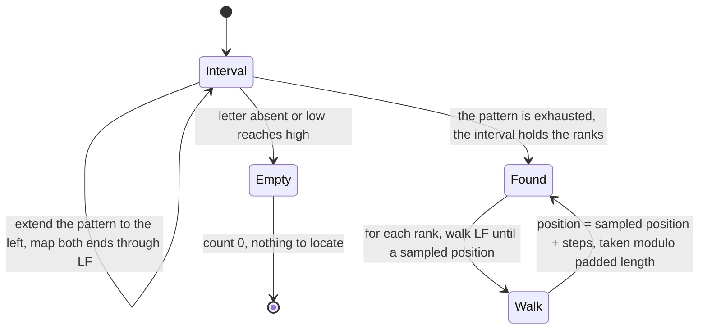
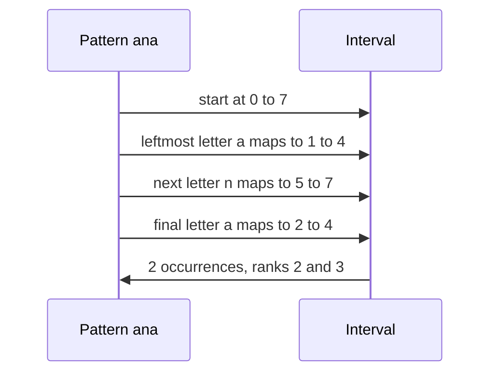

# 580 — Implement FM-index search for substring count (conceptual).

> **Tier:** Advanced · **CTCI chapter:** Beyond — Advanced Data Structures & Algorithms
> **Task spec:** [580-implement-fm-index-search-for-substring-count-conceptual.md](../../../tasks/advanced/580-implement-fm-index-search-for-substring-count-conceptual.md)
> **Solutions:** [Python](../../../solutions/python/advanced/580-implement-fm-index-search-for-substring-count-conceptual/solution.py) ·
> [Java](../../../solutions/java/advanced/580-implement-fm-index-search-for-substring-count-conceptual/Solution.java) ·
> [JavaScript](../../../solutions/javascript/advanced/580-implement-fm-index-search-for-substring-count-conceptual/solution.js) ·
> [C#](../../../solutions/csharp/advanced/580-implement-fm-index-search-for-substring-count-conceptual/Solution.cs)

## 1. Problem restatement

**Input:** a text, plus the queries: how many times does a pattern occur, and where?

**Output:** a working FM-index — the three structures a real one needs, plus the two queries and the
inverse transform:

| Piece | Meaning in the code |
| --- | --- |
| `padded = text + "\x00"` | the text with a unique smallest sentinel, so the transform inverts exactly |
| `suffix_array` | the sorted suffix array of the text |
| `bwt[i]` | `padded[(suffix_array[i] - 1) % length]` — the last column of the BWT |
| `counts[c]` | `C[c]` = the number of characters of the BWT strictly smaller than `c` |
| `occ[c][i]` | the number of occurrences of `c` in `bwt[:i]` |
| `sampled_positions` | every `sampling`-th **text position** (`4` by default) |

The conceptual simplification the header documents is in the rank structure.

> The file stores `Occ` as per-character prefix-count arrays — the conceptual, honest version of the
> wavelet-tree rank structure a real FM-index uses — keeps the full suffix array alongside it, and
> locates occurrences with a sampling step: the suffix array is sampled every `SAMPLING`-th position
> and LF steps are walked until a sampled entry is hit.

The contract is fixed by the assertions, which include structural checks rather than only search
results:

| Call or property | Result | Why |
| --- | --- | --- |
| `LF(i) = C[c] + Occ(c, i)` | `SA[LF(i)] = (SA[i] - 1) mod n` for every `i` | the defining property of the transform, asserted directly |
| inverting the BWT | the original text | checked for four texts of different shapes |
| every pattern of length `<= 4` over a two-symbol alphabet | the same count as `str.count` | all `31` such patterns, on a 300-character text |
| the empty pattern | `n` | every suffix starts with it |
| a pattern longer than the text, an absent pattern | `0` | the interval collapses and backward search bails out |
| located positions, every exhaustive pattern, samplings `1`, `2`, `4` | exactly the occurrence positions, sorted | and `LF steps < sampling` is asserted |
| `count` versus a binary search on the suffix array | identical | an independent cross-check |

## 2. Intuition

Counting occurrences of a pattern without scanning the text relies on one fact about the Burrows-Wheeler
matrix: **rows sharing a prefix form a contiguous block, and the block for a longer pattern sits inside
the block of its shorter suffix**. Backward search exploits it: start with the interval of the empty
pattern (the whole matrix, `[0, n)`), and extend the pattern one character to the *left* at a time,
replacing the interval with the sub-block of rows whose previous character is the new character. If the
interval ever becomes empty, the pattern does not occur.

The mapping that performs that replacement is the LF mapping. For a character `c` and an index `i`,

```
LF(i) = C[c] + Occ(c, i)          where c = bwt[i]
```

`C[c]` counts the characters smaller than `c` (so the `c`-block starts there), and `Occ(c, i)` counts
how many `c`s are already in `bwt[:i]` (so this is the `i`-th row's rank among the `c`s). Applying the
same formula to both interval ends is the entire update step.



The second half of the design is **locating** the occurrences. Counts come from the interval, but the
interval holds *ranks*, not text positions. Storing the whole suffix array would answer `locate` in
`O(occ)` but costs `n` integers — the thing an FM-index is supposed to avoid. The compromise in the
code is sampling.

- keep `SA[k]` only for ranks `k` whose value is a multiple of `sampling`;
- to locate rank `i`, walk `LF` — each step moves one position to the left in the text, because
  `SA[LF(i)] = SA[i] - 1`;
- stop at the first sampled entry and add the number of steps walked, modulo the padded length.

Because the sampling is by **text position** and not by rank, every walk hit a sampled entry within
`sampling - 1` steps, so a single occurrence costs `O(sampling)` and the locate pass costs
`O(occ · sampling)`.



## 3. Algorithm

1. **Pad and sort.** Append the unique smallest sentinel `"\x00"` to the text, build the suffix array
   of the original text (`suffix_array`), and form the BWT column from the padded text.
2. **Build `C`.** Sort the distinct characters of the padded text and count how many BWT characters
   are strictly smaller, accumulating into `counts`.
3. **Build `Occ`.** For every character, one pass over the BWT appending a running count gives the
   prefix array `occ[c]`, so `occ[c][i]` is `O(1)`.
4. **Sample positions.** Store the set of text positions `0, sampling, 2 · sampling, ...` — text
   positions, not ranks.
5. **`lf(i)`.** `counts[bwt[i]] + occ[bwt[i]][i]`.
6. **`interval(pattern)`.** Start at `[0, length)` and extend the pattern right-to-left, mapping both
   ends through the LF formula for the current letter; return `(0, 0)` as soon as a letter is missing
   from the alphabet or `low >= high`.
7. **`count(pattern)`.** `high - low`.
8. **`locate(pattern)`.** For every rank in the interval, walk LF until a sampled rank is reached and
   add the step count; return the sorted positions and the maximum number of steps taken.
9. **`inverse_bwt()`.** Rebuild the matrix by repeated stable sorting (`table = sorted(bwt[i] + table[i])`)
   and return the row that ends with the sentinel, minus the sentinel.

```text
procedure build_index(text, sampling)
    padded ← text + sentinel                  # sentinel sorts before every character
    suffix_array ← sorted suffixes of text
    bwt[i] ← padded[(suffix_array[i] - 1) mod length(padded)]
    counts ← cumulative histogram of bwt over the sorted alphabet
    for letter in sorted alphabet do
        occ[letter] ← prefix counts of letter in bwt
    sampled_positions ← every sampling-th text position
end
```

```text
procedure interval(pattern)
    low ← 0
    high ← length(padded)
    for letter in pattern reversed do
        if letter is not in occ then
            return 0, 0
        end
        low ← counts[letter] + occ[letter][low]
        high ← counts[letter] + occ[letter][high]
        if low >= high then
            return 0, 0
        end
    end
    return low, high
end

function count(pattern)
    low, high ← interval(pattern)
    return high - low
end
```

```text
function locate(pattern)
    low, high ← interval(pattern)
    positions ← empty list
    steps ← 0
    for rank from low to high - 1 do
        cursor ← rank
        walked ← 0
        while suffix_array[cursor] is not a sampled position do
            cursor ← lf(cursor)
            walked ← walked + 1
        end
        steps ← max(steps, walked)
        append (suffix_array[cursor] + walked) mod length(padded) to positions
    end
    return sorted(positions), steps
end

function lf(index)
    letter ← bwt[index]
    return counts[letter] + occ[letter][index]
end
```



## 4. Worked example

Take `text = "banana"` and `sampling = 4`. The padded text is `banana\x00` of length `7`.

| Rank `i` | Suffix `padded[SA[i]:]` | `SA[i]` | `bwt[i] = padded[SA[i] - 1]` |
| --- | --- | --- | --- |
| 0 | `\x00` | 6 | `a` (`padded[5]`) |
| 1 | `a` | 5 | `n` (`padded[4]`) |
| 2 | `ana` | 3 | `n` (`padded[2]`) |
| 3 | `anana` | 1 | `b` (`padded[0]`) |
| 4 | `banana\x00` | 0 | `\x00` (`padded[6]`) |
| 5 | `na` | 4 | `a` (`padded[3]`) |
| 6 | `nana` | 2 | `a` (`padded[1]`) |

So `bwt = a n n b \x00 a a` and the cumulative counts are `C[\x00] = 0`, `C[a] = 1`, `C[b] = 4`,
`C[n] = 5`. The prefix arrays are `occ[a] = 0 1 1 1 1 1 2 3`, `occ[n] = 0 0 1 2 2 2 2 2`,
`occ[b] = 0 0 0 0 1 1 1 1` and `occ[\x00] = 0 0 0 0 0 0 0 1`.

Backward search for `"ana"` — the characters are consumed **right to left**, so `a`, then `n`, then `a`:

| Step | Letter | `low ← C + Occ(low)` | `high ← C + Occ(high)` | Interval |
| --- | --- | --- | --- | --- |
| start | — | `0` | `7` | `[0, 7)` |
| 1 | `a` | `1 + occ[a][0] = 1` | `1 + occ[a][7] = 4` | `[1, 4)` |
| 2 | `n` | `5 + occ[n][1] = 5` | `5 + occ[n][4] = 7` | `[5, 7)` |
| 3 | `a` | `1 + occ[a][5] = 2` | `1 + occ[a][7] = 4` | `[2, 4)` |

`count("ana") = 4 - 2 = 2`, and the ranks `2, 3` carry `SA = 3` and `SA = 1` — the two occurrence
positions, still in rank space.



`locate("ana")` has to turn ranks `2` and `3` into text positions. With `sampling = 4` the sampled
positions are `{0, 4}`:

| Starting rank | `SA[rank]` | Walk | Steps | Position |
| --- | --- | --- | --- | --- |
| 2 | `3` not sampled | `LF(2) = C[n] + occ[n][2] = 5 + 1 = 6` → `SA[6] = 2` not sampled → `LF(6) = C[a] + occ[a][6] = 1 + 2 = 3` → `SA[3] = 1` not sampled → `LF(3) = C[b] + occ[b][3] = 4 + 0 = 4` → `SA[4] = 0` sampled | 3 | `(0 + 3) mod 7 = 3` |
| 3 | `1` not sampled | `LF(3) = 4` → `SA[4] = 0` sampled | 1 | `(0 + 1) mod 7 = 1` |

Both occurrences come out: `sorted([3, 1]) = [1, 3]`, and the maximum walk length is `3`, which is
exactly `sampling - 1` — the bound the file asserts by checking `LF steps < sampling` on every
exhaustive pattern at samplings `1`, `2` and `4`.

The same LF formula is checked structurally: `SA[LF(i)] = SA[i] - 1` holds for every rank, e.g.
`LF(2) = 6` and `SA[6] = 2 = 3 - 1`. That is why the walk can reconstruct a position by counting steps.

## 5. Complexity

Let `n` be the length of the padded text, `m` the pattern length, `occ` the number of occurrences, and
`sigma` the alphabet size.

| Measure | Bound | Why it holds |
| --- | --- | --- |
| Index construction | O(n log n) (suffix array) plus O(n · sigma) for the prefix arrays | one pass per character over the BWT |
| `lf` | O(1) | one array lookup in `counts` and one in `occ` |
| `interval` / `count` | O(m) | one LF step per pattern character, both ends | 
| `locate` | O(occ · sampling) | each occurrence walks at most `sampling - 1` LF steps, asserted by the file |
| Space | O(n · sigma) integers for the prefix arrays, plus `O(n / sampling)` sampled positions | the header calls this the honest conceptual version of a wavelet-tree rank structure |
| Real-FM-index comparison | O(m log sigma) / O(occ · sampling) with `O(n)` bits | replacing the prefix arrays with wavelet-tree rank keeps the same query bounds with a bit-level layout |
| `inverse_bwt` | O(n² log n) as written | it sorts `n` rows of growing length for `n` rounds — a demonstration, not the production path |


## 6. Pitfalls and edge cases

- **The sentinel must be unique and smallest.** Without it the transform is not invertible and the
  suffix array has two suffixes sharing a prefix of the whole text; the file builds the array from
  `text` and indexes `padded` with `(SA[i] - 1) mod length`, which is what makes the row for the empty
  suffix carry the last text character.
- **The empty pattern.** `interval("")` never enters the loop, so the interval stays `[0, n)` and
  `count("")` is `n` — every suffix starts with the empty pattern. The files assert this rather than
  treating it as an error.
- **Absent characters and absent patterns.** A letter that is not in `occ` returns `(0, 0)`
  immediately, and the loop also bails out when `low >= high`; both paths produce `count = 0` and an
  empty `locate` result.
- **Pattern longer than the text.** The interval collapses after at most `m` steps, so the answer is
  `0` without any special case.

## 7. Variants and follow-ups

- **Count without locating.** If only the number of occurrences matters, drop the sampling entirely;
  the interval is the answer — see [410-fm-index-basic-concept-and-small-demo.md](../../../tasks/advanced/410-fm-index-basic-concept-and-small-demo.md)
  for the smaller demo of the same three components.
- **Replace the rank structure.** The per-character prefix arrays here are `O(n · sigma)` integers; the
  wavelet tree of [579-implement-wavelet-tree-for-strings-rank-select.md](../../../tasks/advanced/579-implement-wavelet-tree-for-strings-rank-select.md)
  computes the same `Occ` values from `n log sigma` bits.
- **Compress the suffix array.** Instead of sampling the array, store `psi` and recover entries by
  walking it — [581-implement-compressed-suffix-array-prototype-conceptual.md](../../../tasks/advanced/581-implement-compressed-suffix-array-prototype-conceptual.md).
- **Build the BWT directly.** The transform itself, with its inverse by repeated sorting, is
  [409-implement-burrows-wheeler-transform-and-inverse.md](../../../tasks/advanced/409-implement-burrows-wheeler-transform-and-inverse.md).

## 8. Check yourself

1. Why does backward search extend the pattern from the right end while the LF formula moves left in
   the text?

<details><summary>Show answer</summary>

Because LF maps a row to the row of the suffix that starts one position to the *left*, and in the
Burrows-Wheeler matrix the suffix minus its first character is exactly `bwt[i]` followed by the suffix
of row `LF(i)`. Extending the pattern to the left appends one character to the front of every candidate
suffix, so the new interval is the block of rows whose `bwt` character matches that letter and whose
rank falls inside the previous interval. That is the `C[c] + Occ(c, ·)` update, applied to both ends.

</details>

2. In the worked example `LF(2) = 6` and `SA[6] = 2`. What does that tell you about the two suffixes?

<details><summary>Show answer</summary>

`SA[LF(i)] = SA[i] - 1` here gives `SA[6] = 3 - 1 = 2`, i.e. the suffix at rank 6 starts one position to
the left of the suffix at rank 2. More precisely, the suffixes are `padded[2..] = "nana\x00"` and
`padded[1..] = "anana\x00"`: prefixing the first character `bwt[2] = 'n'`'s rank position with the
letter taken from the front of `padded[2..]` walks one step left in the text. That identity is asserted
for every rank and is what makes `locate`'s step count equal a text offset.

</details>

3. Why does the file sample text positions instead of ranks?

<details><summary>Show answer</summary>

Because each LF step moves exactly one position to the left in the text, so a walk starting at any rank
reaches a sampled text position within `sampling - 1` steps — an assertion the file records as
`LF steps < sampling` for samplings `1`, `2` and `4`. A rank-sampled suffix array can walk for a long
time without provable bound, which is why real implementations use the position-based sampling here.

</details>

4. What does `count` cost, and why does it not depend on the number of occurrences?

<details><summary>Show answer</summary>

`O(m)`: one LF step per pattern character with `O(1)` table lookups, since the file stores the
per-character prefix counts. The interval ends up covering exactly the matching rank block, so the
answer is a subtraction — no occurrence is ever enumerated unless `locate` is called.

</details>

5. When does a pattern's interval become empty, and what does `count` return then?

<details><summary>Show answer</summary>

At any step where `low >= high` after the LF update, or immediately when the current letter is not a
character of the padded text. Both paths return `(0, 0)` from `interval`, so `count` is `0` and `locate`
returns an empty list with `0` steps — this is how "a pattern longer than the text" and "a pattern that
does not occur" behave without special cases.

</details>