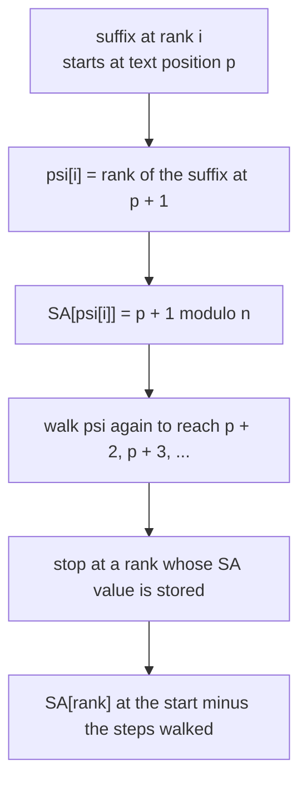
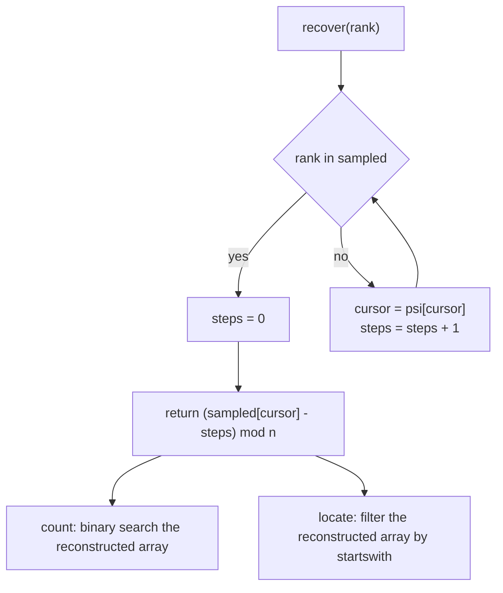
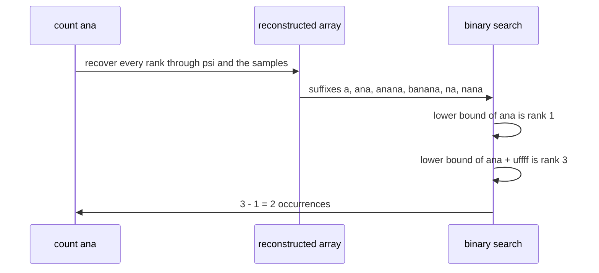

# 581 — Implement compressed suffix array prototype (conceptual).

> **Tier:** Advanced · **CTCI chapter:** Beyond — Advanced Data Structures & Algorithms
> **Task spec:** [581-implement-compressed-suffix-array-prototype-conceptual.md](../../../tasks/advanced/581-implement-compressed-suffix-array-prototype-conceptual.md)
> **Solutions:** [Python](../../../solutions/python/advanced/581-implement-compressed-suffix-array-prototype-conceptual/solution.py) ·
> [Java](../../../solutions/java/advanced/581-implement-compressed-suffix-array-prototype-conceptual/Solution.java) ·
> [JavaScript](../../../solutions/javascript/advanced/581-implement-compressed-suffix-array-prototype-conceptual/solution.js) ·
> [C#](../../../solutions/csharp/advanced/581-implement-compressed-suffix-array-prototype-conceptual/Solution.cs)

## 1. Problem restatement

**Input:** a text, plus the queries the suffix array would normally answer: count and locate a
pattern.

**Output:** a *compressed* suffix array in the Grossi-Vitter sense — the full array is never kept. The
header is explicit that this is a working structure, not an outline:

| Piece | Meaning in the code |
| --- | --- |
| `suffix_array_doubling(text)` | the suffix array by prefix doubling: sort the suffixes by their first `2^k` characters for `k = 0, 1, 2, ...` |
| `lcp_kasai(text, sa)` | the LCP array by Kasai's linear scan |
| `psi[i]` | the rank of the suffix that starts one position to the right of the suffix at rank `i` |
| `sampled` | `{rank: SA[rank]}` for every suffix whose **text position** is a multiple of `sampling` |
| `stored_integers()` | `n` psi entries plus `len(sampled)` samples |
| `recover(rank)` | `SA[rank]` by walking `psi` until a sampled rank is hit |
| `rebuilt_suffix_array()` | the whole array recovered element by element, with the worst walk length |
| `count` / `locate` | binary search on the reconstructed array / a startswith filter over it |

Everything is verified against brute force rather than assumed:

| Property or call | Result | Why |
| --- | --- | --- |
| doubling suffix array, Kasai LCP | equal to brute force on six texts | including a unary string, a two-symbol string and a random one |
| `SA[psi[i]]` | `SA[i] + 1 (mod n)` | one of the two defining psi relations, asserted for every rank |
| the inverse relation | `SA[psi_inverse[i]] = SA[i] - 1 (mod n)` | the other relation, also asserted per rank |
| `rebuilt_suffix_array()` for samplings `1, 2, 4, 8, 17` | the true suffix array, element by element | compression must not change the answers |
| `stored_integers()` | `n + ceil(n / k)`, below `2n` | while the plain array alone is `n` |
| worst walk length | `< sampling` | the bound that makes `recover` cheap, asserted |
| `count` / `locate` for 40 patterns plus boundary patterns | identical to brute force | empty, single character, absent, and the whole text included |

## 2. Intuition

A plain suffix array stores `n` integers, each of which can be as large as `n`. The compressed suffix
array asks a different question: since suffix `SA[i]` and suffix `SA[i] + 1` are related — the second
is the first minus its leading character — why store both their positions when the *rank* of the second
is enough to recover the position of the first?

That is the psi array: `psi[i]` is the **rank** of the suffix that starts one text position to the
right of the suffix at rank `i`. Equivalently,

```
SA[psi[i]] = (SA[i] + 1) mod n
```

so if you know the position of any one suffix on a psi-walk, you know the position of every suffix on
that walk, one step at a time. The array costs `n` integers like the suffix array does, but the array
is now only *ranks*, and a sparse sample of `SA` values makes it invertible.



The second insight is *which* entries to sample. Sampling "every `k`-th rank" makes the walk's length
unbounded, because consecutive ranks say nothing about text positions. Sampling by **text position**
— keep `SA[rank]` whenever `SA[rank] % sampling == 0` — makes the walk terminate within `sampling - 1`
steps, because every psi step advances the text position by exactly one, so a multiple of `sampling`
is reached within one sampling window. This is the point the header calls out: the marker is a rank
(a walk can test it), and the *choice* of marker is where the bound comes from.


## 3. Algorithm

1. **Suffix array by doubling.** Sort suffixes by their first character, then by pairs, doubling the
   compared prefix length `2^k` until the ranks are all distinct; the resulting order is the suffix
   array.
2. **LCP by Kasai.** Walk the array in text order, using the previous suffix's LCP as a starting
   height and never letting the height decrease by more than one per step — one linear pass.
3. **psi.** Build the inverse permutation `rank_of[position]`, then set
   `psi[i] = rank_of[(SA[i] + 1) mod n]`. Both psi relations can be checked directly afterwards.
4. **Sample.** Store `SA[rank]` for every rank whose text position is a multiple of `sampling`.
5. **recover(rank).** Follow `psi` until a sampled rank is reached, counting the steps; the answer is
   `(sampled_value - steps) mod n`.
6. **count(pattern).** Rebuild the array, then binary search for the first suffix `>= pattern` and the
   first suffix `>= pattern + "\uffff"`; the difference is the count.
7. **locate(pattern).** Rebuild the array and keep the positions where the text starts with the
   pattern, sorted.

```text
function psi_array(suffix_array)
    rank_of ← inverse permutation of suffix_array
    psi ← empty array of length n
    for rank from 0 to n - 1 do
        psi[rank] ← rank_of[(suffix_array[rank] + 1) mod n]
    end
    return psi
end

procedure sample_positions(suffix_array, sampling)
    sampled ← empty map
    for rank from 0 to n - 1 do
        if suffix_array[rank] mod sampling == 0 then
            sampled[rank] ← suffix_array[rank]
        end
    end
    return sampled
end
```

```text
function recover(rank)
    cursor ← rank
    steps ← 0
    while cursor is not in sampled do
        cursor ← psi[cursor]              # advances the text position by one
        steps ← steps + 1
    end
    return (sampled[cursor] - steps) mod n, steps
end

procedure rebuilt_suffix_array
    array ← empty list
    worst ← 0
    for rank from 0 to n - 1 do
        value, steps ← recover(rank)
        worst ← max(worst, steps)
        append value to array
    end
    return array, worst
end
```

```text
function count(pattern)
    array, ignored ← rebuilt_suffix_array
    first ← lower bound of pattern in the suffixes indexed by array
    marker ← pattern + "\uffff"           # sorts after every real character
    last ← lower bound of marker in the suffixes indexed by array
    return last - first
end
```



## 4. Worked example

Take `text = "banana"`, `n = 6`. The six suffixes sorted are `a`, `ana`, `anana`, `banana`, `na`,
`nana`, so

| Rank `i` | 0 | 1 | 2 | 3 | 4 | 5 |
| --- | --- | --- | --- | --- | --- | --- |
| `SA[i]` | 5 | 3 | 1 | 0 | 4 | 2 |
| suffix | `a` | `ana` | `anana` | `banana` | `na` | `nana` |

Kasai's scan gives adjacent LCPs `1` (`a`/`ana`), `3` (`ana`/`anana`), `0`
(`anana`/`banana`), `0` (`banana`/`na`), `2` (`na`/`nana`). The inverse permutation is
`rank_of = [3, 2, 5, 1, 4, 0]` for text positions `0..5`, and stepping one position right from each
suffix gives:

| `i` | `SA[i]` | `(SA[i] + 1) mod 6` | rank of that position | `psi[i]` |
| --- | --- | --- | --- | --- |
| 0 | 5 | 0 | 3 | 3 |
| 1 | 3 | 4 | 4 | 4 |
| 2 | 1 | 2 | 5 | 5 |
| 3 | 0 | 1 | 2 | 2 |
| 4 | 4 | 5 | 0 | 0 |
| 5 | 2 | 3 | 1 | 1 |

So `psi = [3, 4, 5, 2, 0, 1]`, and the defining relation holds on every rank: `SA[psi[0]] = SA[3] = 0`
and `(SA[0] + 1) mod 6 = 0`; `SA[psi[2]] = SA[5] = 2` and `(SA[2] + 1) mod 6 = 2`; and so on.

Now compress with `sampling = 2`. Sampled positions are `0, 2, 4`, so the sampled ranks are
`{3: 0, 5: 2, 4: 4}` — note the keys are ranks while the markers are positions:

| `recover` call | Walk | Steps | Result |
| --- | --- | --- | --- |
| `recover(3)` | rank 3 is sampled | 0 | `(0 - 0) mod 6 = 0` = `SA[3]` |
| `recover(0)` | `psi[0] = 3`, sampled | 1 | `(0 - 1) mod 6 = 5` = `SA[0]` |
| `recover(1)` | `psi[1] = 4`, sampled | 1 | `(4 - 1) mod 6 = 3` = `SA[1]` |
| `recover(2)` | `psi[2] = 5`, sampled | 1 | `(2 - 1) mod 6 = 1` = `SA[2]` |

The worst walk is `1 < sampling = 2`, the bound the file asserts. The storage accounting for this text
is `n + len(sampled) = 6 + 3 = 9` integers, below the documented `2n = 12`, while the suffix array
alone is `6`.

With the array reconstructed, `count("ana")` binary-searches the suffixes `a, ana, anana, banana, na,
nana`: the first suffix `>= "ana"` is rank 1, and the first suffix `>= "ana\uffff"` is rank 3
(`banana`), so the count is `3 - 1 = 2`. `locate("ana")` walks the same reconstructed array and keeps
the positions `1` and `3`.



## 5. Complexity

Let `n` be the text length, `k` the sampling step, `m` the pattern length and `occ` the number of
occurrences.

| Measure | Bound | Why it holds |
| --- | --- | --- |
| Suffix array by doubling | O(n log² n) | each of the `log n` rounds sorts `n` pairs |
| Kasai LCP | O(n) | the height never decreases by more than one per step |
| `psi` construction | O(n) | one inverse-permutation pass and one linear map |
| `recover(rank)` | at most `k - 1` psi steps | asserted as `worst < sampling`; the marker is a text-position multiple |
| `rebuilt_suffix_array()` | O(n · k) | `n` recover calls, each bounded by `k - 1` steps |
| `count(pattern)` | O(n · k + m log n) as written | the array is rebuilt on every call, then binary-searched |
| `locate(pattern)` | O(n · k + n · m) as written | a `startswith` filter over the reconstructed array |
| Storage | `n + ceil(n / k)` integers, below `2n` | `n` psi entries plus the samples, versus `n` for the plain array |
| Real CSA comparison | `O(n)` bits with `O(m log n)` counting | block-wise compression of a *sorted* psi, which this prototype does not attempt |

The header is careful about what the prototype does and does not deliver: it delivers a working
psi-plus-samples structure, with both psi relations and the full reconstruction asserted, while the
`count`/`locate` paths rebuild the array per call so that the compression is verified element by
element rather than indirectly through query answers.

## 6. Pitfalls and edge cases

- **Sample by text position, not by rank.** Consecutive ranks are unrelated positions, so a rank-based
  marker can leave a walk unbounded; text-position multiples are reached within `k - 1` psi steps
  because each step advances the position by exactly one. The file records `steps < sampling` as the
  proof, and reconstruction is verified for `k = 1, 2, 4, 8, 17`.
- **The marker is a rank, the value is a position.** `recover` tests whether a *rank* is in the sampled
  map but subtracts from the *position* stored there; swapping the two makes the subtraction
  meaningless.
- **Modulo the text length.** `(sampled value - steps) mod n` must wrap, because a walk that crosses
  position `0` continues at `n - 1` — the file computes exactly that, and a missing modulo produces
  negative positions.
- **Both psi directions matter.** `SA[psi[i]] = SA[i] + 1` and the inverse relation
  `SA[psi_inverse[i]] = SA[i] - 1` are asserted per rank, because a sign error in the map passes
  counting tests for symmetric patterns and fails everywhere else.
- **`sampling = 1` degenerates to the full array.** Every position is a multiple of `1`, so the
  sampled map holds all `n` entries, the worst walk is `0`, and storage is `2n` — the honesty check
  that the compressor still produces the true array when it is not compressing.
- **Empty and unary texts.** A unary string (`aaaa...`) has adjacent LCPs equal to the suffix length
  minus one and psi walks that are still bounded by the sampling step; the file includes it in the six
  verification texts precisely because it is the worst case for LCP lengths.
- **Pattern boundaries.** The empty pattern counts `n`; a pattern absent from the text counts `0`; the
  whole text counts `1` (or more if it repeats). The binary search needs the `"\uffff"` marker,
  otherwise the upper bound collapses onto the lower bound and every count is `0`.
- **Rebuilding per call is deliberate but slow.** `count` and `locate` reconstruct the array, which is
  `O(n · k)`; that is the price of verifying compression by full reconstruction, not an oversight.

## 7. Variants and follow-ups

- **Locate without reconstructing everything.** Keeping a sampled suffix array next to the psi array is
  the cheaper middle ground used by [580-implement-fm-index-search-for-substring-count-conceptual.md](../../../tasks/advanced/580-implement-fm-index-search-for-substring-count-conceptual.md),
  where LF plays the role of psi and only the ranks in the answer interval are walked.
- **Rank/select instead of psi.** A wavelet tree over the BWT gives `Occ` queries in `O(log sigma)` —
  [579-implement-wavelet-tree-for-strings-rank-select.md](../../../tasks/advanced/579-implement-wavelet-tree-for-strings-rank-select.md).
- **Build the pieces separately.** The doubling construction and Kasai's scan are their own tasks:
  [401-implement-suffix-array-sa-is-or-doubling-for-medium-n.md](../../../tasks/advanced/401-implement-suffix-array-sa-is-or-doubling-for-medium-n.md)
  and [402-build-lcp-array-from-suffix-array-kasai.md](../../../tasks/advanced/402-build-lcp-array-from-suffix-array-kasai.md).
- **Use the LCP for structure.** The LCP array turns string properties such as the longest repeated
  substring into a scan — [403-use-suffix-array-lcp-for-longest-repeated-substring.md](../../../tasks/advanced/403-use-suffix-array-lcp-for-longest-repeated-substring.md).
- **Succinct full text index.** A production CSA compresses psi itself (a sorted permutation is highly
  compressible) and answers counts in `O(m log n)` without ever materialising the array; that is
  explicitly beyond the prototype this task ships.

## 8. Check yourself

1. What exactly does `psi[i]` store, and how does that let the array drop from `n` positions to `n`
   ranks?

<details><summary>Show answer</summary>

`psi[i]` is the rank of the suffix that starts one position to the right of the suffix at rank `i`, so
`SA[psi[i]] = (SA[i] + 1) mod n`. It stores ranks, not positions, which is why a small set of sampled
`SA` values is enough: a walk that reaches a sampled rank recovers the whole chain of positions by
subtracting the number of steps taken.

</details>

2. Why does the sampling have to be by text position instead of by rank?

<details><summary>Show answer</summary>

Because each psi step advances the text position by exactly one, so within any `sampling` consecutive
positions there is a multiple of `sampling` — hence a walk of at most `sampling - 1` steps. Sampling
every `k`-th rank says nothing about positions; a walk could run for a long time, which is why real
compressed suffix arrays use position-based sampling plus a rank oracle.

</details>

3. In the `banana` example, why is `recover(0)` equal to `5` when `psi[0] = 3` and the sampled value at
   rank 3 is `0`?

<details><summary>Show answer</summary>

`psi[0] = 3` says the suffix one position right of rank 0 sits at rank 3, whose position is `0`. So rank
0's position is one *before* position 0, i.e. `(0 - 1) mod 6 = 5`. The step count is subtracted from the
sampled position and wrapped around the text length — that modulo is what makes the walk correct at the
text boundary.

</details>

4. What does `stored_integers()` return, and how does the file show the compression is real?

<details><summary>Show answer</summary>

`n` psi entries plus the number of samples, `ceil(n / k)` in the balanced case — below `2n`, while the
suffix array alone is `n` integers. The files assert this and, more importantly, assert that the
reconstructed array equals the true array element by element for samplings `1, 2, 4, 8, 17`, so the
compression is verified by reconstruction rather than assumed from a storage count.

</details>

5. Why do `count` and `locate` rebuild the whole array on each call?

<details><summary>Show answer</summary>

Because the point of the prototype is to prove that psi plus samples reconstruct the suffix array
exactly; querying through the reconstruction makes every query result a check of `recover`. It costs
`O(n · k)` per call, which a production compressed suffix array avoids by answering through a
rank/select structure over psi without materialising the array.

</details>