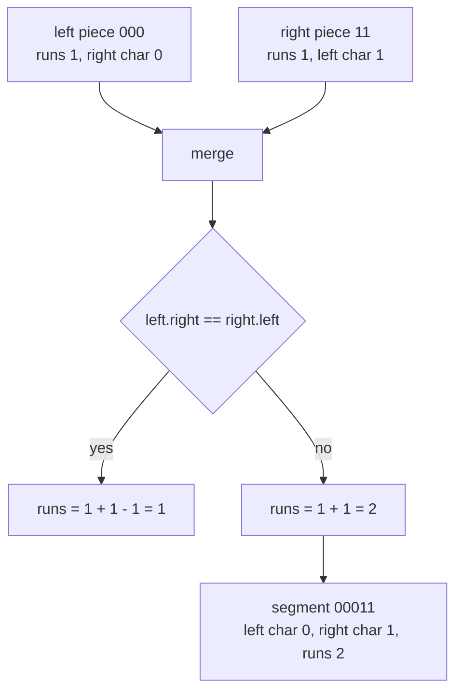
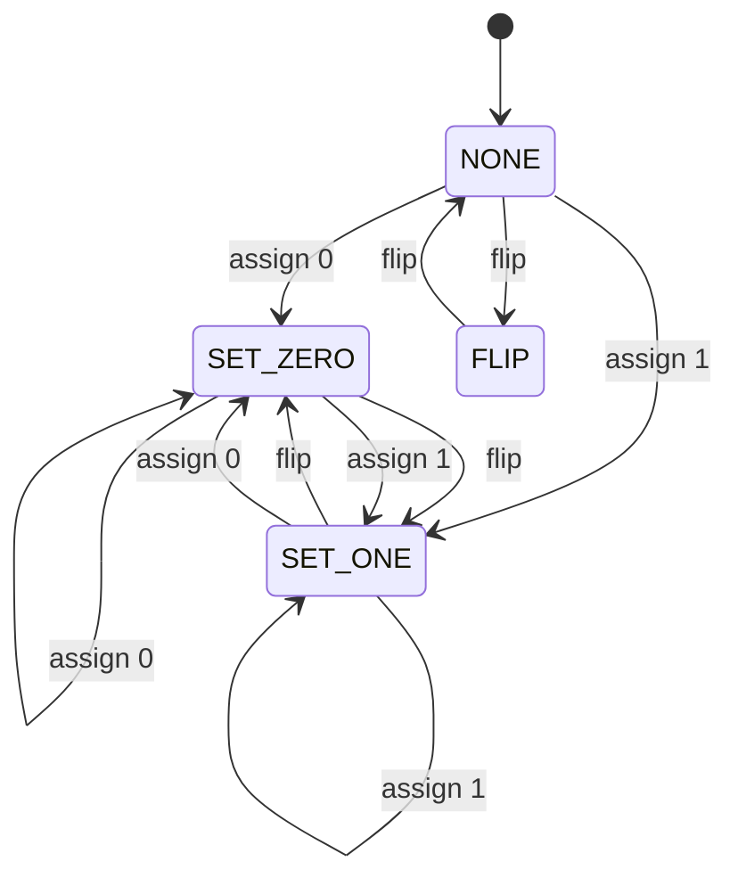
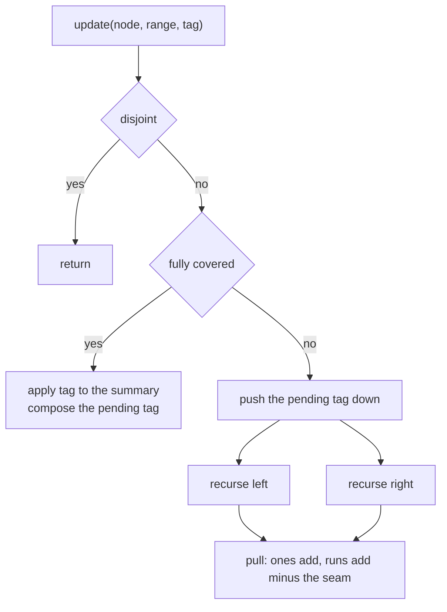
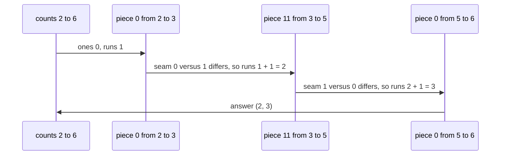

# 582 — Implement run-length encoded segment tree for binary string operations.

> **Tier:** Advanced · **CTCI chapter:** Beyond — Advanced Data Structures & Algorithms
> **Task spec:** [582-implement-run-length-encoded-segment-tree-for-binary-string-oper.md](../../../tasks/advanced/582-implement-run-length-encoded-segment-tree-for-binary-string-oper.md)
> **Solutions:** [Python](../../../solutions/python/advanced/582-implement-run-length-encoded-segment-tree-for-binary-string-oper/solution.py) ·
> [Java](../../../solutions/java/advanced/582-implement-run-length-encoded-segment-tree-for-binary-string-oper/Solution.java) ·
> [JavaScript](../../../solutions/javascript/advanced/582-implement-run-length-encoded-segment-tree-for-binary-string-oper/solution.js) ·
> [C#](../../../solutions/csharp/advanced/582-implement-run-length-encoded-segment-tree-for-binary-string-oper/Solution.cs)

## 1. Problem restatement

**Input:** a binary string, plus range updates and range queries.

**Output:** a segment tree whose every node carries a five-field summary, so that both "how many ones
in `[l, r)`" and "how many runs of equal characters in `[l, r)`" are answered by merging `O(log n)`
nodes:

| Field | Meaning |
| --- | --- |
| `ones` | number of `1` characters in the node's segment |
| `length` | the segment's length |
| `left` | the first character of the segment |
| `right` | the last character of the segment |
| `runs` | the number of maximal equal-character runs in the segment |
| `lazy` | the pending tag, one of `NONE`, `SET_ZERO`, `SET_ONE`, `FLIP` |

Operations: `assign(low, high, symbol)`, `flip(low, high)`, `counts(low, high) -> (ones, runs)`,
`total_ones()`, `total_runs()`, `snapshot()`. The file also counts the nodes visited per query, and it
verifies everything against a plain list of characters that is updated naively.

| Structure | Run count | Why |
| --- | --- | --- |
| `0000` | `1` | one run |
| `1111` | `1` | one run |
| `0011` | `2` | `00` and `11` |
| `0101` | `4` | every character is its own run |
| `0001100` | `3` | `000`, `11`, `00` |
| `1010101` | `7` | alternating, so every character is a run |

The lazy tag composition is documented, not incidental.

> Three lazy range updates are supported — assign `0`, assign `1` and flip — with the tags composing
> by the rules (assign then flip is the opposite assign; flip twice is nothing; flip then assign is the
> assign), and every node's summary is rebuilt from the tag when it is pushed down, which is what makes
> the run-length summary stay consistent under lazy updates.

The battery is 320 random operations — mixed assigns, flips, whole-range assignments and
single-element updates — where **after every operation** the one-count and the run-count of the whole
string, of the updated range, of five random sub-ranges and of six prefixes are compared with the
naive list.

## 2. Intuition

Counting ones in a range is the textbook segment-tree query: each node stores the sum of its segment,
and a query merges `O(log n)` canonical pieces with `+`. Counting **runs** is almost the same, but the
merge is not associative in the obvious way — `"00"` and `"01"` each have the counts `1` and `2`, and
their concatenation `"0001"` has `2`, not `3`, because the boundary dissolved. The fix is to store the
two endpoint characters so the merge can subtract the seam:

```
runs(parent) = runs(left) + runs(right) - (left.right == right.left ? 1 : 0)
```

With that one rule, `runs` becomes mergeable, and the same rule serves the query decomposition: pieces
of a range that are not adjacent in the tree still assemble left-to-right, and the seam test is applied
at each join.



The second half of the problem is the lazy updates. Assignment and flip act on the summary in closed
form: assigning `0` sets `ones = 0`, `left = right = 0`, `runs = 1`; assigning `1` sets `ones = size`,
`left = right = 1`, `runs = 1`; flipping complements `ones` and both endpoint characters while leaving
`runs` and `length` untouched, because flipping a binary string cannot create or destroy a boundary.
That is why a flip needs **no** knowledge of the node's contents beyond its own summary — and it is why
the tags compose the way the header says: a pending assignment then overwritten by a flip becomes the
opposite assignment, two flips cancel, and an assignment always dominates whatever it overwrites.



## 3. Algorithm

1. **Build.** Recurse to single characters; a leaf has `ones = symbol`, `left = right = symbol`,
   `runs = 1`. Every internal node is produced by `pull`.
2. **`pull(node)`.** `ones = left.ones + right.ones`, `left = left.left`, `right = right.right`,
   `runs = left.runs + right.runs - 1` exactly when the children's touching characters agree.
3. **`apply(node, tag)`.** Rewrite the summary for `SET_ZERO` / `SET_ONE` / `FLIP`, then compose the
   node's pending tag with the incoming one.
4. **`push(node)`.** Hand the pending tag to both children (when they exist) and clear it.
5. **`update(node, start, end, low, high, tag)`.** Skip a disjoint node, apply immediately on a fully
   covered node, otherwise push, recurse into both children and pull.
6. **`query(node, start, end, low, high)`.** Skip a disjoint node, return the summary of a fully
   covered node, otherwise push and merge the two children's partial summaries with the same seam
   rule — `None` on a side that contributes nothing.
7. **`counts(low, high)`.** `(ones, runs)` from the query, or `(0, 0)` for an empty range.

```text
procedure pull(node)
    left, right ← children of node
    node.ones ← left.ones + right.ones
    node.left ← left.left
    node.right ← right.right
    node.runs ← left.runs + right.runs
    if left.right == right.left then
        node.runs ← node.runs - 1
    end
end

procedure apply(node, tag)
    size ← node.length
    if tag == SET_ZERO then
        node.ones ← 0, node.left ← 0, node.right ← 0, node.runs ← 1
    else if tag == SET_ONE then
        node.ones ← size, node.left ← 1, node.right ← 1, node.runs ← 1
    else if tag == FLIP then
        node.ones ← size - node.ones
        node.left ← 1 - node.left
        node.right ← 1 - node.right
    end
    if tag == FLIP then
        if node.lazy == SET_ZERO then node.lazy ← SET_ONE
        else if node.lazy == SET_ONE then node.lazy ← SET_ZERO
        else if node.lazy == FLIP then node.lazy ← NONE
        else node.lazy ← FLIP
        end
    else if tag != NONE then
        node.lazy ← tag                   # an assignment overwrites any pending tag
    end
end
```

```text
procedure update(node, start, end, low, high, tag)
    if high <= start or end <= low then
        return
    end
    if low <= start and end <= high then
        apply(node, tag)
        return
    end
    push(node)
    middle ← (start + end) / 2
    update(left child, start, middle, low, high, tag)
    update(right child, middle, end, low, high, tag)
    pull(node)
end

function query(node, start, end, low, high)
    count node as visited
    if high <= start or end <= low then
        return None
    end
    if low <= start and end <= high then
        return summary of node
    end
    push(node)
    middle ← (start + end) / 2
    first ← query(left child, start, middle, low, high)
    second ← query(right child, middle, end, low, high)
    if first is None then return second end
    if second is None then return first end
    runs ← first.runs + second.runs
    if first.right == second.left then
        runs ← runs - 1
    end
    return (first.ones + second.ones, first.length + second.length,
            first.left, second.right, runs)
end
```

Both `pull` and `query` use the same seam rule, which is the whole reason a run-count segment tree
works: the node summary is a monoid, and `runs` plus the two endpoint characters is exactly the
information that monoid needs.



## 4. Worked example

Take `s = "0001100"` (length `7`, one-count `2`, run-count `3`). The build splits at the middle:

| Node | Segment | Contents | `ones` | `left` | `right` | `runs` |
| --- | --- | --- | --- | --- | --- | --- |
| root | `[0, 7)` | `0001100` | 2 | 0 | 0 | 3 |
| left | `[0, 3)` | `000` | 0 | 0 | 0 | 1 |
| right | `[3, 7)` | `1100` | 2 | 1 | 0 | 2 |
| right-left | `[3, 5)` | `11` | 2 | 1 | 1 | 1 |
| right-right | `[5, 7)` | `00` | 0 | 0 | 0 | 1 |

The root's `runs = 1 + 2 = 3` because `left.right = 0` differs from `right.left = 1`; the right node's
`runs = 1 + 1 = 2` because `1 != 0`.

Now query `counts(2, 6)`, i.e. `"0110"`. The canonical pieces are `[2, 3) = "0"`, `[3, 5) = "11"` and
`[5, 6) = "0"`, and they are merged left to right with the seam rule:

| Merge | Left piece | Right piece | Seam equal? | `ones` | `runs` |
| --- | --- | --- | --- | --- | --- |
| start | `[2, 3)`: ones 0, `right = 0`, runs 1 | — | — | 0 | 1 |
| 1 | `"0"`, `right = 0` | `[3, 5)`: ones 2, `left = 1`, runs 1 | `0 != 1` | 2 | `1 + 1 = 2` |
| 2 | merged, `right = 1` | `[5, 6)`: ones 0, `left = 0`, runs 1 | `1 != 0` | 2 | `2 + 1 = 3` |

So `counts(2, 6) = (2, 3)` — two ones and three runs in `"0110"`, which matches the naive list. Note
that the merged piece's `right` character is taken from the *right* argument and its `left` character
from the *left* argument, which is what keeps the next seam test correct.



An update behaves the same way. `flip(3, 5)` lands exactly on the node `[3, 5)`:

| Step | Node | Before | Tag applied | After |
| --- | --- | --- | --- | --- |
| 1 | `[3, 5)` | ones 2, `left = right = 1`, runs 1 | `FLIP` | ones `2 - 2 = 0`, `left = right = 0`, runs 1, pending tag `FLIP` |
| 2 | `[3, 7)` | ones 2, `left = 1`, `right = 0`, runs 2 | `pull` | ones 0, `left = 0`, `right = 0`, runs `1 + 1 - 1 = 1` |
| 3 | root | ones 2, runs 3 | `pull` | ones 0, runs `1 + 1 - 1 = 1` because `left.right = 0` equals `right.left = 0` |

The string is now `"0000000"` with one run and zero ones — exactly what the naive list reports. A second
`flip(3, 5)` would compose the pending `FLIP` into `NONE` (the law "flip twice is nothing") and the
node's summary back to `"11"`.


## 5. Complexity

Let `n` be the string length and `q` the number of operations.

| Measure | Bound | Why it holds |
| --- | --- | --- |
| Build | O(n) | one `pull` per internal node, constant work each |
| `assign` / `flip` | O(log n) | at most two boundary paths plus fully covered nodes, each visited once |
| `counts(low, high)` | O(log n) nodes | the query visits at most `2 log n` nodes, counted in `visited` and asserted against the bound |
| Merge cost | O(1) | five fields plus one seam comparison |
| Space | O(n) | arrays of size `4n` for the five fields plus the tag |
| Naive verification | O(n) per operation | the reference list is updated and scanned element by element; that is what the 320-operation battery compares against |
| Alternative without summaries | O(n) per query | scanning the range and counting boundaries |


## 6. Pitfalls and edge cases

- **The seam test is strict equality, not "both are runs".** `runs = left.runs + right.runs - 1` only
  when `left.right == right.left`; any other test produces the wrong count for strings like `"0011"`.
- **The merged piece's endpoints come from different sides.** In `query`, `left` comes from the first
  piece and `right` from the second one; taking them both from one side breaks the next seam test in a
  longer decomposition.

## 7. Variants and follow-ups

- **Generalize the alphabet.** With more than two symbols the same summary works if `left`/`right` hold
  characters and `FLIP` is dropped (a flip has no meaning over a larger alphabet) — the seam rule is
  unchanged.
- **Count something else per node.** Swapping `runs` for another mergeable statistic (a maximum, a
  modular sum) keeps the lazy structure and only changes `pull` and the query merge; the versioned
  variant of that idea is
  [421-implement-persistent-segment-tree-versioned.md](../../../tasks/advanced/421-implement-persistent-segment-tree-versioned.md).

## 8. Check yourself

1. Why can both `pull` and the query merge use the identical seam rule?

<details><summary>Show answer</summary>

Because the summary `(ones, length, left, right, runs)` is a monoid under concatenation: `ones` adds,
`length` adds, `left` comes from the left operand, `right` from the right operand, and `runs` adds with
a correction of `-1` exactly when the touching characters are equal. A segment-tree node is a
concatenation of its children, and a query range is a concatenation of canonical pieces, so one
function serves both.

</details>

2. What does `flip` do to each field of a node summary, and which field does it leave untouched?

<details><summary>Show answer</summary>

`ones = length - ones`, `left = 1 - left`, `right = 1 - right`; `runs` and `length` are unchanged
because complementing a binary string maps equal characters to equal characters and different to
different. That is why a flip needs only the node summary and not its contents.

</details>

3. `0001100` has `runs = 3` at the root with children `000` and `1100`. What would the root's run count
   be if the seam test were omitted?

<details><summary>Show answer</summary>

`1 + 2 = 3` — correct here only because the seam already differs (`0` versus `1`). On `0011`, whose
children are `00` and `11`, omitting the test gives `1 + 1 = 2` which is also right; but on `0000` with
children `00` and `00` it gives `2` instead of `1`. The subtraction is what keeps concatenation
consistent, which is why the same rule must be used in the query.

</details>

4. A node is fully covered by an `assign 0` while a `FLIP` is already pending. What is the pending tag
   afterwards, and what does pushing it do to the children?

<details><summary>Show answer</summary>

An assignment overwrites whatever is pending, so the tag becomes `SET_ZERO`. Pushing sets both children
to all zeros — the stale flip must not survive, which is exactly the law the file tests by driving the
structure and the naive list to the same state after every operation.

</details>

5. Why does the file count visited nodes during queries?

<details><summary>Show answer</summary>

Because lazy propagation is easy to get slow without getting it wrong: recursing into a fully covered
node still produces correct answers. The `visited` counter is asserted to stay within the `O(log n)`
bound, so the test detects a lost full-cover shortcut as a performance regression rather than silently
accepting it.

</details>