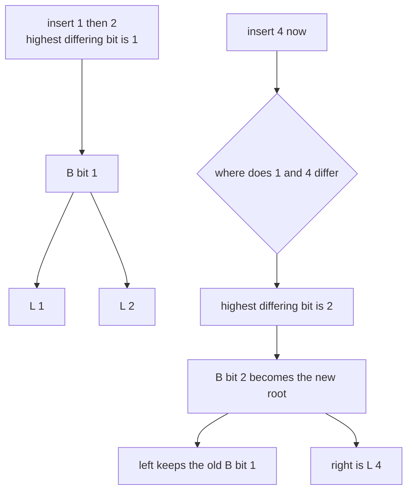
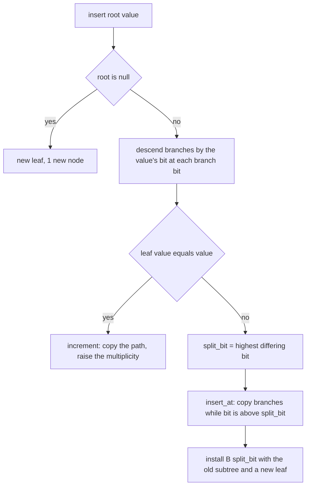
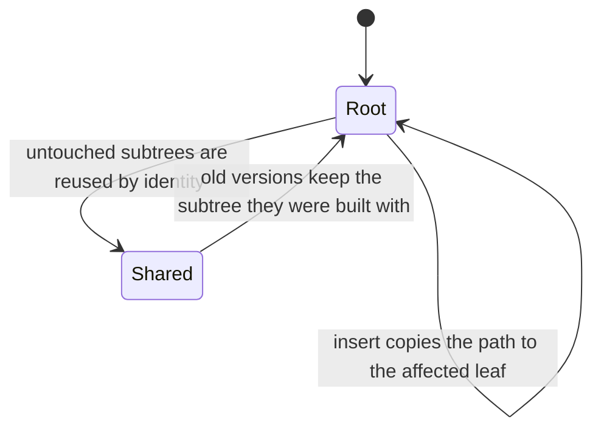
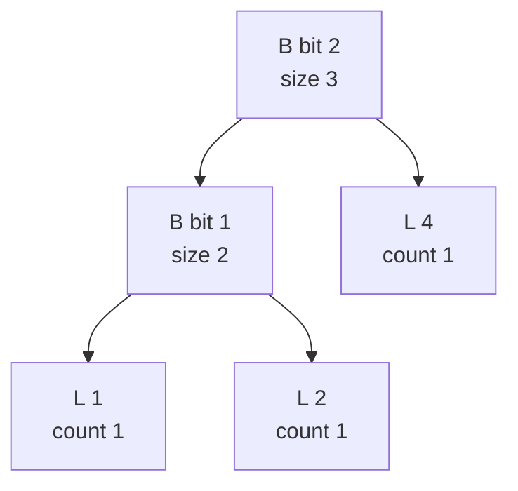

# 583 — Implement compressed persistent trie for integers (binary trie persistent).

> **Tier:** Advanced · **CTCI chapter:** Beyond — Advanced Data Structures & Algorithms
> **Task spec:** [583-implement-compressed-persistent-trie-for-integers-binary-trie-pe.md](../../../tasks/advanced/583-implement-compressed-persistent-trie-for-integers-binary-trie-pe.md)
> **Solutions:** [Python](../../../solutions/python/advanced/583-implement-compressed-persistent-trie-for-integers-binary-trie-pe/solution.py) ·
> [Java](../../../solutions/java/advanced/583-implement-compressed-persistent-trie-for-integers-binary-trie-pe/Solution.java) ·
> [JavaScript](../../../solutions/javascript/advanced/583-implement-compressed-persistent-trie-for-integers-binary-trie-pe/solution.js) ·
> [C#](../../../solutions/csharp/advanced/583-implement-compressed-persistent-trie-for-integers-binary-trie-pe/Solution.cs)

## 1. Problem restatement

**Input:** integers below `2^20`, inserted over time; every insertion produces a new version while all
previous versions stay queryable.

**Output:** a **persistent Patricia (path-compressed) binary trie** plus the uncompressed persistent
trie it is measured against. The compressed representation has two node shapes:

| Shape | Fields | Meaning |
| --- | --- | --- |
| leaf `("L", value, multiplicity)` | value, count | one distinct value and how many times it was inserted |
| branch `("B", bit, left, right)` | bit index, children | the children differ at bit `bit`, and `bit` is the **highest** differing bit of the subtree |

Queries: `contains`, `multiplicity`, `kth_smallest` (`k = 0` and `k > n` return `None`), `max_xor`,
`flatten` (the multiset of a version). The two representations are built side by side and must agree on
every query, with the compressed one using fewer nodes.

| Assertion | Value | Why |
| --- | --- | --- |
| versions built | `13` | twelve fixed-seed insertions, one version each, each expanded and compared to brute force |
| earlier versions after later insertions | unchanged | persistence is checked version by version, not only at the end |
| node counts, twelve values | `23` compressed versus `209` uncompressed | the ratio `209/23` is asserted to be at least `8x` |
| new nodes per insertion | at most two | a leaf plus one branch — copying the whole bit path is what the compression avoids |
| value `v` inserted five times | `multiplicity = 5`, and `kth_smallest(k)` for `k = 1..5` all return `v` | duplicates live in the leaf's counter |
| bit-boundary values | `0` and `2^20 - 1` | the extreme bit patterns |
| the empty trie | every query answers without raising | `contains` false, `kth_smallest` `None`, `max_xor = 0` |
| node sharing | checked by identity between versions | untouched subtrees are reused, not copied |
| `k = 0`, `k > n` | `None` | out-of-range rank |

## 2. Intuition

A binary trie over 20-bit integers is deep and sparse: inserting `1` and `2` creates a path of nineteen
unary branches whose only purpose is to carry the reader to the one bit where the two values differ.
Persistence makes it worse — copy-on-write over that path means every insertion allocates twenty nodes,
which is why the file measures `209` nodes for twelve uncompressed values.

The Patricia insight is to store **only the branching nodes**: a branch's `bit` field holds the highest
bit position on which the values below it differ, and a leaf holds a value that never branches again
because it is stored with a multiplicity. The invariant that makes the search work is that `bit`
decreases strictly along any root-to-leaf path. Then a search for a value is just: at a branch, look at
the value's bit at the branch's `bit` field and go left or right; the tree never wastes a node on a
level where only one distinct value exists.



Insertion therefore has two phases. First descend to the leaf that the value would reach and compare
values: equal means "bump the multiplicity", different means compute
`split_bit = (leaf.value ^ value).bit_length() - 1` — the highest bit where they differ. Then descend
again, **copying the branches on the way** (that is the persistence) until a node whose `bit` is below
`split_bit` (or a leaf, or nothing) is found, and install the new branch there. Only the path is copied;
every subtree that is not touched is shared by identity between the old and the new version.



## 3. Algorithm

1. **Node constructors.** `leaf(value, count)` and `branch(bit, left, right)`; `trie_size` sums the
   multiplicities and `node_count` counts nodes, both used by the assertions.
2. **`insert(root, value)`.** If the root is empty, return a leaf. Otherwise descend: at a branch take
   the child selected by `(value >> bit) & 1` until a leaf is reached.
3. **Duplicate.** If that leaf's value equals `value`, call `increment`, which rebuilds the path bottom
   up with the leaf's count raised and returns the count of copied nodes.
4. **Fresh value.** Compute the highest differing bit of the leaf value and the new value, then call
   `insert_at` with that split bit.
5. **`insert_at(node, value, split_bit)`.** Copy branches whose `bit` is still above `split_bit`,
   recursing into the matching side; when the node is a leaf or its `bit` is below `split_bit`, create
   `branch(split_bit, old_subtree_or_leaf, new_leaf)` in the correct order so that the `0` child is
   left and the `1` child is right.
6. **`contains` / `multiplicity`.** The same descent; at a leaf, compare values and (for multiplicity)
   read the counter.
7. **`kth_smallest(k)`.** At a branch, let `size = trie_size(left)`; if `k <= size` descend left,
   otherwise subtract `size` and descend right; at a leaf, if `k` is within its multiplicity return the
   value, otherwise `None`.
8. **`max_xor(value)`.** At each branch, prefer the child whose bit differs from the query's bit at
   that position (that maximizes the XOR bit), fall back to the other child, and OR the chosen bit into
   the running result.

```text
function insert(root, value)
    if root is null then
        return leaf(value, 1), 1
    end
    node ← root
    while node is a branch do
        node ← node.right if the bit of value at node.bit is 1 else node.left
    end
    if node.value == value then
        return increment(root, value)
    end
    split_bit ← highest bit at which node.value and value differ
    return insert_at(root, value, split_bit)
end
```

```text
function insert_at(node, value, split_bit)
    if node is null then
        return leaf(value, 1), 1
    end
    if node is a leaf or node.bit < split_bit then
        new_leaf ← leaf(value, 1)
        if the bit of value at split_bit is 1 then
            return branch(split_bit, node, new_leaf), 1
        end
        return branch(split_bit, new_leaf, node), 1
    end
    if the bit of value at node.bit is 1 then
        child, created ← insert_at(node.right, value, split_bit)
        return branch(node.bit, node.left, child), created + 1
    end
    child, created ← insert_at(node.left, value, split_bit)
    return branch(node.bit, child, node.right), created + 1
end
```

```text
function max_xor(node, value)
    result ← 0
    while node is a branch do
        bit ← (value >> node.bit) & 1
        if bit == 0 and node.right is not null then
            result ← result | (1 << node.bit)
            node ← node.right
        else if bit == 1 and node.left is not null then
            result ← result | (1 << node.bit)
            node ← node.left
        else
            node ← node.left if bit == 0 else node.right
        end
    end
    return result
end
```



## 4. Worked example

Work with three-bit values to keep the arithmetic readable; the shipped code uses `BITS = 20`, and the
mechanism is identical.

**Insert 1 (`001`).** The trie is empty, so the result is the single node `L 1`. Node count `1`.

**Insert 2 (`010`).** The descent reaches `L 1`, whose value differs. The highest differing bit is
`(1 ^ 2).bit_length() - 1 = (3).bit_length() - 1 = 1`. `insert_at` sees a leaf, so it installs
`B bit 1` with the `0` child `L 1` and the `1` child `L 2`. Node count `3`.

**Insert 4 (`100`).** Descend from `B bit 1`: bit `1` of `4` is `0`, so the walk goes left to `L 1`,
whose value `1` differs. The highest differing bit is `(1 ^ 4).bit_length() - 1 = (5).bit_length() -
1 = 2`. `insert_at` finds the root's `bit = 1 < 2`, so the new branch is installed **above** it:

| Step | Action | Created |
| --- | --- | --- |
| 1 | `B bit 2` is above the old root, so the old subtree becomes a child | new branch |
| 2 | `4` has bit `2` set, so the new leaf goes right, the old subtree left | new leaf |
| 3 | the old `B bit 1` subtree with `L 1` and `L 2` is **shared**, not copied | 0 |

The tree is `B bit 2 ( B bit 1 ( L 1, L 2 ), L 4 )` with `5` nodes for three values, and every value is
reachable: for `4`, bit `2` of `100` is `1` → right → `L 4`; for `2`, bit `2` is `0` → left → `B bit 1`
→ bit `1` of `010` is `1` → right → `L 2`.



Inserting `1` again descends the same path, reaches `L 1` with an equal value, and calls `increment`:
the leaf's counter becomes `2` and both branches on the path are copied so that the new version is
independent — the tree now reads `B bit 2 ( B bit 1 ( L 1 count 2, L 2 ), L 4 )`. `multiplicity(1)`
returns `2`, and `kth_smallest(1)` and `kth_smallest(2)` both return `1`, because the leaf's
multiplicity spreads the value over consecutive ranks:

| `k` | 0 | 1 | 2 | 3 | 4 |
| --- | --- | --- | --- | --- | --- |
| `kth_smallest(k)` | `None` | `1` | `1` | `2` | `4` |

`max_xor(3)` walks the same tree looking for the opposite bit: at `B bit 2` the query bit is `0`, so
going right (into `L 4`) sets that bit in the result; the walk ends and the answer is `4 XOR 3 = 7`.
Brute force over `{1, 1, 2, 4}` gives `max(1 XOR 3, 2 XOR 3, 4 XOR 3) = max(2, 1, 7) = 7`. The shipped
battery runs six such probes per version against exactly this brute force.

Persistence is the other half of the example. After inserting `1`, `2`, `4` and a second `1`, the node
counts are asserted as `23` for the compressed trie against `209` for the uncompressed one over the
twelve fixed-seed values — the uncompressed trie stores one node per bit level, the compressed one only
the branching levels — and version `4` still flattens to `[1, 2, 4]` with each element's multiplicity
unchanged.

## 5. Complexity

Let `n` be the number of inserted values, `b = 20` the bit width, and `d` the number of branching levels
actually present (at most `b`).

| Measure | Bound | Why it holds |
| --- | --- | --- |
| `insert`, compressed | O(d) branches copied, at most two new nodes for a fresh value | the split is anchored at the highest differing bit, so unary chains do not exist |
| `insert`, uncompressed | O(b) nodes per insertion | one node per bit level, even where nothing branches — the `209` versus `23` measurement |
| `contains` / `multiplicity` | O(d) | one bit test per branch |
| `kth_smallest` | O(d) | descend by subtree sizes, `O(1)` per level |
| `max_xor` | O(d) | one preference test per branch |
| `flatten(version)` | O(number of nodes in that version) | walks the shared subtrees |
| Space per version | O(d) new nodes plus the shared subtrees | path copying only; identity structure sharing is asserted |
| Uncompressed space | O(n · b) | the file measures 209 nodes for twelve 20-bit values |

The compression is not an implementation detail: it changes the update cost from `O(b)` per version to
`O(d)`, and `d` is bounded by the number of distinct branching bits in the current set, which for a
small multiset is far below `20`.

## 6. Pitfalls and edge cases

- **The Patricia invariant.** A branch's `bit` must be the highest differing bit of its subtree, and
  bits must strictly decrease along a path. Installing a split above an existing root (as inserting `4`
  did) is the case that breaks naive implementations, because the new branch must become the parent.
- **Copy on write, not mutate.** `insert` and `insert_at` rebuild every branch on the path and return
  the new root; mutating a node in place silently corrupts older versions, and the file guards against
  it by re-checking earlier versions after later insertions.
- **Identity sharing.** Untouched subtrees are shared by identity between versions; the files check
  that with identity assertions, which is also what keeps the per-version node budget small.
- **Duplicates.** A repeated value must not create a second leaf: `multiplicity` lives in the leaf, and
  a value inserted five times reports `5` with `kth_smallest` answering that value for `k = 1..5`.
- **Out-of-range rank.** `k = 0` and `k > n` return `None` rather than raising or wrapping, and the
  `k`-range walk must account for multiplicities, not just leaf identities.
- **The empty trie.** Every query must answer without raising: `contains` false, `multiplicity` `0`,
  `kth_smallest` `None`, `max_xor` `0`, `flatten` empty.
- **Bit boundaries.** `0` and `2^20 - 1` are the extreme patterns; with `0` all bits are `0` so every
  branch sends the search left, and with `2^20 - 1` every bit is `1` so it always goes right.
- **Bit width is a parameter.** Inserting a value at or above `2^BITS` is outside the contract; the
  shift `value >> node.bit` is only meaningful for bits inside the width, and the twentieth bit is the
  root's split for the extreme values.
- **XOR maximization prefers the opposite bit.** Choosing the child whose bit equals the query bit
  gives a `0` at that position, which is always worse than a `1` at a higher position — the greedy walk
  is exact because bits are processed from the most significant down.

## 7. Variants and follow-ups

- **Rank queries over a persistent set.** The `kth_smallest` descent by subtree sizes is the same idea
  as the persistent segment tree of
  [429-implement-range-kth-order-statistic-using-persistent-segtree.md](../../../tasks/advanced/429-implement-range-kth-order-statistic-using-persistent-segtree.md).
- **Persistence without compression.** The versioned segment tree of
  [421-implement-persistent-segment-tree-versioned.md](../../../tasks/advanced/421-implement-persistent-segment-tree-versioned.md)
  keeps history by path copying over a fixed-level tree, which is the uncompressed shape this file
  measures against.
- **Suffix-based trie compression.** Patricia-style path compression is the same trick used by suffix
  trees and by the compressed suffix array prototype
  [581-implement-compressed-suffix-array-prototype-conceptual.md](../../../tasks/advanced/581-implement-compressed-suffix-array-prototype-conceptual.md).
- **Tries for strings.** The same two-node (branch plus terminal) design underlies
  [405-implement-minimal-dfa-for-string-set-conceptual.md](../../../tasks/advanced/405-implement-minimal-dfa-for-string-set-conceptual.md),
  where the compression is taken one step further by merging equivalent suffixes.
- **Range-value counting.** When queries are about value ranges instead of ranks, the wavelet tree of
  [578-implement-dynamic-orthogonal-range-counting-with-wavelet-tree-co.md](../../../tasks/advanced/578-implement-dynamic-orthogonal-range-counting-with-wavelet-tree-co.md)
  replaces the bit-level descent with a value-range descent.

## 8. Check yourself

1. What is stored in a branch's `bit` field, and why is that what makes path compression possible?

<details><summary>Show answer</summary>

The highest bit position on which the values in the branch's subtree differ. Because the bits strictly
decrease along a path, a branch is created only where a real split exists; levels where all values share
the same bit are never materialized. That is why twelve 20-bit values need `23` compressed nodes instead
of `209` uncompressed ones.

</details>

2. Why does `insert` descend twice — once to find a leaf, once to install the branch?

<details><summary>Show answer</summary>

The first descent discovers which leaf the value would land on, and only then can the split bit be
computed as the highest bit where that leaf's value differs from the new one. The second descent
(`insert_at`) copies the branches on the path and installs the new branch exactly where the invariant
allows it — either where the node is a leaf or where the node's bit is already below the split bit.

</details>

3. Insert `1` and `2` into an empty compressed trie. How many nodes does the result have, and how many
   would the uncompressed trie have for three-bit values?

<details><summary>Show answer</summary>

The compressed trie has `3`: `B bit 1` with `L 1` and `L 2`. The uncompressed trie stores a node per bit
level, so the two values share the leading zero bits and need one node per level down to the
distinguishing bit — more nodes for the same information. That ratio is exactly what the file measures
at scale: `209 / 23 >= 8`.

</details>

4. How does `kth_smallest` handle a value with multiplicity five?

<details><summary>Show answer</summary>

The leaf stores the value once with `count = 5`, so the descent by subtree sizes treats it as occupying
five consecutive ranks: `trie_size` adds the multiplicity, and once the walk reaches that leaf, any `k`
within its count returns the value. The file asserts that `kth_smallest(k)` for `k = 1..5` all return
the value inserted five times.

</details>

5. Why is the greedy `max_xor` walk exact?

<details><summary>Show answer</summary>

Because it decides bits from the most significant down, and at each branch it takes the child whose bit
is the complement of the query's bit at that position whenever such a child exists. A `1` at a more
significant position outweighs every possible `1` at lower positions, so no later choice can repair an
earlier `0`. The file checks the result against brute force for six probes per version.

</details>