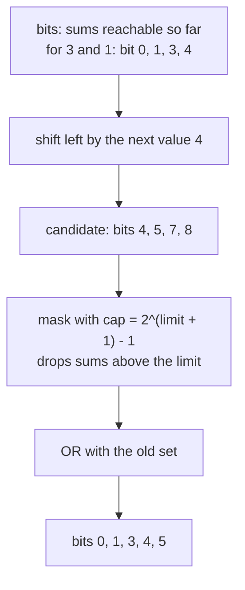
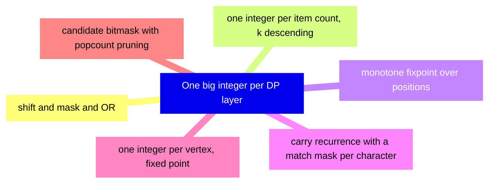
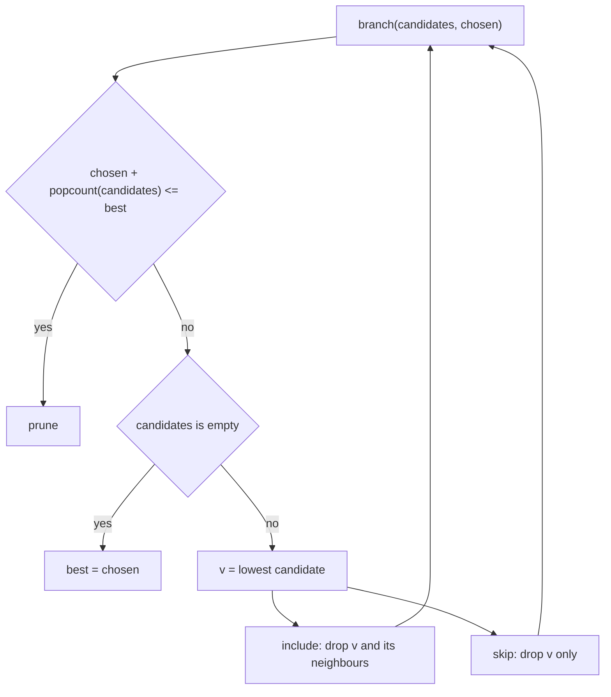
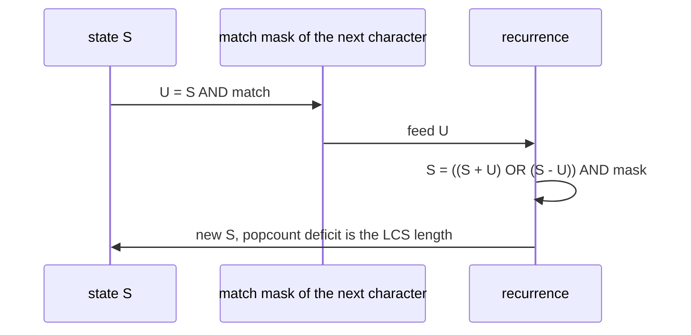

# 584 — Implement offline dynamic programming with bitset acceleration tricks.

> **Tier:** Advanced · **CTCI chapter:** Ch 8 — Recursion and Dynamic Programming
> **Task spec:** [584-implement-offline-dynamic-programming-with-bitset-acceleration-t.md](../../../tasks/advanced/584-implement-offline-dynamic-programming-with-bitset-acceleration-t.md)
> **Solutions:** [Python](../../../solutions/python/advanced/584-implement-offline-dynamic-programming-with-bitset-acceleration-t/solution.py) ·
> [Java](../../../solutions/java/advanced/584-implement-offline-dynamic-programming-with-bitset-acceleration-t/Solution.java) ·
> [JavaScript](../../../solutions/javascript/advanced/584-implement-offline-dynamic-programming-with-bitset-acceleration-t/solution.js) ·
> [C#](../../../solutions/csharp/advanced/584-implement-offline-dynamic-programming-with-bitset-acceleration-t/Solution.cs)

## 1. Problem restatement

**Input:** five different offline DP problems — subset-sum reachability, subset-sum reachability per
cardinality, word break, longest common subsequence, transitive closure, plus maximum independent
set — each with its own data.

**Output:** a bit-parallel implementation of each one, i.e. a whole DP layer packed into a single
arbitrary-precision integer so that the machine's ALU performs the update word-parallel. The five
recurrences the header lists are:

| Problem | Bitset update | Meaning of a bit |
| --- | --- | --- |
| subset-sum reachability | `bits |= (bits << value) & cap` | bit `s` = some subset of the processed values sums to `s` |
| subset-sum per cardinality | `levels[k] |= (levels[k - 1] << value) & cap`, `k` from high to low | bit `s` of level `k` = a `k`-subset sums to `s` |
| word break | `reach |= (reach & match[length]) << length` to a fixpoint | bit `j` = `text[:j]` is segmentable |
| LCS (Hyyrö's bit-vector algorithm) | `U = S & match[c]`, `S = ((S + U) | (S - U)) & mask` | the popcount deficit of `S` is the LCS length |
| transitive closure | one integer per vertex, expanded to a fixpoint | bit `v` of `reach[u]` = `v` is reachable from `u` |
| maximum independent set | branch and bound over a candidate bitmask | `chosen + popcount(candidates)` is the upper bound |

Two properties are asserted rather than assumed.

* the LCS recurrence is compared against the `O(nm)` table on **400 random pairs** and two long
  strings, and the exactness of `S - U` relies on arbitrary-precision borrow propagation (a 64-bit
  port needs the usual per-word borrow bookkeeping, which the header calls "the real trick in C");
* one subset-sum instance has **64 values**, far beyond the `2^n` enumeration, so it can only be
  checked against the scalar `O(n · limit)` table.

Randomness comes from `splitmix64`, not from the repository's 16-bit LCG `(seed * 75 + 74) % 65537`,
because that LCG cycles within a few hundred values and its low bits are strongly correlated — and
this task draws hundreds of "independent" samples (60 subset-sum instances, 400 string pairs, graph
edges).

## 2. Intuition

The naive subset-sum DP asks, for each value, "for every reachable sum, mark `sum + value`". That is a
loop over all sums. The bitset version observes that the loop body is the same operation on every sum:
shifting the whole reachability set left by `value` is exactly "mark `sum + value` for every reachable
`sum`", and the `& cap` keeps the shifted bits inside the limit. So one big-integer shift and one OR
replace an `O(limit)` loop:

```
bits |= (bits << value) & cap
```

Nothing about the DP changed — the recurrence `reach[s] = reach[s] or reach[s - value]` is the same
line of arithmetic. What changed is that the loop over `s` is now executed by the integer's own
word-parallel addition, so the cost per item is `O(limit / w)` machine words instead of `O(limit)`
Python-level steps.



The other four problems follow the same recipe with a different update.

* **per cardinality** keeps one integer per item count and iterates `k` **downward**, so that a level
  is only ever updated from the level below it — the "each item used at most once" bookkeeping that a
  0/1 knapsack needs.
* **word break** needs a fixpoint, and because the update only ever sets bits, a monotone iteration
  terminates: repeat `reach |= (reach & match[L]) << L` over all dictionary lengths until nothing
  changes.
* **LCS** uses Hyyrö's carry recurrence, in which the additions and subtractions inside a fixed-width
  mask propagate borrows exactly as the scalar DP would.
* **transitive closure** replaces the `n x n` byte matrix with one `n`-bit integer per vertex and
  iterates to a fixpoint.
* **maximum independent set** uses a bitmask as the candidate set, taking the lowest candidate and
  branching on it with `cand & ~adj[v] & ~(1 << v)` for the include branch and pruning when
  `chosen + popcount(cand) <= best`.



## 3. Algorithm

1. **Subset sum.** `cap = (1 << (limit + 1)) - 1`, `bits = 1`. For each value with `0 < value <= limit`
   do `bits |= (bits << value) & cap`. Return `bits & cap`. (Values above the cap can never be used,
   and a zero value would produce no new bits — both are skipped by the guard.)
2. **Per cardinality.** `levels[0] = 1`, and for each value, for `k` from the number of values seen so
   far down to `1`, `levels[k] |= (levels[k - 1] << value) & cap`.
3. **Word break.** Build `match[L]` = the OR of `1 << i` over every position `i` where some dictionary
   word of length `L` matches; then iterate `reach |= (reach & match[L]) << L` over all lengths until
   `reach` stops changing. The answer is bit `n`.
4. **LCS.** Build `matches[c]` = the bitmask of positions of `c` in the first string; then for each
   character of the second string set `U = S & matches[c]` and `S = ((S + U) | (S - U)) & mask`; the
   length is `n - popcount(S)`.
5. **Closure.** `reach[u]` starts as the bitmask of `u` plus its direct successors; iterate over every
   vertex folding the reachability sets of all members of `reach[u]` until nothing changes.
6. **MIS.** `branch(candidates, chosen)`: prune when `chosen + popcount(candidates) <= best`; when the
   candidate set is empty update `best`; otherwise take the lowest candidate `v`, branch on including
   it (`candidates & ~adjacency[v] & ~v`, `chosen + 1`) and on skipping it (`candidates & ~v`, `chosen`).

```text
function subset_sum_bitset(values, limit)
    cap ← (1 << (limit + 1)) - 1
    bits ← 1
    for value in values do
        if 0 < value <= limit then
            bits ← bits | ((bits << value) & cap)
        end
    end
    return bits & cap
end

function word_break_bitset(text, words)
    for word in words do
        length ← length(word)
        if 0 < length <= length(text) then
            for i from 0 to length(text) - length do
                if text[i .. i + length - 1] == word then
                    match[length] ← match[length] | (1 << i)
                end
            end
        end
    end
    reach ← 1
    changed ← true
    while changed do
        changed ← false
        for length in keys(match) do
            candidate ← reach | ((reach & match[length]) << length)
            if candidate != reach then
                reach ← candidate
                changed ← true
            end
        end
    end
    return bit number length(text) of reach
end
```

```text
function lcs_bitparallel(a, b)
    n ← length(a)
    for i from 0 to n - 1 do
        matches[a[i]] ← matches[a[i]] | (1 << i)
    end
    mask ← (1 << n) - 1
    s ← mask
    for character in b do
        u ← s & matches[character]
        s ← ((s + u) | (s - u)) & mask
    end
    return n - popcount(s)
end
```



## 4. Worked example

**Subset sum** on `values = [3, 1, 4]`, `limit = 6`, so `cap = 2^7 - 1 = 127`:

| Step | Value | `bits` before | `(bits << value) & cap` | `bits` after | Reachable sums |
| --- | --- | --- | --- | --- | --- |
| start | — | `1` | — | `0b0000001` | `{0}` |
| 1 | 3 | `1` | `0b0001000` | `0b0001001` | `{0, 3}` |
| 2 | 1 | `0b0001001` | `0b0010010` | `0b0011011` | `{0, 1, 3, 4}` |
| 3 | 4 | `0b0011011` | `0b0110000` | `0b0111011` | `{0, 1, 3, 4, 5}` |

The last row is the interesting one: the shift produces bits `4, 5, 7, 8`, the mask drops `7` and `8`
(sum `7 = 3 + 4` exceeds the limit, and `8` is the full set), and the OR adds `4` and `5` — the sums
`4 = 3 + 1` and `5 = 1 + 4` — while keeping the old bits. Checking against enumeration of the eight
subsets: `{} = 0`, `{3} = 3`, `{1} = 1`, `{4} = 4`, `{3,1} = 4`, `{1,4} = 5`, `{3,4} = 7 > 6`,
`{3,1,4} = 8 > 6` — exactly `{0, 1, 3, 4, 5}`.

The cardinality version keeps the same numbers separated by item count: `levels[0] = {0}`,
`levels[1] = {1, 3}` after the first two values, then the value `4` updates `k = 3` first (from
`levels[2]`) and `k = 2` last, giving `levels[2] = {4, 5}` and `levels[3] = {}` (the only 3-subset sums
to `8`, above the cap). So "is there a 2-subset summing to `5`?" is a single bit test.

**Word break** on `text = "apple"`, `words = {"app", "le"}`. `match[3] = 0b00001` (`"app"` at position
`0`) and `match[2] = 0b01000` (`"le"` at position `3`). Starting from `reach = 0b00001`:

| Round | Length | Update | `reach` |
| --- | --- | --- | --- |
| 1 | 3 | `(0b00001 & 0b00001) << 3 = 0b01000` | `0b01001` |
| 1 | 2 | `(0b01001 & 0b01000) << 2 = 0b100000` | `0b101001` |
| 2 | 3 | no new bit | `0b101001` |
| 2 | 2 | no new bit | `0b101001` |

Bit `5` is set and `n = 5`, so the text is segmentable as `"app" + "le"`.

**LCS** on `a = "abc"`, `b = "ac"`: `matches[a] = 0b001`, `matches[b] = 0b010`, `matches[c] = 0b100`,
`mask = 0b111`, `S = 0b111`.

| Character | `U = S & match[c]` | `S + U` | `S - U` | `(S + U) | (S - U)` masked | `S` | `popcount(S)` |
| --- | --- | --- | --- | --- | --- | --- |
| `a` | `0b001` | `0b1000` | `0b110` | `0b1110 & 0b111 = 0b110` | `0b110` | 2 |
| `c` | `0b100` | `0b1010` | `0b010` | `0b1010 & 0b111 = 0b010` | `0b010` | 1 |

`LCS = n - popcount(S) = 3 - 1 = 2`, which is `"ac"` — checked against the `3 x 2 = 6`-cell table.
The subtractions rely on borrow propagation across the whole integer; that is why a 64-bit port needs
explicit per-word borrow handling.



**Maximum independent set** on the 4-cycle `0-1-2-3-0` (so `adjacency[0] = {1, 3}`):

| Call | `candidates` | `chosen` | Bound `chosen + popcount` | Action | `best` |
| --- | --- | --- | --- | --- | --- |
| 1 | `{0,1,2,3}` | 0 | 4 | take `v = 0` | 0 |
| 2 | `{2}` | 1 | 2 | take `v = 2` | 0 |
| 3 | `{}` | 2 | — | update best | 2 |
| 4 | `{}` | 1 | — | skip branch, no bound beat | 2 |


## 5. Complexity

Let `limit` be the subset-sum bound, `w` the machine word size, `n`/`m` the string lengths, `V` the
vertex count, `d` the dictionary size, and `L` the number of distinct word lengths.

| Measure | Bound | Why it holds |
| --- | --- | --- |
| Subset sum, bitset | O(len(values) · limit / w) word operations | one shift, one AND and one OR per value over a `limit + 1`-bit integer |
| Subset sum, scalar | O(len(values) · limit) steps | the explicit loop over sums |
| Per cardinality | O(len(values)² · limit / w) | one integer per item count, each updated once per value |
| Word break | O(L · limit / w) per fixpoint round, few rounds | monotone, so the round count is bounded by the number of positions that can be reached |
| Word break, match tables | O(d · n) character comparisons once | each occurrence of a word sets one bit at that position |
| LCS, bit-parallel | O(m · n / w) | one constant number of big-integer operations per character of the second string |
| LCS, table | O(n · m) steps | the classic filled table |
| Transitive closure | O(rounds · V² / w) | `V` bitmasks, each folded over the members present |
| MIS | O(2^V) worst case, far less with pruning | branch and bound with the popcount upper bound |
| Space | one integer per layer, so O(limit / w) or O(V) integers | nothing is stored per cell |


## 6. Pitfalls and edge cases

- **The mask is mandatory.** Without `& cap` the shifted integer grows forever and marks sums above the
  limit; the guard `0 < value <= limit` also keeps the width fixed and skips unusable values.
- **Zero-valued items and target `0`.** A zero would produce nothing new and is skipped, while
  `bits = 1` means the empty subset always reaches `0`.
- **Cardinality must iterate `k` downward.** Updating `levels[k]` for increasing `k` lets one item be
  counted twice in the same level, silently turning the 0/1 problem into an unbounded one.

## 7. Variants and follow-ups

- **More bitset DP tricks.** The dedicated bitset-DP task collects the same shift-and-mask patterns for
  subset problems — [416-implement-bitset-dp-optimizations-for-subset-problems.md](../../../tasks/advanced/416-implement-bitset-dp-optimizations-for-subset-problems.md).
- **The scalar versions of the same recurrences.** Word break and LCS in table form are
  [124-word-break-dp.md](../../../tasks/beginner/124-word-break-dp.md) and
  [121-longest-common-subsequence-lcs-dp.md](../../../tasks/beginner/121-longest-common-subsequence-lcs-dp.md).
- **Closure by another route.** Floyd-Warshall over the same graphs is
  [178-compute-transitive-closure-floyd-warshall-naive.md](../../../tasks/beginner/178-compute-transitive-closure-floyd-warshall-naive.md),
  and tree-shaped independent set replaces the branch and bound with a DP —
  [426-implement-tree-dp-for-independent-set-in-tree.md](../../../tasks/advanced/426-implement-tree-dp-for-independent-set-in-tree.md).

## 8. Check yourself

1. Why is `bits |= (bits << value) & cap` equivalent to the scalar `reach[s] = reach[s] or
   reach[s - value]` loop?

<details><summary>Show answer</summary>

Shifting the integer left by `value` moves the bit at position `s` to position `s + value`, so the
shifted integer has a bit set at exactly those positions reachable by adding this value to a previously
reachable sum. The OR unions that with the old set — which is `reach[s] = reach[s] or
reach[s - value]` for every `s` at once. The `& cap` is the `s <= limit` filter, applied with one AND
instead of `limit + 1` comparisons.

</details>

2. In the `apple` example, why does the fixpoint need at least two rounds?

<details><summary>Show answer</summary>

Round one discovers the `"app"` match at position `0` and then, because the same round visits the
lengths in order, the `"le"` match at position `3`. The bit for position `5` only appears after
position `3` is reachable, so the fixpoint loop has to run again (and finds no change) to *know* it is
done. The loop is monotone, so this terminates in at most as many rounds as there are positions.

</details>

3. What does `popcount(S)` mean in the LCS recurrence?

<details><summary>Show answer</summary>

`S` is not a reachability set: its bits encode the insertion/deletion structure of the alignment, and
the number of set bits is the deficit from the maximum possible length, so `n - popcount(S)` is the LCS
length. For `a = "abc"`, `b = "ac"` the walk ends with `S = 0b010` and `3 - 1 = 2`.

</details>

4. Why is the pruning bound in the MIS branch `chosen + popcount(candidates)`?

<details><summary>Show answer</summary>

Because no matter how the branch resolves, the final set can contain at most the elements already
chosen plus one element per remaining candidate (ignoring all adjacency constraints, which only remove
more). If that upper bound does not beat the best known solution, the whole subtree can be discarded —
that is what keeps the 4-cycle example at a few calls rather than `16`.

</details>

5. Why does the file not use the repository's default `(seed * 75 + 74) % 65537` generator?

<details><summary>Show answer</summary>

Because that 16-bit LCG cycles within a few hundred values and its low bits are strongly correlated,
while this task takes hundreds of "independent" draws (60 subset-sum instances, 400 string pairs, graph
edges). Correlated draws would make the random battery repeat the same patterns and weaken the
evidence; `splitmix64` mixes the state so that the draws used here behave independently.

</details>