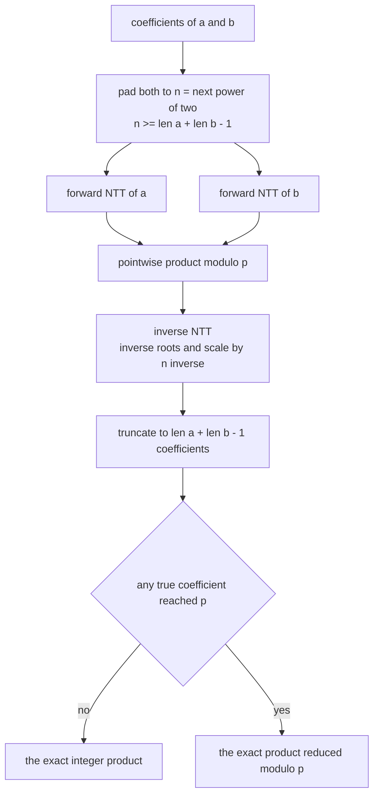
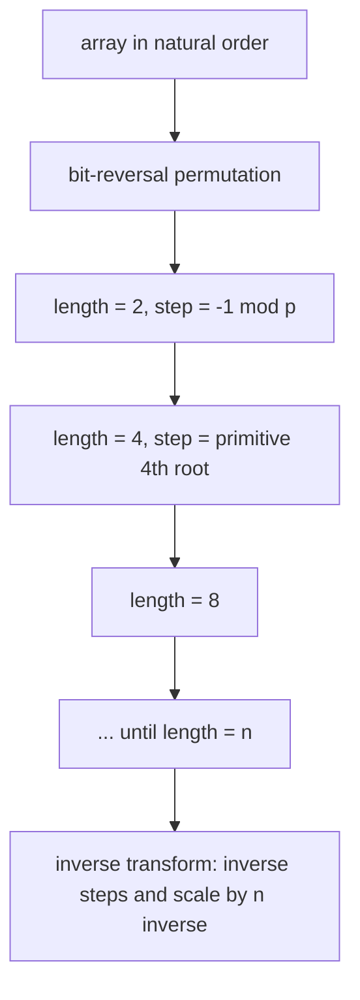
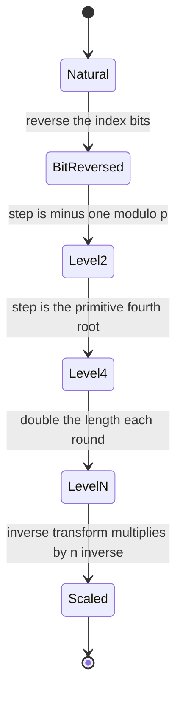
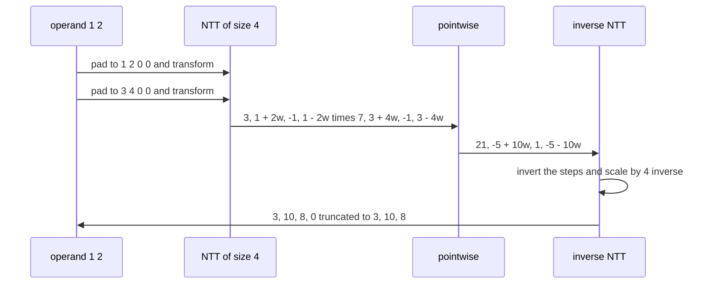

# 585 — Implement modular FFT for polynomial multiplication (NTT) small prime.

> **Tier:** Advanced · **CTCI chapter:** Beyond — Numerical & Scientific Computing
> **Task spec:** [585-implement-modular-fft-for-polynomial-multiplication-ntt-small-pr.md](../../../tasks/advanced/585-implement-modular-fft-for-polynomial-multiplication-ntt-small-pr.md)
> **Solutions:** [Python](../../../solutions/python/advanced/585-implement-modular-fft-for-polynomial-multiplication-ntt-small-pr/solution.py) ·
> [Java](../../../solutions/java/advanced/585-implement-modular-fft-for-polynomial-multiplication-ntt-small-pr/Solution.java) ·
> [JavaScript](../../../solutions/javascript/advanced/585-implement-modular-fft-for-polynomial-multiplication-ntt-small-pr/solution.js) ·
> [C#](../../../solutions/csharp/advanced/585-implement-modular-fft-for-polynomial-multiplication-ntt-small-pr/Solution.cs)

## 1. Problem restatement

**Input:** two integer coefficient arrays `a` and `b`.

**Output:** their convolution — the coefficients of the product polynomial — computed by a
number-theoretic transform over `GF(p)` instead of a floating-point FFT.

| Parameter | Value in the code | Meaning |
| --- | --- | --- |
| modulus `p` | `998244353 = 119 · 2^23 + 1` | an NTT-friendly prime: `2^23` divides `p - 1` |
| primitive root `g` | `3` | generates the multiplicative group, so `g^((p-1)/n)` is a primitive `n`-th root |
| second modulus | `167772161 = 5 · 2^25 + 1`, root `3` | shows nothing is hard-coded to the first prime |
| transform size | the next power of two `>= len(a) + len(b) - 1` | both operands are zero-padded to it |

Operations: `ntt(a, invert, modulus, root)` (in-place iterative radix-2 Cooley-Tukey butterfly with
bit-reversal), `convolve_mod(a, b, ...)`, and the two exact references `convolve_naive` (schoolbook) and
`convolve_kronecker` (coefficients packed into one big integer with `2^64`-wide slots).

The honesty clause in the header is asserted, not hidden.

> The output is the product **modulo p**, so it differs from the exact integer product as soon as a true
> coefficient reaches `p` — both facts are asserted (the wrapped result equals the exact product reduced
> mod `p`, and a small-coefficient instance reproduces the integer product unchanged).

| Check | Result |
| --- | --- |
| transform round trip | exact for every size `1, 2, 4, ..., 1024` |
| twiddle order | `w^n = 1` and `w^(n/2) = -1` |
| `g` is a primitive root | `g^((p-1)/q) != 1` for every prime factor `q` of `p - 1` |
| product versus schoolbook | equal for 120 random operand pairs |
| `(1 + x)^k` | equal to the binomial coefficients from `math.comb`, `k` up to `200` |
| Kronecker substitution product | equal to schoolbook (validated first), then to the NTT |
| boundary operands | empty, length-one, length `5` by length `7`, a delta polynomial |
| algebra | associativity and distributivity over `GF(p)` |
| large coefficients | the wrapped result equals the exact product reduced mod `p` |

## 2. Intuition

Polynomial multiplication is `O(nm)` by definition; the FFT makes it `O(n log n)` by evaluating both
polynomials at `n` points, multiplying pointwise, and interpolating. Floating-point FFTs evaluate at
complex roots of unity, which requires trigonometry and rounding. The NTT does the same thing inside a
finite field: if `p - 1` is divisible by the transform length `n`, then `w = g^((p-1)/n)` is a primitive
`n`-th root of unity in `GF(p)`, and the whole algorithm works with modular arithmetic only — no sine,
no cosine, no accumulated error.

That structural identity is the reason the task exists, and it also explains the catch: all arithmetic
happens modulo `p`, so a product coefficient that reaches `p` wraps. A floating FFT is approximate but
exact for small coefficients; an NTT is exact but modular.



The transform itself is the iterative Cooley-Tukey butterfly. First the input is permuted into
bit-reversed order, then `log n` levels are applied; at the level of length `length`, the step factor is
`w = g^((p-1)/length)` (or its inverse for the inverse transform) and each butterfly computes
`u + v` and `u - v` where `v` already carries one factor of `w`:



## 3. Algorithm

1. **Validate.** The transform length must be a positive power of two; otherwise raise.
2. **Bit-reverse.** Walk `i = 1 .. n-1`, advancing the reversed index `j` bit by bit and swapping when
   `i < j`.
3. **Butterflies.** For `length = 2, 4, 8, ... <= n`: compute `step = g^((p-1)/length) mod p`, invert it
   when transforming backwards, then for every block of `length` and every `k` in its first half
   compute `u = a[k]`, `v = a[k + half] * w mod p`, store `u + v` and `u - v`, and advance
   `w = w * step mod p`.
4. **Scale.** The inverse transform multiplies every entry by `n^{-1} mod p`.
5. **Multiply.** Pad both polynomials to `n`, transform both, multiply pointwise mod `p`, transform
   back inversely, and truncate to `len(a) + len(b) - 1`.

```text
procedure ntt(a, invert, modulus, root)
    n ← length(a)
    if n == 0 or n is not a power of two then
        raise error
    end
    j ← 0
    for i from 1 to n - 1 do
        bit ← n / 2
        while j & bit != 0 do
            j ← j xor bit
            bit ← bit / 2
        end
        j ← j or bit
        if i < j then
            swap a[i] and a[j]
        end
    end
    length ← 2
    while length <= n do
        step ← power_mod(root, (modulus - 1) / length, modulus)
        if invert then
            step ← inverse_mod(step, modulus)
        end
        half ← length / 2
        for start from 0 to n - 1 step length do
            w ← 1
            for k from start to start + half - 1 do
                u ← a[k]
                v ← a[k + half] * w mod modulus
                a[k] ← (u + v) mod modulus
                a[k + half] ← (u - v) mod modulus
                w ← w * step mod modulus
            end
        end
        length ← length * 2
    end
    if invert then
        n_inverse ← inverse_mod(n, modulus)
        for i from 0 to n - 1 do
            a[i] ← a[i] * n_inverse mod modulus
        end
    end
end
```

```text
function convolve_mod(a, b, modulus, root)
    if a is empty or b is empty then
        return empty array
    end
    size ← 1
    while size < length(a) + length(b) - 1 do
        size ← size * 2
    end
    left ← a padded with zeros to size
    right ← b padded with zeros to size
    ntt(left, false, modulus, root)
    ntt(right, false, modulus, root)
    for i from 0 to size - 1 do
        left[i] ← left[i] * right[i] mod modulus
    end
    ntt(left, true, modulus, root)
    return left truncated to length(a) + length(b) - 1
end
```



## 4. Worked example

Multiply `[1, 2]` by `[3, 4]`. The answer must be `[3, 10, 8]`, so with the padded length `n = 4` the
transform must produce `[3, 10, 8, 0]`. Write `w` for the primitive fourth root of unity used at the
top level, so `w² = -1` and `w⁴ = 1` — exactly the relations the file asserts for every size.

**Forward transform of `[1, 2, 0, 0]`**, bit-reversed to `[1, 0, 2, 0]`:

| Level | `length` | `step` | Butterflies | Result |
| --- | --- | --- | --- | --- |
| 1 | 2 | `-1` | `(1, 0)` → `1, 1`; `(2, 0)` → `2, 2` | `[1, 1, 2, 2]` |
| 2 | 4 | `w` | `k = 0`: `1 + 2 = 3`, `1 - 2 = -1`; `k = 1`: `1 + 2w`, `1 - 2w` | `[3, 1 + 2w, -1, 1 - 2w]` |

**Forward transform of `[3, 4, 0, 0]`**, bit-reversed to `[3, 0, 4, 0]`:

| Level | `length` | `step` | Butterflies | Result |
| --- | --- | --- | --- | --- |
| 1 | 2 | `-1` | `(3, 0)` → `3, 3`; `(4, 0)` → `4, 4` | `[3, 3, 4, 4]` |
| 2 | 4 | `w` | `k = 0`: `3 + 4 = 7`, `3 - 4 = -1`; `k = 1`: `3 + 4w`, `3 - 4w` | `[7, 3 + 4w, -1, 3 - 4w]` |

The pointwise product is where `w² = -1` does the work:

| Index | `A[i] · B[i]` | Reduced with `w² = -1` |
| --- | --- | --- |
| 0 | `3 · 7 = 21` | `21` |
| 1 | `(1 + 2w)(3 + 4w) = 3 + 4w + 6w + 8w²` | `-5 + 10w` |
| 2 | `(-1) · (-1)` | `1` |
| 3 | `(1 - 2w)(3 - 4w) = 3 - 4w - 6w + 8w²` | `-5 - 10w` |

**Inverse transform.** The step factors are inverted (`-1` stays `-1`, and `w^{-1} = -w` because
`w² = -1`), and the result is scaled by `n^{-1}`:

| Level | Butterfly work | Before scaling |
| --- | --- | --- |
| length 2 | `(21, 1)` → `22, 20`; `(-5 + 10w, -5 - 10w)` → `-10, 20w` | `[22, 20, -10, 20w]` |
| length 4, step `-w` | `k = 0`: `22 - 10 = 12`, `22 + (-10) = 32`; `k = 1`: `20 + 20w·(-w) = 20 + 20 = 40`, `20 - 20 = 0` | `[12, 40, 32, 0]` |
| scale by `4^{-1}` | divide every entry by `4` | `[3, 10, 8, 0]` |

Truncating to `len(a) + len(b) - 1 = 3` coefficients gives `[3, 10, 8]`, which is
`1·3 + (1·4 + 2·3)x + 2·4x²` — the schoolbook product, coefficient for coefficient. The same walk with
coefficients larger than `p` would return this array reduced mod `p`, and that is the fact the file
asserts by comparing the wrapped result with `exact_product mod p`.



## 5. Complexity

Let `n` be the padded transform length (a power of two) and `m = len(a) + len(b) - 1` the true output
length.

| Measure | Bound | Why it holds |
| --- | --- | --- |
| NTT | O(n log n) modular multiplications | `log n` levels, `n / 2` butterflies each, all constants in `GF(p)` |
| Bit-reversal pass | O(n) | one swap per index pair |
| Convolution | O(n log n) | two forward transforms, `n` pointwise products, one inverse transform |
| Schoolbook reference | O(len(a) · len(b)) | the naive nested loop used as ground truth |
| Kronecker reference | one big-integer multiplication plus packing | the exact integer cross-check, validated against schoolbook first |
| Space | O(n) integers per operand | the transforms are in place on padded copies |
| Error | exact | all values are residues in `GF(p)`; there is no rounding error to grow with coefficient size |
| Limitation | coefficients wrap when a true coefficient `>= p` | asserted: the output equals the exact product reduced mod `p` |

The comparison the header makes is the important one: an NTT has no error growth at all, so
large-coefficient products are exact modulo `p`, whereas a floating-point FFT trades magnitude for
rounding noise. The price is the modulus.

## 6. Pitfalls and edge cases

- **The length must be a power of two.** The transform raises otherwise, and the caller is responsible
  for padding to `>= len(a) + len(b) - 1`; forgetting the `- 1` truncates the top coefficient.
- **A missing `mod` breaks everything.** Every butterfly and every pointwise product must reduce modulo
  `p`; the intermediate `u - v` is stored as a residue, not as a negative integer.
- **The inverse step is an inverse.** `inverse_mod(step, modulus)` is applied only on the inverse pass,
  and the final scaling by `n^{-1}` is what makes the round trip exact. An inverse transform that
  forgets the scaling produces `n`-fold results.
- **Primitive root, not any root.** `g` must have order `p - 1`; the file verifies
  `g^((p-1)/q) != 1` for every prime factor `q` of `p - 1`, and checks that `w^n = 1` and `w^(n/2) = -1`
  for the twiddles it actually uses.
- **Modulus choice.** `p - 1` must be divisible by `2^23` here, which caps the usable transform size at
  `2^23`; the second modulus `167772161` supports `2^25` and reuses the root `3`, which is exactly why
  the test exists.
- **Empty and length-one operands.** An empty operand gives an empty result, and two length-one
  operands degenerate to a single multiplication with `n = 1` (a transform with no levels, so the
  loop body must be skipped rather than executed once).
- **Delta polynomials.** Multiplying by `[1]` must return the other operand unchanged — the cleanest
  check that bit-reversal and the scaling cancel out.

## 7. Variants and follow-ups

- **Non-power-of-two transform lengths.** Bluestein's chirp z-transform removes the power-of-two
  requirement by evaluating the DFT with three transforms of size `>= 2n - 1` —
  [586-implement-chirp-z-transform-outline-for-non-power-of-two-convolu.md](../../../tasks/advanced/586-implement-chirp-z-transform-outline-for-non-power-of-two-convolu.md).
- **Other convolution rings.** Replacing pointwise multiplication with pointwise XOR product gives the
  Walsh-Hadamard transform used for bitset XOR convolution in
  [539-implement-bitset-convolution-using-fwht-xor-convolution-small-n.md](../../../tasks/advanced/539-implement-bitset-convolution-using-fwht-xor-convolution-small-n.md).
- **Several primes.** Two or three moduli combined with the Chinese remainder theorem give products
  larger than any single `p` accepts — the natural fix for the wrapping limitation this file documents.
- **Exact arithmetic over a field in linear algebra.** The same "exactness modulo a prime" idea drives
  the determinant task [587-implement-matrix-determinant-via-lu-decomposition-modular-or-dou.md](../../../tasks/advanced/587-implement-matrix-determinant-via-lu-decomposition-modular-or-dou.md),
  whose modular variant eliminates over `GF(p)` with inverted pivots.
- **Polynomial multiplication without transforms.** Schoolbook multiplication is the fallback whenever
  `n` is tiny or the modulus is unavailable, which is why it stays in the file as the reference.

## 8. Check yourself

1. Why does the NTT require `2^k | p - 1` for a transform of length `2^k`?

<details><summary>Show answer</summary>

Because the twiddle factor must be a primitive `n`-th root of unity, and the multiplicative group of
`GF(p)` has order `p - 1`. A primitive `n`-th root exists exactly when `n` divides `p - 1`, so
`w = g^((p-1)/n)` has order `n` only if `n | p - 1`. That is why `998244353 = 119 · 2^23 + 1` supports
lengths up to `2^23` and why the file also demonstrates a second prime.

</details>

2. In the worked example the pointwise product `(1 + 2w)(3 + 4w)` simplified to `-5 + 10w`. Which
   relation did that use?

<details><summary>Show answer</summary>

`w² = -1`, the same relation the file asserts as `w^(n/2) = -1` for the twiddle of order `n`. Expanding
gives `3 + 4w + 6w + 8w² = 3 + 10w - 8 = -5 + 10w`, and the inverse transform then recovers the integer
coefficients `3, 10, 8` after scaling by `n^{-1}`.

</details>

3. The inverse transform returned `[12, 40, 32, 0]` before scaling. What would the answer be without
   the final scaling step?

<details><summary>Show answer</summary>

`[12, 40, 32, 0]` instead of `[3, 10, 8, 0]` — every coefficient exactly `n = 4` times too large. The
forward transform multiplies by the matrix twice in the round trip, giving a factor of `n`, which is why
the inverse pass multiplies by `n^{-1} mod p`.

</details>

4. When does the NTT result stop being the exact integer product, and how does the file check that?

<details><summary>Show answer</summary>

As soon as a true product coefficient is at least `p`: the transform returns it reduced modulo `p`. The
file asserts both sides of that statement — a small-coefficient instance reproduces the integer product
unchanged, and a large-coefficient instance satisfies `ntt_result == exact_product mod p` when compared
against exact references (schoolbook, `math.comb` binomials and Kronecker substitution).

</details>

5. Why is a modular transform immune to the error growth that affects a floating-point FFT?

<details><summary>Show answer</summary>

Because every value is a residue in `GF(p)`: additions, subtractions and multiplications are exact
integer operations followed by a reduction, and a reduction never accumulates error. A floating-point
FFT evaluates at complex roots, so each butterfly contributes rounding that grows with `log n` and
with the coefficient magnitudes; that is the trade the header describes — exactness modulo `p` instead
of approximate exactness in the reals.

</details>