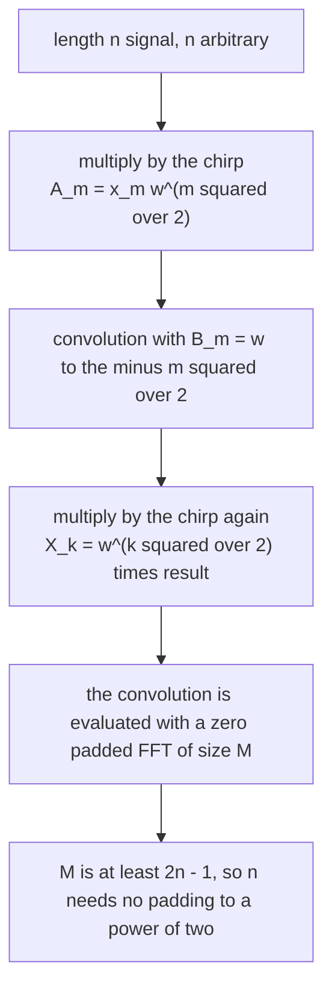
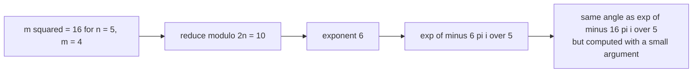
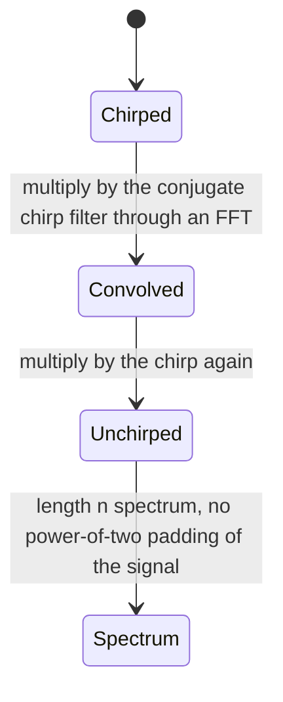
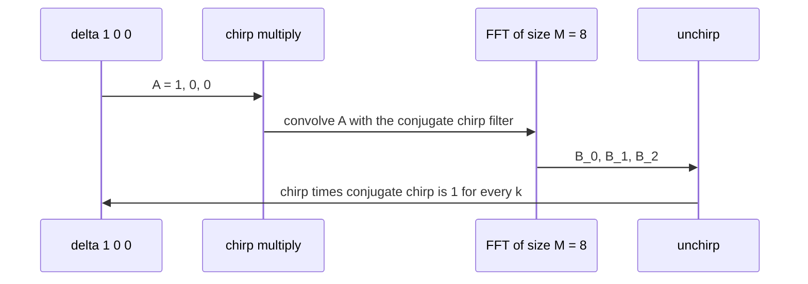

# 586 — Implement chirp z-transform outline for non-power-of-two convolutions.

> **Tier:** Advanced · **CTCI chapter:** Beyond — Numerical & Scientific Computing
> **Task spec:** [586-implement-chirp-z-transform-outline-for-non-power-of-two-convolu.md](../../../tasks/advanced/586-implement-chirp-z-transform-outline-for-non-power-of-two-convolu.md)
> **Solutions:** [Python](../../../solutions/python/advanced/586-implement-chirp-z-transform-outline-for-non-power-of-two-convolu/solution.py) ·
> [Java](../../../solutions/java/advanced/586-implement-chirp-z-transform-outline-for-non-power-of-two-convolu/Solution.java) ·
> [JavaScript](../../../solutions/javascript/advanced/586-implement-chirp-z-transform-outline-for-non-power-of-two-convolu/solution.js) ·
> [C#](../../../solutions/csharp/advanced/586-implement-chirp-z-transform-outline-for-non-power-of-two-convolu/Solution.cs)

## 1. Problem restatement

**Input:** a signal `x` of arbitrary length `n`, or two operands to convolve.

**Output:** its discrete Fourier transform, computed with three power-of-two FFTs and **no** requirement
that `n` be a power of two. The task asks for an "outline"; the header states plainly that the file
"implements the transform for real and documents the design instead of sketching it".

The identity the whole method rests on is

```
nk = (n² + k² - (n - k)²) / 2            with w = exp(-2πi / n)

X_k = w^(k²/2) · Σ_m [ x_m · w^(m²/2) ] · w^(-(k-m)²/2)
```

so with the **chirp** `A_m = x_m · w^(m²/2)` and a filter `B_m = w^(-m²/2)` defined for
`m ∈ [-(n-1), n-1]`, the DFT becomes `X_k = w^(k²/2) · (A * B)_k` — a plain linear convolution that a
zero-padded radix-2 FFT of size `M >= 2n - 1` evaluates exactly.

| Piece | Code |
| --- | --- |
| `chirp_factors(n)` | `exp(-π i m²/n)` for `m = 0..n-1`, computed as `base ** (m² mod 2n)` |
| `dft_bluestein(x)` | chirp multiply, one FFT of `b`, pointwise product, inverse FFT, chirp multiply |
| `idft_bluestein(X)` | the conjugate trick `idft(X) = conj(dft(conj(X))) / n` |
| `convolve_bluestein(a, b)` | both operands padded to the **natural** length `len(a) + len(b) - 1` |
| `convolve_fft(a, b)` | the reference: pad to the next power of two and use the radix-2 FFT |
| `dft_naive(x)` | the `O(n²)` DFT used as ground truth |

The accuracy note is part of the contract.

> Every chirp factor is evaluated as `chirp^(k² mod 2n)` with the exponent reduced modulo `2n` in
> **exact integer arithmetic**, because `exp(-π i k²/n)` with a large `k²` would otherwise lose most of
> its significant digits. The remaining error is the FFT's own `O(eps log M)`, so the checks use `1e-9`
> tolerances.

| Check | Result |
| --- | --- |
| DFT versus `dft_naive` | every length `1..13`, plus `16` |
| inverse round trip | exact to the tolerant comparison |
| Parseval | `Σ|X|² = n · Σ|x|²` |
| linearity, shift theorem | `X_k → X_k · w^(s·k)` for a cyclic shift `s` |
| conjugate symmetry | for real input |
| convolution `5 × 7`, `6 × 6` | equal to schoolbook |
| Bluestein versus the power-of-two FFT route | equal for `8 × 8` operands |
| determinism | the same sample signals give the same spectra |

## 2. Intuition

A radix-2 FFT needs its length to be a power of two, so convolving a length-5 and a length-7 operand
means padding both to `16` and inverse-transforming `16` values to keep `11` of them. Bluestein avoids
that padding by rewriting the DFT as a convolution, and a convolution can be computed with a
power-of-two FFT of any size that is large enough — `M >= 2n - 1` — so an `11`-point transform becomes
three FFTs of size `32`.

The trick is pure algebra on the product `nk` inside the transform's exponential:

```
n·k = (n² + k² - (n - k)²) / 2
```

Substituting it turns the transform into a sum whose terms separate into a factor depending only on
`k`, a factor depending only on `m`, and a factor depending only on the difference `k - m` — which is
precisely a convolution. The "chirp" name comes from the quadratic phase of `w^(m²/2)`, whose frequency
sweeps linearly with `m`.



The chirp factors themselves are where the numerics live. `exp(-πi m²/n)` has period `2n` in `m²`, so
the exponent can be reduced modulo `2n` **in integers** before exponentiating — for `n = 5` and `m = 4`
the exponent `16` becomes `6`, and `exp(-16πi/5) = exp(-6πi/5)` is an identity but the second one is
computed from a small argument and keeps its digits. Without the reduction the implementation would be
correct in exact arithmetic and wrong in floating point, which is why the header calls it out.



## 3. Algorithm

1. **Chirps.** `base = exp(-2πi / (2n))`; `chirp[m] = base ** (m² mod 2n)` for `m = 0..n-1`.
2. **Size.** `M = next_power_of_two(2n - 1)`.
3. **Forward transform.** `a = [x[k] · chirp[k]]` zero-padded to `M`; `b[0] = 1`, and for
   `k = 1..n-1` set `b[k] = b[M - k] = conj(chirp[k])` (the filter is symmetric and wrapped around the
   array); then `X_k = chirp[k] · (a * b)_k` where the convolution is a pointwise product of the two
   FFTs followed by an inverse FFT.
4. **Inverse transform.** `idft(X) = conj(dft(conj(X))) / n` — conjugating the input, transforming,
   conjugating the output and dividing by `n` inverts the sign of every exponential.
5. **Linear convolution at the natural length.** Pad both operands to `size = len(a) + len(b) - 1`,
   take their Bluestein transforms of that length, multiply pointwise, and inverse-transform.
6. **Degenerate cases.** `n = 0` gives an empty spectrum, `n = 1` returns the single value.

```text
function chirp_factors(n)
    base ← exp(-2 pi i / (2 n))
    chirp ← empty array of length n
    for m from 0 to n - 1 do
        chirp[m] ← base raised to the power ((m * m) mod (2 n))
    end
    return chirp
end

function dft_bluestein(x)
    n ← length(x)
    if n == 0 then return empty end
    if n == 1 then return [complex(x[0])] end
    chirp ← chirp_factors(n)
    size ← next_power_of_two(2 * n - 1)
    a ← [x[k] * chirp[k] for k from 0 to n - 1] padded with zeros to size
    b ← zeros of length size
    b[0] ← 1
    for k from 1 to n - 1 do
        b[k] ← conjugate(chirp[k])
        b[size - k] ← conjugate(chirp[k])
    end
    fa ← fft(a)
    fb ← fft(b)
    product ← [fa[i] * fb[i] for i from 0 to size - 1]
    convolution ← inverse_fft(product)
    return [chirp[k] * convolution[k] for k from 0 to n - 1]
end
```

```text
function idft_bluestein(spectrum)
    n ← length(spectrum)
    if n == 0 then return empty end
    return [conjugate(value) / n for value in dft_bluestein(conjugated spectrum)]
end

function convolve_bluestein(a, b)
    if a is empty or b is empty then return empty end
    size ← length(a) + length(b) - 1
    fa ← dft_bluestein(a padded with zeros to size)
    fb ← dft_bluestein(b padded with zeros to size)
    return idft_bluestein([fa[i] * fb[i] for i from 0 to size - 1])
end
```

Note that `convolve_bluestein` never pads to a power of two: the transform length is the natural output
length, and only the *internal* FFTs are padded to `next_power_of_two(2·size - 1)`.



## 4. Worked example

**The chirp index reduction.** For `n = 5` the exponents `m²` for `m = 0..4` are `0, 1, 4, 9, 16`, and
reducing each modulo `2n = 10` gives `0, 1, 4, 9, 6`:

| `m` | `m²` | `m² mod 10` | Factor |
| --- | --- | --- | --- |
| 0 | 0 | 0 | `1` |
| 1 | 1 | 1 | `exp(-πi/5)` |
| 2 | 4 | 4 | `exp(-4πi/5)` |
| 3 | 9 | 9 | `exp(-9πi/5)` |
| 4 | 16 | 6 | `exp(-6πi/5)` |

The last row is the one that matters: `exp(-16πi/5)` and `exp(-6πi/5)` are the same angle because the
exponents differ by `2πi · 1`, but the second is computed from the small argument `6π/5`. The file
reduces in integer arithmetic *before* exponentiating, and the header records that this is what keeps
the chirp's digits.

**A delta input cancels the chirps.** Take `x = [1, 0, 0]`, so `n = 3` and the DFT of a delta is
`[1, 1, 1]`. The chirped signal is `A = [1, 0, 0]`, so the convolution `(A * B)_k = B_k` for
`k = 0, 1, 2`, and the final multiplication gives `X_k = chirp[k] · conj(chirp[k]) = 1` for every `k` —
the chirp cancels against its own conjugate, exactly as the identity predicts.



**Convolution at the natural length.** Convolving a length-5 with a length-7 operand produces
`11` coefficients. The Bluestein route pads both operands to `11`, transforms at length `11`
(`M = next_power_of_two(2·11 - 1) = 32`, so three FFTs of size `32`), multiplies pointwise and
inverse-transforms at length `11`. The radix-2 route pads to `16` and uses one FFT of size `16` — which
is why the file notes that Bluestein is the *slower* choice when the length is already a power of two:
three FFTs of size `2n - 1` cost more than one FFT of size `n`.

| Route | Transform size used | FFT count | When it wins |
| --- | --- | --- | --- |
| radix-2 FFT | `next_power_of_two(len(a) + len(b) - 1)` | 3 of that size | the padded length is close to the true one |
| Bluestein / chirp z | `len(a) + len(b) - 1`, internal FFTs of `M >= 2n - 1` | 3 of `M` | the true length is far from a power of two, or the transform length matters for other reasons |

## 5. Complexity

Let `n` be the transform length and `M = next_power_of_two(2n - 1)` the internal size.

| Measure | Bound | Why it holds |
| --- | --- | --- |
| `dft_bluestein` | O(M log M) | three FFTs of size `M`, plus `O(M)` pointwise work |
| `chirp_factors` | O(n) exponentiations | one `base ** exponent` per index, with integer exponent reduction |
| `idft_bluestein` | O(M log M) | the conjugate trick reuses the forward transform |
| `convolve_bluestein` | O(M log M) | two length-`size` transforms, then one inverse of the same length |
| `convolve_fft` | O(K log K), `K = next_power_of_two(len(a) + len(b) - 1)` | the plain radix-2 route |
| `dft_naive` | O(n²) | the reference implementation the transform is checked against |
| Memory | O(M) complex values | the padded arrays and their spectra |
| Error | O(eps log M) plus the chirp evaluation | the chirp reduction keeps the chirp's own error at rounding level, as the header states |

The comparison the header makes is explicit: Bluestein removes the power-of-two requirement at the cost
of roughly `3 × (2n - 1)`-ish work instead of `n`, so it is the right tool for awkward lengths and the
wrong tool for convenient ones.

## 6. Pitfalls and edge cases

- **Reduce the chirp exponent modulo `2n` in integers.** `exp(-πi m²/n)` with the raw `m²` loses digits
  as `m²` grows; the identity `exp(-πi(m² + 2n)/n) = exp(-πi m²/n)` makes the reduction exact and the
  computation stable. This is the single most important line in the file's numerics.
- **`M >= 2n - 1`, not `M >= n`.** The convolution `A * B` spans `n + (2n - 1) - 1 = 3n - 2` terms, and
  the filter indices run from `-(n-1)` to `n-1`; a shorter FFT wraps the filter around and corrupts the
  spectrum.
- **The filter is wrapped.** entries `b[k]` and `b[M - k]` both hold `conj(chirp[k])`, because negative
  indices live at the end of the array.
- **`n = 1` and `n = 0`.** A length-one transform is the identity and must skip the FFT machinery
  entirely; an empty input returns an empty spectrum rather than raising.
- **Tolerances, not equality.** Floating-point comparisons use `1e-9` tolerances and the assertion
  messages print the measured maximum relative deviation, because the error is the FFT's own
  `O(eps log M)`.
- **Inverse by conjugation.** `idft(X) = conj(dft(conj(X))) / n`; forgetting either conjugate or the
  division by `n` produces a transform that is right up to a reflection or a scale factor.
- **The two reference routes must agree.** For `8 × 8` operands the file asserts that the Bluestein
  route reproduces the power-of-two FFT route, which is the check that catches a wrong filter layout.
- **Bluestein is not automatically better.** When `n` is a power of two, three FFTs of size `~2n` cost
  more than one FFT of size `n`; the file says so instead of claiming a general win.
- **Parseval and the shift theorem are structural checks.** `Σ|X|² = n·Σ|x|²` catches scaling errors,
  and `X_k → X_k · w^(s·k)` under a cyclic shift catches index errors that a single transform
  comparison might miss.

## 7. Variants and follow-ups

- **Modular version.** Replacing the complex roots with `GF(p)` roots of unity makes the same transform
  exact; that is the NTT of
  [585-implement-modular-fft-for-polynomial-multiplication-ntt-small-pr.md](../../../tasks/advanced/585-implement-modular-fft-for-polynomial-multiplication-ntt-small-pr.md),
  which requires `n` to divide `p - 1` — the constraint Bluestein removes.
- **Convolution over other rings.** The Walsh-Hadamard transform plays the same role for XOR
  convolution — [539-implement-bitset-convolution-using-fwht-xor-convolution-small-n.md](../../../tasks/advanced/539-implement-bitset-convolution-using-fwht-xor-convolution-small-n.md).
- **Chirp as a general z-plane evaluator.** Bluestein evaluates the transform on an arc of the unit
  circle; replacing the chirp by an arbitrary geometric progression evaluates the z-transform at points
  on a spiral, which is the classical use of the chirp z-transform.
- **Exactness in linear algebra.** The same "exact arithmetic instead of rounding" theme appears in the
  modular determinant of [587-implement-matrix-determinant-via-lu-decomposition-modular-or-dou.md](../../../tasks/advanced/587-implement-matrix-determinant-via-lu-decomposition-modular-or-dou.md).
- **Big-integer packing as an alternative.** For integer convolution, Kronecker substitution — used as
  a reference by the NTT task — multiplies two packed big integers and can beat any transform at small
  sizes.

## 8. Check yourself

1. Which algebraic identity turns the DFT into a convolution, and what is the role of `n - k`?

<details><summary>Show answer</summary>

`nk = (n² + k² - (n - k)²) / 2`. Substituting it into `w^(nk)` splits the exponential into a factor
depending only on `k` (`w^(k²/2)`), one depending only on `m` (`w^(m²/2)`) and one depending only on the
difference `k - m` (`w^(-(k-m)²/2)`), and the last one is the kernel of a convolution over `m`. That is
why the transform can be evaluated with an FFT of any size `>= 2n - 1`.

</details>

2. Why must the chirp exponent be reduced in integer arithmetic *before* exponentiating?

<details><summary>Show answer</summary>

Because `exp(-πi m²/n)` has period `2n` in `m²`, so `m² mod 2n` gives an identical angle; but computing
`exp(-πi · 16/5)` for large `m` means forming a large angle whose fractional part carries the
information, and the subtraction of the periodic part loses digits. Reducing `16` to `6` first keeps
the argument small and the accuracy at rounding level.

</details>

3. In the delta example `x = [1, 0, 0]`, why is the spectrum `[1, 1, 1]`?

<details><summary>Show answer</summary>

Because `A` equals the zero-padded delta itself, so the convolution with the filter returns `B_k = conjugate(chirp[k])`, and the final multiplication by `chirp[k]` cancels it: `chirp[k] ·
conj(chirp[k]) = |chirp[k]|² = 1`. Every chirp factor has unit modulus, which is exactly why the
transform stays unitary apart from the `1/n` scaling.

</details>

4. For a length-5 by length-7 convolution, what sizes do the two routes use?

<details><summary>Show answer</summary>

Bluestein pads both operands to the natural output length `11` and runs three FFTs of
`M = next_power_of_two(2·11 - 1) = 32`. The radix-2 route pads to `16` and runs three FFTs of `16`.
The first keeps the transform length minimal but pays a larger internal FFT, so it is only a win when
the natural length is far from a power of two.

</details>

5. What does the file assert about accuracy, and why does it not compare exactly?

<details><summary>Show answer</summary>

It documents that the chirp evaluation is exact after the integer exponent reduction, and that the
remaining error is the FFT's own `O(eps log M)`; the checks therefore use `1e-9` tolerances and print
the measured maximum relative deviation in the assertion messages. Exact comparison would fail for
reasons that have nothing to do with the algorithm being right.

</details>