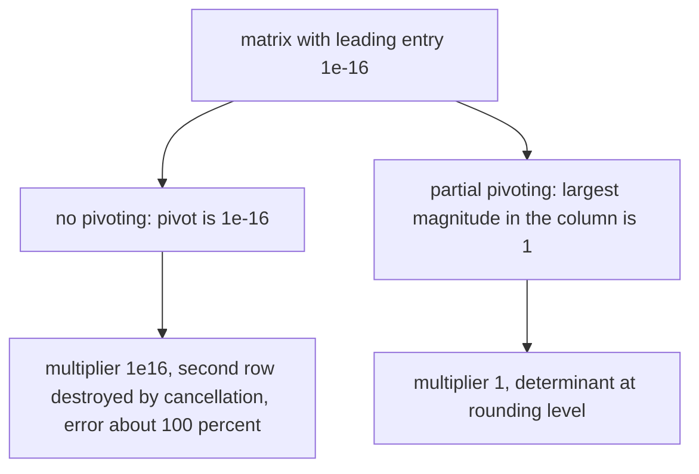
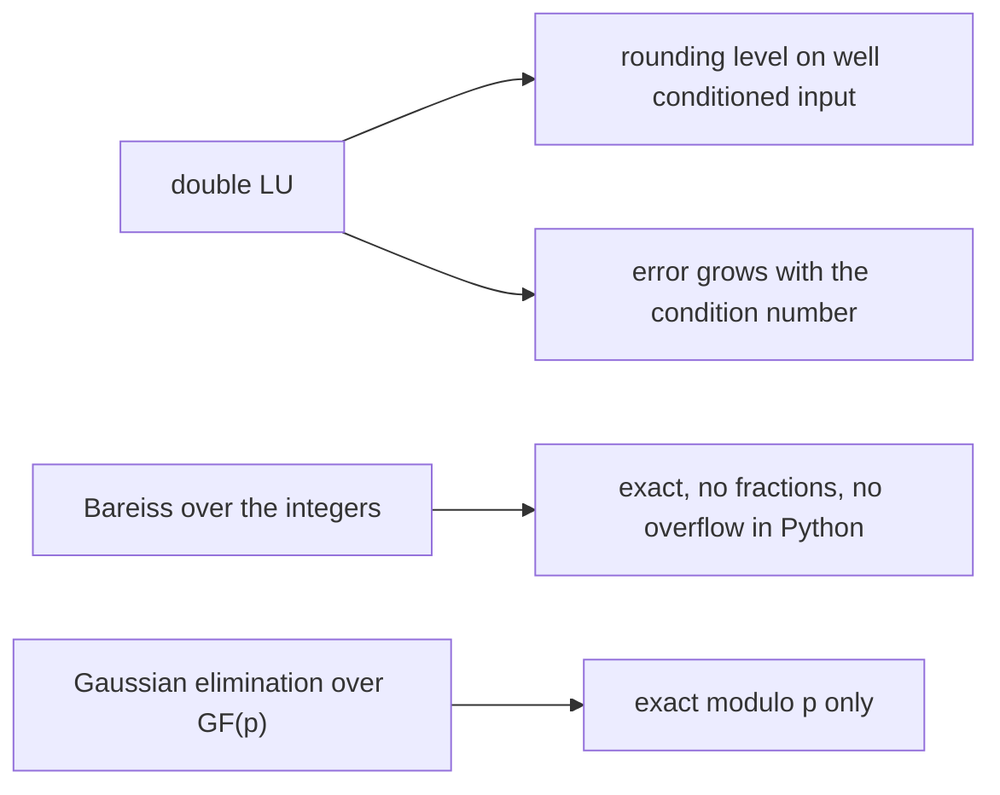
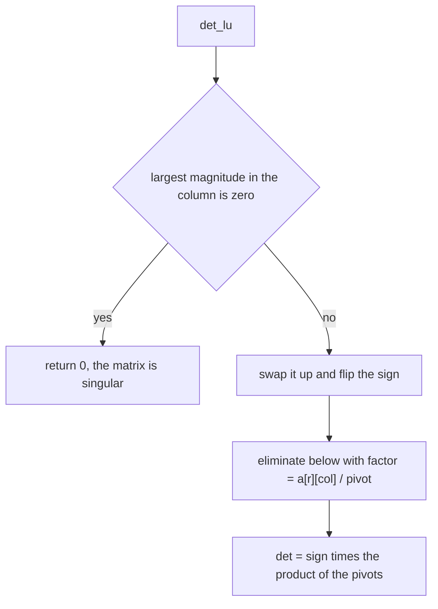
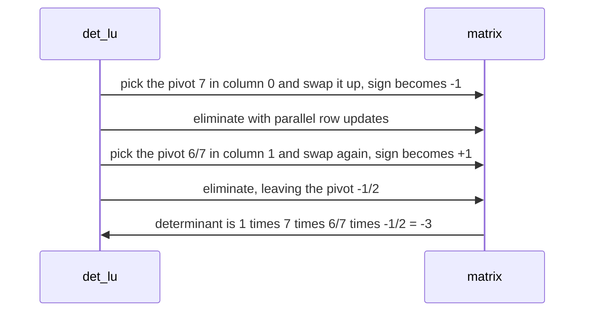

# 587 — Implement matrix determinant via LU decomposition (modular or double).

> **Tier:** Advanced · **CTCI chapter:** Beyond — Numerical & Scientific Computing
> **Task spec:** [587-implement-matrix-determinant-via-lu-decomposition-modular-or-dou.md](../../../tasks/advanced/587-implement-matrix-determinant-via-lu-decomposition-modular-or-dou.md)
> **Solutions:** [Python](../../../solutions/python/advanced/587-implement-matrix-determinant-via-lu-decomposition-modular-or-dou/solution.py) ·
> [Java](../../../solutions/java/advanced/587-implement-matrix-determinant-via-lu-decomposition-modular-or-dou/Solution.java) ·
> [JavaScript](../../../solutions/javascript/advanced/587-implement-matrix-determinant-via-lu-decomposition-modular-or-dou/solution.js) ·
> [C#](../../../solutions/csharp/advanced/587-implement-matrix-determinant-via-lu-decomposition-modular-or-dou/Solution.cs)

## 1. Problem restatement

**Input:** a square matrix, over the reals, over the integers, or over `GF(p)`.

**Output:** the determinant, computed three ways — each exact in a different sense — plus one
deliberately broken variant kept to demonstrate the classic failure:

| Route | Code | Exactness |
| --- | --- | --- |
| LU with partial pivoting (double) | `det_lu` → `(det, swaps)` | correct to rounding, rows swapped by largest magnitude, sign flipped per swap |
| no pivoting at all | `det_lu_no_pivot` | included **to fail**: on a matrix whose leading entry is `1e-16` the computed determinant is off by about 100 % |
| fraction-free elimination (integers) | `det_bareiss` | exact for integer input; every division by the previous pivot is exact, so no rationals appear and nothing overflows |
| elimination over `GF(p)` | `det_mod_p` | exact modulo the prime, pivots inverted with `pow(pivot, p - 2, p)` |
| exact rational LU | `det_fraction` | the reference the float answers are compared against |

The verification battery is a mix of hand-computed values and structural identities:

| Check | What it pins down |
| --- | --- |
| hand-computed `2x2` and `3x3` | `det([[1,2],[3,4]]) = -2`, `det([[1,2,3],[4,5,6],[7,8,10]]) = -3` |
| identity, diagonal, triangular | the product of the diagonal, and `det(I) = 1` |
| permutation matrices | the sign of the permutation |
| singular matrices | exactly `0` (a repeated row, a zero row, a rank-degenerate matrix) |
| Vandermonde | `prod_{i<j} (x_j - x_i)`, the closed form |
| `det(Aᵀ) = det(A)`, row scaling by `c`, row swap, add-a-multiple invariance | the elementary-row-operation laws |
| `det(AB) = det(A)·det(B)` | multiplicativity, exact with Bareiss and modulo `p` |
| 200 random integer matrices | three-way agreement between the double, the Bareiss and the modular routes |

## 2. Intuition

Elimination without pivoting is the textbook algorithm: for each column, divide the rows below by the
current pivot and subtract. It is also the classic numerical trap. On

```
A = [ 1e-16   1 ]
    [ 1       1 ]
```

the leading entry is a legal pivot, so the multiplier is `1 / 1e-16 = 1e16`, and the second row is
computed as `row2 - 1e16 · row1` — the subtraction destroys the row through cancellation. The
determinant comes out wrong by roughly 100 %, even though the matrix is perfectly well conditioned.
Exchanging the two rows first makes the pivot `1` and leaves the answer at rounding level. That is the
whole reason partial pivoting exists, and the file keeps the broken variant so the failure is
reproducible rather than described.



The second insight is that the same elimination can be exact. Bareiss' variant replaces each update by

```
a[i][j] = (a[i][j] · pivot - a[i][k] · a[k][j]) // previous_pivot
```

and the division by the previous pivot is provably exact, so every intermediate stays an integer.
Nothing needs to be a fraction, no denominator blows up, and the final pivot times the sign is the
determinant. The modular variant gets exactness differently: it works in `GF(p)`, where every non-zero
element has an inverse, so elimination is division-free in spirit — divide by multiplying with the
inverse — and the answer is exact modulo `p`.



The honest caveat the header records: double-precision LU is **not** exact on ill-conditioned input.
For the `6x6` Hilbert matrix the file computes the exact 1-norm condition number from the exact rational
inverse and asserts that the measured relative error of the double determinant, compared against the
closed form `(prod_{i<n} i!)⁴ / prod_{i<2n} i!`, lies within `n · eps · cond_1`, which is about `1e-8`
here — seven digits lost, far worse than machine epsilon. The exact routes agree with the closed form
bit for bit, and the difference between the two statements is the point of the task.

## 3. Algorithm

**Double LU with partial pivoting.** For each column: pick the row with the largest absolute value in
that column, swap it up (flipping the sign), and eliminate below. The determinant is the sign times the
product of the pivots.

```text
function det_lu(matrix)
    n ← number of rows
    a ← matrix as doubles
    sign ← 1
    for col from 0 to n - 1 do
        pivot_row ← row in [col, n) with the largest |a[row][col]|
        if a[pivot_row][col] == 0 then
            return 0, swaps                      # singular
        end
        if pivot_row != col then
            swap rows col and pivot_row
            sign ← -sign
        end
        for r from col + 1 to n - 1 do
            factor ← a[r][col] / a[col][col]
            for c from col + 1 to n - 1 do
                a[r][c] ← a[r][c] - factor * a[col][c]
            end
        end
    end
    det ← sign
    for i from 0 to n - 1 do
        det ← det * a[i][i]
    end
    return det, swaps
end
```

**Bareiss over the integers.** The same elimination with two changes: a zero pivot triggers a search
for a non-zero one below (returning `0` when the column is entirely zero), and the update divides by the
previous pivot, which is exact.

```text
function det_bareiss(matrix)
    a ← matrix as integers
    sign ← 1
    previous ← 1
    for k from 0 to n - 2 do
        if a[k][k] == 0 then
            find r > k with a[r][k] != 0
            if none then return 0 end
            swap rows k and r
            sign ← -sign
        end
        pivot ← a[k][k]
        for i from k + 1 to n - 1 do
            for j from k + 1 to n - 1 do
                a[i][j] ← (a[i][j] * pivot - a[i][k] * a[k][j]) / previous
            end
        end
        previous ← pivot
    end
    return sign * a[n - 1][n - 1]
end
```

**Elimination over `GF(p)`.** Every entry is reduced modulo `p`; a column whose entries are all zero
modulo `p` means the determinant is `0`; otherwise the pivot's inverse multiplies the row being
eliminated.

```text
function det_mod_p(matrix, modulus)
    a ← matrix reduced modulo modulus
    det ← 1
    for col from 0 to n - 1 do
        pivot_row ← first row in [col, n) with a[row][col] != 0 modulo modulus
        if pivot_row is none then
            return 0
        end
        if pivot_row != col then
            swap rows col and pivot_row
            det ← -det
        end
        pivot ← a[col][col] modulo modulus
        det ← det * pivot modulo modulus
        inverse ← pivot raised to modulus - 2 modulo modulus
        for r from col + 1 to n - 1 do
            if a[r][col] != 0 modulo modulus then
                factor ← a[r][col] * inverse modulo modulus
                for c from col to n - 1 do
                    a[r][c] ← (a[r][c] - factor * a[col][c]) modulo modulus
                end
            end
        end
    end
    return det modulo modulus
end
```



## 4. Worked example

**A `2x2` by double LU with pivoting.** `A = [[1, 2], [3, 4]]` has determinant `1·4 - 2·3 = -2`.

| Step | Action | Matrix state | `sign` |
| --- | --- | --- | --- |
| start | — | `[[1, 2], [3, 4]]` | `1` |
| col 0 | `3` is larger in magnitude, swap rows | `[[3, 4], [1, 2]]` | `-1` |
| col 0 | `factor = 1/3`, `a[1][1] = 2 - (1/3)·4 = 2/3` | `[[3, 4], [0, 2/3]]` | `-1` |
| end | `det = -1 · 3 · (2/3)` | — | `-2.0` |

Without pivoting the pivot would be `1`, the factor `3`, and `a[1][1] = 4 - 3·2 = -2`, giving
`det = 1 · 1 · (-2) = -2` as well — for this matrix the two routes agree, which is exactly why a
well-conditioned `2x2` is a poor test and why the file keeps the `1e-16` case.

**The same `2x2` by Bareiss.** `previous = 1`, `pivot = a[0][0] = 1`, and the only update is
`a[1][1] = (4·1 - 3·2) / 1 = -2`. The loop ends and the determinant is `sign · a[1][1] = -2`, an exact
integer with no division remainder anywhere.

**A `3x3` needing two swaps.** `B = [[1,2,3],[4,5,6],[7,8,10]]` has determinant `-3` by the cofactor
formula. Partial pivoting picks row 2 first (entry `7`), then row 2 again in the second column:

| Column | Pivot chosen | Swap | `sign` | Row reduction | Matrix after |
| --- | --- | --- | --- | --- | --- |
| 0 | `7` (row 2) | rows 0 ↔ 2 | `-1` | `row1 - (4/7)row0`, `row2 - (1/7)row0` | `[[7, 8, 10], [0, 3/7, 2/7], [0, 6/7, 11/7]]` |
| 1 | `6/7` (row 2) | rows 1 ↔ 2 | `+1` | `row2 - (1/2)row1` | `[[7, 8, 10], [0, 6/7, 11/7], [0, 0, -1/2]]` |
| 2 | `-1/2` | none | `+1` | — | — |

`det = 1 · 7 · (6/7) · (-1/2) = -3`, and the two swaps flipped the sign twice, so the parity is even.
The same matrix over `GF(p)` with `p = 998244353` returns `p - 3`, the residue of `-3`; and Bareiss
returns `-3` exactly, which is how the three routes are cross-checked on 200 random integer matrices.



**The failure the file demonstrates.** For `[[1e-16, 1], [1, 1]]` the no-pivot route takes the pivot
`1e-16`, computes the multiplier `1e16`, and forms `a[1][1] = 1 - 1e16 · 1 = -1e16 + 1`, which rounds to
`-1e16`: one of the two significant digits of the true value is gone. The computed determinant is `-1`
instead of the correct `1e-16 - 1`, i.e. wrong by about 100 %. Partial pivoting swaps the rows, uses the
pivot `1`, and produces the determinant at the rounding level.

## 5. Complexity

Let `n` be the matrix order.

| Measure | Bound | Why it holds |
| --- | --- | --- |
| `det_lu` | O(n³) time, O(n²) space | one elimination pass per column with a parallel row update; the copy of the input is `O(n²)` |
| Pivot search | O(n) per column, so O(n²) total | a linear scan of the column, negligible next to the cubic elimination |
| `det_bareiss` | O(n³) integer operations, O(n²) space | identical elimination shape with exact integer arithmetic; the intermediate sizes grow, which is the real cost in fixed-width languages |
| `det_mod_p` | O(n³) modular operations plus O(n) modular inverses | each inverse is `pow(pivot, p - 2, p)`, i.e. `O(log p)` multiplications |
| `det_fraction` | O(n³) rational operations | exact but with growing numerators and denominators — why it is used only as a reference |
| Numerical error, double | within `n · eps · cond_1` | the header's measured statement: on the `6x6` Hilbert matrix this is about `1e-8`, not machine epsilon |
| Numerical error, Bareiss and modular | zero | exact integers / exact residues |

The three-way agreement on random integer matrices is what makes the error statements concrete: the
double route is compared against the exact one with a tolerance, while Bareiss and the modular route
are compared with equality.

## 6. Pitfalls and edge cases

- **No pivoting is not a shortcut, it is a bug.** The `1e-16` example produces a determinant wrong by
  about 100 %; partial pivoting fixes it with an `O(n)` scan per column.
- **Zero pivots.** A zero pivot in the current column means the determinant is `0` for the double route,
  triggers a row search in Bareiss, and triggers a row search modulo `p`; all three paths are asserted
  on singular inputs (repeated row, zero row, rank-deficient `3x3`).
- **Sign bookkeeping.** Every swap flips the sign, and the parity is what the permutation-matrix tests
  check; forgetting a swap in the modular route changes the residue without changing the singularity.
- **Exact divisions in Bareiss.** Dividing by the previous pivot (initialised to `1`) is exact by
  construction; using integer division on a non-exact quotient silently truncates and corrupts the
  elimination.
- **Overflow in fixed-width languages.** Bareiss avoids rationals but not large magnitudes; the Python
  solution is unbounded, and the header notes that overflow is not handled by the double version.
- **Modular answers are residues.** `det_mod_p` returning `p - 3` is the determinant `-3`; a matrix whose
  true determinant is a multiple of `p` returns `0`, which is correct modulo `p` and misleading if read
  as an integer.
- **`det(AB) = det(A)·det(B)` is the multiplicativity check.** It is asserted exactly with Bareiss and
  modulo `p`, which catches sign errors that single-matrix comparisons hide.
- **The Vandermonde closed form.** `prod_{i<j} (x_j - x_i)` is the only nontrivial analytic value in the
  battery; it exercises rows that are not multiples of each other and pivots that change sign.

## 7. Variants and follow-ups

- **Reuse the factorization.** LU with partial pivoting is the same elimination used to solve systems
  and to invert from the augmented form — see the Gaussian-elimination inverse in
  [588-implement-matrix-inverse-with-gaussian-elimination-careful-with.md](../../../tasks/advanced/588-implement-matrix-inverse-with-gaussian-elimination-careful-with.md).
- **Exactness by another route.** Polynomial transforms over `GF(p)` face the same exactness-versus-
  modulus trade — [585-implement-modular-fft-for-polynomial-multiplication-ntt-small-pr.md](../../../tasks/advanced/585-implement-modular-fft-for-polynomial-multiplication-ntt-small-pr.md).

## 8. Check yourself

1. Why does partial pivoting make the `1e-16` example correct without changing the algorithm?

<details><summary>Show answer</summary>

Because the elimination itself is fine — the problem is the *order* of the rows. Choosing the
largest-magnitude entry in the column puts `1` in the pivot position, the multiplier becomes `1`, and the
update `1 - 1·1` keeps both significant digits instead of rounding `1 - 1e16` to `-1e16`. Row exchanges
only change the sign, which the algorithm tracks.

</details>

2. What makes the Bareiss division exact?

<details><summary>Show answer</summary>

The update `(a[i][j] · pivot - a[i][k] · a[k][j]) / previous` is a determinant of a submatrix
(Sylvester's identity): dividing by the previous pivot gives the next minor. Because the determinant is
an integer for integer input, the quotient is an integer by construction — that is why the file can use
exact integer division and why no fractions appear.

</details>

3. The modular route returned `998244351` for a matrix whose true determinant is `-2`. Is that a bug?

<details><summary>Show answer</summary>

No. The route computes the determinant modulo `p`, and `998244351 = 998244353 - 2` is `-2 mod p`. That
is the documented limitation of the modular approach: it is exact modulo `p`, so a determinant that is a
multiple of `p` reports `0`, and the integer value has to be recovered by other means (for example, a
second modulus combined with the Chinese remainder theorem, or a bound on the determinant).

</details>

4. Why does the file keep `det_lu_no_pivot` if it is known to be wrong?

<details><summary>Show answer</summary>

So the failure is measured rather than asserted from folklore: on the matrix whose leading entry is
`1e-16` the computed determinant is off by about 100 % while the pivoted route stays at the rounding
level, and the permutation/singularity tests confirm the rest of the code is unchanged. A wrong variant
that the reader can run is stronger evidence than a comment.

</details>

5. What exactly does the Hilbert-matrix check measure?

<details><summary>Show answer</summary>

The exact 1-norm condition number is computed from the exact rational inverse, and the relative error of
the double determinant against the closed form `(prod_{i<n} i!)⁴ / prod_{i<2n} i!` is asserted to stay
within `n · eps · cond_1` — about `1e-8` for `6x6`, i.e. seven digits lost. The same file asserts that
the Bareiss and modular routes reproduce the closed form bit for bit, which is the honest statement that
the loss comes from the input's conditioning, not from the elimination.

</details>