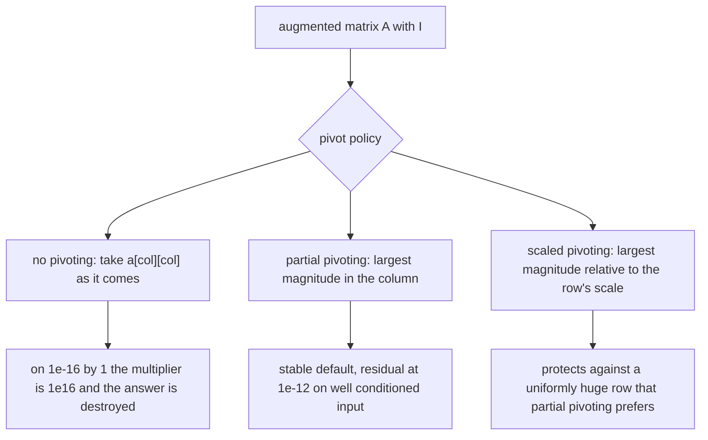
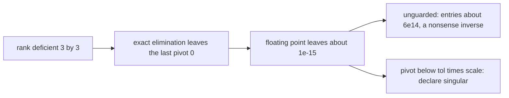
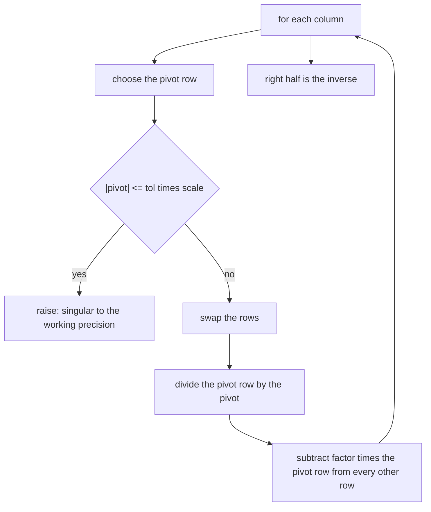
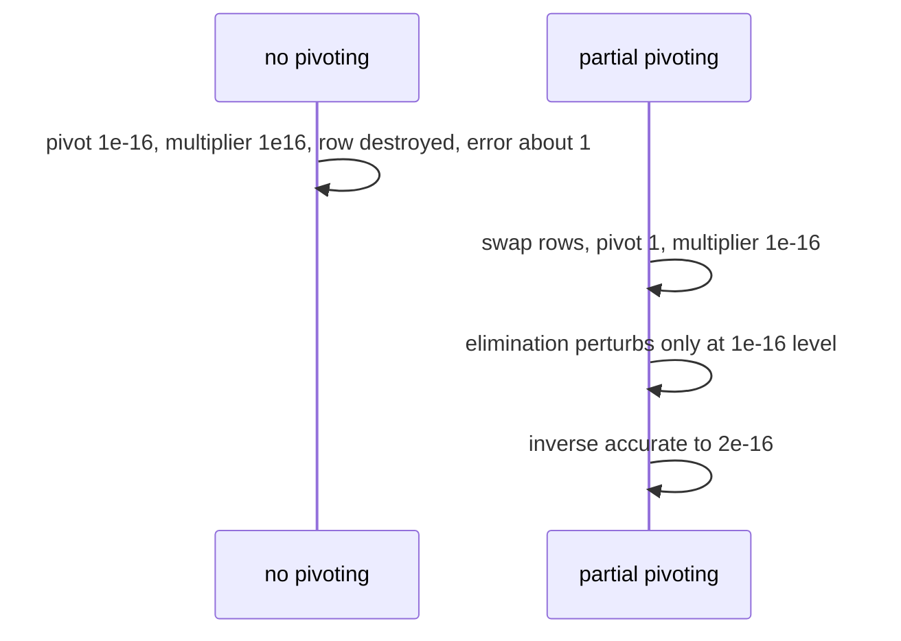

# 588 — Implement matrix inverse with Gaussian elimination (careful with numeric).

> **Tier:** Advanced · **CTCI chapter:** Beyond — Numerical & Scientific Computing
> **Task spec:** [588-implement-matrix-inverse-with-gaussian-elimination-careful-with.md](../../../tasks/advanced/588-implement-matrix-inverse-with-gaussian-elimination-careful-with.md)
> **Solutions:** [Python](../../../solutions/python/advanced/588-implement-matrix-inverse-with-gaussian-elimination-careful-with/solution.py) ·
> [Java](../../../solutions/java/advanced/588-implement-matrix-inverse-with-gaussian-elimination-careful-with/Solution.java) ·
> [JavaScript](../../../solutions/javascript/advanced/588-implement-matrix-inverse-with-gaussian-elimination-careful-with/solution.js) ·
> [C#](../../../solutions/csharp/advanced/588-implement-matrix-inverse-with-gaussian-elimination-careful-with/Solution.cs)

## 1. Problem restatement

**Input:** a square matrix `A`.

**Output:** `A⁻¹`, computed by Gauss-Jordan elimination on the augmented system `[A | I]` with three
pivot policies, each compared against two exact references:

| Function | Pivot policy |
| --- | --- |
| `inverse_gauss_jordan(matrix, tol=1e-12)` | partial pivoting: the largest-magnitude entry in the column |
| `inverse_scaled_pivot(matrix, tol=1e-12)` | scaled partial pivoting: rank rows by `|a[r][c]| / max_j |a[r][j]|` |
| `inverse_no_pivot(matrix)` | none — kept only to exhibit the failure |
| `inverse_fraction(matrix)` | exact rational Gauss-Jordan: the reference for every float comparison |
| `adjugate_inverse(matrix)` | the cofactor formula `A⁻¹ = adj(A)/det(A)` for `1x1 .. 3x3`, sharing no code with elimination |
| `lu_solve(matrix, rhs)` | solve `A x = b` by LU with partial pivoting plus forward/back substitution |

`tol` is a **documented numerical-rank threshold** relative to the largest entry of the input: a pivot
below it is treated as zero.

| Check | What it pins down |
| --- | --- |
| `A·A⁻¹ = I` and `A⁻¹·A = I` | both sides of the identity, to `1e-12` on well-conditioned input |
| `(A⁻¹)⁻¹ = A` | the round trip |
| the `2x2` closed form | `1/(ad - bc)` times the swapped diagonal |
| diagonal and triangular structure | the inverse of an upper triangular matrix is upper triangular, with reciprocal diagonal |
| permutation matrices | the inverse is the transpose and is exactly integral |
| unimodular integer matrices | the inverse is exactly integral |
| `inverse(cA) = inverse(A)/c` | scaling invariance |
| singular inputs | rejected by **every** route: `[[1,2],[2,4]]`, the rank-2 matrix of `1..9`, a zero row |
| random integer matrices | agreement between the elimination route, the rational reference and the adjugate |
| `A x = b` | consistent solve both by `lu_solve` and by multiplying with the inverse |

The numerical statement is asserted, not hidden.

> On well-conditioned instances the residual `||I - A X||` sits at `1e-12` or better, but on an
> ill-conditioned matrix it does **not** stay at rounding level — it grows with the condition number.
> For the `5x5` Hilbert matrix the exact 1-norm condition number from the rational inverse is
> `cond_1 ≈ 9.4e5`, and the measured relative error is asserted to stay under `10 · eps · cond_1 ≈ 2e-9`.

## 2. Intuition

Inverting a matrix is solving `n` linear systems at once, and Gauss-Jordan does it by turning `[A | I]`
into `[I | A⁻¹]` with row operations. Each step picks a pivot, divides its row by the pivot, and
eliminates that column from every other row. The row operations are exact in exact arithmetic — which is
why the failure mode is never "the algorithm is wrong" but always "the pivot was chosen badly".

The classic bad choice is no choice at all. On

```
A = [ 1e-16   1 ]
    [ 1       1 ]
```

the first pivot is `1e-16`, the multiplier for the second row is `1e16`, and the update destroys the row
by cancellation: the computed inverse has an absolute error of about `1`, while the pivoted route stays
at `2e-16`. Swapping the two rows — a change that only reorders the unknowns — fixes it completely.



The second insight is that floating point cannot decide *rank* by itself. Eliminating the rank-2 matrix
`[[1,2,3],[4,5,6],[7,8,9]]` leaves a last pivot of about `1e-15` rather than `0`, because the entries are
not exactly representable; an unguarded route happily divides by it and returns an "inverse" with
entries around `6e14`. The fix is the documented `tol`: a pivot below `tol × scale` — where `scale` is
the largest magnitude in the input — is treated as zero and the matrix is declared singular to the
working precision.



## 3. Algorithm

1. **Scale.** `scale = max(largest magnitude in the input, 1.0)` — the reference for the rank threshold.
2. **Augment.** Build `[A | I]` as doubles.
3. **Row scales (scaled variant only).** `scales[r] = max_j |aug[r][j]|`, kept in step with row swaps.
4. **For each column.** Choose the pivot row — largest `|aug[r][col]|` for partial pivoting, largest
   `|aug[r][col]| / scales[r]` for scaled pivoting. If `|pivot| <= tol · scale`, raise: singular to the
   working precision. Swap the rows (and the scales).
5. **Normalize and eliminate.** Divide the pivot row by the pivot, then for every other row with a
   non-zero entry in that column, subtract `factor · pivot_row`.
6. **Extract.** The right half of the augmented matrix is `A⁻¹`.

```text
function inverse_gauss_jordan(matrix, tol)
    scale ← maximum magnitude in matrix, or 1
    augmented ← [A | I] as doubles
    for col from 0 to n - 1 do
        pivot_row ← row in [col, n) with the largest |augmented[row][col]|
        if |augmented[pivot_row][col]| <= tol * scale then
            raise "singular matrix to the working precision"
        end
        swap rows col and pivot_row
        pivot ← augmented[col][col]
        augmented[col] ← augmented[col] / pivot
        for r from 0 to n - 1 do
            if r != col and augmented[r][col] != 0 then
                factor ← augmented[r][col]
                augmented[r] ← augmented[r] - factor * augmented[col]
            end
        end
    end
    return the right half of augmented
end
```

```text
function inverse_fraction(matrix)
    augmented ← [A | I] as exact rationals
    for col from 0 to n - 1 do
        pivot_row ← first row in [col, n) with augmented[row][col] != 0
        if none then raise "singular matrix" end
        swap rows col and pivot_row
        pivot ← augmented[col][col]
        augmented[col] ← augmented[col] / pivot
        for r from 0 to n - 1 do
            if r != col and augmented[r][col] != 0 then
                augmented[r] ← augmented[r] - augmented[r][col] * augmented[col]
            end
        end
    end
    return the right half of augmented
end

function adjugate_inverse(matrix)
    return transpose of cofactor matrix divided by the determinant
end
```



## 4. Worked example

**The `1e-16` failure, step by step.** `A = [[1e-16, 1], [1, 1]]`, true inverse coefficients of order
`1`. With no pivoting:

| Step | Operation | Augmented state (left half) |
| --- | --- | --- |
| start | — | `[[1e-16, 1], [1, 1]]` |
| normalize row 0 | divide by `1e-16` | `[[1, 1e16], [1, 1]]` |
| eliminate row 1 | `factor = 1`, `row1 = row1 - 1·row0` | `[[1, 1e16], [0, 1 - 1e16]]` |
| normalize row 1 | divide by `1 - 1e16 ≈ -1e16` | `[[1, 1e16], [0, 1]]` |

The `1 - 1e16` subtraction threw away the `1`, and the resulting inverse carries an absolute error of
about `1`. With partial pivoting the two rows are exchanged first, the pivot is `1`, and the elimination
`row1 = row1 - 1e-16·row0` only perturbs the last row by `1e-16`; the inverse is accurate to `2e-16`,
which is the number the file records.



**Rank deficiency and the tolerance.** For `B = [[1,2,3],[4,5,6],[7,8,9]]` the elimination produces a
last pivot around `1e-15` instead of `0`. The threshold `tol · scale` with `tol = 1e-12` and
`scale = 9` is about `9e-12`, so the tiny pivot is recognized as zero and the routine raises
"singular matrix (to the working precision)". With `tol = 0.0` the same code divides by `1e-15` and
returns entries around `6e14` — a plausible-looking matrix that satisfies none of the inverse
identities. That is why `tol` is a parameter with a documented meaning rather than a constant.

**A correct example, `A = [[4, 7], [2, 6]]`.** `det = 10`, so `A⁻¹ = (1/10)·[[6, -7], [-2, 4]]`:

| Step | Pivot | Operation | Augmented left half |
| --- | --- | --- | --- |
| start | — | — | `[[4, 7], [2, 6]]` |
| col 0 | `4` (row 0 is already largest) | `row0 /= 4`, `row1 -= 2·row0` | `[[1, 7/4], [0, 5/2]]` |
| col 1 | `5/2` | `row1 /= (5/2)`, `row0 -= (7/4)·row1` | `[[1, 0], [0, 1]]` |

Reading the right half gives `[[6/10, -7/10], [-2/10, 4/10]]`, and `A·A⁻¹ = I` exactly for this
instance — the well-conditioned case where the residual sits at `1e-12` or better. The same matrix also
runs through `inverse_scaled_pivot` (row scales `7` and `6`, so the ranking is `4/7` versus `2/6`, still
favoring row 0), `inverse_fraction` (exact rationals, bit-for-bit agreement) and `adjugate_inverse`
(`2x2`, cofactor formula, sharing no code with the elimination).

**Ill-conditioning.** For the `5x5` Hilbert matrix the file computes the exact 1-norm condition number
from the exact rational inverse, `cond_1 ≈ 9.4e5`, and asserts that the measured relative error against
the rational reference stays under `10 · eps · cond_1 ≈ 2e-9`. On the integer test matrices, whose
determinants have modest magnitude, the two routes agree to `1e-9` relative because the rational route
rebuilds the exact inverse.

## 5. Complexity

Let `n` be the matrix order.

| Measure | Bound | Why it holds |
| --- | --- | --- |
| `inverse_gauss_jordan` | O(n³) time, O(n²) space | `n` columns, each normalizing a row of length `2n` and updating `n` rows of length `2n` |
| Pivot selection | O(n) per column | a linear scan, `O(n²)` overall |
| `inverse_scaled_pivot` | O(n³) plus O(n²) for the scales | the ranking divides by a precomputed row scale |
| `inverse_fraction` | O(n³) rational operations | exact, but numerators and denominators grow — legal only as a reference |
| `adjugate_inverse` | O(n⁴) or worse | `n²` determinants for the cofactors; shipped for `1x1 .. 3x3` where sharing no code matters more than speed |
| `lu_solve` | O(n³) factor plus O(n²) substitution | the same elimination, reused for one right-hand side |
| Residual, well conditioned | `1e-12` or better | asserted as `||I - A X||` |
| Residual, ill conditioned | grows like `cond_1` | asserted for the `5x5` Hilbert matrix as below `10 · eps · cond_1 ≈ 2e-9` |
| Rank decision | exact up to `tol · scale` | floating point cannot distinguish a zero pivot from `1e-15`, which is why the threshold exists |

The point of shipping three pivot policies is comparative: partial pivoting is the default because it is
asymptotically free, scaled pivoting is the fix when a row's magnitude is uniformly large, and
no-pivoting is present only as the measured failure.

## 6. Pitfalls and edge cases

- **Singularity must be detected, not divided by.** Every route rejects `[[1,2],[2,4]]`, the rank-2 `1..9`
  matrix and a matrix with a zero row; the check is `|pivot| <= tol · scale`, with `scale` the largest
  magnitude in the input rather than of the current column.
- **`tol` has a meaning.** It is a relative rank threshold, not an arbitrary epsilon: `tol = 1e-12` with
  `scale = 9` treats pivots below `9e-12` as zero, which is what turns the `1e-15` residue of a rank-2
  matrix into a clean rejection.
- **`(A⁻¹)⁻¹ = A` catches scale errors.** A missing normalization step can still satisfy one of the two
  inverse identities in special cases; the round trip and the `2x2` closed form catch it in general.
- **Triangular structure is a shape check.** The inverse of an upper triangular matrix must be upper
  triangular with reciprocals on the diagonal; the file asserts that rather than only comparing numbers.
- **Permutation matrices are the exact-integrality check.** Their inverse is the transpose and contains
  only `0`s and `1`s, so any rounding at all shows up immediately.
- **Scaling invariance.** `inverse(cA) = inverse(A)/c` must hold for any non-zero `c`; a route that
  mishandles the pivot normalization breaks it.
- **Scaled pivoting can disagree with plain partial pivoting.** On the random instances in the file the
  two policies agree to about `1e-12`, but they are not the same rule: scaled pivoting ranks by
  `|a[r][c]| / max_j |a[r][j]|`, which is what protects against a row that is uniformly huge.
- **Column order follows the row swaps.** Swapping rows must swap the corresponding row scales in the
  scaled variant; otherwise the ranking uses a stale scale.
- **Consistency of solves.** `lu_solve` and multiplication by the inverse are both checked against a
  known solution, because a consistent `x` is a stronger statement than a small residual on one system.
- **Ill-conditioning is not a bug.** The `5x5` Hilbert error of about `2e-9` is asserted as the correct
  outcome for a matrix with `cond_1 ≈ 9.4e5`; hiding it behind exact comparison would make the test
  meaningless.

## 7. Variants and follow-ups

- **Determinants by the same elimination.** The product of the pivots is the determinant, and the modular
  route avoids floating point entirely — [587-implement-matrix-determinant-via-lu-decomposition-modular-or-dou.md](../../../tasks/advanced/587-implement-matrix-determinant-via-lu-decomposition-modular-or-dou.md).
- **Iterative refinement.** After an `O(n³)` factorization, a cheap residual solve can recover digits
  lost to the conditioning; the header's error bound tells you when that is worth doing.
- **Least squares when the matrix is not square.** The pseudo-inverse replaces `A⁻¹` and QR or the normal
  equations replace elimination — see the sparse-coder's use of ridge terms in
  [591-implement-k-svd-sketch-for-dictionary-learning-outline.md](../../../tasks/advanced/591-implement-k-svd-sketch-for-dictionary-learning-outline.md).
- **Structured inverses.** Triangular and permutation matrices have `O(n²)` inverses; recognizing the
  structure beats any pivot policy.
- **Eigen-based inversion.** A symmetric positive-definite matrix is inverted through its eigen
  decomposition, which is also how the spectral clustering task builds its operators —
  [589-implement-spectral-clustering-using-sparse-eigen-solver-power-it.md](../../../tasks/advanced/589-implement-spectral-clustering-using-sparse-eigen-solver-power-it.md).

## 8. Check yourself

1. Why does the file treat a pivot below `tol · scale` as zero?

<details><summary>Show answer</summary>

Because floating-point elimination cannot decide rank on its own: the rank-2 matrix of `1..9` leaves a
last pivot of about `1e-15` instead of `0`, and dividing by it produces an "inverse" with entries around
`6e14`. The threshold is relative to the largest magnitude in the input, so it scales with the problem;
pivots below it mean the matrix is singular to the working precision, and the routine raises instead of
returning nonsense.

</details>

2. On `[[1e-16, 1], [1, 1]]`, what exactly goes wrong without pivoting?

<details><summary>Show answer</summary>

The pivot is `1e-16`, so the multiplier for the second row is `1e16`, and the update forms
`1 - 1e16 · 1`, which rounds to `-1e16`: the `1` is annihilated by cancellation. The resulting inverse
has an absolute error of about `1`. Swapping the rows makes the pivot `1`, the multiplier `1e-16`, and
the answer accurate to `2e-16`.

</details>

3. What does scaled partial pivoting protect against that plain partial pivoting does not?

<details><summary>Show answer</summary>

A row that is uniformly huge: if every entry of row `r` is `1000` times larger than its neighbours, plain
partial pivoting may prefer that row even though its *relative* content in the column is tiny. Ranking by
`|a[r][c]| / max_j |a[r][j]|` compares candidates on a common scale, which is why the file implements
both policies and reports that they agree to `1e-12` on its well-scaled random instances.

</details>

4. Why is `adjugate_inverse` restricted to `1x1 .. 3x3`?

<details><summary>Show answer</summary>

Because the cofactor formula computes `n²` determinants, each `O(n³)`, which is far slower than Gauss-Jordan
for larger `n`. Its value here is independence: it shares no code and no intermediate representation with
the elimination routes, so agreement between the two is real evidence rather than a tautology.

</details>

5. A `5x5` Hilbert inverse shows a relative error of `2e-9`. Is that a failure of the implementation?

<details><summary>Show answer</summary>

No: the exact 1-norm condition number is about `9.4e5`, and the file asserts the measured error stays
under `10 · eps · cond_1 ≈ 2e-9`, which is precisely the accuracy attainable in double precision. The
same file shows the integer matrices agreeing to `1e-9` with the exact rational inverse, so the loss is
attributable to the input's conditioning, not to the pivot policy.

</details>