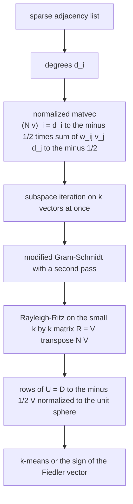
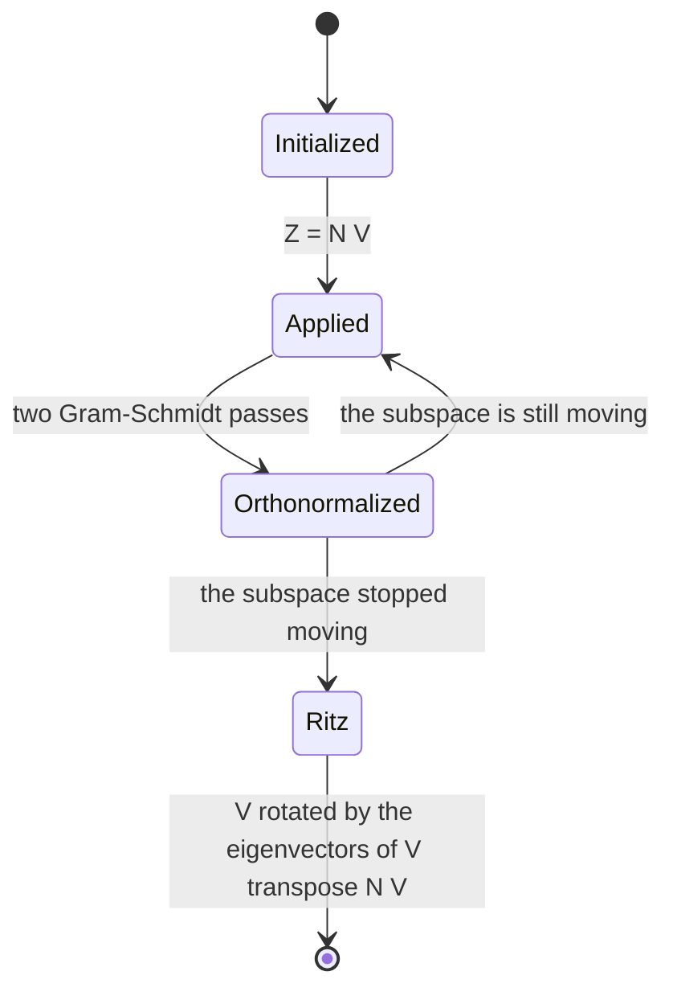
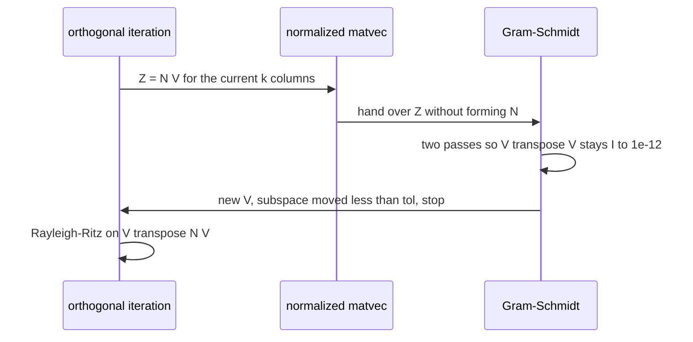

# 589 — Implement spectral clustering using sparse eigen solver (power iteration, multiple vectors).

> **Tier:** Advanced · **CTCI chapter:** Beyond — Machine Learning & AI
> **Task spec:** [589-implement-spectral-clustering-using-sparse-eigen-solver-power-it.md](../../../tasks/advanced/589-implement-spectral-clustering-using-sparse-eigen-solver-power-it.md)
> **Solutions:** [Python](../../../solutions/python/advanced/589-implement-spectral-clustering-using-sparse-eigen-solver-power-it/solution.py) ·
> [Java](../../../solutions/java/advanced/589-implement-spectral-clustering-using-sparse-eigen-solver-power-it/Solution.java) ·
> [JavaScript](../../../solutions/javascript/advanced/589-implement-spectral-clustering-using-sparse-eigen-solver-power-it/solution.js) ·
> [C#](../../../solutions/csharp/advanced/589-implement-spectral-clustering-using-sparse-eigen-solver-power-it/Solution.cs)

## 1. Problem restatement

**Input:** a small sparse graph — an adjacency list of dicts, one `{neighbour: weight}` map per vertex.

**Output:** a `k`-way partition of the vertices, computed from the graph's spectrum with an iterative
eigensolver instead of a dense decomposition. The operator that is iterated is the symmetric normalized
adjacency

```
N = D^(-1/2) W D^(-1/2)        (N v)_i = d_i^(-1/2) · Σ_{j ~ i} w_ij · v_j · d_j^(-1/2)
```

applied **matrix-free** by `normalized_matvec`, so no `n x n` dense matrix is ever formed.

| Stage | Function | Detail |
| --- | --- | --- |
| propagation | `orthogonal_iteration` | subspace iteration: `Z = N V`, then re-orthonormalize |
| orthonormalization | `gram_schmidt` | modified Gram-Schmidt **with a second re-orthogonalization pass** for conditioning |
| Rayleigh-Ritz | `jacobi_eigh` on `R = Vᵀ N V` | a small cyclic Jacobi sweep, then `V ← V · eigenvectors` |
| embedding | `normalized_rows` | rows of `U = D^(-1/2) V` normalized to the unit sphere |
| grouping | `kmeans` | deterministic farthest-point initialization |
| `k = 2` shortcut | `fiedler_split` | the sign of the combinatorial Fiedler vector `u2 = D^(-1/2) v2` |

The Rayleigh-Ritz step is what makes the returned vectors genuine eigenvector approximations rather than
merely a spanning set, and the `k = 2` shortcut is justified by the header: `u2` is orthogonal to the
positive vector `d^(1/2)·1` and therefore straddles `0`.

| Check | What it pins down |
| --- | --- |
| `λ1 = 1` within `1e-12` | the top eigenvalue of `N` |
| leading eigenvector equals `d^(1/2) / ||d^(1/2)||` | an **independent** closed form, not a self-consistency test |
| `||N v - λ v|| <= 1e-9` for every returned pair | the eigen-equation itself |
| `Vᵀ V = I` to `1e-12` | orthonormality after Gram-Schmidt |
| Rayleigh quotient matches `λ` | `vᵀ N v` consistency |
| top-`k` eigenvalues versus a dense cyclic Jacobi decomposition of the same `N` | second, independent method, agreement to `1e-9` |
| all eigenvalues in `[-1, 1]` | the theoretical range for the normalized adjacency |
| planted communities | the two-clique and three-clique graphs are split exactly along the planted groups |

## 2. Intuition

Clustering by spectrum rests on one observation: the eigenvectors of the normalized adjacency say how the
graph's mass distributes itself at different scales. The leading eigenvector is the trivial one — it is
proportional to `d^(1/2)`, the stationary distribution of the random walk — and the next ones encode the
cuts. Fiedler's idea is that the second eigenvector is *smooth within communities and changes sign
between them*, so its sign pattern is already a bipartition; for `k` communities, `k` eigenvectors give a
`k`-dimensional embedding in which the communities become well-separated points.

Computing those eigenvectors without a dense decomposition means never materialising `N`. The matvec is
applied vertex by vertex over the adjacency list:



Pure power iteration converges to the single dominant vector, which for a connected graph is the trivial
one — useless for clustering. Two ingredients fix that. First, iterate `k` vectors **simultaneously** and
re-orthonormalize after every application: the subspace spanned by the `k` dominant eigenvectors is stable,
so the iteration converges to it even though each individual vector does not converge to an eigenvector.
Second, finish with a **Rayleigh-Ritz** projection: `R = Vᵀ N V` is a `k x k` matrix whose eigenvectors,
pulled back through `V`, are the best eigenvector approximations inside the converged subspace.


The conditioning detail is not cosmetic: one Gram-Schmidt pass loses orthogonality when the vectors are
nearly parallel — exactly the situation after many applications of `N`, which pushes every column toward
the dominant one — so the file runs a second pass (`Vᵀ V = I` to `1e-12` is asserted) and it is that
orthogonality the whole method depends on.

## 3. Algorithm

1. **Graph.** `clique_graph(cliques, bridges)` builds weighted cliques joined by bridge edges; `degrees`
   accumulates `d_i = Σ_j w_ij`.
2. **Matvec.** `normalized_matvec(adjacency, weights, vector)` returns `d_i^(-1/2) · Σ_j w_ij v_j
   d_j^(-1/2)` by iterating each vertex's neighbour map only.
3. **Start.** `random_orthonormal(n, k, seed)` gives a deterministic orthonormal `k`-column start.
4. **Iterate.** Repeat `Z = N V`; re-orthonormalize `Z` with `gram_schmidt` (two passes); stop when the
   columns stop moving (relative change in `1e-13`, at most `1000` iterations).
5. **Rayleigh-Ritz.** Form `R = Vᵀ N V` (one extra matvec), diagonalize it with `jacobi_eigh`, and rotate
   `V ← V · Q`; the eigenvalues of `R` are the Ritz values, and the columns are the approximations.
6. **Embed.** `normalized_rows` builds `U = D^(-1/2) V` and scales every row to unit length.
7. **Cluster.** `kmeans(rows, k, seed)` groups the rows with deterministic farthest-point initialization;
   for `k = 2`, `fiedler_split` uses `sign(u2)` instead.

```text
procedure orthogonal_iteration(adjacency, weights, k)
    V ← random orthonormal n by k
    repeat up to max_iters times
        Z ← normalized_matvec(adjacency, weights, each column of V)
        Z ← gram_schmidt(Z)                      # two passes for conditioning
        if the columns of Z moved less than tol then break end
        V ← Z
    end
    R ← V transposed times normalized_matvec(adjacency, weights, V)
    eigenvalues, Q ← jacobi_eigh(R)
    V ← V times Q
    return V, eigenvalues
end
```

```text
function normalized_rows(V, weights, n)
    U ← rows i of V scaled by d_i to the minus 1/2
    for each row do
        if the row norm is above a small threshold then
            divide the row by its norm
        end
    end
    return U
end

function fiedler_split(adjacency, weights, u2)
    return the vertices with u2[i] < 0 and the vertices with u2[i] >= 0
end
```



## 4. Worked example

**The matrix-free matvec.** Take the four-vertex path `0-1-2-3` with unit weights, so `d = (1, 2, 2, 1)`.
Applying `N` to the all-ones vector `v = (1, 1, 1, 1)`:

| Vertex `i` | `d_i` | Neighbours and their `w_ij v_j / sqrt(d_j)` | `(N v)_i` |
| --- | --- | --- | --- |
| 0 | 1 | `1 / sqrt(1) = 1` | `1.0000 / sqrt(1) = 0.7071` |
| 1 | 2 | `1/sqrt(1) + 1/sqrt(2) = 1.7071` | `1.7071 / sqrt(2) = 1.2071` |
| 2 | 2 | `1/sqrt(2) + 1/sqrt(1) = 1.7071` | `1.7071 / sqrt(2) = 1.2071` |
| 3 | 1 | `1 / sqrt(1) = 1` | `1.0000 / sqrt(1) = 0.7071` |

Two things are visible in the result: the scaling acts on both sides of each edge (the `d_j^(-1/2)` on the
neighbour and the `d_i^(-1/2)` on the result), and the outcome is symmetric, as it must be because `N` is
symmetric.

**The leading eigenpair, checked against the closed form.** For any graph, `λ1 = 1` with
`v1 = d^(1/2) / ||d^(1/2)||`. Here `d^(1/2) = (1, 1.4142, 1.4142, 1)`, `||d^(1/2)|| = sqrt(6) = 2.4495`,
so `v1 = (0.4082, 0.5774, 0.5774, 0.4082)`. Applying `N` by hand: vertex `1` contributes
`(w_10 v1_0 / d_0^(1/2) + w_12 v1_2 / d_2^(1/2)) / d_1^(1/2) = (0.4082 + 0.5774 · 0.7071) / 1.4142 =
0.5774`, which is exactly `v1[1]`. The closed-form check the file performs is the identity `N v1 = v1`
numerically to `1e-12`, which is a statement independent of the iteration: it validates the matvec against
theory rather than against its own output.



**From the spectrum to clusters.** On the planted two-clique graph — two six-cliques joined by a single
edge — the leading eigenvector is the trivial `d^(1/2)`-shaped one, and the **second** vector is the
Fiedler vector: nearly constant with one sign inside each clique and changing sign between them. Because
`u2 = D^(-1/2) v2` is orthogonal to `d^(1/2)·1`, it must have entries of both signs, so
`fiedler_split` simply partitions by `sign(u2[i])` and recovers the planted communities exactly. For
`k = 3`, the three-clique graph (three five-cliques chained by single edges) is handled by the general
path: `V` has three columns, the rows of `U = D^(-1/2) V` are normalized to the unit sphere, and the three
communities appear as three tight groups that `kmeans` separates — the same graph split into three parts
along the planted edges. The file asserts that the resulting partitions equal the planted ones
(`same_partition`), and independently that the top-`k` Ritz values agree with a dense cyclic Jacobi
decomposition of the same `N` to `1e-9` and lie in `[-1, 1]`.

## 5. Complexity

Let `n` be the vertex count, `m` the number of edges, `k` the number of requested eigenvectors and `t`
the number of iterations.

| Measure | Bound | Why it holds |
| --- | --- | --- |
| One `normalized_matvec` for `k` vectors | O(k · m) | each vector is multiplied against the adjacency list once |
| Orthonormalization | O(n · k²) per iteration | Gram-Schmidt on `k` columns of length `n`, run twice |
| Orthogonal iteration | O(t · (k · m + n · k²)) | the two costs above, per iteration |
| Rayleigh-Ritz | O(k · m + k³) | one extra matvec plus a Jacobi sweep on a `k x k` matrix |
| Dense reference | O(n³) | `dense_normalized` plus `dense_spectrum`, used only as the independent check |
| Space | O(n · k + m) | the `k` columns and the adjacency list; never `O(n²)` |
| Convergence | linear in the spectral gap | the subspace converges at a rate set by the ratio of the `k`-th and `(k+1)`-th eigenvalues |

The comparison with the dense route is the reason the task exists: for a sparse graph, `O(m)` per
iteration beats `O(n²)` memory and `O(n³)` time, and the retained quantity is exactly the spectrum the
clustering needs.

## 6. Pitfalls and edge cases

- **The trivial eigenvector is useless for clustering.** `λ1 = 1` with `v1 ∝ d^(1/2)` carries no community
  information; clustering starts from the *second* vector, which is why the file asserts both the value
  `1` and the closed form of its eigenvector.
- **One Gram-Schmidt pass is not enough.** Repeated application of `N` makes the columns nearly parallel,
  and a single pass loses orthogonality exactly there; the second pass is what keeps `Vᵀ V = I` at `1e-12`.
- **Subspace iteration converges to the subspace, not to eigenvectors.** Turning the converged subspace
  into eigenvectors requires the Rayleigh-Ritz step; skipping it produces vectors that span the right
  space while each one satisfies `||N v - λ v||` badly.
- **Sign ambiguity.** An eigenvector is defined up to sign, so the file compares partitions
  (`same_partition`) and residuals rather than vectors.
- **Degenerate eigenvalues.** Repeated eigenvalues make individual vectors meaningless while the subspace
  stays well defined — another reason the assertions are about subspaces, Ritz values and partitions.
- **Disconnected graphs.** With more than one component, `λ = 1` has multiplicity equal to the number of
  components and the "second" vector already separates them; the file includes a single-community graph
  (`planted_one_community`) to check that nothing splits when there is nothing to split.
- **`k` larger than the useful spectrum.** Requesting more vectors than the graph has communities pulls
  in noise vectors, and `kmeans` then splits arbitrarily; the Ritz values in `[-1, 1]` and the dense
  comparison are the diagnostics.
- **Isolated vertices and zero degrees.** `d_i^(-1/2)` is undefined for `d_i = 0`, and `normalized_rows`
  guards rows whose norm is below a threshold instead of dividing by zero.
- **Determinism.** The start matrix, the k-means initialization and the Jacobi sweeps are all seeded, so
  repeated runs give equal partitions — and the random draws come from `splitmix64`, not from a
  short-cycle generator.
- **Tolerance, not equality.** `λ1 = 1` to `1e-12`, `||N v - λ v|| <= 1e-9`, orthonormality to `1e-12`:
  an iterative eigensolver has no exact answers, and the file states the tolerances it uses.

## 7. Variants and follow-ups

- **Dense spectral clustering.** The same graph and the same reasoning with a full eigen-decomposition is
  [500-implement-spectral-clustering-small-example-eigen-decomposition.md](../../../tasks/advanced/500-implement-spectral-clustering-small-example-eigen-decomposition.md) —
  useful to see what the iterative route replaces.
- **Rank-one power iteration.** The single-vector ancestor of this method, used for PCA, is
  [501-implement-pca-via-power-iteration-for-largest-eigenvector.md](../../../tasks/advanced/501-implement-pca-via-power-iteration-for-largest-eigenvector.md).
- **Randomized low-rank structure.** When the matrix is dense and only a few singular directions are
  needed, randomized SVD does the same job with random sketches —
  [502-implement-randomized-svd-basic-using-power-method.md](../../../tasks/advanced/502-implement-randomized-svd-basic-using-power-method.md).
- **Learning latent factors instead of a spectrum.** NMF finds non-negative parts rather than signed
  eigenvectors — [590-implement-non-negative-matrix-factorization-simple-multiplicativ.md](../../../tasks/advanced/590-implement-non-negative-matrix-factorization-simple-multiplicativ.md).
- **Dictionary learning over the same embeddings.** K-SVD alternates sparse coding with an atom update
  over patches of an embedding matrix —
  [591-implement-k-svd-sketch-for-dictionary-learning-outline.md](../../../tasks/advanced/591-implement-k-svd-sketch-for-dictionary-learning-outline.md).

## 8. Check yourself

1. Why does the file iterate `k` vectors at once instead of running power iteration `k` times?

<details><summary>Show answer</summary>

Because plain power iteration converges to the dominant eigenvector every time — for a connected graph
that is the trivial `d^(1/2)` vector, which carries no clustering information. Subspace iteration keeps
`k` orthonormal vectors and re-orthonormalizes after each matvec, so the *subspace* spanned by the `k`
dominant eigenvectors converges even though no individual column does; the Rayleigh-Ritz step then
extracts the eigenvectors from it.

</details>

2. What does the Rayleigh-Ritz step contribute?

<details><summary>Show answer</summary>

It turns the converged subspace into actual eigenvector approximations. `R = Vᵀ N V` is the compression of
`N` to that subspace, and its eigenvectors, pulled back through `V`, are the best approximations
available inside the subspace. That is why the returned pairs satisfy `||N v - λ v|| <= 1e-9` and why the
Ritz values agree with the dense decomposition of the same `N` to `1e-9`.

</details>

3. Why is `u2` (the combinatorial Fiedler vector) guaranteed to take both signs for a connected graph?

<details><summary>Show answer</summary>

Because `v2` is orthogonal to `v1 ∝ d^(1/2)`, hence `u2 = D^(-1/2) v2` satisfies
`Σ_i d_i^(1/2) u2_i = 0` — a weighted sum of the `u2` entries with strictly positive weights is zero, so
the entries cannot all have the same sign. That is exactly why the sign split is a valid bipartition and
why the `k = 2` case can skip k-means.

</details>

4. What breaks if Gram-Schmidt runs only one pass?

<details><summary>Show answer</summary>

Orthogonality. After several applications of `N` the columns are nearly parallel, and classical or single-pass
modified Gram-Schmidt loses most of the orthogonal component in that regime; the re-orthogonalization
pass restores it. The file asserts `Vᵀ V = I` to `1e-12`, a check that fails immediately without the
second pass.

</details>

5. The file tests the leading eigenvector against `d^(1/2)/||d^(1/2)||`. Why is that stronger than
   checking `λ1 = 1`?

<details><summary>Show answer</summary>

Because it is an independent identity from theory rather than a self-consistency check: it validates the
matrix-free matvec, the degree computation and the normalization all at once, and it pins the eigenvector
down to a specific vector instead of accepting any multiple of it. `λ1 = 1` alone would pass for a matvec
that returns the wrong direction inside the top eigenspace.

</details>