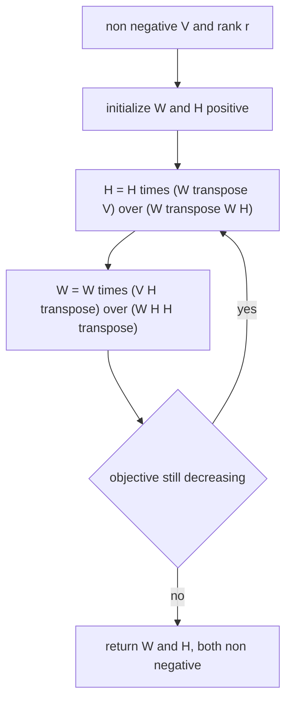
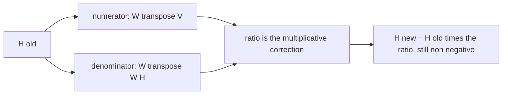
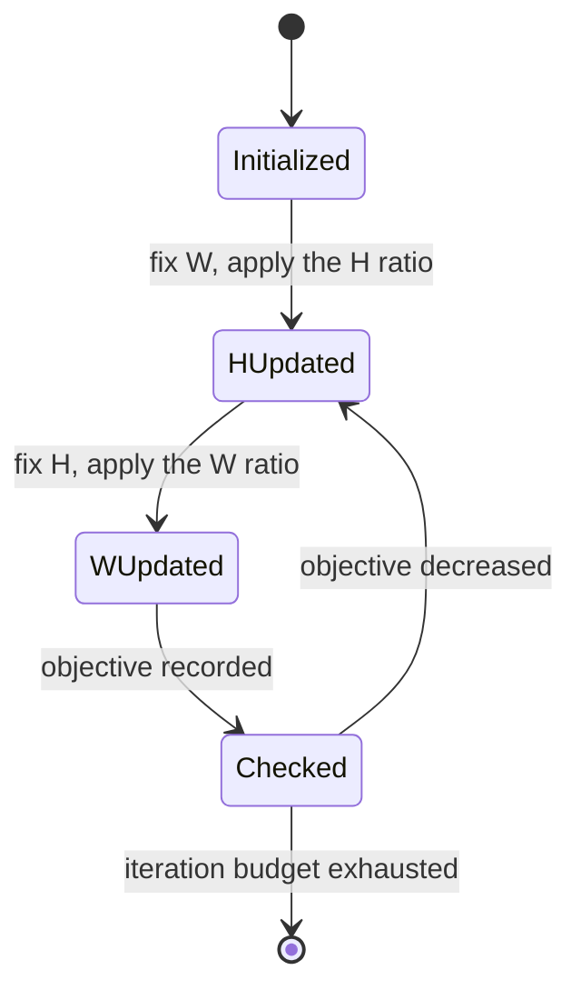
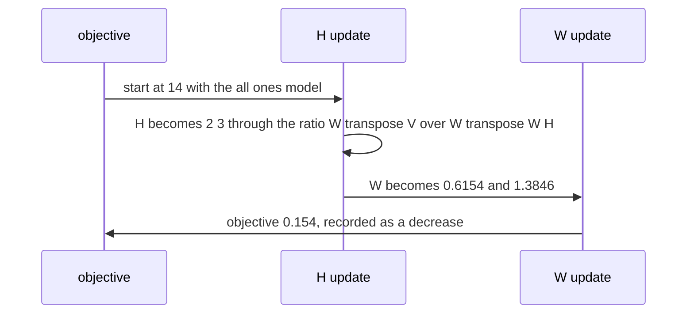

# 590 — Implement non-negative matrix factorization simple multiplicative update.

> **Tier:** Advanced · **CTCI chapter:** Beyond — Machine Learning & AI
> **Task spec:** [590-implement-non-negative-matrix-factorization-simple-multiplicativ.md](../../../tasks/advanced/590-implement-non-negative-matrix-factorization-simple-multiplicativ.md)
> **Solutions:** [Python](../../../solutions/python/advanced/590-implement-non-negative-matrix-factorization-simple-multiplicativ/solution.py) ·
> [Java](../../../solutions/java/advanced/590-implement-non-negative-matrix-factorization-simple-multiplicativ/Solution.java) ·
> [JavaScript](../../../solutions/javascript/advanced/590-implement-non-negative-matrix-factorization-simple-multiplicativ/solution.js) ·
> [C#](../../../solutions/csharp/advanced/590-implement-non-negative-matrix-factorization-simple-multiplicativ/Solution.cs)

## 1. Problem restatement

**Input:** a non-negative matrix `V` (`n x m`) and a rank `r`.

**Output:** non-negative factors `W` (`n x r`) and `H` (`r x m`) with `V ≈ W H`, found by **Lee-Seung
multiplicative updates** — element-wise rules that need no step size and never produce a negative entry.

| Objective | `H` update | `W` update |
| --- | --- | --- |
| Frobenius `‖V - W H‖_F²` | `H ← H * (Wᵀ V) / (Wᵀ W H)` | `W ← W * (V Hᵀ) / (W H Hᵀ)` |
| I-divergence (KL) `Σ V log(V / WH) - V + WH` | `H ← H * (Wᵀ (V / W H)) / (Wᵀ 1)` | `W ← W * ((V / W H) Hᵀ) / (1 Hᵀ)` |

Both rules use a small `eps` in the denominator, and both are **majorise-minimise** schemes: the
objective does not increase at any step, which the file asserts **iteration by iteration** rather than
once at the end.

Two independent references judge the result instead of the update trusting itself:

| Reference | Statement |
| --- | --- |
| truncated SVD of `V` by `jacobi_eigh` on `V Vᵀ` | `‖V - W H‖_F >= ‖V - V_r‖_F` is a **theorem** over all rank-`r` factorizations, real-valued included — asserted as a lower bound, with the observed gap reported as the honest price of non-negativity |
| Perron-Frobenius for `r = 1` | for a strictly positive matrix, the best non-negative rank-1 approximation is the leading singular pair `σ1 u1 v1ᵀ`; the iteration is asserted to land within 2 % of it from above and never below |

| Check | What it pins down |
| --- | --- |
| monotone objectives, both rules | `monotone(history, slack=1e-12)` over the recorded per-iteration values |
| `W, H >= 0` at every step | `nonnegative_check` after hundreds of updates, not only at the end |
| planted `V = W0 H0`, `r = 2` | exact recovery of the planted factorization |
| positive rank-1 instance | the Perron bound above |
| the SVD lower bound | never violated, gap reported |

## 2. Intuition

Fitting `V ≈ W H` with both factors non-negative is a constrained least-squares problem: unlike SVD,
which allows negative entries and has a closed form, the non-negativity makes the problem non-convex and
the optimum generally worse than the unconstrained one. The miracle of the multiplicative rules is that
they follow from an auxiliary function: for a fixed `W`, the function `G(H, H_t) ≥ f(H)` that touches
`f` at `H_t` is minimized in closed form, and the minimizer is exactly the ratio rule. Because each step
minimizes a majorant of the objective, the objective cannot increase — not asymptotically, at **every**
step — and because the rule is a product of non-negative quantities, both factors stay non-negative
without any clamping or projection.



The three multiplicities in the rule each have a job: the numerator is a correlation of the residual's
desired direction with the fixed factor, the denominator is the current model's mass, and the ratio is
the multiplicative correction. Writing it that way also explains why the elements can never flip sign —
they are multiplied by a non-negative ratio rather than moved by a step that could overshoot below zero.



The KL variant swaps the squared-error terms for a divergence: the ratio becomes
`(V / W H)` weighted by `Wᵀ` — the same shape, applied to relative rather than absolute error, which is
why it is preferred when the data are counts.

## 3. Algorithm

1. **Initialize.** `random_positive_factors(state, n, r, m, low=0.2, high=1.0)` draws strictly positive
   factors from `splitmix64`, so the ratios are well defined from the first step.
2. **Frobenius loop.** Alternate `H ← H ⊙ (WᵀV)/(WᵀWH + eps)` and `W ← W ⊙ (VHᵀ)/(WHHᵀ + eps)`.
   Each multiplication is element-wise; the denominators are computed from the current factors, so the
   update is simultaneous, not sequential.
3. **KL loop.** Alternate `H ← H ⊙ (Wᵀ(V/(WH + eps)))/(Wᵀ1 + eps)` and
   `W ← W ⊙ ((V/(WH + eps))Hᵀ)/(1Hᵀ + eps)`.
4. **Record.** When `record` is set, append `frobenius_objective` (or `kl_divergence`) after every
   iteration; `monotone(history, slack=1e-12)` then has to hold for the whole history.
5. **Reference.** `svd_low_rank(V, k)` computes the truncated SVD via `jacobi_eigh(V Vᵀ)` and
   `svd_residual(V, k)` the bound; `relative_residual(V, W, H)` reports the achieved value.

```text
function nmf_frobenius(V, r, iterations, seed, eps)
    W, H ← strictly positive random factors
    history ← empty list
    for step from 1 to iterations do
        H ← H * ((W transposed V) / (W transposed W H + eps))          # element-wise
        W ← W * ((V H transposed) / (W H H transposed + eps))
        append frobenius_objective(V, W, H) to history
    end
    return W, H, history
end
```

```text
function nmf_kl(V, r, iterations, seed, eps)
    W, H ← strictly positive random factors
    history ← empty list
    for step from 1 to iterations do
        ratio ← V / (W H + eps)
        H ← H * ((W transposed ratio) / (W transposed ones + eps))
        W ← W * ((ratio H transposed) / (ones H transposed + eps))
        append kl_divergence(V, W, H) to history
    end
    return W, H, history
end
```

```text
function svd_low_rank(V, k)
    eigenvalues, eigenvectors ← jacobi_eigh(V times V transposed)
    keep the k largest eigenpairs
    return singular values, left and right factors
end

function svd_residual(V, k)
    return the Frobenius norm of V minus its rank-k truncation   # the lower bound for NMF
end
```



## 4. Worked example

Take `V = [[1, 2], [3, 4]]`, `r = 1`, and start from the deliberately simple `W = [[1], [1]]`,
`H = [[1, 1]]`, so the initial model is the all-ones matrix. The initial objective is
`‖V - W H‖_F² = 0² + 1² + 2² + 3² = 14`.

**`H` update.** `Wᵀ V = [[1, 1]] · [[1, 2], [3, 4]] = [[4, 6]]`, `Wᵀ W = [[2]]`, so
`Wᵀ W H = [[2, 2]]` and

| Quantity | Value |
| --- | --- |
| `Wᵀ V` | `[[4, 6]]` |
| `Wᵀ W H` | `[[2, 2]]` |
| ratio | `[[2, 3]]` |
| `H ← H ⊙ ratio` | `[[2, 3]]` |

**`W` update.** `V Hᵀ = [[1, 2], [3, 4]] · [[2], [3]] = [[8], [18]]`, `H Hᵀ = [[13]]`, so
`W H Hᵀ = [[13], [13]]` and the ratio is `[[8/13], [18/13]] ≈ [[0.6154], [1.3846]]`.

**The objective after one full step.** `W H = [[0.6154], [1.3846]] · [[2, 3]] ≈ [[1.2308, 1.8462],
[2.7692, 4.1538]]`, so `V - W H ≈ [[-0.2308, 0.1538], [0.2308, -0.1538]]` and the squared Frobenius norm
is `0.0533 + 0.0237 + 0.0533 + 0.0237 ≈ 0.154` — down from `14`. The step reduced the objective by two
orders of magnitude, and every entry of `W` and `H` is still positive, which is the property the rules
guarantee structurally.



**How the result is judged.** The squared Frobenius norm of the best *unconstrained* rank-1
approximation is the sum of the discarded squared singular values of `V`, i.e. `σ2² ≈ 0.133`
(`V Vᵀ = [[5, 11], [11, 25]]` has eigenvalues `29.87` and `0.133`), so `‖V - V_1‖_F ≈ 0.365` is a floor
that no rank-1 factorization can beat. The file asserts exactly that inequality for every instance —
`‖V - W H‖_F >= ‖V - V_r‖_F` — and reports how far above the floor the non-negative answer sits, which
is the price the constraint imposes. For `r = 1` and strictly positive `V` the header goes further: the
best non-negative rank-1 approximation is the Perron pair `σ1 u1 v1ᵀ`, so the converged multiplicative
iteration is asserted to be within 2 % of that value and never below it.

## 5. Complexity

Let `n, m` be the dimensions of `V`, `r` the rank and `t` the number of iterations.

| Measure | Bound | Why it holds |
| --- | --- | --- |
| One Frobenius iteration | O(n · m · r) | the two matrix products `WᵀV` and `V Hᵀ` dominate; the rest are element-wise |
| One KL iteration | O(n · m · r) | the same products with a division by `W H` added, also `O(n · m)` |
| Total | O(t · n · m · r) | iterations to convergence are not bounded in theory, so the file fixes a budget |
| Objective evaluation | O(n · m · r) | one product `W H` |
| Truncated SVD reference | O(n³) via `jacobi_eigh` on `V Vᵀ` | only used as a bound, on small instances |
| Space | O(n · m + r · (n + m)) | the matrix and the two factors; no auxiliary matrix of the same size is needed |
| Non-negativity | exact, structurally | products of non-negative ratios, no projection or clamping |

There is no convexity, so no global convergence rate exists; what the file asserts is monotonicity, which
is a property of every single step, plus the two independent quality statements (the SVD floor and the
Perron agreement).

## 6. Pitfalls and edge cases

- **`eps` in the denominator.** A zero entry in `Wᵀ W H` would divide by zero and, worse, a zero in
  `W H` makes the KL ratio `V / W H` infinite; the small `eps` keeps both rules finite, and the
  non-negativity assertion confirms the factors never reach zero in a way that produces `NaN`.
- **Both factors must be strictly positive to start.** A zero in `W` at initialization multiplies every
  later update of that entry by a ratio computed from a zero denominator, locking the entry at zero
  forever — a permanent dead atom.
- **Monotonicity is per iteration, not asymptotic.** The file records the objective after **every**
  update and asserts `monotone(history, slack=1e-12)`; a step size or a wrong denominator that still
  converges eventually would fail this check.
- **Simultaneous, not sequential, updates.** The `H` update must use the old `W` for both numerator and
  denominator; mixing in the updated `W` breaks the majorise-minimise argument and the monotone history.
- **The lower bound is a theorem, not a target.** `‖V - W H‖_F >= ‖V - V_r‖_F` holds for every real
  rank-`r` factorization, so the NMF residual is never below it; a violated bound would mean a bug in the
  SVD reference or in the residual computation.
- **The gap is reported, not hidden.** The header states that the distance above the floor is the honest
  price of the non-negativity constraint, so the test asserts the inequality and reports the gap rather
  than pretending NMF matches SVD.
- **`r = 1` is the special case with a known optimum.** For a strictly positive matrix, Perron-Frobenius
  makes the leading singular pair non-negative, so the best non-negative rank-1 factor is known; the
  iteration must be within 2 % of it and never below, which is a much sharper check than monotonicity.
- **Exact recovery needs a planted problem.** `V = W0 H0` with `r = 2` reproduces the planted factors
  exactly, which is the only situation where the factorization is identifiable at all; a general matrix
  is only ever approximated.
- **Local minima are real.** Multiplicative updates from different seeds can land on different objectives;
  the file reports the observed values rather than claiming a global optimum.
- **KL divergence needs strictly positive data.** `V log(V / W H)` is undefined for negative `V` and
  awkward for zeros, which is why the KL rule is exercised on non-negative instances only.

## 7. Variants and follow-ups

- **Sparse coding instead of part-based factorization.** OMP selects few atoms rather than updating all
  of them continuously —
  [592-implement-sparse-coding-orthogonal-matching-pursuit-omp.md](../../../tasks/advanced/592-implement-sparse-coding-orthogonal-matching-pursuit-omp.md).
- **Learning a dictionary on top of the factors.** K-SVD alternates sparse coding of signals with an
  atom-by-atom update, and compares its update against the closed-form MOD rule —
  [591-implement-k-svd-sketch-for-dictionary-learning-outline.md](../../../tasks/advanced/591-implement-k-svd-sketch-for-dictionary-learning-outline.md).
- **The unconstrained optimum.** The truncated SVD used here as a floor is the subject of
  [502-implement-randomized-svd-basic-using-power-method.md](../../../tasks/advanced/502-implement-randomized-svd-basic-using-power-method.md).
- **Signed latent structure.** PCA and spectral methods allow negative entries and therefore recover a
  better fit, at the cost of losing the "parts" interpretation —
  [589-implement-spectral-clustering-using-sparse-eigen-solver-power-it.md](../../../tasks/advanced/589-implement-spectral-clustering-using-sparse-eigen-solver-power-it.md).
- **Regularized variants.** Adding an `L1` term on `H` produces sparse parts, which is the coordinate
  descent lasso of
  [593-implement-l1-regularized-least-squares-via-coordinate-descent.md](../../../tasks/advanced/593-implement-l1-regularized-least-squares-via-coordinate-descent.md)
  applied per row.

## 8. Check yourself

1. Why can the multiplicative rules never produce a negative entry?

<details><summary>Show answer</summary>

Each update multiplies the current factor by a ratio of non-negative quantities: `WᵀV` and `V Hᵀ` are
products of non-negative matrices, and the denominators are the same products applied to the current model
plus `eps > 0`. A product of non-negative numbers stays non-negative, so no projection or clamping is
needed — the property is structural, which is why the file can assert `W, H >= 0` after every iteration.

</details>

2. What makes the objective monotone at every step rather than merely convergent?

<details><summary>Show answer</summary>

Both rules are majorise-minimise: for a fixed `W` there is an auxiliary function `G(H, H_t)` that bounds
the objective from above and touches it at the current `H_t`, and the ratio rule is its exact minimizer.
Minimizing a majorant can only lower the true objective, so each update decreases it — the file records
the objective after every iteration and asserts the sequence is non-increasing.

</details>

3. In the worked example the objective fell from `14` to about `0.154` in one step. Why is that not `0`?

<details><summary>Show answer</summary>

Because a rank-1 non-negative factorization cannot represent `[[1,2],[3,4]]` exactly: the unconstrained
rank-1 floor is `‖V - V_1‖_F ≈ 0.365` in norm, i.e. about `0.133` squared, and non-negativity can only
push the residual higher. The step was large because the starting point was the crude all-ones model.

</details>

4. Why is `‖V - V_r‖_F` a valid lower bound, and what does the gap mean?

<details><summary>Show answer</summary>

`V_r` is the best approximation of `V` by *any* rank-`r` matrix, real-valued included, so every rank-`r`
factorization — in particular every non-negative one — has a residual at least as large. The gap between
the NMF residual and the SVD floor is the price of the non-negativity constraint; the file asserts the
inequality and reports the gap, with the `r = 1` Perron case as the one instance where the exact
non-negative optimum is known.

</details>

5. Why does the file record the objective after every single update instead of checking the final value?

<details><summary>Show answer</summary>

Because monotonicity is the *guarantee* that makes the method usable without a line search — a bug in one
of the two ratios, an `eps` in the wrong place, or a mix of old and new factors can still converge
eventually while violating the majorise-minimise property on individual steps. Checking all `t` values with
`monotone(history, slack=1e-12)` turns that guarantee into an executable assertion.

</details>