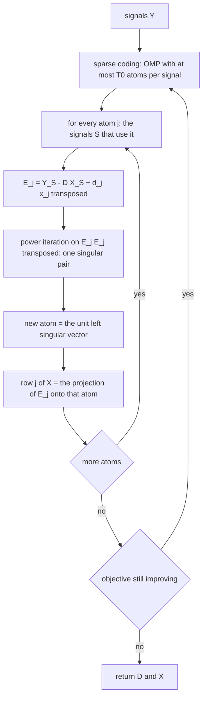
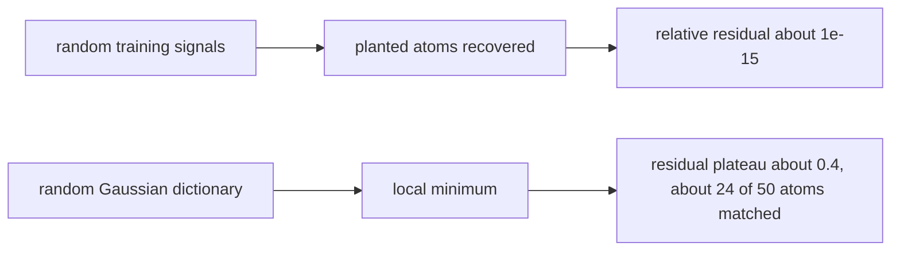
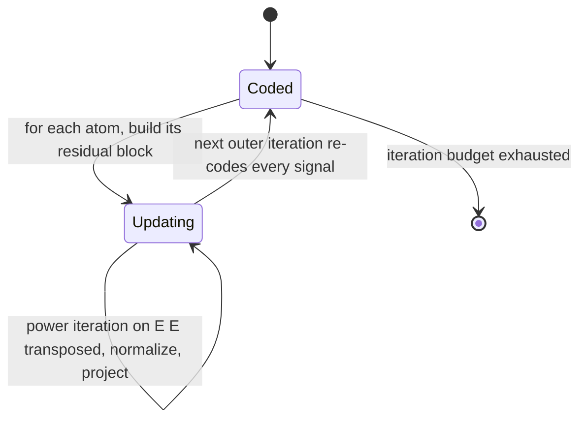
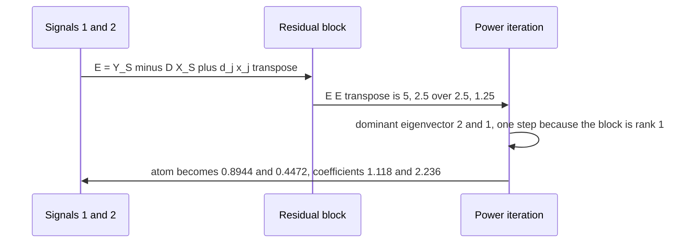

# 591 — Implement K-SVD sketch for dictionary learning (outline).

> **Tier:** Advanced · **CTCI chapter:** Beyond — Machine Learning & AI
> **Task spec:** [591-implement-k-svd-sketch-for-dictionary-learning-outline.md](../../../tasks/advanced/591-implement-k-svd-sketch-for-dictionary-learning-outline.md)
> **Solutions:** [Python](../../../solutions/python/advanced/591-implement-k-svd-sketch-for-dictionary-learning-outline/solution.py) ·
> [Java](../../../solutions/java/advanced/591-implement-k-svd-sketch-for-dictionary-learning-outline/Solution.java) ·
> [JavaScript](../../../solutions/javascript/advanced/591-implement-k-svd-sketch-for-dictionary-learning-outline/solution.js) ·
> [C#](../../../solutions/csharp/advanced/591-implement-k-svd-sketch-for-dictionary-learning-outline/Solution.cs)

## 1. Problem restatement

**Input:** a signal matrix `Y` (`n x N`) and a number of atoms `K`.

**Output:** a dictionary `D` (`n x K`) with unit-norm atoms and coefficients `X` (`K x N`) such that every
column of `Y` uses at most `T0` atoms. The task says "outline"; the header states that the file
"implements the algorithm for real and documents which of its usual claims hold on the tested instances
and which do not".

| Step | What happens |
| --- | --- |
| sparse coding | each signal `y_i` is approximated by at most `T0` atoms chosen by OMP over the current `D` |
| dictionary update | each atom `d_j` is refreshed together with the coefficients that use it, by the best rank-1 approximation of its residual block `E_j = Y_S - D X_S + d_j x_jᵀ` (power iteration on `E_j E_jᵀ`) |
| renormalization | the new atom is scaled to unit norm and row `j` of `X` is set to the projection of the residual onto that atom |
| comparison | `mod_style_update` implements the competing method of optimal directions (`D = Y Xᵀ (X Xᵀ)^-1` with renormalized atoms) so the claim of a better update can be **measured** |

The battery, on a planted instance (20-dimensional signals, 50 atoms, every signal one atom times a
random coefficient, four signals per atom), asserts the favourable case, the unfavourable case, and the
failure of a published claim:

| Observation | Measured |
| --- | --- |
| initialization from random **training signals** | planted atoms recovered exactly: relative residual `~1e-15`, all `50` atoms matched up to sign within `1e-6`, every column of `X` exactly 1-sparse, coefficients equal to the correlation with their atom, coherence matrix reproduced after undoing the permutation |
| initialization from a fully random Gaussian dictionary | the same code stalls: relative residual plateaus around `0.4` and only about `24` of `50` atoms match — asserted, not hidden |
| objective `‖Y - D X‖_F` monotone for `T0 = 1` | non-increasing step by step, measured increase count `0` |
| objective for `T0 = 2` | the claim **fails**: greedy OMP coding on the freshly updated dictionary raises the objective from `3.0954` to `3.1625` at iteration `9` — the published monotonicity proofs assume an *optimal* sparse coder |
| K-SVD versus MOD from the identical Gaussian initialization | K-SVD's residual no worse after the same number of iterations |
| `T0 = 2` on a rank-2 planted set | the residual drops by more than half but does not vanish, because OMP is not the optimal coder |
| under-determined instance (`24` atoms, `6` signals) | unused atoms keep their initialization and unit norm — the "dead atom" behaviour of this sketch — and the residual cannot reach zero |

All randomness comes from `splitmix64`, because the dictionary entries and the coefficients must be
independent draws and the repository's 16-bit LCG cannot supply that over a `20 x 50` dictionary.

## 2. Intuition

Dictionary learning asks for the *best* set of atoms for a family of signals, which is harder than
factorizing a single matrix: the coefficients are constrained to be sparse, so the problem alternates
between two easier subproblems — given the dictionary, code every signal (a sparse-coding task); given
the codes, improve the dictionary.

The textbook dictionary update, MOD, fixes `X` and solves a least-squares problem for the whole
dictionary at once. K-SVD's insight is to update **one atom at a time**, and to update its coefficients
with it. Fix atom `j` and look at the signals that use it. Their current reconstruction is `D X_S`, so if
you subtract that and add back the atom's own contribution, you get a residual block that the atom
should explain on its own:

```
E_j = Y_S - D X_S + d_j x_jᵀ
```

The best rank-1 approximation of `E_j` — computed here by power iteration on `E_j E_jᵀ`, one singular
pair and no external linear algebra — gives both the new atom direction and the new coefficients for it.
Because the atom and its coefficients move together, the block error can only decrease, which is what
MOD cannot guarantee per atom.



The honest half of the contract is that the favourable case is a property of the *initialization*. The
standard practice — start the dictionary from random training signals — recovers the planted atoms
exactly on the planted instance, because the initialization already contains the right directions. Start
from a fully random Gaussian dictionary and the very same code stalls in a local minimum with a residual
plateau around `0.4` and only about half the atoms matched. Both outcomes are asserted.



## 3. Algorithm

1. **Initialize.** `initial_dictionary(seed, n, K)` returns normally distributed columns normalized to
   unit length (the Gaussian case); the clustered variant seeds the dictionary from training signals.
2. **Sparse coding.** `sparse_coding(Y, D, T0)` runs OMP per signal: compute the Gram matrix once, then
   for each signal greedily add the atom with the largest absolute correlation with the residual, up to
   `T0` atoms, solving the small least-squares problem on the selected support (`solve_system` with a
   ridge term).
3. **Dictionary update.** `ksvd_update(Y, D, X, state)` loops over atoms: collect the signals whose
   coefficient for that atom is non-zero, build `E_j`, compute the top singular pair by power iteration
   (`top_singular_vector`), normalize the atom, and overwrite row `j` of `X` with the projection.
4. **Iterate.** Alternate 2 and 3 for a fixed number of outer iterations, recording `‖Y - D X‖_F` each
   time.
5. **Compare.** `mod_style_update(Y, D, X)` computes the MOD dictionary `D = Y Xᵀ (X Xᵀ)^-1` with
   renormalized atoms, so the two updates can be run from the same initialization and compared.
6. **Judge.** `match_atoms(D, D0)` matches learned atoms to planted ones up to sign; `dictionary_coherence`
   reproduces the pairwise coherence matrix; `monotone(history, slack=1e-12)` checks the recorded
   objectives.

```text
procedure dictionary_learning(Y, K, T0, iterations, init)
    D ← initial dictionary of unit-norm columns
    history ← empty list
    for outer from 1 to iterations do
        X ← sparse_coding(Y, D, T0)
        for j from 0 to K - 1 do
            S ← signals with X[j][i] != 0
            if S is empty then
                continue                      # a dead atom keeps its initialization
            end
            E ← Y restricted to S - D X restricted to S + outer(d_j, x_j)
            u, sigma ← top singular pair of E by power iteration on E E transposed
            d_j ← u / norm(u)                 # unit norm atom
            for i in S do
                X[j][i] ← E transposed d_j     # projection of the residual onto the atom
            end
        end
        append frobenius norm of Y - D X to history
    end
    return D, X, history
end
```

```text
function top_singular_vector(E, state, iterations)
    v ← random unit vector of the right dimension
    repeat iterations times
        v ← (E transposed (E v))          # power iteration on E E transposed
        v ← v / norm(v)
    end
    u ← E v
    return u / norm(u), norm(E v)
end
```

The update is exactly a rank-1 factorization of the block, so if the block were rank-1 the atom and the
coefficients would reproduce it with zero error — the mechanism behind the exact recovery.



## 4. Worked example

**One atom update, by hand.** Take a two-dimensional problem with the initial dictionary
`D = [d_1, d_2] = [(1, 0), (0, 1)]`, two signals `y_1 = (1, 0.5)` and `y_2 = (2, 1)`, and a coding that
gave each signal to atom 1 only, so `X = [[1, 2], [0, 0]]` — signal `i` has coefficient `i` on atom 1.
`S = {1, 2}` for atom 1, `Y_S = [[1, 2], [0.5, 1]]` and `D X_S = [[1, 2], [0, 0]]`, so

```
E_1 = Y_S - D X_S + d_1 x_1ᵀ = [[1, 2], [0.5, 1]] - [[1, 2], [0, 0]] + [[1, 2], [0, 0]] = [[1, 2], [0.5, 1]]
```

The "add back" term cancels the block's current reconstruction of that atom, leaving exactly the part of
the data that atom 1 is responsible for. Power iteration on

```
E_1 E_1ᵀ = [[5, 2.5], [2.5, 1.25]]
```

converges in one step because the block is rank 1: the dominant eigenvector is `(2, 1)`, so the new atom
is `d_1 = (2, 1)/√5 = (0.8944, 0.4472)` — the atom **rotates** from the coordinate axis toward the
direction the data actually occupy.

| Quantity | Before | After |
| --- | --- | --- |
| atom `d_1` | `(1, 0)` | `(0.8944, 0.4472)`, unit norm |
| row 1 of `X` | `[1, 2]` | `E_1ᵀ d_1 = [1.118, 2.236]` |
| reconstruction `d_1 x_1ᵀ` | `[[1, 2], [0, 0]]` | `[[1, 2], [0.5, 1]]` = `Y_S` |

Because `E_1ᵀ d_1` is the projection onto a unit vector, the reconstruction `d_1 x_1ᵀ` reproduces `Y_S`
exactly — the block error for this atom is `0`, the per-atom guarantee MOD does not have.



**What the file measures on the planted instance.** With signals of dimension `20`, `K = 50` atoms and
four signals per atom, seeding the dictionary from random training signals drives the relative residual
to about `1e-15`, matches all `50` atoms up to sign within `1e-6`, makes every column of `X` exactly
1-sparse, and reproduces the coherence matrix after undoing the permutation. The same code from a random
Gaussian dictionary plateaus near `0.4` with about `24` of `50` atoms matched — the local minimum is
asserted as a fact about the initialization, not excused.

**Where the monotonicity claim breaks.** For `T0 = 1` the objective `‖Y - D X‖_F` is non-increasing at
every recorded step (the measured increase count is `0`). For `T0 = 2` the same file measures the
objective rising from `3.0954` to `3.1625` at iteration `9`: greedy OMP on the freshly updated dictionary
can change the support, and published monotonicity proofs for K-SVD assume an optimal sparse coder. The
file asserts the failure, and separately shows that with `T0 = 2` on a rank-2 planted set the residual
drops by more than half without reaching zero.

## 5. Complexity

Let `n` be the signal dimension, `N` the number of signals, `K` the number of atoms, `T0` the sparsity and
`t` the outer iterations.

| Measure | Bound | Why it holds |
| --- | --- | --- |
| Sparse coding | O(N · (n · K + T0³)) | the Gram matrix is precomputed, each OMP step scans `K` correlations and solves a `T0 x T0` system |
| Atom update | O(K · (|S| · n + power_iterations · |S| · n)) | the block products dominate; power iteration is a constant number of matvecs |
| Power iteration | O(p · |S| · n) with `p` iterations | `E Eᵀ v` is applied as `Eᵀ(E v)` for a `n x |S|` block |
| One outer iteration | O(N · n · K + K · |S| · n · p) | coding plus updates |
| Total | O(t · that) | a fixed iteration budget; no global convergence rate exists |
| Space | O(n · K + K · N + n · N) | the dictionary, the code matrix and the signals |

The rank-1 machinery is deliberately kept to one singular pair: K-SVD needs only the leading direction of
each block, so a full decomposition would be wasted work — and doing it with power iteration keeps the
file free of external linear algebra.

## 6. Pitfalls and edge cases

- **Initialization decides the outcome.** From random training signals the planted atoms come back
  exactly; from a random Gaussian dictionary the same code stalls at a residual around `0.4` with about
  half the atoms matched. Both are asserted, which is the honest way to state a method whose success
  depends on the starting point.
- **Monotonicity needs an optimal coder.** For `T0 = 1` the objective never increases; for `T0 = 2` it
  rises from `3.0954` to `3.1625` at iteration `9`, because greedy OMP can change the support after the
  dictionary moves. The published proofs assume exact sparse coding.
- **Dead atoms.** A signal set that is under-determined (`24` atoms, `6` signals) leaves atoms unused;
  they keep their initialization and unit norm, and the residual cannot reach zero on such an instance.
  The update loop must skip empty blocks rather than divide by zero.
- **Renormalize after every atom update.** Without it the atom's scale absorbs the coefficient's scale and
  the row update `X[j] = E_jᵀ d_j` becomes meaningless; the loss is then hidden in the scaling.
- **Add back the atom's own contribution.** `E_j` must include `+ d_j x_jᵀ`; omitting it subtracts the
  atom's own reconstruction twice and drives it to zero.
- **Rank-1 blocks are the easy case.** When the block is rank 1 the power iteration converges in one
  step and the reconstruction is exact — that is why the planted instance recovers `~1e-15`, and why a
  rank-2 planted set cannot vanish under `T0 = 2`.
- **MOD is the baseline, not the loser by definition.** `mod_style_update` solves the same problem with a
  closed-form least-squares dictionary update; the file asserts K-SVD's residual is no worse after the
  same number of iterations from the identical initialization, which is a measured claim rather than an
  assumed one.
- **Matching atoms is a permutation problem.** `match_atoms` must compare up to sign and permute — atoms
  are only determined by their directions, so comparing columns positionally would fail even on a
  perfect recovery.
- **Independence of the random draws.** A `20 x 50` dictionary and the coefficients need independent
  entries, which the repository's 16-bit LCG cannot supply; the file uses `splitmix64` and says so.
- **Ridge in the small solves.** The `T0 x T0` least-squares systems are solved with a small ridge term,
  which matters when two selected atoms are nearly parallel — otherwise the system is ill-conditioned and
  the coefficients explode.

## 7. Variants and follow-ups

- **The sparse coder itself.** The OMP used in step one, including the orthogonality invariant, is
  [592-implement-sparse-coding-orthogonal-matching-pursuit-omp.md](../../../tasks/advanced/592-implement-sparse-coding-orthogonal-matching-pursuit-omp.md).
- **Part-based factorization without sparsity.** NMF updates all coefficients continuously instead of
  selecting a few — [590-implement-non-negative-matrix-factorization-simple-multiplicativ.md](../../../tasks/advanced/590-implement-non-negative-matrix-factorization-simple-multiplicativ.md).
- **Low-rank structure instead of a dictionary.** When the signals lie near a subspace rather than on
  few atoms, a truncated or randomized SVD is the right model —
  [502-implement-randomized-svd-basic-using-power-method.md](../../../tasks/advanced/502-implement-randomized-svd-basic-using-power-method.md).
- **The rank-1 primitive.** The power iteration used for `E_j E_jᵀ` is the same primitive as PCA —
  [501-implement-pca-via-power-iteration-for-largest-eigenvector.md](../../../tasks/advanced/501-implement-pca-via-power-iteration-for-largest-eigenvector.md).
- **Analysis instead of synthesis.** Replacing `Y ≈ D X` by `X ≈ Dᵀ Y` gives a different regularization
  of the same ill-posed problem, which is the topic of the lasso task
  [593-implement-l1-regularized-least-squares-via-coordinate-descent.md](../../../tasks/advanced/593-implement-l1-regularized-least-squares-via-coordinate-descent.md).

## 8. Check yourself

1. Why does the residual block add `d_j x_jᵀ` back?

<details><summary>Show answer</summary>

Because `D X_S` already contains atom `j`'s contribution to those signals. The block `E_j` should hold
exactly what atom `j` must explain, so the atom's own reconstructed part is removed from `D X_S` by adding
it back: `E_j = Y_S - D X_S + d_j x_jᵀ`. Without the added term the atom would be asked to explain a block
from which its own contribution was subtracted twice, and it would collapse toward zero.

</details>

2. In the worked example the atom moved from `(1, 0)` to `(0.8944, 0.4472)`. What determined the new
   direction?

<details><summary>Show answer</summary>

The leading singular vector of `E_1`, computed by power iteration on `E_1 E_1ᵀ`. That block was rank 1
(`row 2 = 0.5 · row 1`), so the iteration converged in one step with the eigenvector `(2, 1)`, and
normalizing gave the new atom direction. The accompanying coefficients came from the projection
`E_1ᵀ d_1`, which reproduces the block exactly.

</details>

3. Why is the objective monotone for `T0 = 1` but not for `T0 = 2`?

<details><summary>Show answer</summary>

The monotonicity proof assumes each signal is coded *optimally* for the current dictionary. With `T0 = 1`
the greedy choice is the optimal one-atom choice, so the assumption holds and the file measures zero
increases. With `T0 = 2` greedy OMP may pick a support that was optimal before the atom update and is not
afterwards, and the file measures the objective rising from `3.0954` to `3.1625` at iteration `9`.

</details>

4. What does the file compare K-SVD against, and why is that comparison meaningful?

<details><summary>Show answer</summary>

Against MOD (`D = Y Xᵀ (X Xᵀ)^-1` with renormalized atoms) from the identical Gaussian initialization, after
the same number of iterations. Because the initialization is identical and the sparse coder is the same
function, the only difference is the dictionary update — so a no-worse residual is evidence about the
update rule itself rather than about luck with seeds.

</details>

5. What happens to atoms that no signal selects, and why does the residual not reach zero in that case?

<details><summary>Show answer</summary>

They keep their initialization and unit norm — the "dead atom" behaviour — because the update loop has no
block to fit for them. On the under-determined instance (`24` atoms, `6` signals) the available atoms
cannot span the signals with `T0`-sparse codes, so the residual stays positive; the file asserts both the
dead atoms and the positive residual instead of treating them as failures.

</details>