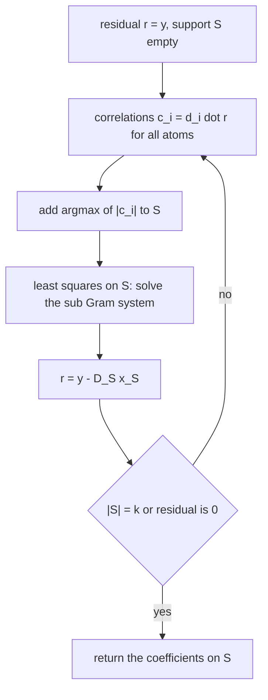
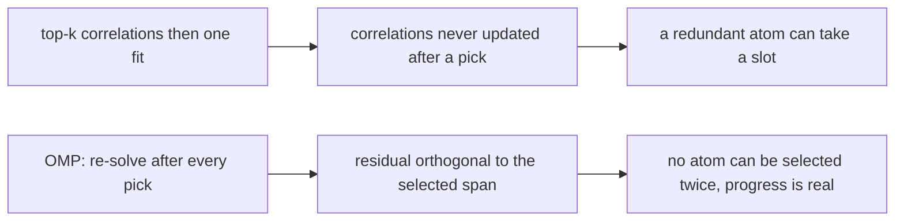
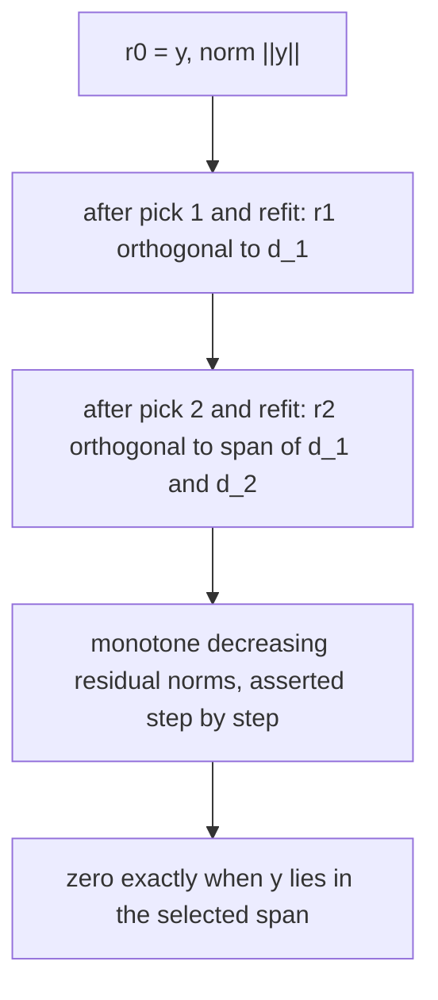
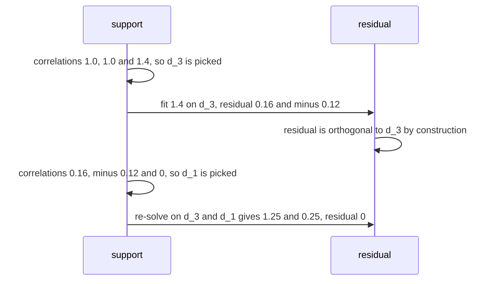

# 592 — Implement sparse coding orthogonal matching pursuit (OMP).

> **Tier:** Advanced · **CTCI chapter:** Beyond — Machine Learning & AI
> **Task spec:** [592-implement-sparse-coding-orthogonal-matching-pursuit-omp.md](../../../tasks/advanced/592-implement-sparse-coding-orthogonal-matching-pursuit-omp.md)
> **Solutions:** [Python](../../../solutions/python/advanced/592-implement-sparse-coding-orthogonal-matching-pursuit-omp/solution.py) ·
> [Java](../../../solutions/java/advanced/592-implement-sparse-coding-orthogonal-matching-pursuit-omp/Solution.java) ·
> [JavaScript](../../../solutions/javascript/advanced/592-implement-sparse-coding-orthogonal-matching-pursuit-omp/solution.js) ·
> [C#](../../../solutions/csharp/advanced/592-implement-sparse-coding-orthogonal-matching-pursuit-omp/Solution.cs)

## 1. Problem restatement

**Input:** a signal `y` in `Rⁿ`, an overcomplete dictionary `D` (`n x K`, `K > n`, atoms normalized to
unit length), and a sparsity `k`.

**Output:** a coefficient vector `x` with `||x||_0 <= k` and `y ≈ D x`, found by **orthogonal matching
pursuit**. Each step.

1. selects the atom with the largest absolute correlation against the **current residual**;
2. re-solves the least-squares problem on the selected support by Cholesky factorization of the
   sub-Gram matrix.

The re-solve is what makes OMP "orthogonal": afterwards the residual is orthogonal to the whole selected
subspace, and the file asserts exactly that structural invariant, `D_Sᵀ r = 0` to `1e-9`. A second,
independent solver (plain Gaussian elimination on the same sub-Gram) runs in parallel so the reported
coefficients do not depend on a single linear-algebra path.

| Check | What it pins down |
| --- | --- |
| coherence `μ = max_{i≠j} |<d_i, d_j>|` | computed, and the file verifies that the chosen `k` satisfies the sufficient condition `k < (1/2)(1 + 1/μ)` before asserting exact recovery |
| exact recovery | support equals the planted support, coefficients match to `1e-9` |
| residual monotone non-increasing | every step, and reaching `0` on exactly representable signals |
| support cardinality | exactly `k` distinct entries |
| zero signal, `k = 0` | empty support with residual `0`, and residual `||y||` |
| `k >= n` | the signal is reproduced exactly, because the atoms of an overcomplete dictionary span `Rⁿ` |
| optimality | OMP's residual is never smaller than a brute-force search over all `C(K, k)` supports (asserted with `1e-9` slack) |
| 60 random Gaussian instances | OMP matches the brute force — asserted as a count |
| a hand-built counterexample | OMP is **strictly worse** |

## 2. Intuition

Sparse coding asks for the few atoms that explain a signal, and the exact problem is combinatorial. OMP
is greedy, but with one non-greedy ingredient: after each new atom is added, it re-fits **all** selected
coefficients by least squares. That re-fit is what keeps the residual orthogonal to everything selected so
far, so no atom can be picked twice and each step makes real progress toward the projection of `y` onto
the span of the chosen atoms.



Why re-solving matters is easiest to see against the naive alternative: pick the `k` largest
correlations at once and do a single least-squares fit. That variant never updates its correlations
after a choice, so a redundant atom (one highly correlated with an already chosen atom) can occupy a slot
that a genuinely useful atom needed. OMP's per-step re-solve spends `O(k²)` work per step to avoid that,
and the file measures both variants to show the difference.



## 3. Algorithm

1. **Precompute.** `gram_matrix(D)` and `mutual_coherence(D)` once per dictionary.
2. **Loop up to `k` times.** Form the correlations `Dᵀ r`; pick the not-yet-selected atom with the
   largest absolute correlation; add it to the support.
3. **Re-solve.** Build the sub-Gram `D_Sᵀ D_S` and the right-hand side `D_Sᵀ y`, solve for the
   coefficients — `cholesky_solve` in the main path, `elimination_solve` as the independent check.
4. **Update the residual.** `r = y - D_S x_S`; if `||r||` is below the tolerance, stop early.
5. **Return.** `x` supported on `S`, plus optionally the recorded residual norms.

```text
function omp(D, y, k)
    support ← empty set
    coefficients ← zeros of length K
    residual ← y
    history ← empty list
    while size(support) < k and norm(residual) > tolerance do
        correlations ← D transposed times residual
        candidate ← the index not in support with the largest |correlations[index]|
        add candidate to support
        sub_gram ← columns of D in support transposed times columns of D in support
        rhs ← columns of D in support transposed times y
        values ← cholesky_solve(sub_gram, rhs)
        coefficients[support] ← values
        residual ← y - (columns of D in support times values)
        append norm(residual) to history
    end
    return coefficients, support, history
end
```

```text
function cholesky_solve(sub_gram, rhs)
    factor ← Cholesky factor of sub_gram (lower triangular)
    solve L z = rhs by forward substitution
    solve L transposed values = z by back substitution
    return values
end
```

The two diagrams below show the same loop from the two viewpoints the file asserts: the control flow, and
the state of the residual.



## 4. Worked example

Take the unit-norm dictionary `D = [(1, 0), (0, 1), (0.6, 0.8)]` and the signal `y = (1, 1)` with `k = 2`.

**Step 1: correlations against `y`.**

| Atom | Correlation `<d_i, y>` |
| --- | --- |
| `d_1 = (1, 0)` | `1.0` |
| `d_2 = (0, 1)` | `1.0` |
| `d_3 = (0.6, 0.8)` | `1.4` |

OMP picks `d_3`, the compromise atom, because `1.4` is the largest absolute correlation. The least-squares
fit on `{d_3}` is the projection, giving coefficient `1.4` and residual

```
r_1 = y - 1.4·d_3 = (1, 1) - (0.84, 1.12) = (0.16, -0.12),      ||r_1|| = 0.2
```

and the orthogonality invariant holds immediately: `<d_3, r_1> = 0.6·0.16 + 0.8·(-0.12) = 0`.

**Step 2: correlations against the residual.** `<d_1, r_1> = 0.16`, `<d_2, r_1> = -0.12`,
`<d_3, r_1> = 0` — and `d_3` is already in the support, so OMP picks `d_1`.

**Step 2 re-solve.** With `S = {3, 1}` the sub-Gram is `[[1, 0.6], [0.6, 1]]` and the right-hand side is
`[<d_3, y>, <d_1, y>] = [1.4, 1.0]`. Solving `G x = b`:

| Equation | Solution |
| --- | --- |
| `a + 0.6 b = 1.4` | `a = 1.25` (coefficient of `d_3`) |
| `0.6 a + b = 1.0` | `b = 0.25` (coefficient of `d_1`) |

The reconstruction is `1.25·(0.6, 0.8) + 0.25·(1, 0) = (0.75 + 0.25, 1.0) = (1, 1) = y`, so the residual
is exactly `0` after two atoms and the loop stops early. The residual norms `0.2 → 0` are recorded, and
the support has exactly `2` distinct entries.



**Where OMP fails.** The file builds a counterexample whose coherence breaks the guarantee: atoms
`(1, 0, 0)`, `(cos 0.3, sin 0.3, 0)` and `(cos 0.15, sin 0.15, 0.15)` with `y = d_1 + d_2`. The mutual
coherence is `μ = cos 0.3 ≈ 0.955`, so the sufficient condition `k < (1/2)(1 + 1/μ)` allows only `k = 1`.
OMP picks the compromise atom and stops with residual `0.209`, while brute force over the `C(3, 2)`
supports finds the exact support `{d_1, d_2}` with residual `0`. The file asserts OMP's residual is never
*smaller* than the brute-force optimum on every instance, and that on 60 random Gaussian instances the
two coincide — the failure is specific to the coherent case and is reported as such.

## 5. Complexity

Let `n` be the ambient dimension, `K` the dictionary size, `k` the sparsity and `G` the cost of a Gram
product.

| Measure | Bound | Why it holds |
| --- | --- | --- |
| Setup | O(n · K²) for the Gram matrix | one matrix product, reused by every OMP step |
| One iteration | O(n · K) for the correlations plus O(k²) for the solve | the residual correlations are the only `O(n · K)` work |
| `cholesky_solve` | O(k³) worst case, O(k²) typical | factorizing and solving the `k x k` sub-Gram |
| Total OMP | O(n · K + k · (n · K + k³)) | `k` iterations of the step above |
| Residual update | O(n · k) | one matrix-vector product on the support |
| Brute-force reference | O(C(K, k) · k³) | enumerates every support, used only on small instances |
| Space | O(n · K) for the dictionary plus O(K²) for the Gram | the coefficients and residual are `O(K)` |

The `O(n · K²)` Gram matrix is what makes the correlation step cheap on repeated calls: without it every
iteration would cost `O(n · K)` inner products of length `n`, which is the same asymptotically here but a
much larger constant.

## 6. Pitfalls and edge cases

- **The re-solve is the algorithm.** Dropping it (the "top-`k` correlations then one fit" heuristic) leaves
  the residual correlated with already selected atoms and lets a redundant atom occupy a slot; the file
  measures that variant so the difference is visible.
- **The coherence condition is sufficient, not necessary.** Exact recovery is asserted only after
  verifying `k < (1/2)(1 + 1/μ)`; the counterexample with `μ ≈ 0.955` shows what happens outside it, where
  the bound permits only `k = 1`.
- **OMP is greedy, so it is not optimal.** The residual can never be *smaller* than the brute-force
  optimum over all `k`-supports; the file asserts that inequality with `1e-9` slack on every instance and
  separately asserts the count of instances where the two match.
- **Zero signal.** The support is empty and the residual is `0` — the loop must not try to pick an atom
  from a zero correlation vector.
- **`k = 0`.** Returns the zero coefficients with residual `||y||`, which is the boundary of the monotone
  residual sequence.
- **`k >= n`.** An overcomplete dictionary spans `Rⁿ`, so if `y` lies in the span of the selected atoms the
  residual reaches exactly `0`; the file asserts exact reproduction in that regime.
- **Support cardinality.** The support must contain exactly `k` distinct entries (or fewer when the
  residual vanishes early) — duplicates would mean the orthogonality invariant broke.
- **Two solvers, one answer.** `cholesky_solve` and `elimination_solve` operate on the same sub-Gram; a
  discrepancy means the factorization or the substitution is wrong, which is why both paths exist.
- **Numerical ties.** Two atoms with equal overlap make the greedy choice ambiguous; the file's assertions
  are on residuals and supports where the choice is unique, and the tolerance `1e-9` absorbs the rest.
- **Dictionary normalization.** The strategy assumes unit-norm atoms; without it the correlation ranking
  compares atoms by scale rather than by alignment.

## 7. Variants and follow-ups

- **Dictionary learning around the coder.** K-SVD calls OMP for the sparse-coding step and then updates
  each atom with its coefficients —
  [591-implement-k-svd-sketch-for-dictionary-learning-outline.md](../../../tasks/advanced/591-implement-k-svd-sketch-for-dictionary-learning-outline.md).
- **Convex relaxation.** Replacing the `L0` constraint by an `L1` penalty gives the lasso, solved by
  coordinate descent — [593-implement-l1-regularized-least-squares-via-coordinate-descent.md](../../../tasks/advanced/593-implement-l1-regularized-least-squares-via-coordinate-descent.md).
- **Non-negative parts.** NMF relaxes sparsity entirely and asks for non-negative factors —
  [590-implement-non-negative-matrix-factorization-simple-multiplicativ.md](../../../tasks/advanced/590-implement-non-negative-matrix-factorization-simple-multiplicativ.md).
- **Subspace models.** When the signal lies near a low-dimensional subspace rather than on few atoms, a
  truncated SVD is the right tool —
  [502-implement-randomized-svd-basic-using-power-method.md](../../../tasks/advanced/502-implement-randomized-svd-basic-using-power-method.md).
- **Exact sparse solvers.** Basis pursuit replaces the greedy choice with a linear program, trading the
  `O(k · n · K)` cost for exactness on instances where OMP's greedy step fails.

## 8. Check yourself

1. Why is the residual orthogonal to the selected atoms after the re-solve?

<details><summary>Show answer</summary>

Because the re-solve computes the least-squares coefficients on the support, i.e. the projection of `y`
onto the span of the selected atoms. The residual of a projection is orthogonal to the whole subspace, so
`D_Sᵀ r = 0` — the invariant the file asserts to `1e-9`. It also implies no atom can be selected twice,
since its correlation with the residual is exactly zero.

</details>

2. In the worked example OMP picked the "compromise" atom `d_3` first and still reconstructed `y`
   exactly. Why did that happen?

<details><summary>Show answer</summary>

Because OMP is allowed `k = 2` atoms, and the second step re-solved the least-squares problem on
`{d_3, d_1}` rather than keeping the first coefficient. The re-solve found `1.25` and `0.25`, whose
combination equals `(1, 1)` exactly. The compromise atom was a fine first step; the refit is what turned
it into an exact answer.

</details>

3. Why can OMP's residual never be smaller than the brute-force optimum?

<details><summary>Show answer</summary>

The brute force minimises `||y - D_S x_S||` over **all** supports of size `k`, while OMP produces one
particular support. A minimum over a superset of candidates can never be larger, so OMP's residual is at
least the brute-force residual. The file asserts that inequality with `1e-9` slack, and separately
measures how often the two coincide (all 60 random Gaussian instances).

</details>

4. What does the mutual coherence condition guarantee, and how does the file use it?

<details><summary>Show answer</summary>

For a dictionary with coherence `μ = max_{i≠j} |<d_i, d_j>|`, exact recovery of any `k`-sparse signal is
guaranteed when `k < (1/2)(1 + 1/μ)`. The file computes `μ`, verifies the inequality for the chosen `k`,
and only then asserts that OMP recovers the planted support and coefficients — so the recovery claim is
made where theory supports it. The counterexample has `μ ≈ 0.955`, allowing only `k = 1`, and there OMP
fails with residual `0.209` against `0`.

</details>

5. Why does the file run two different linear solvers on the same sub-Gram?

<details><summary>Show answer</summary>

Because the coefficients are the only output that matters, and a single solver would make a
factorization bug invisible: every residual, support and recovery assertion would silently agree with the
same wrong coefficients. Computing them twice by Cholesky and by Gaussian elimination turns that into a
detectable disagreement.

</details>