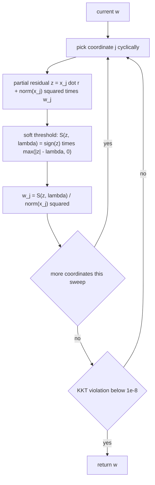
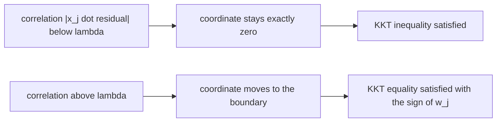
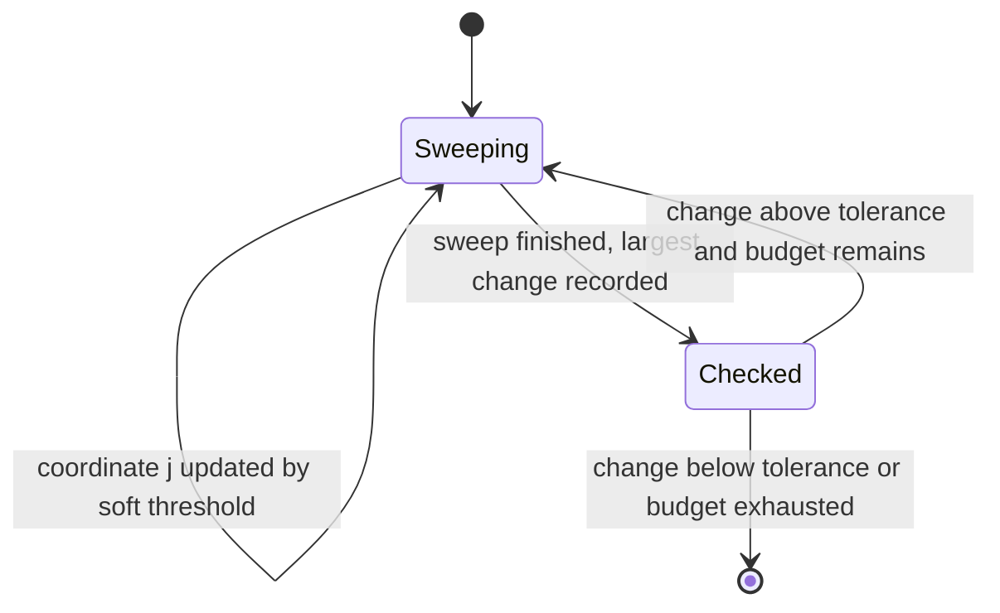
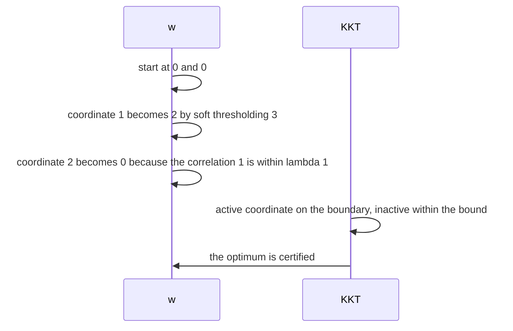

# 593 — Implement L1-regularized least squares via coordinate descent.

> **Tier:** Advanced · **CTCI chapter:** Beyond — Machine Learning & AI
> **Task spec:** [593-implement-l1-regularized-least-squares-via-coordinate-descent.md](../../../tasks/advanced/593-implement-l1-regularized-least-squares-via-coordinate-descent.md)
> **Solutions:** [Python](../../../solutions/python/advanced/593-implement-l1-regularized-least-squares-via-coordinate-descent/solution.py) ·
> [Java](../../../solutions/java/advanced/593-implement-l1-regularized-least-squares-via-coordinate-descent/Solution.java) ·
> [JavaScript](../../../solutions/javascript/advanced/593-implement-l1-regularized-least-squares-via-coordinate-descent/solution.js) ·
> [C#](../../../solutions/csharp/advanced/593-implement-l1-regularized-least-squares-via-coordinate-descent/Solution.cs)

## 1. Problem restatement

**Input:** a design matrix `X` (`n x p`), a response `y`, and a penalty `λ > 0`.

**Output:** the lasso minimiser of

```
f(w) = (1/2) ‖y - X w‖² + λ ‖w‖₁
```

computed by **cyclic coordinate descent**, where each coordinate is updated in closed form by the
soft-threshold of the partial residual:

```
w_j ← S(x_jᵀ r + ‖x_j‖² w_j, λ) / ‖x_j‖²          S(z, t) = sign(z) · max(|z| - t, 0)
```

with `r = y - X w` the current residual. Working with `‖x_j‖²` rather than assuming unit-norm columns
keeps the rule valid for arbitrary scaling, and the file also checks that normalizing the columns changes
nothing but the reported scale of the coefficients.

Because `f` is convex, the KKT conditions are necessary **and** sufficient:

```
|x_jᵀ (y - X w)| <= λ  for all j,     and     x_jᵀ (y - X w) = λ · sign(w_j)  whenever w_j != 0
```

| Check | What it pins down |
| --- | --- |
| full KKT verification of every returned solution | both inequalities and the equality on the active set, tolerance `1e-8`, on random instances and along the path |
| exhaustive global optimality for `p = 6` | all `3^p` sign patterns enumerated, each leading to an equality-constrained least-squares problem solved in closed form, keeping self-consistent signs and taking the best feasible objective; coordinate descent matches it to `1e-9` |
| `λ = 0` | reproduces the ordinary least-squares solution, compared against a Gaussian-elimination solve of the normal equations |
| `λ >= λ_max = max_j |x_jᵀ y|` | returns exactly `w = 0` |
| `λ` just below `λ_max` | activates exactly one coordinate: the arg-max of `|x_jᵀ y|`, with the sign of `x_jᵀ y` |
| orthonormal design (`XᵀX = I`) | the closed form `w = S(Xᵀ y, λ)` to `1e-9` |
| monotone objective and path | `f` non-increasing over every sweep, and `‖w(λ₁)‖₁ >= ‖w(λ₂)‖₁` for `λ₁ < λ₂` |
| warm starts | warm-started path solutions coincide with cold-started ones to `1e-9` |

The honest caveat about convergence is documented.

> Coordinate descent is not finitely terminating for correlated designs, so the file fixes a sweep budget,
> asserts the KKT violation of the returned point, and reports that the violation falls below `1e-8`
> within the budget — it does not claim exact optimality in a fixed number of sweeps.

## 2. Intuition

Adding an `L1` penalty to least squares produces sparse solutions, and the reason is geometric: the
constraint region has corners on the axes, so the optimum tends to sit exactly on a corner where some
coordinates are zero. Coordinate descent exploits the fact that this objective is *separable enough*: fix
every coordinate but one and the problem becomes a one-dimensional piecewise-quadratic whose minimiser is
a soft-threshold — a single `max(|z| - t, 0)` with the right sign.



The soft-threshold has a second, equally important consequence: it can set a coordinate **exactly** to
zero when the correlation is within `λ`, which is what gives the method its sparsity. The KKT conditions
describe that behaviour precisely: coordinates that stay zero must satisfy `|x_jᵀ(y - X w)| <= λ`, and
active coordinates must sit exactly on the boundary `x_jᵀ(y - X w) = λ · sign(w_j)`. Those two statements
are what the file verifies instead of trusting the iteration.



## 3. Algorithm

1. **Precompute.** The squared column norms `‖x_j‖²` once.
2. **Sweep.** For every coordinate `j` cyclically: form the partial residual's correlation
   `z = x_jᵀ r + ‖x_j‖² w_j`, apply the soft-threshold, and divide by `‖x_j‖²`.
3. **Update the residual.** Either recompute `r = y - X w` after each coordinate, or maintain it
   incrementally by the change in `w_j` — the file keeps the objective non-increasing either way.
4. **Stop.** When the relative change of `w` over a sweep falls below the tolerance, or after the sweep
   budget (`500` sweeps by default). The KKT violation is then measured.
5. **Path.** For a decreasing sequence of `λ`, warm-start each solve from the previous solution —
   the file asserts warm and cold starts agree to `1e-9`.

```text
function lasso_coordinate_descent(X, y, lambda, sweeps, tol)
    w ← zeros of length p
    for sweep from 1 to sweeps do
        largest_change ← 0
        for j from 0 to p - 1 do
            residual ← y - X w                                # or maintained incrementally
            partial ← dot(column j, residual) + squared_norm(j) * w[j]
            new_value ← soft_threshold(partial, lambda) / squared_norm(j)
            largest_change ← max(largest_change, |new_value - w[j]|)
            w[j] ← new_value
        end
        if largest_change <= tol then break end
    end
    return w
end
```

```text
function kkt_violation(X, y, w, lambda)
    residual ← y - X w
    worst ← 0
    for j from 0 to p - 1 do
        correlation ← dot(column j, residual)
        if w[j] != 0 then
            worst ← max(worst, |correlation - lambda * sign(w[j])|)
        else
            worst ← max(worst, max(correlation - lambda, -lambda - correlation, 0))
        end
    end
    return worst
end
```

```text
function brute_force_lasso(X, y, lambda)
    best ← infinity
    for every sign pattern s in {-1, 0, +1} to the power p do
        active ← coordinates with s[j] != 0
        solve the equality-constrained least squares on active
        if the resulting signs match s then
            best ← min(best, objective of that solution)
        end
    end
    return best
end
```



## 4. Worked example

**Orthonormal design, `X = [[1, 0], [0, 1]]`, `y = (3, 1)`, `λ = 1`.** Because `XᵀX = I`, the closed form
is `w = S(Xᵀy, λ) = (S(3, 1), S(1, 1)) = (2, 0)`. The coordinate descent must reach exactly that, and the
first sweep does:

| Coordinate | Residual before | `z = x_jᵀ r + ‖x_j‖² w_j` | Soft-threshold | New `w_j` |
| --- | --- | --- | --- | --- |
| start | — | — | — | `w = (0, 0)` |
| `j = 1` | `r = (3, 1)` | `3 + 1·0 = 3` | `S(3, 1) = 2` | `2` |
| `j = 2` | `r = (1, 1)` | `1 + 1·0 = 1` | `S(1, 1) = 0` | `0` |

The second coordinate is zeroed *exactly*, which is the sparsity the penalty creates. The KKT check
confirms the optimum: with `r = (1, 1)`, `|x_1ᵀ r| = 1 = λ` and `w_1 = 2 > 0` so the equality
`x_1ᵀ r = λ · sign(w_1)` holds; for coordinate 2, `|x_2ᵀ r| = 1 = λ` and `w_2 = 0` so the inequality
`|x_jᵀ r| <= λ` is satisfied. The objective is `0.5(1 + 1) + 1·2 = 3`, and the alternative `w = (3, 0)`
gives `0.5(0 + 1) + 3 = 3.5`, so the sparse answer really is better.



**The two limits of the path.** `λ_max = max_j |x_jᵀ y| = max(3, 1) = 3`. Setting `λ = 3` returns exactly
`w = 0`, and setting `λ` slightly below `3` activates exactly one coordinate: `j = 1`, the arg-max, with
the sign of `x_1ᵀ y = 3`, i.e. positive. At `λ = 0` the answer is the ordinary least-squares solution,
which for this design is `w = (3, 1)` again with a zero coefficient only by coincidence of the design —
the file compares that case against a Gaussian-elimination solve of the normal equations instead of a
closed form.

**Why the file does not claim exact optimality.** For correlated designs coordinate descent converges but
is not finitely terminating, so each returned point is judged by its KKT violation. On the `p = 6` brute
force the objective matches the enumeration over all `3^p = 729` sign patterns to `1e-9` — a genuinely
independent global check, because the enumeration solves equality-constrained problems in closed form
rather than iterating. On larger instances the guarantee reported is the weaker, honest one: the violation
falls below `1e-8` within the sweep budget.

## 5. Complexity

Let `n` be the number of rows, `p` the number of columns and `s` the number of sweeps actually needed.

| Measure | Bound | Why it holds |
| --- | --- | --- |
| One coordinate update | O(n) | one inner product `x_jᵀ r`, with an incremental residual update keeping the same order |
| One sweep | O(n · p) | all `p` coordinates, one pass each |
| Total | O(s · n · p) | `s` sweeps; the file fixes a budget of `500` and stops early on the tolerance |
| Objective evaluation | O(n · p) | one `X w` product, recorded per sweep for the monotonicity assertion |
| KKT verification | O(n · p) | one residual and `p` correlations |
| Brute-force optimum | O(3^p · p³) | the exhaustive enumeration, feasible only for tiny `p` |
| Space | O(n · p + p) | the design matrix plus the coefficient vector |
| Path over `λ` values | O(path_length · s · n · p) cold, less warm | warm starts reuse the previous solution and are asserted to give the same answers |

The complexity is the same as ordinary least squares through coordinate descent; the difference is that
each coordinate is a soft-threshold rather than a plain normalized correlation, and that convergence is
governed by the design's correlation structure rather than by a fixed number of sweeps.

## 6. Pitfalls and edge cases

- **Soft-threshold, not shrink.** The correct rule is `sign(z) · max(|z| - λ, 0)`, which can produce an
  exact zero; a rule that only subtracts a multiple of the coefficient's own sign never reaches zero and
  destroys the sparsity.
- **Divide by `‖x_j‖²`.** The closed form assumes unit-norm columns; without the division the effective
  penalty per coordinate depends on the column's scale, and the file's assertion that normalization
  changes only the scale of the reported coefficients would fail.
- **`λ = 0` is ordinary least squares.** The soft-threshold degenerates to the plain correlation, and the
  file asserts this against a Gaussian-elimination solve of the normal equations.
- **`λ >= λ_max` gives the zero vector.** `λ_max = max_j |x_jᵀ y|` is the smallest penalty at which every
  coordinate is inactive; just below it exactly one coordinate — the arg-max, with the sign of its
  correlation — becomes active.
- **Convergence is not finite.** For correlated designs, coordinate descent has no finite-termination
  guarantee, so the file uses a sweep budget plus a KKT check instead of claiming exact optimality.
- **Correlated columns make ties.** When two columns are nearly identical, the arg-max at `λ` just below
  `λ_max` can be either of them; assertions about "exactly one active coordinate" hold for the value
  reported by the implementation, which the file verifies against the arg-max it computes.
- **Warm starts must not change the answer.** A path solver that reuses the previous solution changes the
  trajectory; the file asserts warm-started and cold-started solutions agree to `1e-9`.
- **Path monotonicity.** `‖w(λ₁)‖₁ >= ‖w(λ₂)‖₁` for `λ₁ < λ₂` is a theorem for the lasso and is asserted
  along the path; a violation would mean the solves are not actually at the stated penalties.
- **Objective monotonicity over sweeps.** Each coordinate update minimizes the objective along that
  coordinate, so the full objective cannot increase in a sweep; the file records it every sweep.
- **Data scaling.** The repository's 16-bit LCG supplies the random instances here: the draws are few,
  immediately centred, and each instance is normalized, so no long-range independence is assumed — the
  header says so explicitly.

## 7. Variants and follow-ups

- **Greedy sparsity instead of a convex penalty.** OMP selects atoms one at a time against the residual —
  [592-implement-sparse-coding-orthogonal-matching-pursuit-omp.md](../../../tasks/advanced/592-implement-sparse-coding-orthogonal-matching-pursuit-omp.md).
- **Non-negative factors with no sparsity term.** NMF's multiplicative updates play the role of the
  coordinate rule in a different geometry —
  [590-implement-non-negative-matrix-factorization-simple-multiplicativ.md](../../../tasks/advanced/590-implement-non-negative-matrix-factorization-simple-multiplicativ.md).
- **Dictionary learning with the lasso inside.** An online dictionary learner codes each signal with an
  `L1` solver before updating atoms —
  [591-implement-k-svd-sketch-for-dictionary-learning-outline.md](../../../tasks/advanced/591-implement-k-svd-sketch-for-dictionary-learning-outline.md).
- **Regularization by rank instead of sparsity.** Truncated SVD constrains the rank rather than the `L1`
  norm — [502-implement-randomized-svd-basic-using-power-method.md](../../../tasks/advanced/502-implement-randomized-svd-basic-using-power-method.md).
- **Solving the normal equations directly.** At `λ = 0` the problem is ordinary least squares, which the
  file solves by Gaussian elimination as a cross-check — the same elimination used for inverses in
  [588-implement-matrix-inverse-with-gaussian-elimination-careful-with.md](../../../tasks/advanced/588-implement-matrix-inverse-with-gaussian-elimination-careful-with.md).

## 8. Check yourself

1. Why does the soft-threshold produce exact zeros while a plain shrinkage would not?

<details><summary>Show answer</summary>

Because the one-dimensional subproblem's minimiser is `sign(z)·max(|z| - λ, 0)`: whenever the correlation
`z` is inside the penalty band `|z| <= λ`, the maximiser is exactly `0`, not a small non-zero value. Plain
shrinkage that keeps a fraction of `z` never reaches zero, so no coordinate is ever switched off and the
solution is dense.

</details>

2. In the worked example, why does coordinate 2 end up exactly zero even though `y` has a non-zero second
   component?

<details><summary>Show answer</summary>

Because after coordinate 1 is set to `2`, the residual is `(1, 1)` and the correlation with column 2 is
`x_2ᵀ r = 1`, exactly equal to `λ = 1`. The soft-threshold of `1` with threshold `1` is `0`, so the
coordinate is switched off: paying `λ` for it is no better than leaving it out. The KKT inequality
`|x_jᵀ r| <= λ` confirms it as optimal.

</details>

3. What exactly does the `p = 6` brute force check add beyond the KKT verification?

<details><summary>Show answer</summary>

Independence. The KKT check verifies that the returned point satisfies a condition the *same* algorithm is
aiming at, while the enumeration over `3^p` sign patterns solves equality-constrained least-squares
problems in closed form and keeps the sign-consistent ones, giving a genuinely different route to the
global optimum. Equality of the objectives to `1e-9` is therefore evidence about the global optimum, not
about the iteration.

</details>

4. Why does the file not claim a fixed number of sweeps suffices for convergence?

<details><summary>Show answer</summary>

Because for correlated designs coordinate descent converges asymptotically but is not finitely
terminating — there is no theorem saying `s` sweeps reach the exact optimum. Instead the file fixes a
budget (`500` sweeps), measures the KKT violation of the returned point, and asserts that it falls below
`1e-8` within the budget, which is the honest statement about what was actually achieved.

</details>

5. What happens along the regularization path as `λ` decreases from `λ_max` to `0`?

<details><summary>Show answer</summary>

At `λ >= λ_max = max_j |x_jᵀ y|` the solution is exactly `w = 0`. Just below it, exactly one coordinate
becomes active: the arg-max of `|x_jᵀ y|`, with the sign of `x_jᵀ y`. More coordinates switch on as `λ`
decreases, the `L1` norm grows monotonically (`‖w(λ₁)‖₁ >= ‖w(λ₂)‖₁` for `λ₁ < λ₂`, asserted along the
path), and at `λ = 0` the answer is the ordinary least-squares solution.

</details>