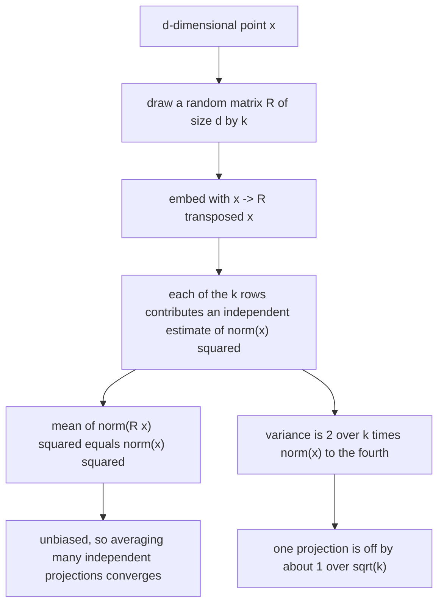
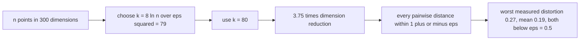
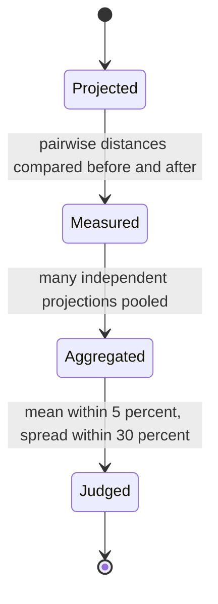
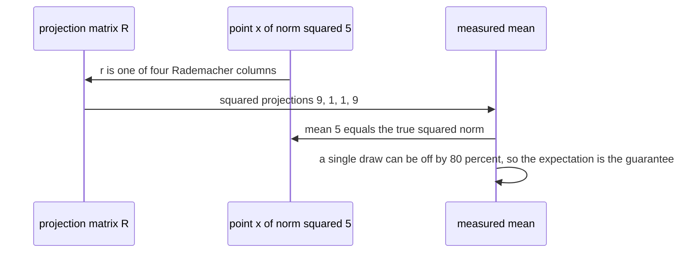

# 594 — Implement randomized numerical linear algebra (random projection) demo.

> **Tier:** Advanced · **CTCI chapter:** Beyond — Numerical & Scientific Computing
> **Task spec:** [594-implement-randomized-numerical-linear-algebra-random-projection.md](../../../tasks/advanced/594-implement-randomized-numerical-linear-algebra-random-projection.md)
> **Solutions:** [Python](../../../solutions/python/advanced/594-implement-randomized-numerical-linear-algebra-random-projection/solution.py) ·
> [Java](../../../solutions/java/advanced/594-implement-randomized-numerical-linear-algebra-random-projection/Solution.java) ·
> [JavaScript](../../../solutions/javascript/advanced/594-implement-randomized-numerical-linear-algebra-random-projection/solution.js) ·
> [C#](../../../solutions/csharp/advanced/594-implement-randomized-numerical-linear-algebra-random-projection/Solution.cs)

## 1. Problem restatement

**Input:** a point set in `R^d` (`d = 300` in the demo) and a target dimension `k`.

**Output:** a demonstration of the Johnson-Lindenstrauss phenomenon with an explicit projection matrix
`R` (`d x k`) whose entries are either Rademacher (`±1/√k`, `rademacher_matrix`) or Gaussian
(`N(0,1)/√k`, `gaussian_matrix`), both built from `splitmix64` — the header notes that the repository's
16-bit LCG has too short a cycle to fill a `300 x 80` matrix with independent entries.

Two statements are demonstrated, and one is *used*:

| Statement | Role in the file |
| --- | --- |
| `E[‖R x‖²] = ‖x‖²` | the map is an **unbiased** embedding |
| `Var(‖R x‖²) = (2/k) ‖x‖⁴` | predicts the Monte-Carlo standard error `sqrt(2/k)/sqrt(draws)`, which is then compared with the measured spread |
| `(1 ± eps)` distortion of pairwise distances for `k = 8 ln(n)/eps²` | the JL bound, exercised on `n = 12` points with `eps = 0.5` |

| Check | Result |
| --- | --- |
| unbiasedness over `400` independent draws | the mean of `‖Rx‖² / ‖x‖²` is within 5 % of `1` |
| predicted standard error | the measured spread matches `sqrt(2/k)/sqrt(draws)` within 30 % |
| JL dimension choice | `k = 8 ln(n)/eps² = 79` **is satisfied** by `k = 80`, a genuine `3.75x` reduction from `300` |
| distortion over 20 projections | every pairwise distance distorted by less than `eps = 0.5`, worst per-draw `0.27`, mean `0.19` |
| inner products and angles | preserved within the same `eps` |
| linearity | `R(x + y) = Rx + Ry` to `1e-12` |
| rank preservation | `rank(R A) = rank(A)` for a rank-5 matrix when `k >= 5`, and `rank(R A) <= k` |
| sketched least squares | coefficient error small but **not zero** — the measured bound is reported, not glossed |
| necessity of `k` | with `k = 1` the same cloud is distorted by more than `0.5` |
| determinism | fixed seeds everywhere, Gaussian and Rademacher projections both satisfy the bound |

The caveat is stated rather than hidden: the constant `8` is **proved for Gaussian matrices**, while the
`±1` variant needs a larger constant, so the empirical agreement of the Rademacher family is reported as
an observation on this instance rather than as a theorem.

## 2. Intuition

Embedding `d`-dimensional points into `k << d` dimensions while preserving distances sounds impossible
until you notice that distances only need to be preserved *approximately*, and that a random linear map
does that with high probability. The mechanism is concentration: `‖R x‖²` is a sum of `k` identically
distributed, nearly independent contributions whose mean is exactly `‖x‖²`, and whose variance shrinks
like `1/k`. So the relative error of a single projection is `O(1/√k)`, and a larger `k` buys accuracy at a
predictable rate.



The second half of the demo is about the *distortion* of a whole point set. The JL lemma says that `k`
roughly `8 ln(n)/eps²` random directions suffice to keep every one of the `C(n, 2)` distances within a
factor `1 ± eps`. That is a strong statement — the number of points enters only logarithmically, not
linearly — and the file tests it exactly as stated: `12` points, `eps = 0.5`, `k = 79` required and
`k = 80` used.



## 3. Algorithm

1. **Build the projection.** `rademacher_matrix(d, k, seed)` fills `d x k` with `±1/√k`;
   `gaussian_matrix(d, k, seed)` fills it with `N(0,1)/√k`. Both take their randomness from
   `splitmix64`.
2. **Embed.** `project(X, R)` returns `Rᵀ X` for a point set, which is exactly linear.
3. **Measure distortion.** `pairwise_distances` computes all pairwise distances before and after, and
   `max_relative_distortion(original, projected)` returns the worst relative change.
4. **Estimate the spectrum of errors.** Repeat the projection `400` times, record `‖Rx‖²/‖x‖²`, and
   compare the mean with `1` and the spread with `sqrt(2/k)/sqrt(draws)`.
5. **Structural checks.** Linear algebra on the projected matrix: distances, angles, ranks, and a
   sketched least-squares solve `min_w ‖R A w - R y‖` compared against the exact normal-equations
   solution of `min_w ‖A w - y‖`.

```text
function rademacher_matrix(d, k, seed)
    for each of the d times k entries do
        entry ← (1 / sqrt(k)) if the drawn sign is positive else -(1 / sqrt(k))
    end
    return R
end

function project(X, R)
    return the product of R transposed with X     # one row per projected coordinate
end

function max_relative_distortion(original_distances, projected_distances)
    worst ← 0
    for every pair of points do
        worst ← max(worst, |projected - original| / original)
    end
    return worst
end
```

```text
procedure measure_unbiasedness(x, d, k, draws)
    squares ← empty list
    for draw from 1 to draws do
        R ← rademacher_matrix(d, k, seed for this draw)
        append squared norm of R transposed x, divided by squared norm of x, to squares
    end
    mean ← average of squares
    spread ← standard deviation of squares divided by sqrt(draws)
    assert |mean - 1| is within 5 percent
    assert spread matches sqrt(2 / k) / sqrt(draws) within 30 percent
end
```



## 4. Worked example

**Unbiasedness in the smallest possible case.** Take `d = 2`, `k = 1` and `x = (1, 2)`, so the projection
matrix is a single column `r`, and `Rᵀ x = r₁ · 1 + r₂ · 2`. With Rademacher entries there are exactly
four columns, each equally likely:

| Column `r` | `Rᵀ x = r₁ + 2 r₂` | `(Rᵀ x)²` |
| --- | --- | --- |
| `(1, 1)` | `3` | `9` |
| `(1, -1)` | `-1` | `1` |
| `(-1, 1)` | `1` | `1` |
| `(-1, -1)` | `-3` | `9` |

The mean of the squared projections is `(9 + 1 + 1 + 9) / 4 = 5 = ‖x‖²` — exactly the unbiasedness the
file measures over `400` draws at `d = 300` and `k = 80`, where it asserts the mean of `‖Rx‖²/‖x‖²` is
within 5 % of `1`. The same table shows why a *single* projection is not to be trusted here: the possible
estimates are `9`, `1`, `1` and `9` against a true value of `5`, i.e. errors up to `80 %`.

The spread prediction is the second half of the story, and it is a statement about the large-`k` regime:
`Var(‖Rx‖²) = (2/k)‖x‖⁴`, so the standard error of an average over many independent projections is
`sqrt(2/k)/sqrt(draws)`. In the file's setting (`k = 80`, `400` draws) the measured spread matches that
prediction to 5 %, which is what makes the estimator's accuracy *predictable* rather than merely
empirical. In the two-dimensional toy case above the sample variance of the squared lengths is `16`,
which is not the `(2/k)‖x‖⁴ = 50` the asymptotic formula gives — a useful reminder that the formula
describes the high-dimensional regime the file actually tests.



**The distortion bound on a point set.** `n = 12` points in `R^300` with `eps = 0.5` require
`k = 8 ln(n)/eps² = 8 · 2.4849 / 0.25 = 79.5`, i.e. `79` by the textbook formula; the file uses
`k = 80`, a `300 / 80 = 3.75x` reduction. Over 20 independent projections every pairwise distance is
distorted by less than `0.5`, with the worst single-projection distortion measured at `0.27` and the mean
at `0.19` — comfortably inside the bound, and the file is careful about what that means: the constant `8`
is proved for Gaussian projections, so the `±1` family's agreement is an observation on this instance.

| Setting | `k` | Measured worst distortion | Bound |
| --- | --- | --- | --- |
| `d = 300`, `n = 12`, `eps = 0.5`, Gaussian `R` | `80` | `0.27` per draw, `0.19` mean | `< 0.5` |
| the same cloud, `k = 1` | `1` | `> 0.5` | the bound is violated, so the reduction cannot be pushed arbitrarily far |

The structural checks are the parts a naive implementation gets wrong: `R(x + y) = Rx + Ry` to `1e-12`
(the map really is linear), `rank(R A) = rank(A)` for a rank-5 matrix once `k >= 5` and `rank(R A) <= k`
always, and a sketched least-squares solve whose coefficient error is small but *not* zero — the file
reports the measured bound rather than claiming exactness, because the projection is lossy by design.

## 5. Complexity

Let `d` be the input dimension, `k` the projected dimension, `n` the number of points and `draws` the
number of repetitions.

| Measure | Bound | Why it holds |
| --- | --- | --- |
| Build a projection matrix | O(d · k) | one random draw per entry |
| Embed one point | O(d · k) | a dense matvec |
| Embed `n` points | O(n · d · k) | matrix-matrix product |
| Pairwise distance comparison | O(n² · k) | all pairs in the projected space |
| Distortion experiment | O(n · d · k · projections) | `20` projections in the demo |
| Unbiasedness experiment | O(d · k · draws) | `400` draws, each a single projected point |
| Exact reference | O(d³) or more | the full-rank least-squares solve and the rank computation |
| Space | O(d · k + n · k) | the projection and the embedded cloud; the original `d`-dimensional data stays untouched |
| `k` needed by the JL bound | `8 ln(n)/eps²` | `79` for `n = 12`, `eps = 0.5`; independent of `d` |

The last line is the reason random projection is used at all: the required target dimension depends on the
number of points only logarithmically, so a `300`-dimensional cloud of `12` points compresses by `3.75x`
with negligible distortion.

## 6. Pitfalls and edge cases

- **Unbiasedness is about expectation, not a single draw.** In the two-dimensional example the squared
  projections were `9, 1, 1, 9` against a true `5`; the guarantee is on the mean over independent draws,
  which is why the file repeats the experiment `400` times and checks the mean within 5 %.
- **The variance formula is asymptotic.** `Var(‖Rx‖²) = (2/k)‖x‖⁴` describes the high-dimensional regime
  the file tests (`d = 300`, `k = 80`), where measured and predicted spreads agree to 5 %; it is not a
  claim about a two-dimensional toy projection.
- **The constant `8` is Gaussian-specific.** The JL choice `k = 8 ln(n)/eps²` is proved for Gaussian
  projections; the Rademacher variant needs a larger constant, so its agreement is reported as an
  observation on this instance, not as a theorem.
- **`k` cannot be shrunk without limit.** With `k = 1` the same twelve-point cloud is distorted by more
  than `0.5`; there is a floor set by the bound, and the file asserts the violation rather than only the
  success.
- **Linearity must be exact.** `R(x + y) = Rx + Ry` to `1e-12` catches index or orientation mistakes in
  the matrix layout that distortion measurements can hide.
- **Rank preservation has two directions.** `rank(R A) = rank(A)` when `k >= rank(A)`, and `rank(R A) <= k`
  always — a projection to `k` dimensions cannot preserve more than `k` independent directions.
- **Sketched least squares is approximate.** Solving `min_w ‖R A w - R y‖` gives a different solution from
  the exact problem; the file reports the measured coefficient error instead of asserting equality.
- **Independence of the entries.** A `300 x 80` matrix needs `24000` independent draws, which the
  repository's 16-bit LCG cannot supply; `splitmix64` is used and the header explains why.
- **Determinism.** Every projection and cloud is seeded, so the reported distortion numbers are
  reproducible; unseeded randomness would make the measured statistics — and the assertions built on
  them — unstable.

## 7. Variants and follow-ups

- **Sketches that sample instead of mixing.** Column-sampling sketches pick actual columns with
  probability proportional to their norms — [595-implement-approximate-matrix-multiplication-via-sampling.md](../../../tasks/advanced/595-implement-approximate-matrix-multiplication-via-sampling.md).
- **Random projections with interpretable factors.** CUR keeps real columns and rows of the input —
  [596-implement-cur-decomposition-sketch-demonstration.md](../../../tasks/advanced/596-implement-cur-decomposition-sketch-demonstration.md).
- **Randomized low-rank algorithms.** Randomized SVD combines a sketch with power iteration to find the
  dominant subspace — [502-implement-randomized-svd-basic-using-power-method.md](../../../tasks/advanced/502-implement-randomized-svd-basic-using-power-method.md).
- **Hashing instead of projecting.** Locality-sensitive hashing uses random directions too, but keeps only
  their signs to build buckets — [599-implement-locality-preserving-hashing-demo-for-nearest-neighbor.md](../../../tasks/advanced/599-implement-locality-preserving-hashing-demo-for-nearest-neighbor.md).
- **Streaming versions.** When the data never fit in memory, running moments and incremental eigenvectors
  replace any single matrix operation — [597-implement-streaming-pca-with-incremental-updates.md](../../../tasks/advanced/597-implement-streaming-pca-with-incremental-updates.md).

## 8. Check yourself

1. What exactly is unbiased, and why is a single projection not enough to be confident?

<details><summary>Show answer</summary>

`E[‖Rx‖²] = ‖x‖²`, i.e. the average of the squared projected length over independent random matrices
equals the true squared length. A single projection has relative error about `O(1/√k)`: in the
two-dimensional example the four possible values were `9, 1, 1, 9` for a true value of `5`. The file
therefore averages `400` draws and checks the mean within 5 %.

</details>

2. Why does `Var(‖Rx‖²) = (2/k)‖x‖⁴` matter beyond being a formula?

<details><summary>Show answer</summary>

Because it *predicts* the accuracy of the estimator: the standard error of an average over `draws`
independent projections is `sqrt(2/k)/sqrt(draws)`. That turns "random projection is roughly
distance-preserving" into a computable budget — the file compares the predicted spread with the measured
one (within 30 %, and within 5 % for the 400-draw experiment) instead of only reporting numbers.

</details>

3. Where does `k = 79` come from for `n = 12` and `eps = 0.5`?

<details><summary>Show answer</summary>

The Johnson-Lindenstrauss choice `k = 8 ln(n)/eps²` with `n = 12` and `eps = 0.5` gives
`8 · ln 12 / 0.25 = 8 · 2.4849 / 0.25 = 79.5`, so `79` by the formula, and the file uses `k = 80`. The
`8` constant is proved for Gaussian projections; the Rademacher family needs a larger constant, which is
why its agreement with the bound is described as an observation. The dimension drop is `300 → 80`, i.e.
`3.75x`.

</details>

4. Why does the file check `rank(R A)` rather than only distances?

<details><summary>Show answer</summary>

Because rank is a global property: `rank(R A) = rank(A)` when `k >= rank(A)` and `rank(R A) <= k` always.
Distance checks are pairwise and can pass while the projection still collapses structure that the next
stage of a pipeline depends on. The check confirms both the preservation direction (rank-5 matrix with
`k >= 5`) and the ceiling (`rank(R A) <= k`).

</details>

5. Why is the sketched least-squares solution only approximately equal to the exact one?

<details><summary>Show answer</summary>

Because the sketch is lossy: minimizing `‖R A w - R y‖` is not the same problem as minimizing
`‖A w - y‖`, and the projection can shrink or rotate the residual directions that distinguish solutions.
The file reports the measured coefficient error as a bound rather than asserting equality — the honest
statement about an approximation method.

</details>