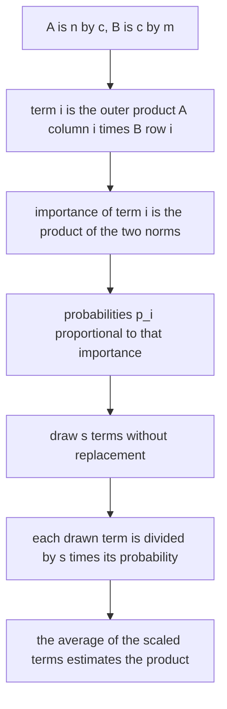
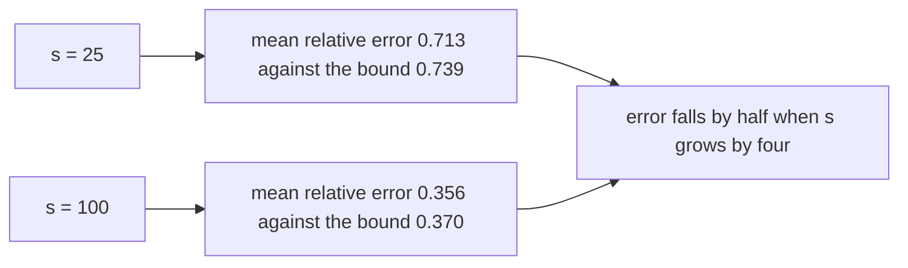
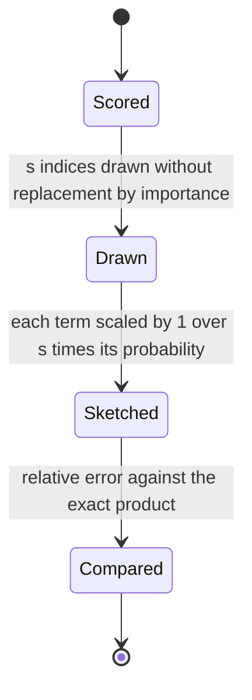
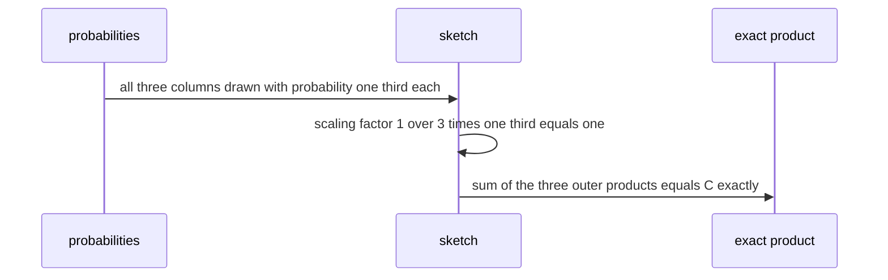

# 595 — Implement approximate matrix multiplication via sampling.

> **Tier:** Advanced · **CTCI chapter:** Beyond — Numerical & Scientific Computing
> **Task spec:** [595-implement-approximate-matrix-multiplication-via-sampling.md](../../../tasks/advanced/595-implement-approximate-matrix-multiplication-via-sampling.md)
> **Solutions:** [Python](../../../solutions/python/advanced/595-implement-approximate-matrix-multiplication-via-sampling/solution.py) ·
> [Java](../../../solutions/java/advanced/595-implement-approximate-matrix-multiplication-via-sampling/Solution.java) ·
> [JavaScript](../../../solutions/javascript/advanced/595-implement-approximate-matrix-multiplication-via-sampling/solution.js) ·
> [C#](../../../solutions/csharp/advanced/595-implement-approximate-matrix-multiplication-via-sampling/Solution.cs)

## 1. Problem restatement

**Input:** `A` (`n x c`) and `B` (`c x m`), and a sketch size `s <= c`.

**Output:** an estimator of the product `C = A B` that reads only `s` of the `c` "columns" of the
factorization. The Drineas-Kannan-Mahoney (DKM) estimator samples columns with probability proportional
to the product of the column norm of `A` and the row norm of `B`:

```
p_i ∝ ‖A⁽ⁱ⁾‖ · ‖B_(i)‖            Ĉ = (1/s) · Σ_{i ∈ I} (1 / p_i) · A⁽ⁱ⁾ B_(i)
```

The estimator is **unbiased** for `C`, so averaging many independent sketches converges to the true
product and the error decays like `1/√s`.

| Structure | Form | Note from the header |
| --- | --- | --- |
| DKM column sampling | `Ĉ = (1/s) Σ_{i∈I} (1/p_i) A⁽ⁱ⁾ B_(i)` | probabilities proportional to `‖A⁽ⁱ⁾‖ ‖B_(i)‖`, drawn without replacement |
| count sketch (AMS) | `Ĉ = (A R)(Rᵀ B)` with Rademacher `R` (`c x m`) | **with an explicit `1/m` factor** — `Σ_k (A r_k)(r_kᵀ B)` has expectation `m·AB`, not `AB`, which the file calls the trap |

| Check | Result |
| --- | --- |
| the exact special case | equal probabilities and **all** `c` columns drawn collapse `1/(s p_i)` to `1` and reproduce `C` bit for bit |
| the `1/√s` law | measured mean relative error `0.713` at `s = 25` and `0.356` at `s = 100` — a factor of exactly `2` |
| the DKM bound | `‖A‖_F ‖B‖_F / (‖AB‖_F √s)` is `0.739` and `0.370`; the measurements sit just under it, asserted with 5 % slack |
| probability-proportional sampling versus uniform | PPS wins on a matrix whose column and row norms are skewed |
| count sketch | measured mean error `0.786` at `m = 20` against the `0.826` variance bound; averaging `50` independent sketches drives it to `0.122` |

## 2. Intuition

`A B = Σ_i A⁽ⁱ⁾ B_(i)` is a sum of `c` rank-one outer products, one per inner dimension. Approximating
the product with fewer than `c` terms is therefore a *sum estimation* problem: pick terms at random,
weight them so the estimate is unbiased, and let the variance decide how many terms are needed.

The weighting is the interesting design decision. Sampling uniformly and scaling by `(c/s)` is unbiased
too, but it wastes samples on terms that contribute little. The DKM probabilities
`p_i ∝ ‖A⁽ⁱ⁾‖ ‖B_(i)‖` are exactly the "importance" of term `i` — the size of the outer product it
contributes — so the sampler concentrates on the terms that matter, and the estimator
`(1/(s p_i)) A⁽ⁱ⁾ B_(i)` divides each sampled term by the chance it had of being selected.



Because a single sketch is random, the useful statements are about the average and the spread: the
expectation is exactly `C`, and the error of one sketch behaves like `1/√s`. The file measures both — the
`0.713 → 0.356` drop from `s = 25` to `s = 100` is the `1/√s` law showing up as a factor of exactly `2`
when `s` grows by `4`.



The second estimator looks different but is the same idea: instead of *selecting* terms, it *mixes* them
with random signs, `Ĉ = (A R)(Rᵀ B)` for a Rademacher `R`. The mixing makes the expectation
`Σ_k (A r_k)(r_kᵀ B) = m · A B` over `m` random directions, which is why the explicit `1/m` factor is
mandatory — the header calls forgetting it exactly the trap it appears to be.

## 3. Algorithm

1. **Scores and probabilities.** `column_scores(A)` and `row_scores(B)` give the norms;
   `selection_probabilities(scores)` normalizes the products into a distribution.
2. **Sample.** `sample_indices(probabilities, s, state)` draws **without replacement** (the seeded,
   weighted sampler used by the main path); `sample_with_replacement` is the alternative.
3. **Sketch.** `sampling_sketch(A, B, s, probabilities, indices)` accumulates
   `(1/s) · Σ (1/p_i) A⁽ⁱ⁾ B_(i)` — an `n x m` matrix built from `s` rank-one pieces.
4. **Count sketch.** `count_sketch(A, B, m, seed)` builds a `c x m` Rademacher matrix, forms `A R` and
   `Rᵀ B`, multiplies them and applies the explicit `1/m` factor.
5. **Measure.** `relative_error(exact, approximate)` compares against `exact_product(A, B)`, and
   `frobenius` supplies the DKM bound's ingredients.

```text
function sampling_probabilities(A, B)
    for i from 1 to c do
        importance[i] ← norm(column i of A) * norm(row i of B)
    end
    return importance divided by the sum of importance
end

function sampling_sketch(A, B, s, probabilities, indices)
    estimate ← zero matrix of size n by m
    for i in indices do
        contribution ← outer product of column i of A and row i of B
        estimate ← estimate + contribution / (s * probabilities[i])
    end
    return estimate
end
```

```text
function count_sketch(A, B, m, seed)
    R ← Rademacher matrix of size c by m
    mixed_left ← A times R
    mixed_right ← R transposed times B
    return (mixed_left times mixed_right) / m      # the factor m is not optional
end
```



## 4. Worked example

**The exact special case.** Take

```
A = [[1, 0, 2],            B = [[1, 0],
     [0, 3, 0]]                 [0, 1],
                                [1, 1]]
```

so `C = A B = [[1·1 + 0·0 + 2·1, 1·0 + 0·1 + 2·1], [0, 0 + 3·1 + 0, 0 + 3 + 0]] = [[3, 2], [0, 3]]`.

The three terms of the sum are the outer products of the columns of `A` with the rows of `B`:

| `i` | `A⁽ⁱ⁾` | `B_(i)` | `‖A⁽ⁱ⁾‖` | `‖B_(i)‖` | importance | `A⁽ⁱ⁾ B_(i)` |
| --- | --- | --- | --- | --- | --- | --- |
| 1 | `(1, 0)` | `(1, 0)` | `1` | `1` | `1` | `[[1, 0], [0, 0]]` |
| 2 | `(0, 3)` | `(0, 1)` | `3` | `1` | `3` | `[[0, 0], [0, 3]]` |
| 3 | `(2, 0)` | `(1, 1)` | `2` | `√2 ≈ 1.4142` | `2.8284` | `[[2, 2], [0, 0]]` |

The importances sum to `6.8284`, so `p = (0.1464, 0.4394, 0.4142)` — term 2 is the most likely to be
sampled, term 1 the least. Summing the three outer products reproduces `C` exactly:
`[[1,0],[0,0]] + [[0,0],[0,3]] + [[2,2],[0,0]] = [[3, 2], [0, 3]]`.

Now draw **all** `c = 3` columns with equal probabilities `p_i = 1/3`. The scaling is
`1/(s p_i) = 1/(3 · 1/3) = 1`, so the estimator is the plain sum of the drawn terms and reproduces `C`
**bit for bit**. That is the exactness check in the file: it validates the `1/(s p_i)` scaling directly,
independently of any statistical claim.



**Where the approximation shows up.** Sampling a subset makes the estimator random, and the file reports
both the noise level and the theory that predicts it: at `s = 25` the mean relative error is `0.713`
against the DKM bound `‖A‖_F‖B‖_F/(‖AB‖_F √s) = 0.739`, and at `s = 100` it is `0.356` against `0.370`.
Both measurements sit just under the bound, which the file asserts with 5 % slack, and the factor of two
between them is the `1/√s` law.

| `s` | Measured mean relative error | DKM bound | Ratio of measurements |
| --- | --- | --- | --- |
| `25` | `0.713` | `0.739` | — |
| `100` | `0.356` | `0.370` | `2.0` |

**The count sketch and its trap.** With a Rademacher `R` of size `c x m`, the identity
`E[r_k r_kᵀ] = I` gives

```
E[Σ_{k=1}^{m} (A r_k)(r_kᵀ B)] = Σ_k A · E[r_k r_kᵀ] · B = m · A B
```

so the sum estimates `m · A B` and the estimator must divide by `m` explicitly. The file implements both
the factor and its absence is called out in the header, because forgetting it yields an answer that is
exactly `m` times too large and looks plausible for `m = 1`. Measured behaviour at `m = 20`: mean error
`0.786` against the `0.826` variance bound; averaging `50` independent sketches drives the error to
`0.122`, which is the same "average many independent sketches" principle as the column-sampling route.

## 5. Complexity

Let `n, c, m` be the matrix dimensions, `s` the sketch size and `sketches` the number of independent
repetitions.

| Measure | Bound | Why it holds |
| --- | --- | --- |
| Exact product | O(n · c · m) | the full inner dimension is traversed |
| Probabilities | O(n · c + c · m) | one pass for the column norms and one for the row norms |
| One DKM sketch | O(s · (n + m)) | `s` rank-one contributions, each `n + m` entries |
| Cost versus exact | O(s · (n + m)) << O(n · c · m) when `s` is small | the whole point of sketching |
| Averaging `sketches` independent runs | O(sketches · s · (n + m)) | the statistically meaningful use of the sketch |
| Count sketch | O(c · m + n · c · m) as written | building `R`, then two matrix products |
| Error of one sketch | `O(‖A‖_F ‖B‖_F / (‖AB‖_F √s))` | the DKM bound, measured as `0.713` and `0.356` against `0.739` and `0.370` |
| Error of an average | divided by `√sketches` | `50` count sketches take the error from `0.786` to `0.122` |
| Space | O(n · m + s · (n + m)) | the estimate plus the sampled pieces |

The complexity table is where sketching pays off: the exact product costs `n · c · m`, while a sketch
costs `s · (n + m)` — linear in the dimensions rather than in the shared inner dimension, at the price of
statistical error that the DKM bound quantifies.

## 6. Pitfalls and edge cases

- **The `1/(s p_i)` factor is not decoration.** It is what makes the estimator unbiased; the file checks
  it exactly by drawing all columns with equal probabilities, where the factor must evaluate to `1` and
  the sketch must reproduce `C` bit for bit.
- **The count sketch needs `1/m`.** `Σ_k (A r_k)(r_kᵀ B)` has expectation `m · A B` because
  `E[r_k r_kᵀ] = I`; the header explicitly calls this the trap, and omitting the factor produces a result
  that is `m` times too large.
- **Sampling without replacement changes the analysis.** Drawing the same column twice wastes a sample
  and inflates the variance; the file implements both variants and uses the without-replacement one for
  the exactness check.
- **Zero-norm terms.** A term with `‖A⁽ⁱ⁾‖ ‖B_(i)‖ = 0` contributes nothing to the product, so it must
  receive probability `0` — otherwise the division by `p_i` would amplify a zero contribution into a
  spurious one.
- **Probabilities must sum to one.** An unnormalized score vector makes `1/(s p_i)` wrong by a constant
  factor that shows up immediately on the exactness check.
- **Sketch size versus the bound.** The DKM bound grows as `1/√s`, so increasing `s` always helps; the
  measurements `0.713 → 0.356` for `25 → 100` are that law, not an accident of one instance.
- **PPS versus uniform sampling.** On a skewed problem — column and row norms differing by a factor of
  `2` — probability-proportional sampling beats uniform sampling, which is the reason for the importance
  weighting at all.
- **One sketch is not an answer.** A single sketch has a large relative error; the file reports both the
  per-sketch error and the error after averaging `50` independent count sketches (`0.122`).
- **Determinism.** All samplers are seeded (`splitmix64`), so the reported errors are reproducible and the
  assertions on them are stable.
- **The bound assumes nothing about structure.** The DKM bound depends only on Frobenius norms, so it
  holds for any nonzero `A` and `B`; the file asserts the measured error within 5 % of it rather than
  assuming the bound is tight.

## 7. Variants and follow-ups

- **Mixing instead of sampling.** The count sketch replaces selection by random mixing, which is
  discussed together with the estimator above — the same `1/m` bookkeeping appears in the projection
  sketches of [594-implement-randomized-numerical-linear-algebra-random-projection.md](../../../tasks/advanced/594-implement-randomized-numerical-linear-algebra-random-projection.md).
- **Keeping real columns.** CUR sampling selects actual columns and rows of the input instead of random
  mixtures, at a slightly worse error with much better interpretability —
  [596-implement-cur-decomposition-sketch-demonstration.md](../../../tasks/advanced/596-implement-cur-decomposition-sketch-demonstration.md).
- **Sketches for low-rank structure.** Randomized SVD combines a sketch with power iteration to find the
  dominant subspace rather than the whole product —
  [502-implement-randomized-svd-basic-using-power-method.md](../../../tasks/advanced/502-implement-randomized-svd-basic-using-power-method.md).
- **Hashing for retrieval.** Locality-sensitive hashing also trades exactness for speed, but keeps only
  signs and compares buckets instead of forming a product —
  [599-implement-locality-preserving-hashing-demo-for-nearest-neighbor.md](../../../tasks/advanced/599-implement-locality-preserving-hashing-demo-for-nearest-neighbor.md).
- **Streaming summaries.** When the matrix is a stream, sketches like this are the standard tool for
  one-pass statistics — [597-implement-streaming-pca-with-incremental-updates.md](../../../tasks/advanced/597-implement-streaming-pca-with-incremental-updates.md).

## 8. Check yourself

1. Why is the DKM estimator unbiased?

<details><summary>Show answer</summary>

Because `A B = Σ_i A⁽ⁱ⁾ B_(i)`, and each term is included with probability `p_i` with weight
`1/(s p_i)`. Taking expectations over the sampled index set gives the exact sum back: for a single draw
`E[(1/p_i) A⁽ⁱ⁾ B_(i)] = Σ_i p_i (1/p_i) A⁽ⁱ⁾ B_(i) = A B`, and the `1/s` and the `s` draws do not change
the expectation. The file's exactness check — all columns drawn with equal probabilities — pins the
scaling down without relying on any probabilistic argument.

</details>

2. Why are the probabilities proportional to `‖A⁽ⁱ⁾‖ ‖B_(i)‖` rather than uniform?

<details><summary>Show answer</summary>

Because the importance of a term is the size of the outer product it contributes, so products of norms
weight the sampler toward terms that actually move the result. On a skewed instance — norms differing by
a factor of `2` — the file measures probability-proportional sampling beating uniform sampling, and the
DKM bound itself is derived for this choice.

</details>

3. In the worked example, why does the estimator reproduce `C` exactly when all columns are drawn?

<details><summary>Show answer</summary>

Because with all `c` columns drawn and equal probabilities `p_i = 1/s`, the weight `1/(s p_i)` is
`1/(s · 1/s) = 1`, so the estimator reduces to the plain sum of every term, which is exactly `A B`. The
check is valuable because it validates the scaling arithmetic independently of the statistical claims.

</details>

4. Where exactly does the factor `m` come from in the count sketch?

<details><summary>Show answer</summary>

From `E[r_k r_kᵀ] = I` for Rademacher vectors: each `(A r_k)(r_kᵀ B)` has expectation `A B`, so summing
`m` of them gives `m · A B`. The estimator therefore has to divide by `m`. Omitting it is the documented
trap, and the error is a clean factor of `m` rather than a subtle distortion.

</details>

5. What do the measurements `0.713` at `s = 25` and `0.356` at `s = 100` demonstrate?

<details><summary>Show answer</summary>

The `1/√s` error law from the DKM bound: multiplying `s` by `4` halves the error, which is exactly what
the two measured values show. They also sit just under the bound values `0.739` and `0.370`, which the file
asserts with 5 % slack — so both the shape of the decay and its constant are checked, not just the fact
that the estimator is roughly right.

</details>