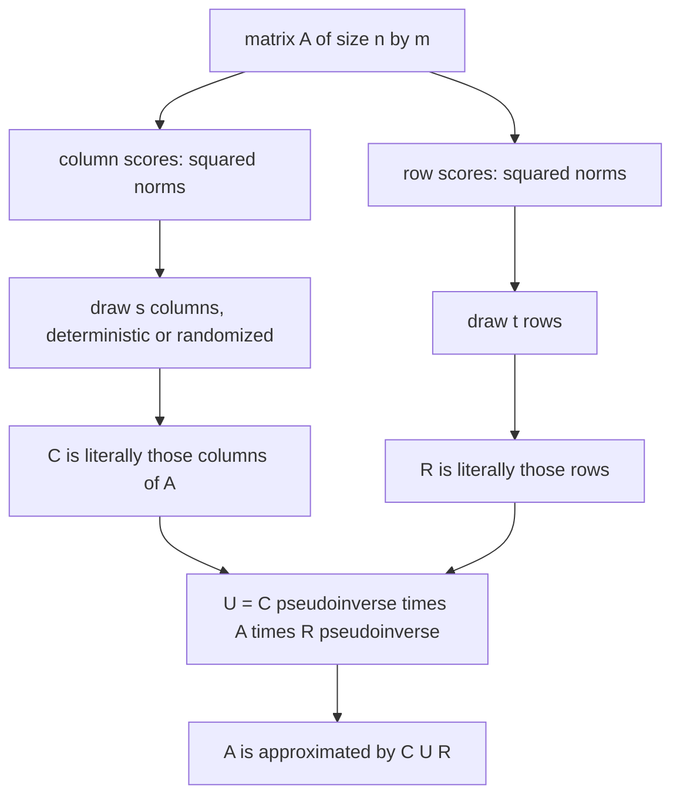
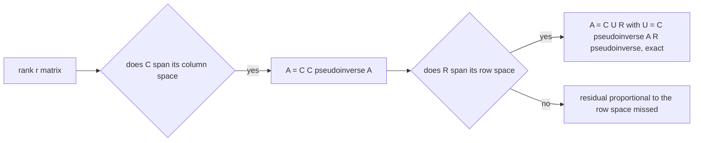
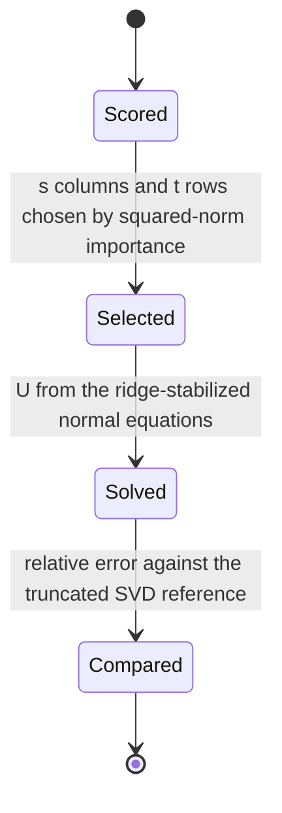
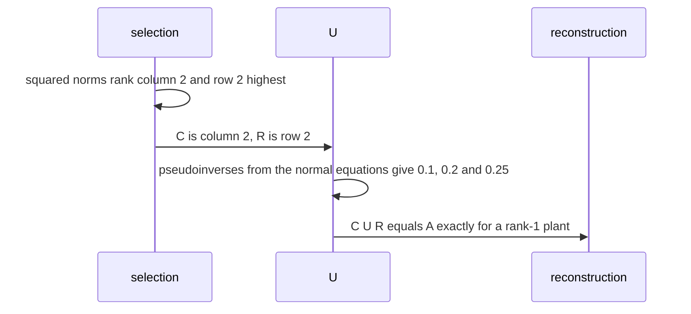

# 596 — Implement CUR decomposition sketch demonstration.

> **Tier:** Advanced · **CTCI chapter:** Beyond — Numerical & Scientific Computing
> **Task spec:** [596-implement-cur-decomposition-sketch-demonstration.md](../../../tasks/advanced/596-implement-cur-decomposition-sketch-demonstration.md)
> **Solutions:** [Python](../../../solutions/python/advanced/596-implement-cur-decomposition-sketch-demonstration/solution.py) ·
> [Java](../../../solutions/java/advanced/596-implement-cur-decomposition-sketch-demonstration/Solution.java) ·
> [JavaScript](../../../solutions/javascript/advanced/596-implement-cur-decomposition-sketch-demonstration/solution.js) ·
> [C#](../../../solutions/csharp/advanced/596-implement-cur-decomposition-sketch-demonstration/Solution.cs)

## 1. Problem restatement

**Input:** a matrix `A` (`n x m`) and sizes `s` (columns) and `t` (rows).

**Output:** a factorization `A ≈ C U R` in which

| Factor | Shape | Origin |
| --- | --- | --- |
| `C` | `n x s` | **actual columns** of `A`, chosen with probability `∝ ‖A⁽ⁱ⁾‖²` |
| `R` | `t x m` | **actual rows** of `A`, chosen with probability `∝ ‖A_(j)‖²` |
| `U` | `s x t` | `C⁺ A R⁺`, the Moore-Penrose pseudoinverses of `C` and `R` |

The point of the method is interpretability: the factors are literal columns and rows of the input,
unlike the SVD's dense mixtures. Both a deterministic top-score selection (`top_indices`) and a seeded
randomized weighted selection (`weighted_sample_without_replacement`) are implemented; the
pseudoinverses come from the normal equations `C⁺ = (CᵀC)⁻¹Cᵀ` with a small ridge (`RIDGE = 1e-10`) for a
rank-deficient `C`, and the low-rank reference is the truncated SVD from a cyclic Jacobi decomposition of
`A Aᵀ`.

| Check | Result |
| --- | --- |
| all columns and all rows | `C = A`, `R = A` gives `C U R = A` **bit for bit** — in exact arithmetic `A A⁺ A A⁺ A = A` because `A A⁺ A = A` — asserted to `1e-9` |
| planted rank-5 matrix, `15` of `60` columns and `15` of `40` rows | reproduced to `1.1e-14`, because `C` spans the column space and `R` the row space exactly — a **structural** fact, and the file says so |
| the same plant plus noise, `s = t = 6, 10, 15` | relative error `0.22`, `0.17`, `0.14` against best achievable errors `0.119`, `0.109`, `0.079`, i.e. measured factors `1.85`, `1.57`, `1.74` |
| the textbook factor | reported as a bounded observation (`<= 2.5`) rather than as the theorem |
| SVD lower bound | `rank(C U R) <= min(s, t)`, so `‖A - C U R‖_F` can never beat `‖A - A_r‖_F` — asserted, which pins down that CUR is measured against the right reference |
| selection quality | deterministic norm-based selection beats uniform random selection on a matrix with one dominant column, and the error is monotonically non-increasing as more columns are selected |
| interpretability | every column of `C` and every row of `R` is literally a column/row of `A`, and `U` has shape `s x t` |
| boundaries | a `1`-column/`1`-row CUR is a poor approximation, and a zero column keeps probability `0` and stays out of `C` |
| determinism | all sampling from `splitmix64` with fixed seeds |

## 2. Intuition

SVD gives the best low-rank approximation but its factors are dense combinations that nobody can read: a
"component" is a signed mixture of every column. CUR trades a little accuracy for readability — picks
`C` as a subset of the actual columns, `R` as a subset of the actual rows, and squeezes the correction
into the small matrix `U` that maps one to the other.

The choice of subset is where the sampling theory lives. A column that is nearly zero contributes almost
nothing to any product, so it should not be picked; a column with a large norm carries much of the
matrix's energy. Sampling with probability proportional to the squared norm makes the selected set a
representative sketch, and the correction

```
U = C⁺ A R⁺
```

is exactly the least-squares map from the sampled rows to the sampled columns: `C⁺` projects onto the
column space of `C`, `A` carries the true matrix, and `R⁺` projects onto the row space of `R`.



Why the method is *exact* on a low-rank matrix is a property of the pseudoinverse: if `C` contains enough
columns to span the column space of `A` and `R` enough rows to span its row space, then `A = C C⁺ A R⁺ R`
and the factorization is exact up to floating-point rounding. The file observes exactly that — `1.1e-14`
relative error for a rank-5 plant — and describes it as structural rather than as a numerical accident.



## 3. Algorithm

1. **Scores.** `column_scores(A)` and `row_scores(A)` return the squared norms; `selection_probabilities`
   normalizes them.
2. **Select.** `top_indices(scores, count)` picks the largest scores deterministically;
   `weighted_sample_without_replacement(probabilities, count, state)` draws the randomized version.
3. **Build the factors.** `cur(A, column_indices, row_indices)` assembles `C`, `R`, then
   `U = pseudoinverse(C) · A · pseudoinverse(R)` and returns all three plus the approximation.
4. **Pseudoinverse.** `pseudoinverse(matrix)` solves the normal equations `(MᵀM + ridge·I) X = Mᵀ` by
   `solve`, which is the ridge-stabilized form that handles a rank-deficient selection.
5. **Reference.** `jacobi_eigh` on `A Aᵀ` gives the truncated SVD (`svd_residual`), and
   `numerical_rank` gives the rank that confirms `rank(C U R) <= min(s, t)`.

```text
function cur(A, column_indices, row_indices)
    C ← the chosen columns of A, in order
    R ← the chosen rows of A, in order
    U ← pseudoinverse(C) times A times pseudoinverse(R)
    return C, U, R, C times U times R
end

function pseudoinverse(matrix, ridge)
    normal ← matrix transposed times matrix
    for i from 0 to size - 1 do
        normal[i][i] ← normal[i][i] + ridge
    end
    return solve(normal, matrix transposed)      # (M transposed M + ridge I) X = M transposed
end
```

```text
procedure select_columns(A, s, randomized)
    probabilities ← squared column norms, normalized
    if randomized then
        return weighted sample of s indices without replacement
    end
    return the s largest scores                       # deterministic top-score selection
end
```



## 4. Worked example

**A rank-1 matrix reconstructed from one column and one row.** Let

```
A = [[1, 2],
     [2, 4]]
```

which is `u vᵀ` with `u = (1, 2)` and `v = (1, 2)`, so its rank is `1`. Column scores are `‖(1,2)‖² = 5`
and `‖(2,4)‖² = 20`, so the highest-scoring column is the second; row scores are `5` and `20`, so the
highest-scoring row is the second, and with `s = t = 1` the deterministic selection picks `C = [[2], [4]]`
and `R = [[2, 4]]`.

| Step | Computation | Result |
| --- | --- | --- |
| `Cᵀ C` | `(2 4) · (2 4)ᵀ` | `[[20]]` |
| `C⁺ = (Cᵀ C)⁻¹ Cᵀ` | `(1/20) · (2 4)` | `[[0.1, 0.2]]` |
| `R Rᵀ` | `(2 4)ᵀ (2 4)` | `[[20]]` |
| `R⁺ = Rᵀ (R Rᵀ)⁻¹` | `(1/20) · (2, 4)ᵀ` | `[[0.1], [0.2]]` |
| `C⁺ A` | `[[0.1, 0.2]] · [[1, 2], [2, 4]]` | `[[0.5, 1.0]]` |
| `U = (C⁺ A) R⁺` | `[[0.5, 1.0]] · [[0.1], [0.2]]` | `[[0.25]]` |
| `C U R` | `[[2], [4]] · [[0.25]] · [[2, 4]]` | `[[1, 2], [2, 4]] = A` |

One column and one row reconstruct a rank-1 matrix exactly, and the reason is visible in the arithmetic:
`U = 0.25 = 1/4` is precisely the factor that makes `u = 2·0.5` and `v = 2·2` match the original
scaling. `U` has shape `1 x 1 = s x t`, and both `C` and `R` are literal columns and rows of `A`.



**The all-columns, all-rows case is exact in any rank.** Taking `C = A` and `R = A` gives
`U = A⁺ A A⁺`, and multiplying back yields `A A⁺ A A⁺ A = A`, because `A A⁺ A = A` is the defining
property of the Moore-Penrose pseudoinverse. The file asserts this to `1e-9` — the check that validates
the pseudoinverse arithmetic independently of any sampling claim.

**What happens when the matrix is not low rank.** On the planted rank-5 matrix with noise, choosing
`15` of `60` columns and `15` of `40` rows gives a relative error of `1.1e-14` **without** noise, since
the selected columns and rows span the two spaces exactly. With noise, the relevant reference is the best
rank-`min(s, t)` approximation:

| `s = t` | CUR relative error | best rank-`min(s,t)` error | measured factor |
| --- | --- | --- | --- |
| `6` | `0.22` | `0.119` | `1.85` |
| `10` | `0.17` | `0.109` | `1.57` |
| `15` | `0.14` | `0.079` | `1.74` |

The textbook `2 + eps` factor is reported as a bounded observation (`<= 2.5`) rather than as a theorem,
and the lower bound `‖A - C U R‖_F >= ‖A - A_r‖_F` with `r = min(s, t)` is asserted — that inequality pins
down that CUR is being compared against the right target, since `rank(C U R) <= min(s, t)` always.

## 5. Complexity

Let `n, m` be the matrix shape, `s` and `t` the selection sizes, and `r` the numerical rank.

| Measure | Bound | Why it holds |
| --- | --- | --- |
| Scores | O(n · m) | one pass for column and row norms |
| Selection | O(n + m) for the top scores, O(n + m) for the weighted sampler | one linear scan each |
| Pseudoinverse of `C` | O(s² · n + s³) | the normal equations and their factorization |
| Pseudoinverse of `R` | O(t² · m + t³) | the same for the row side |
| `U` | O(s · n · t + s · t · m) | two dense products through the selected spaces |
| Approximation | O(n · s · t + n · t · m) | forming `C U R` |
| SVD reference | O(n² · m) or more | the cyclic Jacobi decomposition used as the low-rank baseline |
| Space | O(n · m + n · s + t · m + s · t) | the matrix plus the factors |
| Error | at least the best rank-`min(s, t)` error | a theorem, asserted |

Compared with the SVD the trade is explicit: CUR needs only the norms and a small number of matrix
products, returns interpretable factors, and pays with an error that is provably worse than the optimal
rank-`min(s, t)` approximation.

## 6. Pitfalls and edge cases

- **Ridge in the pseudoinverse.** A selected `C` may be rank-deficient (repeated or dependent columns), so
  `(CᵀC)⁻¹` does not exist; the small ridge (`1e-10`) makes the normal equations solvable and is the
  documented stabilization.
- **Reference must be rank `min(s, t)`.** `rank(C U R) <= min(s, t)` means the honest baseline is the
  truncated SVD at that rank; comparing against the full-rank SVD would make CUR look arbitrarily bad.
- **Low-rank exactness is structural.** When the columns of `C` span the column space and the rows of `R`
  span the row space, `A = C C⁺ A R⁺ R` exactly; the `1.1e-14` error is rounding, not approximation, and
  the file says so instead of presenting it as luck.
- **Zero columns.** A zero column has probability `0` and must never be selected — otherwise `p_i = 0`
  would divide by zero in the weighted sampler, and the file asserts the column stays out of `C`.
- **A single column and row is a poor CUR.** With `s = t = 1` the rank of the approximation is `1`, so a
  general matrix cannot be recovered; the file asserts the poor result rather than skipping the case.
- **Deterministic versus random selection.** On a matrix with one dominant column, the deterministic
  top-score selection beats uniform random selection; the randomized weighted sampler is the version with
  provable error bounds, and both are exercised.
- **Monotone improvement with more columns.** The error is non-increasing as more columns are selected
  (with the deterministic scorer), which the file asserts as a sanity property of the selection rule.
- **Interpretability has a structural test.** Every column of `C` must be literally a column of `A`, and
  `U` must have shape `s x t` — a factorization that mixes columns would fail both.
- **Noise changes the story.** Without noise the error is at rounding level; with noise it is a multiple of
  the optimal low-rank error. Reporting both cases together is what makes the claim precise.
- **Reproducibility.** All sampling uses `splitmix64` with fixed seeds, so every reported error is
  reproducible; the assertions on measured factors depend on that.

## 7. Variants and follow-ups

- **Sampling the product instead of the matrix.** Column-sampling sketches estimate `A B` from the same
  norm-based probabilities — [595-implement-approximate-matrix-multiplication-via-sampling.md](../../../tasks/advanced/595-implement-approximate-matrix-multiplication-via-sampling.md).
- **Mixing instead of selecting.** Random projection forms dense mixtures with a provable distortion
  bound — [594-implement-randomized-numerical-linear-algebra-random-projection.md](../../../tasks/advanced/594-implement-randomized-numerical-linear-algebra-random-projection.md).
- **The optimal low-rank reference.** The truncated SVD that bounds every CUR error is the subject of
  [502-implement-randomized-svd-basic-using-power-method.md](../../../tasks/advanced/502-implement-randomized-svd-basic-using-power-method.md).
- **Interpretable factors without sampling.** Non-negative matrix factorization also produces readable
  parts, but mixes columns instead of selecting them —
  [590-implement-non-negative-matrix-factorization-simple-multiplicativ.md](../../../tasks/advanced/590-implement-non-negative-matrix-factorization-simple-multiplicativ.md).
- **Selecting for sparsity instead of rank.** The lasso picks a few columns of a design matrix by
  penalizing coefficients rather than by norm-based sampling —
  [593-implement-l1-regularized-least-squares-via-coordinate-descent.md](../../../tasks/advanced/593-implement-l1-regularized-least-squares-via-coordinate-descent.md).

## 8. Check yourself

1. Why is `C = A`, `R = A` guaranteed to give `C U R = A`?

<details><summary>Show answer</summary>

Because `U = A⁺ A A⁺` and `C U R = A A⁺ A A⁺ A`. The Moore-Penrose property `A A⁺ A = A` collapses the
expression to `A`. The file asserts this to `1e-9` as a check of the pseudoinverse arithmetic — it holds
for any matrix, not just low-rank ones.

</details>

2. In the worked example, why did one column and one row suffice?

<details><summary>Show answer</summary>

Because the matrix had rank `1`: a single column spans its column space and a single row spans its row
space, so the structural condition `A = C C⁺ A R⁺ R` is met. The arithmetic confirmed it, with
`U = [[0.25]]` and `C U R = A` exactly. For a general matrix a rank-`1` CUR cannot work, and the file
asserts that a `1`-column/`1`-row CUR is a poor approximation.

</details>

3. Why is the truncated SVD at rank `min(s, t)` the right reference?

<details><summary>Show answer</summary>

Because `rank(C U R) <= min(s, t)`: with `s` selected columns and `t` selected rows the approximation
cannot have more than `min(s, t)` independent directions. So the best possible error is
`‖A - A_r‖_F` with `r = min(s, t)`, and CUR's residual can never be smaller — an inequality the file
asserts, which is also what makes the measured factors `1.85`, `1.57`, `1.74` interpretable.

</details>

4. Why does the pseudoinverse need a ridge term?

<details><summary>Show answer</summary>

Because the selected columns can be linearly dependent (or include duplicates), making `CᵀC` singular and
the normal equations unsolvable. Adding `RIDGE = 1e-10` to the diagonal keeps the system solvable and
stable while perturbing the answer far below the tolerance the file uses.

</details>

5. What is lost and what is gained by using CUR instead of the SVD?

<details><summary>Show answer</summary>

Gained: interpretability — `C` and `R` are literal columns and rows of the input, which is what makes the
factors readable, and the checks assert that structural property. Lost: accuracy — the error is at least
the best rank-`min(s, t)` error, measured as factors `1.57` to `1.85` above it on the noisy plant, where
the SVD would be optimal by definition.

</details>