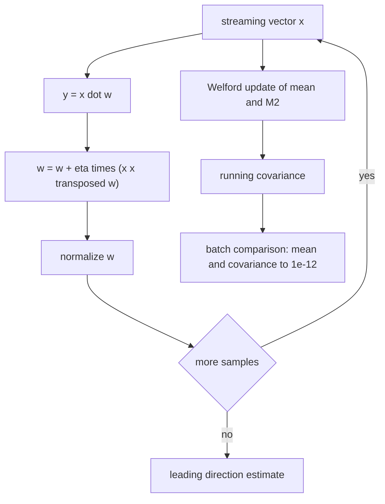
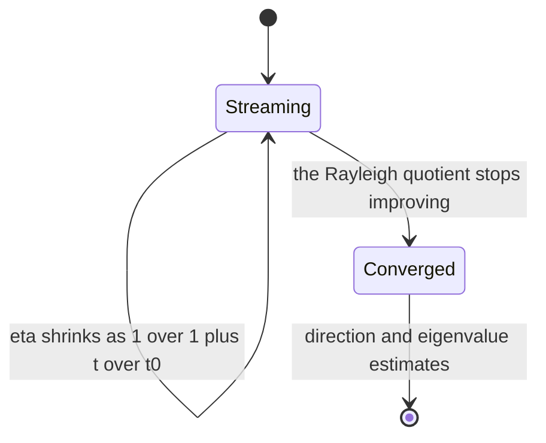
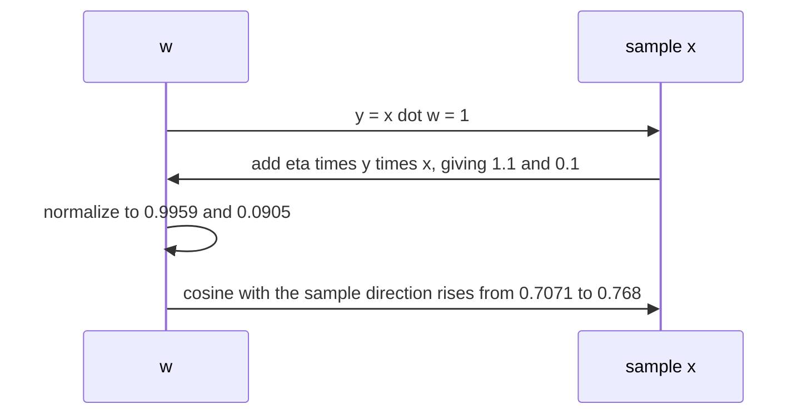

# 597 — Implement streaming PCA with incremental updates.

> **Tier:** Advanced · **CTCI chapter:** Beyond — Machine Learning & AI
> **Task spec:** [597-implement-streaming-pca-with-incremental-updates.md](../../../tasks/advanced/597-implement-streaming-pca-with-incremental-updates.md)
> **Solutions:** [Python](../../../solutions/python/advanced/597-implement-streaming-pca-with-incremental-updates/solution.py) ·
> [Java](../../../solutions/java/advanced/597-implement-streaming-pca-with-incremental-updates/Solution.java) ·
> [JavaScript](../../../solutions/javascript/advanced/597-implement-streaming-pca-with-incremental-updates/solution.js) ·
> [C#](../../../solutions/csharp/advanced/597-implement-streaming-pca-with-incremental-updates/Solution.cs)

## 1. Problem restatement

**Input:** a stream of vectors, never stored.

**Output:** the principal components, computed by two layers of incremental machinery that are both
cross-checked against a batch computation:

| Layer | Function | Recurrence |
| --- | --- | --- |
| running moments | `StreamingMoments` | Welford's numerically stable one-pass mean and covariance, so the data matrix is never needed |
| one principal direction | `oja_stream` | Oja's rule `w ← w + η · (x xᵀ w)` — a stochastic power iteration with a decreasing step `η_t = η₀ / (1 + t / t₀)` |
| `k` components | `sanger_stream` | Sanger's generalization `w_j ← w_j + η · y_j · (x - Σ_{l<=j} y_l w_l)` with `y_j = xᵀ w_j`, which is exactly the Gram-Schmidt correction written incrementally |

| Check | Result |
| --- | --- |
| streaming mean and covariance | **exactly** the batch mean and covariance, asserted to `1e-12` |
| Oja's direction | converges to the true leading eigenvector: `|cos| >= 0.999` against the batch power-iteration result |
| Rayleigh quotient | asserted to stay **below** the true `λ1` — a theorem, since `vᵀΣv <= λ_max` — while also reaching 99 % of it |
| eigenvalue estimate | compared with the batch estimate and with the planted spectrum: the `k` largest eigenvalues are asserted, and the variance-explained figure is reported as a measured quantity |
| Sanger's components | orthonormal to `1e-9`, and they span the same subspace as the batch eigenvectors (projection trace `k` to within `1e-3`, and never above `k`) |
| the documented failure | with two planted eigenvalues within `0.1 %` of each other the *direction* is ill-determined: the cosine with the batch leading direction falls to `0.912`, while the eigenvalue estimate stays within `0.5 %` of `λ1` |
| convergence | the Rayleigh quotient averaged over the first 20 % of the stream versus the last 20 % is asserted to increase |
| reconstruction error | the streaming subspace's error is compared with the exact sum of the trailing eigenvalues |

All stream data comes from `splitmix64` (Box-Muller), because the planted spectra and the step-size
schedule need tens of thousands of independent draws.

## 2. Intuition

Batch PCA needs the covariance matrix, which needs the data — the two things a stream does not give you.
Two independent ideas make it possible anyway.

* **Moments.** Welford's update computes the running mean and the running second moment from a single
  pass, with the numerical stability that comes from centring each new sample against the *current* mean
  instead of accumulating products of raw values.
* **Directions.** Oja's rule is power iteration applied to one sample at a time: each `x xᵀ w` pulls `w`
  toward `x`, and by averaging over many samples the pull is proportional to the covariance times `w`.
  Because the step is stochastic, the step size has to shrink — the schedule `η₀ / (1 + t / t₀)` is what
  makes the iteration converge rather than wander.



For `k` components the naive approach — run Oja `k` times with the previous components deflated — is
awkward on a stream. Sanger's rule fixes it inside the update: when updating component `j`, subtract the
projections onto component `j` **and all earlier components**, which is precisely the Gram-Schmidt step.
The components therefore stay orthogonal without ever recomputing a matrix product, and the subtraction
is what prevents all `k` vectors from collapsing onto the leading direction.


## 3. Algorithm

1. **Moments.** For each streamed vector: update the mean with
   `mean ← mean + (x - mean)/n` and the second-moment accumulator `M2 ← M2 + (x - mean_old)(x - mean_new)ᵀ`;
   the covariance is `M2 / n` (`batch_covariance` gives the same quantity by the direct formula, for
   comparison).
2. **Oja.** For each vector: `y = xᵀ w`, then `w ← w + η_t · y · x`, then normalize. The step size is
   `η_t = η₀ / (1 + t / t₀)`.
3. **Sanger.** For each vector and each component `j = 1..k`: `y_j = xᵀ w_j`, then
   `w_j ← w_j + η_t · y_j · (x - Σ_{l<=j} y_l w_l)`, renormalizing each component.
4. **References.** `batch_mean`, `batch_covariance` and `power_iteration` compute the batch answers;
   `symmetric_eigenvalues` gives the planted/batch spectrum for comparison; `rayleigh` evaluates
   `vᵀΣv`; `gram_schmidt` orthonormalizes when needed.
5. **Measure.** The cosine between the streaming and batch directions, the Rayleigh quotient's progress
   (first 20 % versus last 20 % of the stream), the orthonormality of Sanger's components, the projection
   trace, and the reconstruction error against the sum of the trailing eigenvalues.

```text
procedure streaming_moments(stream)
    count ← 0
    mean ← zero vector
    m2 ← zero matrix
    for x in stream do
        count ← count + 1
        delta ← x - mean
        mean ← mean + delta / count
        m2 ← m2 + outer(delta, x - mean)
    end
    return mean, m2 / count
end
```

```text
function oja_stream(stream, eta0, t0)
    w ← random unit vector
    for t, x in stream do
        eta ← eta0 / (1 + t / t0)
        y ← dot(x, w)
        w ← w + eta * y * x
        w ← w / norm(w)
    end
    return w
end

function sanger_stream(stream, k, eta0, t0)
    components ← k orthonormal random vectors
    for t, x in stream do
        eta ← eta0 / (1 + t / t0)
        for j from 1 to k do
            y ← dot(x, components[j])
            correction ← x - sum over l <= j of (dot(x, components[l]) * components[l])
            components[j] ← components[j] + eta * y * correction
            components[j] ← components[j] / norm(components[j])
        end
    end
    return components
end
```



## 4. Worked example

**Welford's updates on `1, 2, 3`.** The running mean and the `M2` accumulator after each sample:

| Sample | `delta = x - mean` | Mean after | `M2` after |
| --- | --- | --- | --- |
| `1` | `1 - 0 = 1` | `1` | `0` |
| `2` | `2 - 1 = 1` | `1 + 1/2 = 1.5` | `0 + 1·(2 - 1.5) = 0.5` |
| `3` | `3 - 1.5 = 1.5` | `1.5 + 1.5/3 = 2.0` | `0.5 + 1.5·(3 - 2) = 2.0` |

The final mean is `2.0` and the covariance is `M2 / n = 2/3 ≈ 0.6667`, which is exactly the population
variance of `{1, 2, 3}` — the direct formula the file asserts against, to `1e-12`. The important detail is
that `M2` accumulated products of *centred* deviations, so the catastrophic cancellation that would come
from accumulating `x²` and subtracting the squared mean never happens.

**One Oja step.** Take `w = (1, 0)`, a sample `x = (1, 1)` and `η = 0.1`. Then `y = xᵀw = 1`, and

```
w ← (1, 0) + 0.1 · 1 · (1, 1) = (1.1, 0.1),   normalized ≈ (0.9959, 0.0905)
```

The cosine with the sample direction `x/‖x‖ = (0.7071, 0.7071)` moved from `0.7071` to
`0.9959 · 0.7071 + 0.0905 · 0.7071 ≈ 0.768`, so the step pulled `w` toward `x`. Averaged over a whole
stream with the shrinking `η_t`, that pull is proportional to `Σ w`, which is the covariance — that is
why the iteration's fixed point is the leading eigenvector, and why the file can assert `|cos| >= 0.999`
against the batch power-iteration answer.



**Sanger's correction for `k = 2`.** With `w_1 = (1, 0)`, `w_2 = (0, 1)`, `x = (1, 1)` and `η = 0.1`:
`y_1 = 1` and `y_2 = 1`. Updating `w_2` subtracts the projections onto **both** components,

```
correction = x - y_1 w_1 - y_2 w_2 = (1, 1) - (1, 0) - (0, 1) = (0, 0)
```

so the second component does not move at all in this symmetric case, while `w_1` moves to
`(0.9959, 0.0905)` as above. Without the correction, both components would be pulled toward the same
direction and end up representing one eigenvector twice; with it, the second component only tracks what
the first has not already explained. Over a full stream the file asserts the components stay orthonormal
to `1e-9` and span the same subspace as the batch eigenvectors — the projection trace is `k` to within
`1e-3` and never exceeds `k`.

**The Rayleigh quotient bound, exactly.** For the covariance `Σ = [[2, 1], [1, 2]]` the eigenvalues are
`3` and `1`, so `λ1 = 3`. Evaluating `vᵀΣv`:

| `v` | `Σv` | `vᵀΣv` | Interpretation |
| --- | --- | --- | --- |
| `(1, 0)` | `(2, 1)` | `2` | a feasible direction, below `λ1` |
| `(0.7071, 0.7071)` | `(2.1213, 2.1213)` | `3.0` | the leading eigenvector, equal to `λ1` |
| `(0.7071, -0.7071)` | `(0.7071, -0.7071)` | `1.0` | the second eigenvector, equal to `λ2` |

No unit vector can score above `3`, which is the theorem the file asserts on the streaming estimates:
the Rayleigh quotient of Oja's direction never exceeds the true `λ1`, and the convergence check is that it
*reaches* 99 % of it. That combination — a hard upper bound plus a measured closeness — is much stronger
than reporting an estimate alone.

## 5. Complexity

Let `d` be the dimension, `T` the number of streamed vectors and `k` the number of components.

| Measure | Bound | Why it holds |
| --- | --- | --- |
| Welford update | O(d²) per sample | the `M2` accumulator is a `d x d` matrix |
| Oja step | O(d) per sample | one dot product and one vector update |
| Sanger step | O(k² · d) per sample | for each component, the correction sums over `l <= j`, so `O(k²)` projections plus `O(k · d)` vector work |
| Total, Oja | O(T · d) | linear in the stream length and the dimension |
| Total, Sanger | O(T · k² · d) | `k` components with Gram-Schmidt inside |
| Batch reference | O(T · d²) plus an eigen-decomposition | feasible only because the demo can materialize the stream |
| Space | O(d²) for the moments, O(k · d) for the components | the stream itself is never stored |
| Step-size schedule | `η_t = η₀ / (1 + t / t₀)` | the classical Robbins-Monro form needed for stochastic convergence |

The contrast with batch PCA is the point: the streaming method never forms the data matrix, and its
per-sample cost is `O(k² · d)` rather than `O(T · d²)` for the one-pass covariance plus decomposition.

## 6. Pitfalls and edge cases

- **The step size must shrink.** Oja's rule with a constant step does not converge; the schedule
  `η₀ / (1 + t / t₀)` is what the file uses, and the convergence claim (`|cos| >= 0.999`) depends on it.
- **Renormalize after every step.** The update `w + η y x` changes the norm; without normalizing, `w`
  grows and the effective step size changes silently.
- **Sanger's correction covers `l <= j`.** Subtracting only the *previous* components leaves `w_j`
  absorbing its own contribution; subtracting all `l <= j` is the Gram-Schmidt step, and it is what keeps
  the `k` directions from collapsing onto one.
- **The Rayleigh quotient cannot exceed `λ1`.** This is the theorem used as a check: an estimate above
  the true largest eigenvalue is impossible, so any such number is a bug, while closeness to `λ1`
  (99 %) is the convergence measure.
- **Welford, not raw sums.** Accumulating `Σ x²` and subtracting `n·mean²` loses precision catastrophically
  on large offsets; the centred recurrence avoids it, which is why the file can assert exact agreement
  with the batch formula to `1e-12`.
- **Ill-conditioned spectra.** When two planted eigenvalues are within `0.1 %` of each other the
  *direction* is ill-determined — the cosine with the batch leading direction drops to `0.912` — while
  the eigenvalue estimate stays within `0.5 %` of `λ1`. The file asserts both halves, which is the honest
  statement about eigenvector conditioning.
- **Convergence is measured, not assumed.** The Rayleigh quotient averaged over the first 20 % of the
  stream is compared with the last 20 % and asserted to increase; a single endpoint value would hide a
  schedule that is too aggressive.
- **The trailing eigenvalues bound the reconstruction error.** The error of the streaming subspace is
  compared with the exact sum of the eigenvalues the subspace does not capture — the definition of what
  a `k`-dimensional PCA can achieve.
- **Independence of the draws.** The planted spectra and the step-size schedule need tens of thousands of
  independent draws, so the stream comes from `splitmix64` (Box-Muller) rather than a short-cycle
  generator.
- **Projection trace.** Sanger's subspace is the right one only if the trace of the projection onto the
  batch eigenvectors is `k` to within `1e-3` and never above `k`; a larger trace would mean the
  components overlap in a way orthonormality forbids.

## 7. Variants and follow-ups

- **Batch power iteration.** The deterministic ancestor of Oja's rule, used here as the reference —
  [501-implement-pca-via-power-iteration-for-largest-eigenvector.md](../../../tasks/advanced/501-implement-pca-via-power-iteration-for-largest-eigenvector.md).
- **Subspace iteration on a sparse operator.** Spectral clustering propagates `k` vectors at once and
  finishes with a Rayleigh-Ritz step — [589-implement-spectral-clustering-using-sparse-eigen-solver-power-it.md](../../../tasks/advanced/589-implement-spectral-clustering-using-sparse-eigen-solver-power-it.md).
- **Randomized low-rank approximations.** A sketch plus power iteration computes the dominant subspace of
  a matrix that does fit in memory — [502-implement-randomized-svd-basic-using-power-method.md](../../../tasks/advanced/502-implement-randomized-svd-basic-using-power-method.md).
- **Sketching as an alternative to moments.** Random projection preserves geometry without estimating a
  covariance — [594-implement-randomized-numerical-linear-algebra-random-projection.md](../../../tasks/advanced/594-implement-randomized-numerical-linear-algebra-random-projection.md).
- **Online classifiers instead of online subspaces.** Kernelized online learning keeps a dual
  representation that grows with the data — [598-implement-online-svm-perceptron-with-kernel-trick-simple.md](../../../tasks/advanced/598-implement-online-svm-perceptron-with-kernel-trick-simple.md).

## 8. Check yourself

1. Why is Welford's recurrence used instead of accumulating sums of squares?

<details><summary>Show answer</summary>

Because `Σ x²` and `n·mean²` are both huge when the data have a large offset, and subtracting them loses
most of the significant digits — the classic cancellation failure. Welford's update accumulates products of
*centred* deviations (`delta · (x - mean_new)`), which stay comparable to the variance itself, and that is
why the file can assert the streaming covariance equals the batch covariance to `1e-12`.

</details>

2. In the worked example, what did one Oja step do to the direction, and why does that imply convergence?

<details><summary>Show answer</summary>

It moved `w` from `(1, 0)` to `(0.9959, 0.0905)`, raising the cosine with the sample direction from
`0.7071` to `0.768`. Each step pulls `w` toward the current sample; averaged over a stream, the pull is
`O(η Σ w)` (plus lower-order terms), i.e. proportional to the covariance applied to `w` — power iteration
with noise. With the step size shrinking like `1/(1 + t/t₀)` the direction converges, which the file
verifies as `|cos| >= 0.999` against the batch power iteration.

</details>

3. What exactly does Sanger's rule subtract, and what breaks without it?

<details><summary>Show answer</summary>

For component `j` it subtracts the projections onto components `1..j`, i.e. `Σ_{l<=j} y_l w_l` with
`y_l = xᵀ w_l` — the Gram-Schmidt construction of the residual after removing the already explained
directions. Without it, every component would be pulled toward the leading direction and the `k` vectors
would converge to the same eigenvector, so the subspace would have rank 1; the file's orthonormality
(`1e-9`) and projection-trace (`k` within `1e-3`, never above) checks would both fail.

</details>

4. Why is "Rayleigh quotient <= λ1" a useful check for a streaming estimator?

<details><summary>Show answer</summary>

Because `vᵀΣv <= λ_max` for every unit vector is a theorem, so any estimate above `λ1` is provably wrong
— the check can fail but cannot falsely pass. Combined with the requirement that the quotient *reaches*
99 % of `λ1`, it turns an estimate into a two-sided statement: bounded above by theory, close below by
measurement.

</details>

5. The two nearly equal planted eigenvalues make the cosine drop to `0.912`. Why is that not a bug?

<details><summary>Show answer</summary>

Because when two eigenvalues are within `0.1 %` of each other, the leading eigenvector is only determined
up to a rotation inside the nearly-degenerate subspace — any mixture of the two directions is an almost
equally good leading direction. The eigenvalue, by contrast, is well determined, and the file asserts it
stays within `0.5 %` of `λ1`. That contrast is the standard conditioning statement about eigenvectors
versus eigenvalues, and the file reports it as such.

</details>