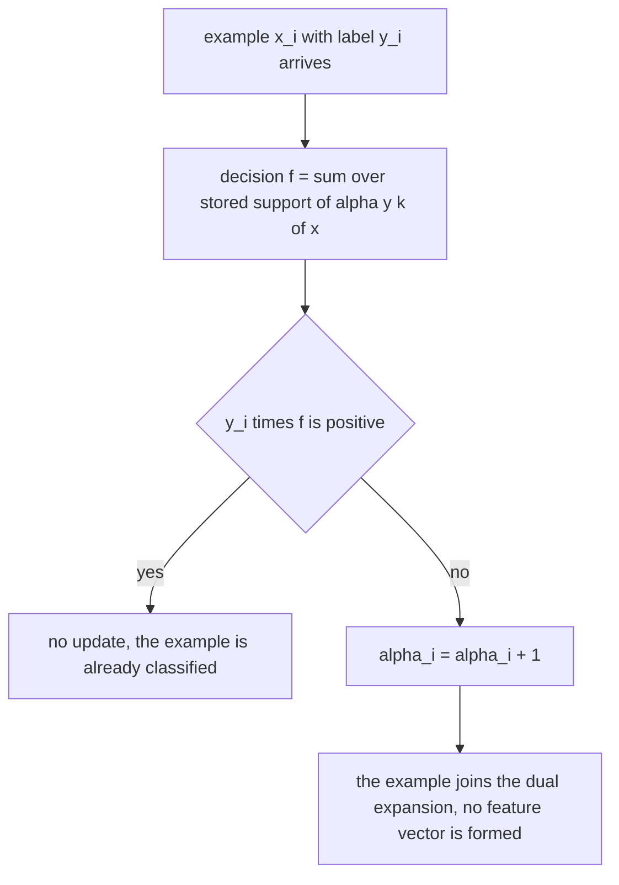
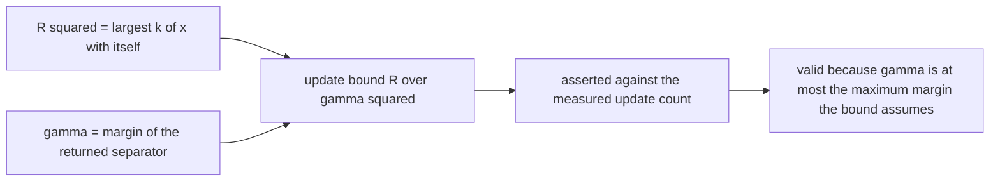
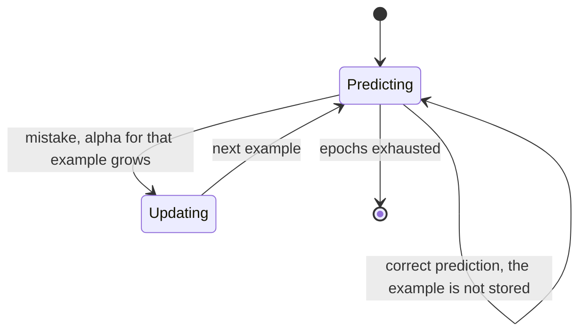
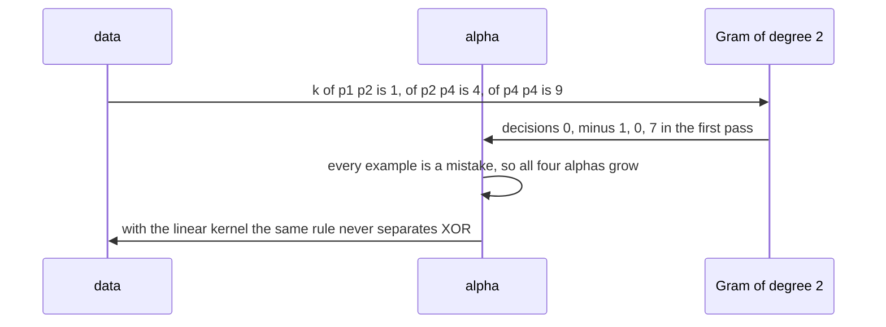

# 598 — Implement online SVM perceptron with kernel trick (simple).

> **Tier:** Advanced · **CTCI chapter:** Beyond — Machine Learning & AI
> **Task spec:** [598-implement-online-svm-perceptron-with-kernel-trick-simple.md](../../../tasks/advanced/598-implement-online-svm-perceptron-with-kernel-trick-simple.md)
> **Solutions:** [Python](../../../solutions/python/advanced/598-implement-online-svm-perceptron-with-kernel-trick-simple/solution.py) ·
> [Java](../../../solutions/java/advanced/598-implement-online-svm-perceptron-with-kernel-trick-simple/Solution.java) ·
> [JavaScript](../../../solutions/javascript/advanced/598-implement-online-svm-perceptron-with-kernel-trick-simple/solution.js) ·
> [C#](../../../solutions/csharp/advanced/598-implement-online-svm-perceptron-with-kernel-trick-simple/Solution.cs)

## 1. Problem restatement

**Input:** labelled examples arriving one at a time, plus a kernel function.

**Output:** two online learners in **dual form**, so the feature map is never materialised:

| Learner | Update | Decision |
| --- | --- | --- |
| kernelised perceptron | on a mistake, `α_i ← α_i + 1` | `f(x) = Σ_i α_i y_i k(x_i, x)` |
| Pegasos kernel SVM | subgradient step on `(λ/2)‖w‖² + hinge`, with the projection `‖w‖ <= 1/√λ` after **every** step, plus the averaged variant | the same dual expansion |

The norm is available without ever forming `w`:
`‖w‖² = Σ_{i,j} α_i α_j y_i y_j k(x_i, x_j)`.

Kernels: `linear_kernel`, `polynomial_kernel(degree)` = `(1 + x·z)^d`, `rbf_kernel(gamma)` =
`exp(-γ‖x - z‖²)` — with `polynomial_features` providing an **explicit** feature map so the kernel identity
can be checked against a materialised feature space rather than against itself.

| Check | Result |
| --- | --- |
| the kernel identity | `k(x, z)` equals the dot product of the explicit degree-`d` monomial features (multinomial weights `√2` on cross terms) to `1e-9` |
| XOR | zero training errors with the degree-2 polynomial kernel, while the same online rule with the **linear** kernel keeps making mistakes |
| mistake bound | with `R² = max_i k(x_i, x_i)` and the margin `γ` of the returned separator, `updates <= (R/γ)²` — the file states that the bound is proved for the **maximum** margin `γ*`, and since the perceptron's margin is `<= γ*`, using the measured `γ` keeps the inequality valid |
| Gram matrices | symmetric and positive semi-definite for all three kernels (Jacobi eigenvalues `>= -1e-9`), and the linear Gram equals `X Xᵀ` exactly |
| presentation order | four deterministic orders give at least two different mistake counts |
| Pegasos objective | per-epoch monotonicity is **not** expected in a stochastic subgradient method; the file asserts the trend (last epoch better than the first, best epoch at least 10 % better) and that upward steps occur |
| RBF on two concentric circles | zero training errors, where the linear kernel is asserted to fail; Pegasos on the same data reaches `>= 0.9` test accuracy, the averaged update beats the unaveraged one, and `‖w‖ <= 1/√λ` holds after every step |
| determinism | orders and sample points come from `splitmix64` |

## 2. Intuition

The kernel trick rests on one observation: a linear learner only ever touches the data through inner
products. The perceptron's decision `wᵀx` with `w = Σ_i α_i y_i x_i` becomes
`Σ_i α_i y_i (x_i · x)`, and the *only* place `x_i · x` appears is a dot product — so replacing
`x_i · x` by `k(x_i, x)` gives a learner that works in the feature space of `k` without ever building a
feature vector. The dual representation is the whole algorithm: `n` coefficients, one update each, and a
decision function that sums over the data.



The second insight is that online mistakes are bounded. If the data are separable in the feature space
with margin `γ` and every example has `k(x, x) <= R²`, then the perceptron makes at most `(R/γ)²` updates.
The file asserts that inequality using the margin of the separator it actually returns, and explains why
that is valid: the bound is proved for the maximum margin, which is at least the observed one, so an
inequality with the measured margin is the conservative statement.



## 3. Algorithm

1. **Kernels.** `polynomial_kernel(d)` and `rbf_kernel(γ)` close over their parameters;
   `kernel_matrix(X, kernel)` builds the Gram matrix once.
2. **Perceptron.** For each example in order: compute `f(x) = Σ_i α_i y_i K[i][j]`; if `y f <= 0`, add
   one to `α_j`. Repeat for the epoch budget; `dual_norm_squared` and `margin` read the resulting dual
   solution.
3. **Pegasos.** For each example: shrink every coefficient by `(1 - η·λ)` with `η = 1/(λ·count)` — the
   regularizing half of the subgradient — then, if the margin is violated (`< 1`), add `η` to that
   example's coefficient; project so that `‖w‖ <= 1/√λ` using `dual_norm_squared(α, y, gram)`; the averaged
   variant accumulates the running average of the coefficients.
4. **Measure.** `training_errors`, `decision_accuracy`, `objective`, `margin`, and the kernel checks
   (`symmetric_eigenvalues` of the Gram matrix; the explicit feature map for the polynomial kernel).

```text
procedure kernel_perceptron(X, y, kernel, order, epochs)
    gram ← kernel matrix of X against X
    alpha ← zeros of length n
    for epoch from 1 to epochs do
        for j in order do
            decision ← sum over i of alpha[i] * y[i] * gram[i][j]
            if y[j] * decision <= 0 then
                alpha[j] ← alpha[j] + 1
            end
        end
    end
    return alpha
end
```

```text
procedure pegasos(X, y, kernel, lambda, epochs, order, averaging)
    gram ← kernel matrix of X against X
    alpha ← zeros of length n
    accumulated ← zeros of length n
    limit ← 1 / sqrt(lambda)
    for step, i in order do
        count ← step + 1
        eta ← 1 / (lambda * count)
        margin_value ← y[i] * sum over j of alpha[j] * y[j] * gram[j][i]
        alpha ← alpha * (1 - eta * lambda)       # the shrinkage applies to every dual coefficient
        if margin_value < 1 then
            alpha[i] ← alpha[i] + eta            # the label is already inside alpha
        end
        if dual_norm_squared(alpha, y, gram) > limit * limit then
            alpha ← alpha * (limit / sqrt(dual_norm_squared(alpha, y, gram)))
        end
        if averaging then
            accumulate alpha into accumulated
        end
    end
    return accumulated divided by the number of steps if averaging else alpha
end
```

Two details in that loop are the ones the implementation comments call out, because both are silent
failure modes rather than crashes: the `(1 - eta·lambda)` shrinkage must be applied to **every** dual
coefficient (omitting it freezes the direction after the first example, when `eta = 1/lambda` dwarfs every
later coefficient), and the update must be `alpha[i] += eta` rather than `alpha[i] += eta · y[i]`, because
this file writes the separator as `w = Σ α_j y_j φ(x_j)` and the label is already inside `α`.



## 4. Worked example

**The kernel identity, in exact arithmetic.** For two-dimensional points and degree 2, the polynomial
kernel is `k(x, z) = (1 + x·z)²`, and the file's explicit feature map places a factor `√2` on cross
terms:

```
phi(x) = (1, sqrt(2)·x_1, sqrt(2)·x_2, x_1², sqrt(2)·x_1·x_2, x_2²)
```

Two concrete checks:

| `x` | `z` | `phi(x)·phi(z)` | `(1 + x·z)²` |
| --- | --- | --- | --- |
| `(1, 0)` | `(0, 1)` | `1 + 0 + 0 + 0 + 0 + 0 = 1` | `(1 + 0)² = 1` |
| `(1, 1)` | `(1, 1)` | `1 + 2 + 2 + 1 + 2 + 1 = 9` | `(1 + 2)² = 9` |

The second row is the one that makes the `√2` weights necessary: without them the cross term would
contribute `1` instead of `2` and the identity would fail. The file asserts agreement to `1e-9` for
degrees up to its tolerance, which is a check against a **materialised** feature space rather than
against the kernel itself.

**The kernel perceptron on XOR.** The four points with labels
`p₁ = (0,0), y₁ = -1`; `p₂ = (0,1), y₂ = +1`; `p₃ = (1,0), y₃ = +1`; `p₄ = (1,1), y₄ = -1` are not
linearly separable. With the degree-2 kernel the Gram matrix is

| `k(·, ·)` | `p₁` | `p₂` | `p₃` | `p₄` |
| --- | --- | --- | --- | --- |
| `p₁` | `1` | `1` | `1` | `1` |
| `p₂` | `1` | `1` | `1` | `4` |
| `p₃` | `1` | `1` | `1` | `4` |
| `p₄` | `1` | `4` | `4` | `9` |

because `k(p₄, p₄) = (1 + 2)² = 9` and `k(p₂, p₄) = k(p₃, p₄) = (1 + 1)² = 4`. The first pass over the
data, with `α` starting at zero:

| Step | Example | Decision `f = Σ α_i y_i k(p_i, x)` | `y f` | Action | `α` |
| --- | --- | --- | --- | --- | --- |
| 1 | `p₁` (`y = -1`) | `0` | `0` | mistake, update | `(1, 0, 0, 0)` |
| 2 | `p₂` (`y = +1`) | `1 · (-1) · 1 = -1` | `-1` | mistake, update | `(1, 1, 0, 0)` |
| 3 | `p₃` (`y = +1`) | `(-1) + 1 = 0` | `0` | mistake, update | `(1, 1, 1, 0)` |
| 4 | `p₄` (`y = -1`) | `(-1) + 4 + 4 = 7` | `-7` | mistake, update | `(1, 1, 1, 1)` |

The second pass continues (`α` grows further), and the file asserts zero training errors within the epoch
budget — the kernel makes XOR separable, which is exactly why the same online rule with the **linear**
kernel is asserted to keep making mistakes on the same data.



**Margin, norm and the mistake bound.** The dual norm is
`‖w‖² = Σ_{i,j} α_i α_j y_i y_j k(x_i, x_j)`, computed entirely from the Gram matrix — no feature vector
is ever built, and the file uses the same quantity for the Pegasos projection `‖w‖ <= 1/√λ`. With
`R² = max_i k(x_i, x_i)` (here `9` for the XOR data) and the margin `γ` of the returned separator, the
update count is asserted to satisfy `updates <= (R/γ)²`, with the file's own explanation that the theorem
is stated for the maximum margin `γ* >= γ`, so the inequality with the measured `γ` remains valid.

**What the honest accounting looks like.** Online order matters: four deterministic orders are asserted
to produce at least two different mistake counts. Pegasos is a stochastic subgradient method, so the file
does **not** expect per-epoch monotonicity of its objective — it asserts the trend (the last epoch better
than the first, the best epoch at least 10 % better) and asserts that upward steps occur. On two
concentric circles the RBF kernel reaches zero training errors where the linear kernel fails, and the
Pegasos run reaches at least `0.9` test accuracy, with the averaged update beating the unaveraged one and
the projection `‖w‖ <= 1/√λ` verified after every single step.

## 5. Complexity

Let `n` be the number of examples and `d` the input dimension.

| Measure | Bound | Why it holds |
| --- | --- | --- |
| Gram matrix | O(n² · d) | every pair of examples through the kernel; `O(n²)` for RBF |
| One perceptron decision | O(n) | a sum over the dual coefficients |
| One perceptron epoch | O(n²) | `n` decisions against the precomputed Gram |
| Perceptron updates | at most `(R/γ)²` | the classical bound, asserted |
| One Pegasos step | O(n) for the decision plus O(n²) for the norm check | the projection needs `αᵀ (y yᵀ ⊙ K) α` |
| Pegasos, `e` epochs | O(e · n · (n + n²)) as written | the norm check dominates, and can be maintained incrementally |
| Prediction | O(n) per query | the dual expansion has one term per stored example |
| Space | O(n²) for the Gram plus O(n) per learner | the price of never materialising features |
| Feature-space alternative | O(n · φ(d)) time and space | explicit polynomial features grow as `O(d^degree)` |

The dual form trades feature-space dimension for the number of examples: the Gram matrix is `n x n`
whatever the feature dimension, which is what makes high-dimensional and infinite-dimensional kernels
(the RBF) usable at all.

## 6. Pitfalls and edge cases

- **The update only fires on a mistake.** `y f <= 0` is the trigger; updating on every example would turn
  the perceptron into a different (and unbounded) algorithm.
- **The bound uses a margin you must be honest about.** It is proved for the maximum margin `γ*`; using
  the measured `γ <= γ*` keeps `updates <= (R/γ)²` valid, and the file states that reasoning rather than
  quietly substituting the measured value.
- **Kernels must be positive semi-definite.** The file checks the Jacobi eigenvalues of every Gram matrix
  to be `>= -1e-9` and the linear Gram to equal `X Xᵀ` exactly; a non-PSD kernel makes the optimization
  non-convex and the dual norm meaningless.
- **The explicit feature map is the real test.** Comparing a kernel against itself proves nothing; the
  file compares `k(x, z)` with `φ(x)·φ(z)` for the explicit monomial features, including the `√2` weights
  on cross terms.
- **Order matters online.** No shuffling exists in a stream, so the file asserts that four deterministic
  orders give at least two different mistake counts — the honest statement about online variance.
- **Pegasos is stochastic, so its objective is not monotone.** Per-epoch monotonicity is explicitly *not*
  expected; the checks are the trend across epochs plus the presence of upward steps.
- **The projection is part of the algorithm.** Pegasos's `O(1/λ)` convergence needs `‖w‖ <= 1/√λ` after
  every step; the file verifies the invariant step by step, and it is the reason `dual_norm_squared`
  exists.
- **Averaging helps.** The averaged Pegasos coefficients beat the unaveraged ones on the circles data,
  which is the standard practical trick for stochastic methods with a decaying step.
- **XOR and circles are the two canonical negative linear results.** XOR is not linearly separable, and
  two concentric circles are not either; the file asserts the linear kernel's failure on both rather than
  only the kernels' successes.
- **Two conventions, one sign flip.** Writing the separator as `w = Σ α_j y_j φ(x_j)` means the stochastic
  step is `alpha[i] += eta`; the alternative convention `w = Σ α_j φ(x_j)` would need `+= eta · y_i`.
  Mixing them flips the sign of every negative example, and the implementation comment records that this
  mistake was caught by the objective-trend assertion rather than by a crash.
- **The shrinkage is not optional.** `alpha ← alpha · (1 - eta·lambda)` applies to **every** coefficient —
  it is the regularizing half of the `(λ/2)‖w‖² + hinge` subgradient. Omitting it freezes the direction
  after the first example, when `eta = 1/λ` dwarfs everything that follows.
- **Determinism.** Orders and sample points come from `splitmix64`, so the reported mistake counts and
  accuracies are reproducible.

## 7. Variants and follow-ups

- **Streaming subspaces instead of classifiers.** Oja and Sanger maintain directions online with a
  decaying step, exactly analogous to the online updates here —
  [597-implement-streaming-pca-with-incremental-updates.md](../../../tasks/advanced/597-implement-streaming-pca-with-incremental-updates.md).
- **Greedy sparse coding.** OMP also builds a dual-style expansion, but by selection against a residual
  rather than by mistake-driven updates —
  [592-implement-sparse-coding-orthogonal-matching-pursuit-omp.md](../../../tasks/advanced/592-implement-sparse-coding-orthogonal-matching-pursuit-omp.md).
- **Regression instead of classification.** The lasso's coordinate updates and the online margin updates
  both trade a per-example correction against a regularizer —
  [593-implement-l1-regularized-least-squares-via-coordinate-descent.md](../../../tasks/advanced/593-implement-l1-regularized-least-squares-via-coordinate-descent.md).
- **Geometric views of margins.** Kernel separators define margins in a feature space whose dimension can
  be enormous; the explicit feature map used as a check is the small, finite case.
- **Nearest-neighbour retrieval instead of a decision function.** When the task is lookup rather than
  classification, hashing replaces the dual expansion —
  [599-implement-locality-preserving-hashing-demo-for-nearest-neighbor.md](../../../tasks/advanced/599-implement-locality-preserving-hashing-demo-for-nearest-neighbor.md).

## 8. Check yourself

1. What exactly does the kernel trick save you from computing?

<details><summary>Show answer</summary>

The feature vector `φ(x)` and its inner products. Every kernel method only ever needs `φ(x)·φ(z)`, so
replacing that by `k(x, z)` avoids both the explicit map — which for the degree-`d` polynomial kernel grows
like `O(d^degree)` — and any high-dimensional vector arithmetic. For the RBF kernel the feature space is
infinite-dimensional, so the dual form is the only practical option.

</details>

2. In the XOR example, why is `k(p₄, p₄) = 9` while `k(p₁, p₄) = 1`?

<details><summary>Show answer</summary>

Because `k(x, z) = (1 + x·z)²` for degree 2: `p₄·p₄ = 2`, so `k = (1 + 2)² = 9`, while `p₁·p₄ = 0`, so
`k = 1`. Those two values are what let the perceptron separate the XOR pattern: the diagonal of the Gram
matrix is much larger for the "corner" points, and the dual expansion can weight them accordingly.

</details>

3. Why is `updates <= (R/γ)²` still valid when `γ` is the margin of the perceptron rather than the maximum
   margin?

<details><summary>Show answer</summary>

Because the theorem guarantees the bound for the maximum separable margin `γ*`, and the perceptron's own
margin satisfies `γ <= γ*`. Since `(R/γ)² >= (R/γ*)²`, an inequality written with the smaller, measured
margin is weaker than the proven one and therefore still true. The file states this explicitly instead of
silently substituting the measured value.

</details>

4. Why does the file not assert monotonicity of the Pegasos objective?

<details><summary>Show answer</summary>

Because Pegasos is a stochastic subgradient method: each step uses one example's subgradient, and either
of the two cases (the regularizing step or the hinge step) can increase the full objective. Per-epoch
monotonicity is not expected, so the file asserts the trend (last epoch better than first, best epoch at
least 10 % better) and asserts that upward steps occur — the honest description of a stochastic method.

</details>

5. What do the positive semi-definiteness and the explicit-feature checks protect against?

<details><summary>Show answer</summary>

A kernel that is not positive semi-definite makes the implied feature space non-existent and the dual
norm `αᵀ(y yᵀ ⊙ K)α` meaningless (it can go negative), so the optimization is no longer a convex problem.
The eigenvalue check catches that, and the explicit feature comparison catches a kernel with the wrong
constant — such as a missing `√2` on cross terms — which would still be PSD but no longer equal to the
intended `(1 + x·z)^d`.

</details>