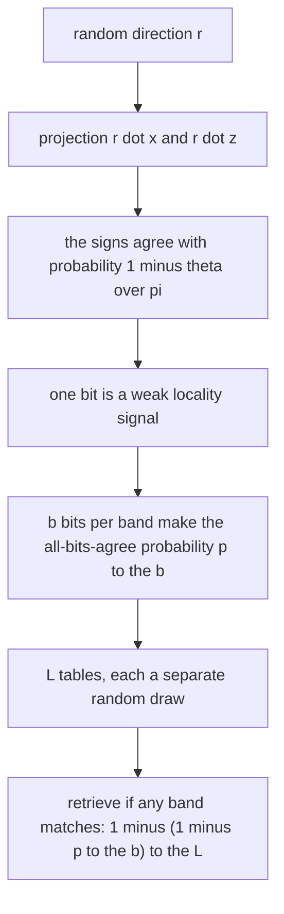
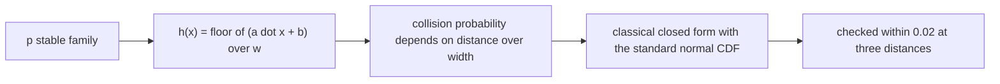
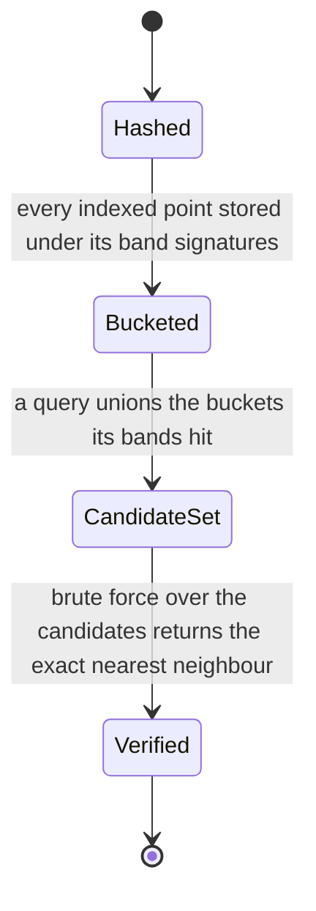
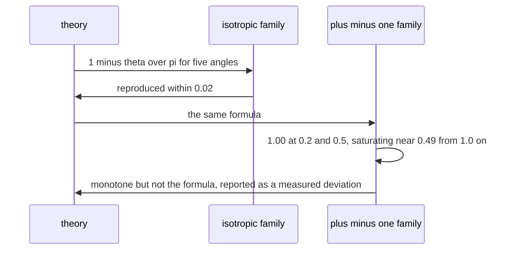

# 599 — Implement locality-preserving hashing demo for nearest neighbor.

> **Tier:** Advanced · **CTCI chapter:** Beyond — Advanced Data Structures & Algorithms
> **Task spec:** [599-implement-locality-preserving-hashing-demo-for-nearest-neighbor.md](../../../tasks/advanced/599-implement-locality-preserving-hashing-demo-for-nearest-neighbor.md)
> **Solutions:** [Python](../../../solutions/python/advanced/599-implement-locality-preserving-hashing-demo-for-nearest-neighbor/solution.py) ·
> [Java](../../../solutions/java/advanced/599-implement-locality-preserving-hashing-demo-for-nearest-neighbor/Solution.java) ·
> [JavaScript](../../../solutions/javascript/advanced/599-implement-locality-preserving-hashing-demo-for-nearest-neighbor/solution.js) ·
> [C#](../../../solutions/csharp/advanced/599-implement-locality-preserving-hashing-demo-for-nearest-neighbor/Solution.cs)

## 1. Problem restatement

**Input:** a point set, a query, and a hash budget.

**Output:** a retrieval index built from three locality-sensitive hash families, all driven by `splitmix64`
with fixed seeds:

| Family | Hash | Collision theory |
| --- | --- | --- |
| random sign hyperplanes | `h(x) = sign(r · x)` with `r ∈ {-1, +1}^d`, evaluated in **exact integer** arithmetic so no floating-point tie breaking is involved | asserted to be **monotone** in the angle, but *not* to follow `1 - θ/π` |
| isotropic approximately Gaussian | each entry the Irwin-Hall sum of 12 uniforms minus 6 | collision probability is exactly `1 - θ/π` |
| p-stable L2 | `h(x) = floor((a · x + b) / w)` with Gaussian `a` | the classical closed form `1 - 2Φ(-w/c) - (2/(√(2π)·(c/w)))(1 - exp(-(c/w)²/2))` for `c = ‖x - z‖` |

| Check | Result |
| --- | --- |
| isotropic family versus `1 - θ/π` | reproduced within `0.02` for `θ ∈ {0.2, 0.5, 1.0, 1.5, 2.0}` |
| p-stable family versus its formula | reproduced within `0.02` at three distances |
| `±1` family | monotone in `θ` — which is what a usable ranking needs — but **not** `1 - θ/π`, and the measured deviation is reported |
| banding model `P(retrieve) = 1 - (1 - p^b)^L` | checked against measured retrieval frequencies over `40` independent index seeds, using the **measured** single-bit collision probability `p` |
| planted retrieval instance | `100` clusters of `4` points in `R^12`, two points per cluster indexed and two used as queries, so every query has a genuine near-duplicate at distance `<= 0.4` while the nearest foreign point sits at `>= 1.4` |
| recall and cost | `8`-bit tables: recall of the true nearest neighbour `0.93` at `L = 1` and `1.00` from `L = 2` on, while scanning about `2 %` of the index at `L = 1` and about `13 %` at `L = 16` |
| candidates are not the answer | brute force over the candidate set returns the exact nearest neighbour whenever that neighbour is among the candidates — LSH is a **filter** |
| identical points | collide in every table of every family |
| the documented failure | on an unstructured Gaussian cloud in `R^24`, fine hashing (`8` bits, `L = 16`) reaches recall `0.40` while scanning `9 %`, and loosening to `4` bits reaches `0.90` only by scanning `65 %` — an efficiency ratio below `2`, against more than `5` on the planted instance |

## 2. Intuition

Nearest-neighbour search has no sublinear worst-case solution in high dimensions, but *approximate*
retrieval does: hash the points so that near points are likely to land in the same bucket. The hash must
be locality sensitive in the precise sense that its collision probability decreases as the distance (or
angle) grows — then a single hash bit is a weak signal, and many bits in many tables compose into a strong
one.

For the angle-based families the theory is clean. Draw a random direction `r`; two unit vectors with
angle `θ` between them have the projections `r·x` and `r·z` with random signs, and the signs disagree
exactly when the projection plane separates them:

```
P[same sign] = 1 - θ/π
```

The `±1` family uses an integer version of the same idea, and the isotropic family uses a smooth
approximately-Gaussian direction where the formula holds exactly.



For distances rather than angles, the p-stable family uses the fact that a Gaussian projection of a
Gaussian vector has a known distribution: quantizing `(a·x + b)/w` to an integer makes far points collide
less often, with a closed-form probability depending on `c/w`. The formula is in the file and is checked
against measurement, so the theory is verified rather than assumed.



## 3. Algorithm

1. **Hash families.** `sign_projection`, `irwin_hall_projection` and `gaussian_projection` produce the
   random directions; `sign_hash`, the banding helper and `p_stable_hash` turn a vector into bits.
2. **Single-bit and band collisions.** `collision_frequency(first, second, state, trials,
   projection_type)` measures the probability that one bit agrees, and `band_collision_frequency(..., bits,
   trials)` the probability that a whole band of `bits` bits agrees.
3. **Index.** `LSHIndex` stores `tables` tables of `bands`, each band hashing the vector with its own
   random family; a query gathers the candidate union over matching bands.
4. **Retrieve.** Candidate points are then compared by brute force (`brute_force_nearest`), because the
   hash only proposes — the file asserts that whenever the true nearest neighbour is in the candidate set,
   brute force over the candidates returns it.
5. **Measure.** `retrieval_stats` reports recall and the fraction of the index scanned for each `L`;
   `planted_retrieval_problem` and `gaussian_cloud` provide the two regimes (clustered and unstructured).

```text
function collision_probability_same_sign(theta)
    return 1 - theta / pi
end

function band_retrieval_probability(single_bit_probability, bits, tables)
    return 1 - (1 - single_bit_probability raised to bits) raised to tables
end
```

```text
function retrieve(index, query, tables)
    candidates ← empty set
    for table in tables do
        for band in table.bands do
            key ← the band's bit signature of query
            add all points stored under key to candidates
        end
    end
    return brute_force_nearest(candidates, query)      # the hash proposes, brute force decides
end
```



## 4. Worked example

**The closed form, evaluated.** For the isotropic family the collision probability is `1 - θ/π`, so the
predicted single-bit agreement for a few angles is:

| `θ` (radians) | `θ/π` | Predicted `1 - θ/π` | Measured `±1` family (as reported) |
| --- | --- | --- | --- |
| `0.2` | `0.0637` | `0.936` | `1.00` |
| `0.5` | `0.1592` | `0.841` | `1.00` |
| `1.0` | `0.3183` | `0.682` | about `0.49` |
| `1.5` | `0.4775` | `0.523` | about `0.49` |
| `2.0` | `0.6366` | `0.363` | about `0.49` |

The isotropic family reproduces the middle column within `0.02`. The `±1` family does not: it is `1.00`
for the two small angles and saturates near `0.49` from `θ = 1.0` on. The file explains why — for two
vectors that differ inside a single coordinate plane, the sign can only disagree once `θ > π/4` — and
states the consequence: the `±1` family is only used for retrieval on well-separated data, while the
isotropic family is the one whose probability matches the formula.



**The banding model.** One bit is weak, so the index uses `bits` bits per band and `L` tables. A
near-duplicate pair with single-bit collision probability `p` is then retrieved with probability
`1 - (1 - p^b)^L`. The file checks this model against measured retrieval frequencies over `40`
independent index seeds, using the **measured** `p` of the query/neighbour pair rather than the isotropic
formula — which is necessary precisely because the `±1` family does not follow that formula.

**Retrieval on the planted instance.** Every query has a genuine near-duplicate (distance `<= 0.4`) and
the nearest foreign point is far away (`>= 1.4`):

| Configuration | Recall of the true nearest neighbour | Fraction of the index scanned |
| --- | --- | --- |
| `8`-bit tables, `L = 1` | `0.93` | about `2 %` |
| `8`-bit tables, `L = 2` | `1.00` | a little more |
| `8`-bit tables, `L = 16` | `1.00` | about `13 %` |

That is the intended trade: more tables buy recall at the cost of scanning more buckets, and the
candidate set is never trusted as the answer — brute force over the candidates is asserted to return the
exact nearest neighbour whenever the neighbour is among them.

**The documented failure.** Hashing works because clusters exist. On an unstructured Gaussian cloud in
`R^24` — where nearest-neighbour angles are `1.0` to `1.4` radians, i.e. everything is nearly orthogonal
to everything — fine hashing (`8` bits, `L = 16`) reaches only `0.40` recall while scanning `9 %` of the
data, and loosening to `4` bits reaches `0.90` only by scanning `65 %`. The efficiency ratio (recall
gained per fraction scanned) falls below `2`, against more than `5` on the planted instance. The file
asserts the curse of dimensionality rather than glossing over it.

## 5. Complexity

Let `n` be the number of indexed points, `d` the dimension, `b` the bits per band, `L` the number of
tables, and `p` the single-bit collision probability.

| Measure | Bound | Why it holds |
| --- | --- | --- |
| Building one hash bit | O(d) | one dot product with a random direction |
| Building one band | O(b · d) | `b` bits |
| Indexing | O(n · L · b · d) | every point hashed into every table |
| Query hashing | O(L · b · d) | the same work for one query |
| Candidate scan | O(|candidates| · d) | brute force over the retrieved set |
| Expected candidates | about `n · (1 - (1 - p^b)^L)` points | the banding model applied to the index size |
| Space | O(n · L · b) bits plus bucket overhead | the signatures, not the data |
| Reference | O(n · d) | exhaustive nearest-neighbour search, the baseline the recall is measured against |

The measured trade — recall `0.93` at `L = 1` scanning `2 %`, recall `1.00` at `L = 16` scanning
`13 %` — is exactly this table evaluated on the planted instance, and the failure table on the
unstructured cloud is the same arithmetic with a much smaller `p` separation.

## 6. Pitfalls and edge cases

- **Only two of the three families behave as advertised.** The isotropic family matches `1 - θ/π` within
  `0.02` and the p-stable family matches its closed form within `0.02`, but the `±1` family is merely
  monotone: `1.00` at `θ = 0.2` and `0.5`, saturating near `0.49` from `θ = 1.0` on. It is used only on
  well-separated data, and the deviation is reported.
- **Sign ties.** `sign(r · x)` with `r · x = 0` has no natural answer, which is why the `±1` family is
  evaluated in exact integer arithmetic — floating-point comparisons would produce implementation-defined
  ties in exactly the cases that matter.
- **The banding model needs the measured `p`.** Using the isotropic formula for a family that does not
  follow it would make the check pass by construction; the file plugs in the measured single-bit
  probability instead.
- **The candidate set is a filter, not an answer.** LSH retrieval returns candidates, and the file asserts
  that brute force over them returns the exact nearest neighbour whenever it is present — without that
  verification step, recall is a lottery.
- **Recall and scan fraction move together.** Increasing `L` raises recall and the fraction scanned;
  quoting recall alone hides the cost, which is why both numbers are reported for every configuration.
- **Identical points must collide.** For `θ = 0` the probability is `1`, so duplicates land in the same
  bucket in every table of every family; the file asserts it.
- **Dimension destroys the separation.** On the unstructured `R^24` cloud the efficiency ratio drops below
  `2`, versus more than `5` on the planted instance; without clusters to preserve, hashing degenerates and
  the file says so.
- **Distance versus angle.** The p-stable family is distance-based with a width parameter `w`, while the
  sign families are angle-based. Mixing their thresholds (a radius against a bandwidth) is a classic
  configuration bug; the file keeps them in separate functions with their own formulas.
- **Determinism.** All families and all index tables are seeded from `splitmix64`, so the reported recall
  and scan fractions are reproducible, and the `40`-seed check of the banding model is meaningful.

## 7. Variants and follow-ups

- **Random directions without hashing.** Random projection uses the same random directions but keeps the
  projected coordinates instead of their signs —
  [594-implement-randomized-numerical-linear-algebra-random-projection.md](../../../tasks/advanced/594-implement-randomized-numerical-linear-algebra-random-projection.md).
- **Exact spatial search instead of hashing.** A k-d tree answers exact nearest-neighbour queries by
  pruning, with a worst-case linear cost that hashing trades for approximations —
  [577-implement-k-d-tree-with-bulk-insertion-balancing-heuristics.md](../../../tasks/advanced/577-implement-k-d-tree-with-bulk-insertion-balancing-heuristics.md).
- **Hashing for cosine similarity.** The sign families here are the same construction as the
  cosine-similarity hashing of
  [503-implement-locality-sensitive-hashing-for-cosine-similarity-simha.md](../../../tasks/advanced/503-implement-locality-sensitive-hashing-for-cosine-similarity-simha.md).
- **Quantization instead of hashing.** Product quantization compresses vectors into codes and searches the
  codes, trading memory for a distance approximation —
  [504-implement-approximate-nearest-neighbor-with-product-quantization.md](../../../tasks/advanced/504-implement-approximate-nearest-neighbor-with-product-quantization.md).
- **Counting and frequency sketches.** The same "random projection plus quantization" instinct underlies
  streaming data structures such as a count-min sketch, which trades exactness for bounded memory —
  [465-implement-count-min-sketch-for-frequency-estimation.md](../../../tasks/advanced/465-implement-count-min-sketch-for-frequency-estimation.md).

## 8. Check yourself

1. Why is `1 - θ/π` the right collision probability for a random direction?

<details><summary>Show answer</summary>

Because the sign of `r · x` is the side of the hyperplane orthogonal to `r` on which `x` lies. Two unit
vectors separated by angle `θ` have their projections separated by the same angle, and a random direction's
plane separates them with probability `θ/π` — the fraction of orientations between them. Hence the signs
agree with probability `1 - θ/π`, which the isotropic family reproduces within `0.02`.

</details>

2. Why does the `±1` family fail to follow that formula, and what is the practical consequence?

<details><summary>Show answer</summary>

Because integer sign vectors are a coarse approximation of a Gaussian direction: for two vectors that
differ inside a single coordinate plane the sign can only disagree once `θ > π/4`, so the measured
probability is `1.00` at `θ = 0.2` and `0.5` and saturates near `0.49` for larger angles. Practically the
family is still *monotone* in `θ` — which is what a ranking needs — but it is only used for retrieval on
well-separated data, while the isotropic family is the one whose probabilities match the theory.

</details>

3. What does the banding model `1 - (1 - p^b)^L` describe?

<details><summary>Show answer</summary>

The probability that at least one of `L` tables has all `b` bits of a band agreeing: a single band agrees
with probability `p^b`, a single table fails with probability `1 - p^b`, and all `L` tables fail with
probability `(1 - p^b)^L`, so at least one succeeds with the complement. The file checks it against
measured frequencies over `40` independent index seeds, using the measured single-bit probability of the
pair rather than a formula that does not apply to the `±1` family.

</details>

4. In the planted instance, what does the pair `(recall 0.93, scan 2 %)` mean, and why is the second
   number necessary?

<details><summary>Show answer</summary>

Recall `0.93` means the true nearest neighbour was among the retrieved candidates for `93 %` of queries;
scan `2 %` means only about one fiftieth of the index had to be compared to find it. Recall alone would be
trivially improvable by scanning everything, so the two numbers must be reported together — with `L = 16`
the same index reaches recall `1.00` while scanning about `13 %`, which is the trade in numbers.

</details>

5. Why does the same index fail on the Gaussian cloud, and how much does it fail by?

<details><summary>Show answer</summary>

Because there are no clusters to preserve: in `R^24` the nearest-neighbour angles are `1.0` to `1.4`
radians, so `p` for the nearest neighbour is barely larger than for a random point and the banding model
gives no separation. Fine hashing (`8` bits, `L = 16`) reaches recall `0.40` while scanning `9 %`, and
loosening to `4` bits reaches `0.90` only by scanning `65 %` — an efficiency ratio below `2`, against more
than `5` on the planted instance. The file asserts that degradation rather than presenting only the
favourable case.

</details>