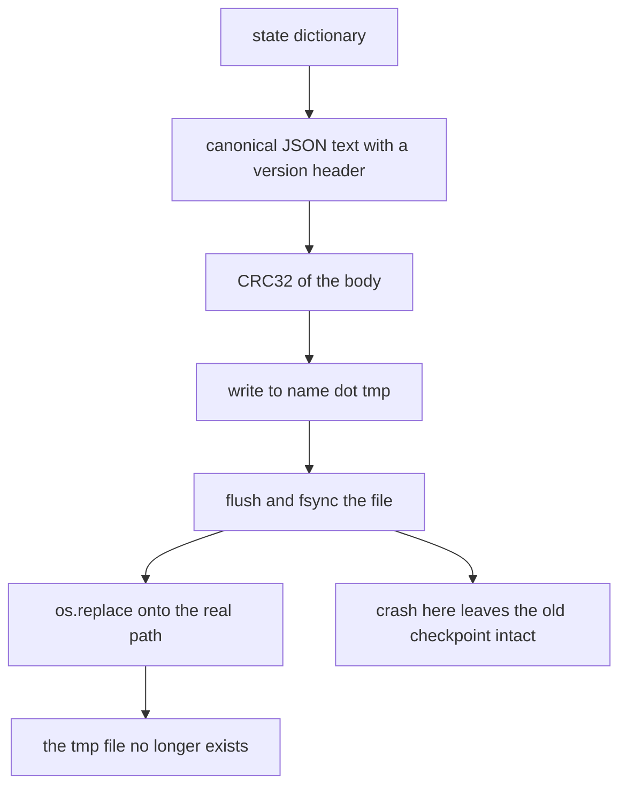
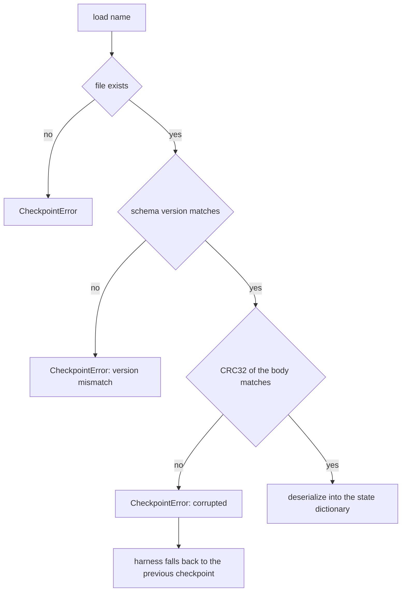
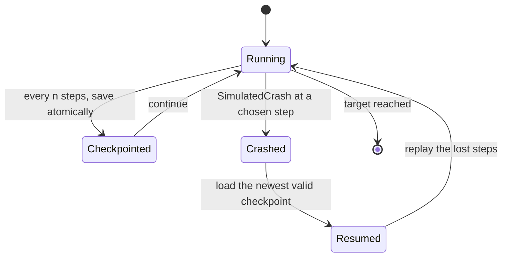
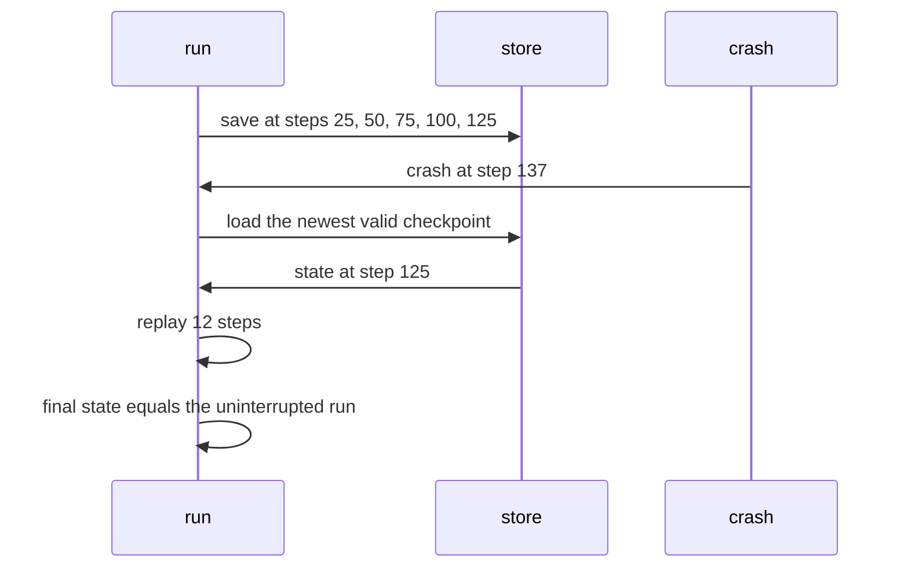

# 600 — Implement advanced checkpoint-restore for long-running computations (save state).

> **Tier:** Advanced · **CTCI chapter:** Beyond — Software Engineering & Tooling
> **Task spec:** [600-implement-advanced-checkpoint-restore-for-long-running-computati.md](../../../tasks/advanced/600-implement-advanced-checkpoint-restore-for-long-running-computati.md)
> **Solutions:** [Python](../../../solutions/python/advanced/600-implement-advanced-checkpoint-restore-for-long-running-computati/solution.py) ·
> [Java](../../../solutions/java/advanced/600-implement-advanced-checkpoint-restore-for-long-running-computati/Solution.java) ·
> [JavaScript](../../../solutions/javascript/advanced/600-implement-advanced-checkpoint-restore-for-long-running-computati/solution.js) ·
> [C#](../../../solutions/csharp/advanced/600-implement-advanced-checkpoint-restore-for-long-running-computati/Solution.cs)

## 1. Problem restatement

**Input:** a deterministic long-running computation and a checkpoint interval.

**Output:** a checkpoint/restart harness built around a small **explicit state record** — a plain dict
rather than a pickled object graph, which makes it JSON-serialisable, inspectable and comparable:

| Field | Meaning |
| --- | --- |
| step counter | how far the computation has progressed |
| 64-bit generator state | the stream position, so replay is deterministic |
| exact integer accumulator | an integer summary of the work so far |
| Welford mean / `M2` pair | the running mean and second-moment accumulator |
| running maximum | the largest value seen |
| rolling DP vector | the small state of the recursion/dynamic program |
| digest | a rolling hash of the input, for integrity-style comparison |

The store (`CheckpointStore`) is where the engineering lives, because checkpointing is a storage problem
before it is a numerical one:

| Property | Mechanism |
| --- | --- |
| atomic writes | payload → `<name>.tmp`, flushed and `fsync`**ed**, then `os.replace`d over the target, so a crash never leaves a half-written checkpoint at the real path (`a_save_leaves_no_tmp_behind` asserts the tmp file is gone afterwards) |
| integrity | a schema version and a CRC32 of the canonical JSON body, checked on load, so a truncated file or a flipped character is reported as `CheckpointError` instead of silently resuming from garbage |
| retention | old checkpoints are pruned, keeping the newest `retention` files, and the harness is asserted to keep working after the very checkpoint it would have resumed from has been pruned (it falls back to the newest surviving one) |
| the documented limit | CRC32 detects **corruption, not tampering** — anyone who edits the payload can recompute the checksum, which would need an HMAC with a key the file deliberately does not manage |

| Check | Result |
| --- | --- |
| uninterrupted versus killed and resumed | **identical** states: exact equality for every integer, string and list field, `1e-15` relative agreement for the two floating-point fields |
| resuming from an older checkpoint | reaches the same final state, which pins down replay determinism |
| work after a restart | exactly the steps lost since the last checkpoint |
| a corrupted checkpoint | raises `CheckpointError`, and the harness transparently resumes from the previous one |
| a version mismatch | raises too |
| loading twice | idempotent |
| the final state | carries the expected keys and survives a JSON round trip unchanged |
| the test directory | a temporary directory created **next to the file** (never `/tmp`), removed in a `finally` block, with an assertion that nothing is left behind |

## 2. Intuition

A long computation that can only restart from the beginning wastes everything it has done. The fix looks
simple — periodically write the state and resume from it — but the interesting part is what "write the
state" has to mean. If the checkpoint is written in place, a crash in the middle leaves a corrupt file
that the next run will happily load; if the state is an opaque serialized object, nothing can be compared
or inspected; and if nothing validates the file, an unrelated corruption becomes a wrong answer.

The file's answers are the standard ones, applied carefully.

* **atomic replacement** — write to a temporary name, force the bytes to disk, then rename. The rename is
  atomic on every mainstream filesystem, so a reader either sees the old checkpoint or the new one, never
  a partial mixture;



* **validation on load** — the version and checksum are checked before the payload is trusted, so a
  truncated or flipped file is an error, not a silently different computation;



* **a plain state record** — the state is a dict of primitives, so it can be compared field by field
  (`states_equal`), printed, and diffed, and replaying from it is deterministic because the generator
  state is part of it.

## 3. Algorithm

1. **State.** `initial_state(seed, width)` builds the dict with a step counter of `0`, the generator
   state, a zeroed accumulator, the Welford pair, a running max, a rolling DP vector and a digest.
2. **One step.** `advance(state, width)` performs exactly one deterministic update on every field: the
   counter, the generator draw, the accumulator, the Welford mean and `M2`, the maximum, the DP vector
   and the digest.
3. **Save.** `CheckpointStore.save(step, state)` serializes `canonical_payload(state)` with the version
   header and checksum, writes `name.tmp`, flushes and `fsync`s it, then `os.replace`s it onto
   `name.json`; retention prunes the directory afterwards.
4. **Load.** `CheckpointStore.load(name)` reads the file, verifies the version and the CRC32, and returns
   the deserialized state, raising `CheckpointError` on any failure.
5. **Run.** `compute(state, total_steps, width, store, every, crash_at, counter)` advances until
   `total_steps`, saving every `every` steps and raising `SimulatedCrash` at `crash_at` when asked;
   `run_with_restarts` resumes from the newest loadable checkpoint after each simulated crash and returns
   the final state plus the per-attempt step counts.
6. **Compare.** `states_equal(first, second)` checks every integer, string and list field exactly and the
   two float fields to `1e-15` relative.

```text
function advance(state, width)
    state.step ← state.step + 1
    state.generator_state, value ← splitmix64 of state.generator_state
    state.accumulator ← state.accumulator + value
    state.mean, state.m2 ← Welford update with value
    state.maximum ← max(state.maximum, value)
    shift the rolling DP vector and fold value into it
    state.digest ← rolling hash of state.digest and value
    return state
end
```

```text
procedure save(store, name, state)
    body ← canonical JSON text of state
    payload ← version header plus CRC32 of body plus body
    write payload to the temporary path for name
    flush and fsync the temporary file
    rename the temporary path onto the real path        # atomic replacement
    prune older checkpoints beyond the retention count
end

function load(store, name)
    text ← read the file
    version, checksum, body ← parse the header
    if version != expected_version then raise CheckpointError end
    if CRC32 of body != checksum then raise CheckpointError end
    return deserialize(body)
end
```

```text
procedure run_with_restarts(store, target, every, crashes)
    state ← None
    for each crash point do
        if state is None then
            state ← newest loadable checkpoint, or initial_state
        end
        try
            state ← compute(state, target, every, store, crash_at = crash point)
        catch SimulatedCrash do
            continue                                 # the next attempt resumes from the checkpoint
        end
    end
    return state
end
```



## 4. Worked example

**The lost-work arithmetic.** With `every = 25` and a crash at step `137`, the checkpoints written so far
sit at steps `25, 50, 75, 100, 125`, so the newest loadable one is step `125`:

| Quantity | Value |
| --- | --- |
| work done before the crash | `137` steps |
| newest checkpoint | step `125` |
| steps replayed after the restart | `137 - 125 = 12` |
| final state versus an uninterrupted run | identical fields |

That the replay count is exactly `12` is what the file asserts — the work lost is precisely the work since
the last checkpoint, no more and no less. Replay is deterministic because the generator state at step
`125` is part of the checkpoint: the same twelve `splitmix64` draws happen in the same order.



**The atomic write, step by step.** `save` produces the canonical JSON body, prepends the version and the
CRC32 of that body, opens `<name>.tmp`, writes, flushes, calls `fsync`, and only then renames. The
sequence matters: after the rename the tmp file is gone, which the harness asserts directly
(`a_save_leaves_no_tmp_behind`), and a crash anywhere before the rename leaves the previous checkpoint
untouched — because the real path was never opened for writing.

**Corruption and fallback.** Flipping one character of a checkpoint's body changes the CRC32, so the next
`load` raises `CheckpointError` instead of resuming from a slightly different computation. The harness then
falls back to the previous checkpoint and replays a little more work; the file asserts both the exception
and the fact that the run still succeeds. A version mismatch raises for the same reason: a state written
by a different schema cannot be assumed to mean the same thing.

The honest limit is documented alongside it: CRC32 detects accidental corruption, not tampering, because
anyone who edits the payload can recompute the checksum. Making the check tamper-evident needs an HMAC
with a secret key, which is a key-management decision the file does not claim to solve.

**Why the state record is a dict.** Every field is a primitive, so `states_equal` can compare integers,
strings and lists exactly and the two floating-point fields to `1e-15` relative; a resumed run is asserted
to match an uninterrupted one on all of them, and the state survives a JSON round trip unchanged. The
`1e-15` tolerance for the floats is the honest part: the mean and `M2` are re-derived by the same Welford
recurrences, and floating-point equality of re-derived accumulations is asserted at that precision rather
than bit for bit.

## 5. Complexity

Let `n` be the number of steps, `every` the checkpoint interval, `s` the state size and `retention` the
number of kept files.

| Measure | Bound | Why it holds |
| --- | --- | --- |
| One step | O(width) | the DP vector of length `width` is folded each step |
| One save | O(s) plus the file write | canonical JSON of a small fixed-size state, written once |
| Saves per run | `n / every` | the interval controls the trade |
| Work lost per crash | `< every` steps | the newest checkpoint is at most `every - 1` steps behind |
| Total cost | O(n · width + (n / every) · s) | steps plus checkpoints |
| Restart cost | O(every · width) | replay of the lost steps |
| Space | O(retention · s) | retention prunes everything older |
| Corruption detection | O(s) | one CRC32 pass over the body |

The interval `every` is the knob: a smaller interval loses less work per crash but writes more often —
the classic checkpointing trade, made measurable here because both sides are counted by the harness
(`compute` returns how many steps it executed, and the file asserts the count equals the work lost).

## 6. Pitfalls and edge cases

- **Non-atomic writes are the classic bug.** Writing directly to the real path leaves a truncated file if
  the process dies mid-write, and the next run resumes from garbage; the tmp-plus-`fsync`-plus-`os.replace`
  sequence avoids it, and the file asserts the tmp file is gone after a successful save.
- **`fsync` matters, not just `flush`.** A flushed buffer is in the page cache, not necessarily on disk;
  a crash of the machine (rather than the process) can lose it, which is why the sequence includes
  `fsync` before the rename.
- **Checksums detect corruption, not tampering.** CRC32 is not a signature: an attacker who edits the
  payload can recompute it. The header states this limit instead of implying the checkpoints are
  authenticated.
- **Version mismatch must be fatal.** Resuming from a state written by a different schema produces a
  plausible-looking but wrong computation, so `deserialize` raises rather than guessing.
- **Retention can prune the checkpoint you need.** Keeping only the newest `retention` files means the
  intended resume point may be gone; the harness is asserted to fall back to the newest surviving
  checkpoint and still finish, which is exactly why `run_with_restarts` loads rather than assumes.
- **Determinism requires the generator state to be in the checkpoint.** If the random stream position is
  not saved, replaying produces different values and the resumed run diverges; it is a state field
  precisely for that reason.
- **Exactness is per field.** The file asserts exact equality for integers, strings and lists, and `1e-15`
  relative agreement for the two floats; demanding bit-level equality from re-derived floating-point
  accumulations would be a test that fails for reasons unrelated to correctness.
- **Loading must be idempotent.** Saving twice and loading twice must not change the state; otherwise a
  restart could compound an effect.
- **No temporary directories outside the project.** The harness creates its scratch directory **next to the
  file** and removes it in a `finally` block, asserting that nothing is left behind — the same discipline
  that keeps a failed test from leaking files into a shared location.
- **The crash point is simulated, not the failure mode.** `SimulatedCrash` models a process dying between
  steps; it is not a fault-injection framework, and the file does not claim to test power-loss behaviour.

## 7. Variants and follow-ups

- **Checkpointing as an optimization problem.** Where to place checkpoints when intervals are unequal and
  the cost of replay varies is the subject of
  [481-implement-optimistic-checkpointing-restart-simulation.md](../../../tasks/advanced/481-implement-optimistic-checkpointing-restart-simulation.md).
- **Integrity with proofs instead of checksums.** A Merkle tree verifies a log entry against a root, which
  is the authenticated version of what CRC32 does here —
  [474-implement-merkle-tree-for-log-integrity-and-proof-generation.md](../../../tasks/advanced/474-implement-merkle-tree-for-log-integrity-and-proof-generation.md).
- **Checkpoint-shaped write paths in storage engines.** An LSM tree's flush-and-merge cycle writes
  immutable files and swaps them atomically, the same idea applied to data rather than to state —
  [478-implement-log-structured-merge-tree-lsm-basic-flush-merge-simula.md](../../../tasks/advanced/478-implement-log-structured-merge-tree-lsm-basic-flush-merge-simula.md).
- **Replication instead of restart.** Consensus protocols recover from failures by replaying a log on
  another node — [472-implement-basic-raft-consensus-pseudo-simulation-leader-election.md](../../../tasks/advanced/472-implement-basic-raft-consensus-pseudo-simulation-leader-election.md).
- **Exporting state rather than re-deriving it.** The same explicit-record discipline appears in the
  streaming tasks, where the running moments are the state that must survive a restart —
  [597-implement-streaming-pca-with-incremental-updates.md](../../../tasks/advanced/597-implement-streaming-pca-with-incremental-updates.md).

## 8. Check yourself

1. Why is the write sequence tmp → `fsync` → `os.replace` rather than a direct write to the target?

<details><summary>Show answer</summary>

Because a direct write can be interrupted, leaving a truncated file at the real path that the next run
would treat as a valid checkpoint. Writing to a temporary name and renaming means the real path either
still holds the previous checkpoint or holds the complete new one — a rename is atomic. The `fsync` before
the rename is what forces the payload to disk rather than merely into the page cache, and the file asserts
the temporary file no longer exists after a successful save.

</details>

2. With `every = 25` and a crash at step `137`, how much work is repeated, and why exactly that much?

<details><summary>Show answer</summary>

The newest checkpoint is at step `125` (the multiples of `25` up to `137` are `25, 50, 75, 100, 125`), so
`137 - 125 = 12` steps are replayed. It is exactly the work done since the last checkpoint, which is what
the harness asserts — and the replay is deterministic because the generator state at step `125` is one of
the checkpoint's fields.

</details>

3. What does the CRC32 check protect against, and what does it not?

<details><summary>Show answer</summary>

It detects accidental corruption: a truncated file or a flipped character changes the checksum, so `load`
raises `CheckpointError` and the harness falls back to the previous checkpoint. It does not protect against
deliberate editing, because anyone who changes the body can recompute the CRC32. Making the check
tamper-evident requires an HMAC with a secret key, which the file explicitly does not implement.

</details>

4. Why is the state a dict of primitives rather than a pickled object?

<details><summary>Show answer</summary>

Because a plain record is JSON-serialisable, inspectable and comparable: `states_equal` can assert exact
equality per field for integers, strings and lists and `1e-15` relative agreement for the two floats, the
file's own checks can read individual keys, and the state survives a JSON round trip unchanged. A pickled
object graph would serialize just as well but would not be diffable or comparable field by field.

</details>

5. Why can retention pruning break a naive harness, and how does this one survive it?

<details><summary>Show answer</summary>

Because pruning keeps only the newest `retention` checkpoints, so the file a crash would resume from may
have been deleted. A harness that assumes a specific path exists would then fail to restart. This one
loads the newest *valid surviving* checkpoint — the behaviour the file asserts by pruning the intended
resume point and checking that the run still reaches the same final state.

</details>