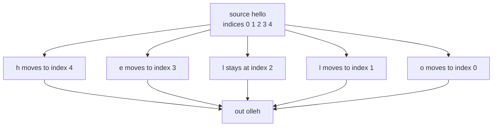
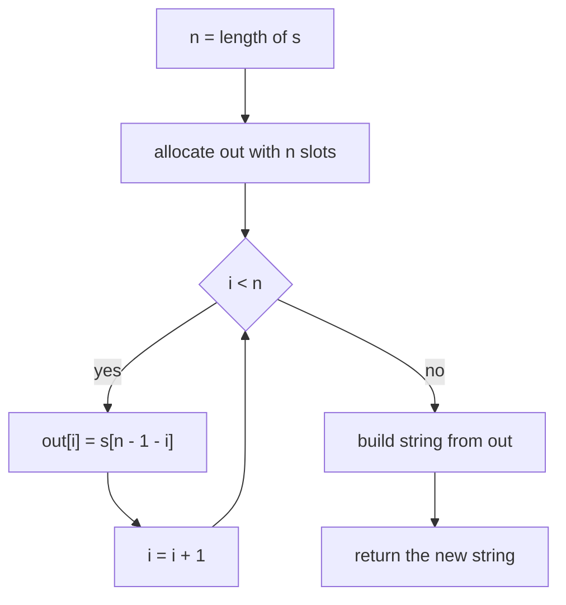
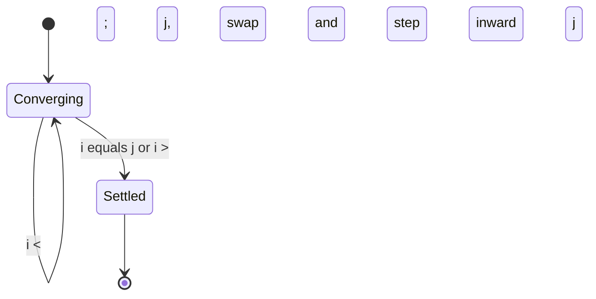
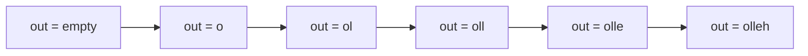

# 001 — Reverse a string.

> **Tier:** Beginner · **CTCI chapter:** Ch 1 — Arrays and Strings
> **Task spec:** [001-reverse-a-string.md](../../../tasks/beginner/001-reverse-a-string.md)
> **Solutions:** [Python](../../../solutions/python/beginner/001-reverse-a-string/solution.py) ·
> [Java](../../../solutions/java/beginner/001-reverse-a-string/Solution.java) ·
> [JavaScript](../../../solutions/javascript/beginner/001-reverse-a-string/solution.js) ·
> [C#](../../../solutions/csharp/beginner/001-reverse-a-string/Solution.cs)

## 1. Problem restatement

**Input:** a single string `s` of `n` characters. The string may be empty.

**Output:** a new string that holds the same characters in the opposite order. The original
string is not modified — every solution returns a fresh value.

The task spec states the problem in one line ("Reverse a string."), so the exact contract is
fixed by the assertions the four solution files ship with:

| Call | Result | Why |
| --- | --- | --- |
| `reverse_string("hello")` | `"olleh"` | odd length: the middle character stays put |
| `reverse_string("ab")` | `"ba"` | the two halves trade places |
| `reverse_string("")` | `""` | nothing to move |
| `reverse_string("a")` | `"a"` | a single character is its own mirror |

The Python file asserts all four rows; the Java, JavaScript and C# files assert the first,
second and third (their single-character case is covered by the same loop shape). No input
validation is required, and the task is not in-place: the output is a brand-new string.

## 2. Intuition

The naive idea is to walk the source string from the last character to the first and append
each character to a growing result:

```text
result ← ""
for i ← n - 1 down to 0 do
    result ← result + s[i]
end
```

That is correct, but in Java, JavaScript and C# strings are immutable and Python strings are
immutable too: every `result + s[i]` allocates a *new* string of length `i + 1` and copies it.
Summed over the loop that is `1 + 2 + ... + n` copied characters, i.e. **O(n²)** time. The
classic fix — collect the pieces in a mutable buffer and join once — is exactly what the
solution files do, because each of them hands the whole job to a built-in that allocates the
result once:

- Python: a stride `-1` slice produces a new string of length `n` in one pass.
- Java: `StringBuilder(s).reverse()` flips the internal `char[]` with swaps, then `toString()`.
- C#: `ToCharArray()` copies once, `Array.Reverse` swaps in place, `new string(chars)` copies once.
- JavaScript: `[...s]` materialises an array of characters, `reverse()` swaps it, `join("")` builds the string.

The key insight is that reversal is not a sequence of appends at all — it is a **pure index
permutation**. Position `i` in the output always receives the character that sits at position
`n - 1 - i` in the input, and that mapping is independent of every other character. Once you see
the permutation, you know you need exactly one allocation and exactly `n` moves.



Every character makes the trip exactly once, and the two characters at mirrored positions
`i` and `n - 1 - i` simply trade places. That second reading of the same insight is what makes
the in-place variant possible.

## 3. Algorithm

The filling variant used by the Python, Java and C# solutions:

1. Let `n` be the length of `s`.
2. Allocate a writable buffer of `n` slots (a char array, a byte array, or an array of code points).
3. For each `i` from `0` to `n - 1`, copy the character at `n - 1 - i` of the source into slot `i`.
4. Convert the filled buffer into a string and return it.

```text
procedure reverse_string(s)
    n ← length(s)
    out ← new array of n characters
    for i ← 0 to n - 1 do
        out[i] ← s[n - 1 - i]
    end
    return string built from out
end
```

Step 3 is the whole algorithm; steps 1, 2 and 4 are the price of immutability. The swap variant
that the built-ins actually execute internally touches only half as many slots per character and
needs no second array:

```text
procedure reverse_in_place(text)
    i ← 0
    j ← length(text) - 1
    while i < j do
        swap text[i] with text[j]
        i ← i + 1
        j ← j - 1
    end
end
```

`i` and `j` start at the two ends and converge; the loop stops as soon as they meet or cross, so
an odd-length string never touches its middle character and an even-length string performs
exactly `n / 2` swaps.



The same walk seen as a machine with two pointers:



Note that the two states differ only in the stopping condition: converging while the pointers
have not met, settled once they have. No character is ever visited twice.

## 4. Worked example

Trace `reverse_string("hello")`. `n = 5`, so slot `i` reads source index `4 - i`:

| Step | `i` | source index `4 - i` | character read | `out` so far |
| --- | --- | --- | --- | --- |
| start | — | — | — | `""` |
| 1 | 0 | 4 | `o` | `"o"` |
| 2 | 1 | 3 | `l` | `"ol"` |
| 3 | 2 | 2 | `l` | `"oll"` |
| 4 | 3 | 1 | `e` | `"olle"` |
| 5 | 4 | 0 | `h` | `"olleh"` |

After the fifth iteration `i` reaches `n` and the loop exits, leaving `"olleh"`. The fifth row is
the one that proves the mapping is a bijection: every source index appears exactly once as a
destination index.

The output grows left to right while the *read* cursor walks right to left:



The swap variant on the same input visits characters in a different order: `i = 0, j = 4` swaps
`h` and `o` to get `oellh`, then `i = 1, j = 3` swaps `e` and `l` to get `olleh`, then `i = 2,
j = 2` stops immediately because the pointers met. Two swaps instead of five copies — the same
answer from the same insight.

## 5. Complexity

Let `n` be the length of `s`.

| Measure | Bound | Why it holds |
| --- | --- | --- |
| Time, best | O(n) | the output depends on every input character; only the empty string finishes in O(1) |
| Time, average | O(n) | one pass, one read and one write per character |
| Time, worst | O(n) | the index arithmetic per character is constant, so total work is `c · n` |
| Space, output | O(n) | the result itself is `n` characters and must be materialised |
| Space, extra (fill) | O(n) | the buffer that becomes the output; Python's slice, Java's `StringBuilder`, C#'s `char[]` and the JavaScript array all live here |
| Space, extra (swap) | O(1) | the two-pointer variant reuses the input buffer and stores two indices |
| Time of the naive append loop | O(n²) | each `result + c` copies the whole prefix |

The swap variant is only available when the input is mutable, which rules out Python `str` and
Java/C# `string`. That is why the four shipped solutions allocate: they were written against the
immutable string types. In Java and C# you can reach the swap variant through
`StringBuilder` / `char[]` (which is what those libraries do internally); in JavaScript, through
an array of characters.

## 6. Pitfalls and edge cases

- **Empty string.** `n = 0`, the loop body never executes and the result is `""`. Python, Java,
  JavaScript and C# all assert this case, so returning `null` or throwing here is a bug.
- **Single character.** `"a"` maps to index `0` and comes back unchanged; in the swap variant
  `i` and `j` are already equal and no swap happens. Python and C# assert it explicitly.
- **Even length.** Exactly `n / 2` swaps with no untouched middle slot; `"ab"` becomes `"ba"`.
  All four solutions assert this row.
- **No case folding, no trimming.** `"Hello"` reverses to `"olleH"`. Reversal is a positional
  operation, not a textual one.
- **Surrogate pairs.** Java's `StringBuilder.reverse()` and C#'s `Array.Reverse(char[])` operate
  on UTF-16 code units, so a character outside the BMP (an emoji, for instance) can be split
  into two lonely surrogates and produce an invalid string. Python's slice reverses *code points*
  and JavaScript's `[...s]` spread iterates *code points*, so those two survive astral
  characters. None of the four handles grapheme clusters — a base letter plus a combining accent
  reverses to accent-plus-letter, which renders differently.
- **Do not mutate the caller's data.** All four solutions return a new value; reversing the
  caller's array in place (as task 022 does for rotations) would surprise callers who still need
  the original order.
- **Index arithmetic.** `n - 1 - i` requires signed indices; in languages where the length is
  unsigned, `n - 1` for an empty string underflows. All four languages here index with signed
  values, but the underflow is the classic port bug to watch for.

## 7. Variants and follow-ups

- **Reverse in place.** Reach for the two-pointer swap when the buffer is mutable and memory
  matters — the pattern is shared with [022-rotate-array-in-place-by-k-positions.md](../../../tasks/beginner/022-rotate-array-in-place-by-k-positions.md)
  and [024-remove-element-at-index-from-array-in-place.md](../../../tasks/beginner/024-remove-element-at-index-from-array-in-place.md).
- **Rotate instead of reverse.** Rotating right by `k` is three reversals: reverse the whole
  buffer, then the first `k`, then the rest. See
  [021-rotate-array-right-by-k-positions-create-new-array.md](../../../tasks/beginner/021-rotate-array-right-by-k-positions-create-new-array.md).
- **Stop early.** The palindrome check
  [002-check-if-a-string-is-a-palindrome.md](../../../tasks/beginner/002-check-if-a-string-is-a-palindrome.md)
  runs the same two-pointer walk but returns as soon as a mirrored pair disagrees, which makes it
  cheaper than reversing and comparing.
- **Reverse something other than characters.** Digits of an integer
  ([030-reverse-digits-of-an-integer.md](../../../tasks/beginner/030-reverse-digits-of-an-integer.md))
  use the same permutation through division and multiplication rather than indexing.
- The chapter walkthrough in [Arrays and Strings](../../ctci/01-arrays-and-strings.md) puts
  reversal next to rotation and in-place compaction as the three Ch 1 index gymnastics.

## 8. Check yourself

1. Why can the four solutions ignore the `O(n²)` trap that a hand-written append loop falls into?

<details><summary>Show answer</summary>

Because they never build the result incrementally with string concatenation. The Python slice,
the Java `StringBuilder`, the C# `char[]` plus `new string`, and the JavaScript array plus `join`
each allocate the output once and fill it with a single pass, so no prefix is ever copied twice.

</details>

2. How many character copies does the swap variant perform on a string of length `n`, and how
   many does the fill variant perform?

<details><summary>Show answer</summary>

The swap variant performs `n / 2` swaps, each touching two slots, so `n` slot writes total and
`O(1)` extra space. The fill variant performs `n` reads and `n` writes, but needs a second buffer
of `n` slots. Same asymptotics, different constant and different memory profile.

</details>

3. What does `reverse_string("")` return in each solution?

<details><summary>Show answer</summary>

`""` in all four. Python's `s[::-1]` of an empty string is empty, `new StringBuilder("").reverse()`
is empty, `[...""].reverse().join("")` is `""`, and `new string(new char[0])` is empty. The
assertions in the solution files pin this down.

</details>

4. Is `reverse_string("😀a")` guaranteed to round-trip as a valid text sequence?

<details><summary>Show answer</summary>

Not in Java or C#: those reverse UTF-16 code units, so the surrogate pair that encodes the emoji
is emitted in reverse order and the result is an invalid code unit sequence. Python's slice and
JavaScript's spread iterate code points and do round-trip the emoji, but neither protects
combining marks or zero-width joiners. If the interview question is "reverse text", say which
unit you are reversing.

</details>

5. Why is reversing the digits of a number (task 030) considered the same idea even though it
   never builds an array?

<details><summary>Show answer</summary>

Because both are the permutation `out[i] = s[n - 1 - i]` expressed in a different coordinate
system. On a string the mirrored position comes from index arithmetic; on an integer it comes
from repeatedly peeling the last digit with `% 10` and appending it with `* 10`. The insight —
mirror the sequence — is identical.

</details>
