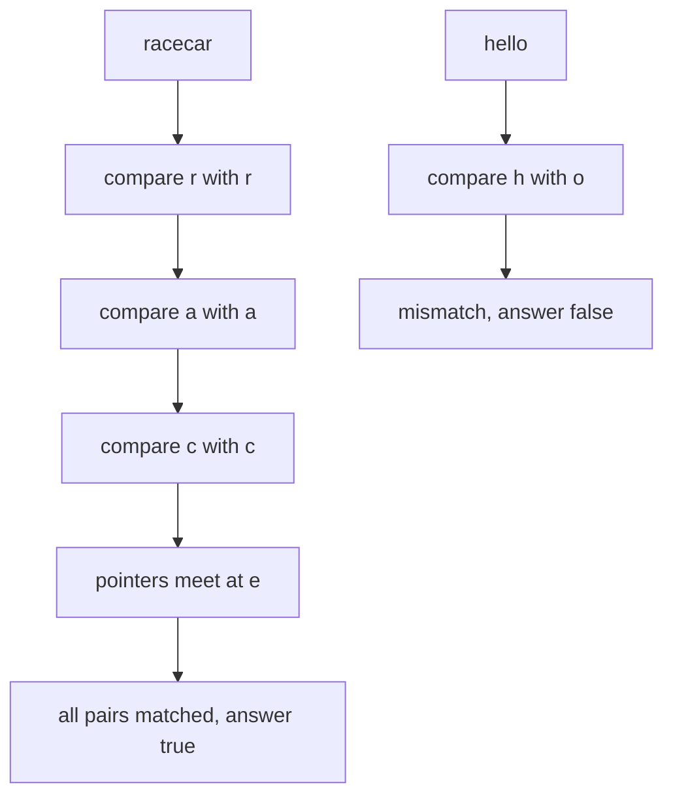
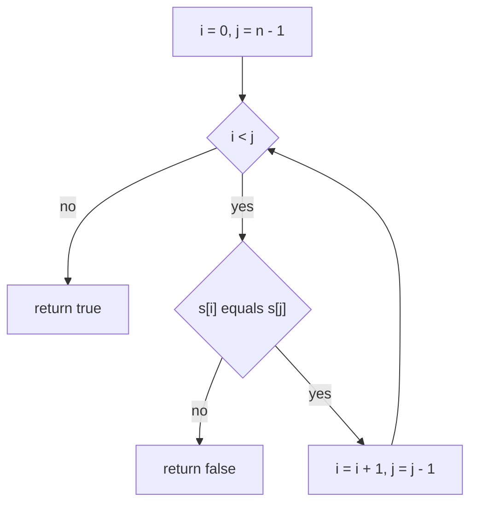
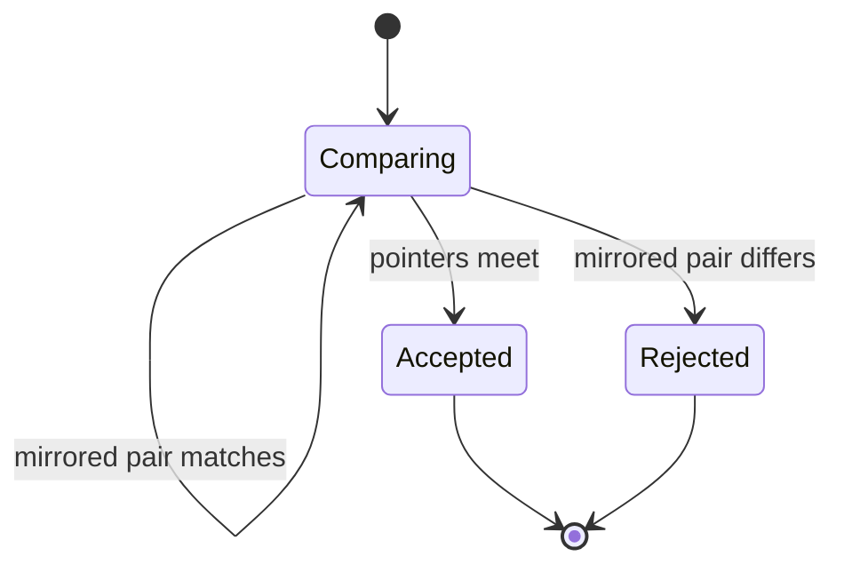
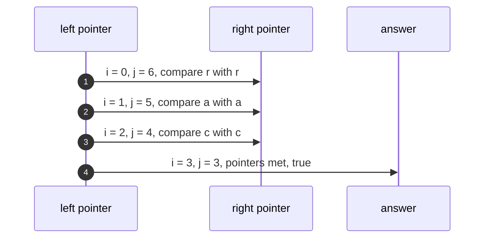

# 002 — Check if a string is a palindrome.

> **Tier:** Beginner · **CTCI chapter:** Ch 1 — Arrays and Strings
> **Task spec:** [002-check-if-a-string-is-a-palindrome.md](../../../tasks/beginner/002-check-if-a-string-is-a-palindrome.md)
> **Solutions:** [Python](../../../solutions/python/beginner/002-check-if-a-string-is-a-palindrome/solution.py) ·
> [Java](../../../solutions/java/beginner/002-check-if-a-string-is-a-palindrome/Solution.java) ·
> [JavaScript](../../../solutions/javascript/beginner/002-check-if-a-string-is-a-palindrome/solution.js) ·
> [C#](../../../solutions/csharp/beginner/002-check-if-a-string-is-a-palindrome/Solution.cs)

## 1. Problem restatement

**Input:** a single string `s` of `n` characters, possibly empty.

**Output:** `true` when `s` reads the same forwards and backwards, `false` otherwise. The
function is a pure predicate: no string is built, no input is modified.

The spec sentence is one line, so the executable contract is the assertions in the solution
files:

| Call | Result | Why |
| --- | --- | --- |
| `is_palindrome("racecar")` | `true` | mirrored pairs match all the way to the middle |
| `is_palindrome("")` | `true` | the empty string is trivially its own reverse |
| `is_palindrome("a")` | `true` | the single character has no partner to disagree with |
| `is_palindrome("hello")` | `false` | `h` versus `o` fails on the first comparison |

Python asserts all four rows; Java, JavaScript and C# assert the mirrored-pairs case, the empty
string and the failing case. Nothing in the task asks for case folding, whitespace stripping or
punctuation removal — the comparison is exact, character for character.

## 2. Intuition

The naive idea follows directly from task 001: reverse the string, then compare the reversed copy
with the original.

```text
procedure is_palindrome_naive(s)
    return reverse_string(s) == s
end
```

That answer is correct but wasteful. It allocates a second string of `n` characters even though
the very first comparison can already decide the answer for most inputs, and it always performs
all `n` character copies no matter how early the mismatch is.

The key insight is that a palindrome is defined by *mirrored equality*: for every index `i`,
character `i` must equal character `n - 1 - i`. You do not need the reversed string — you only
need to compare pairs. Walk one pointer in from the left and one in from the right, compare them,
and return `false` at the first disagreement:

- If a pair disagrees, the string can never be a palindrome (no other character can repair it),
  so you may answer immediately.
- If the pointers meet or cross, all required pairs were verified, so the answer is `true`.

That walk costs no extra memory and stops early; for a randomly chosen string it usually stops
after one or two comparisons.



Notice how the odd-length string never compares its middle character: a character is always equal
to itself, so that comparison would carry no information.

## 3. Algorithm

1. Set `i` to `0` and `j` to `n - 1`.
2. While `i < j`, compare `s[i]` with `s[j]`. If they differ, return `false` immediately.
3. Advance both pointers: `i` grows, `j` shrinks.
4. When the pointers meet or cross, every mirrored pair has matched: return `true`.

```text
procedure is_palindrome(s)
    i ← 0
    j ← length(s) - 1
    while i < j do
        if s[i] != s[j] then
            return false
        end
        i ← i + 1
        j ← j - 1
    end
    return true
end
```

The loop condition `i < j` is what makes the empty string and the single character succeed
without a special case: `i = 0` and `j = -1` for the empty string, `i = j = 0` for one character,
and in both cases the loop body never runs, so the procedure falls through to `return true`.

Java, JavaScript and C# express the same loop with a combined `for (i = 0, j = n - 1; i < j; i++, j--)`
header and an early `return false` inside; Python spells it out with a `while` and a tuple
assignment. The traversal is identical in all four.



As a state machine the walk has three outcomes: still comparing, accepted, or rejected. Rejection
is absorbing — nothing is examined after a mismatch.



## 4. Worked example

Trace `is_palindrome("racecar")`. `n = 7`, so the pairs are `(0, 6)`, `(1, 5)` and `(2, 4)`; index
`3` is the middle and is never compared.

| Step | `i` | `j` | `s[i]` | `s[j]` | Verdict |
| --- | --- | --- | --- | --- | --- |
| start | 0 | 6 | `r` | `r` | match, step inward |
| 1 | 1 | 5 | `a` | `a` | match, step inward |
| 2 | 2 | 4 | `c` | `c` | match, step inward |
| 3 | 3 | 3 | `e` | `e` | loop condition `i < j` fails |

The loop exits after three pair comparisons, not seven, and the string is accepted with the middle
character untouched.

Now trace the rejection path on `is_palindrome("hello")`:

| Step | `i` | `j` | `s[i]` | `s[j]` | Verdict |
| --- | --- | --- | --- | --- | --- |
| start | 0 | 4 | `h` | `o` | mismatch, return `false` |

One comparison is enough: whatever the remaining three characters are, `h` can never equal the
last character of this string, so no continuation could change the answer.



## 5. Complexity

Let `n` be the length of `s`.

| Measure | Bound | Why it holds |
| --- | --- | --- |
| Time, best | O(1) | a mismatch at the outermost pair ends the function after one comparison |
| Time, average | O(1) for random input, O(n) for palindromic input | random strings fail on the first or second pair; a true palindrome must inspect every pair |
| Time, worst | O(n) | at most `n / 2` pair comparisons, each O(1) |
| Space | O(1) | two integer indices; nothing is copied |
| Comparisons | `ceil(n / 2)` | indices `0 … n/2 - 1` compared against their mirrors |
| Reverse-and-compare alternative | O(n) time, O(n) space | always allocates the reversed string and always performs `n` copies, with no early exit |

The two-pointer version dominates the alternative on both axes: it never allocates, and on
non-palindromes it terminates far earlier than `n / 2` comparisons. The only regime where the
naive version is competitive is readability, which is why it still shows up as the "obvious"
answer.

## 6. Pitfalls and edge cases

- **Empty string.** `i = 0` and `j = -1`, the loop never runs, the answer is `true`. All four
  solutions assert this; note that an implementation that indexes `s[0]` before the loop would
  crash here.
- **Single character.** `i = j = 0`, loop never runs, answer `true`. Java and Python assert it.
- **Odd length.** The middle character is skipped by construction (`i == j` fails `i < j`), which
  is intended — a character always equals itself.
- **Case sensitivity.** The solutions compare raw characters, so `"Racecar"` returns `false`.
  Normalising with a lowercase pass is a deliberate extension, not part of this task.
- **Whitespace and punctuation.** `"A man, a plan, a canal: Panama"` returns `false` here: the
  commas, spaces and colon are ordinary characters that have no mirror partner. The classic
  "phrase palindrome" variant requires a filtering pass, which the four files document by not
  doing it.
- **Consecutive equal halves.** `"aa"` is a palindrome; `"ab"` is not. Even length has no middle
  character to skip.
- **Encoding units.** Java, JavaScript and C# index UTF-16 code units, so a mirrored pair of
  surrogate halves happens to compare equal for some astral inputs. Python indexes code points.
  If the question is about text rather than storage units, normalise first.
- **`i <= j` instead of `i < j`.** Harmless when the pointers meet exactly (the extra comparison
  is `s[k] != s[k]`, always false) but it does one redundant comparison and is the common
  off-by-one in this loop; use `i < j`.
- **Thread of control.** The `return false` must not be swallowed by an accumulate-then-check
  refactor — an early exit is the only reason the best case is O(1).

## 7. Variants and follow-ups

- **Reverse and compare.** The straightforward variant of
  [001-reverse-a-string.md](../../../tasks/beginner/001-reverse-a-string.md); use it only when the
  reversed string is needed anyway.
- **Ignore non-letters and case.** Add a normalisation pass that skips anything that is not a
  letter and lowercases what remains, then run the identical two-pointer walk. Letter classification
  is exactly the machinery in [003-count-vowels-and-consonants-in-a-string.md](../../../tasks/beginner/003-count-vowels-and-consonants-in-a-string.md).
- **Palindrome numbers.** [031-palindrome-number-check-without-string-conversion.md](../../../tasks/beginner/031-palindrome-number-check-without-string-conversion.md)
  replaces the two pointers with digit arithmetic — reverse the second half of the number and
  compare it with the first half, which avoids both the string conversion and the overflow that a
  full reversal can cause.
- **Palindromic substrings.** The same mirrored-equality test becomes the inner loop of
  "longest palindromic substring" and "count palindromic substrings", where it runs expanding
  outward from every centre.
- The chapter walkthrough in [Arrays and Strings](../../ctci/01-arrays-and-strings.md) groups this
  with the other two-pointer patterns.

## 8. Check yourself

1. Why is the empty string a palindrome, and what does that say about the loop bounds?

<details><summary>Show answer</summary>

Reversing the empty string yields the empty string, so it equals itself. The two-pointer loop
`while i < j` never executes when `i = 0` and `j = -1`, so the procedure returns `true` with no
special case; the same bound handles the single-character case with `i = j = 0`.

</details>

2. How many character comparisons does `is_palindrome("hello")` make?

<details><summary>Show answer</summary>

One. `s[0]` is `h` and `s[4]` is `o`, so the function returns `false` immediately. That early
exit is exactly why the best-case time is O(1) rather than O(n).

</details>

3. `is_palindrome("Racecar")` returns `false` with these solutions. Is that a bug?

<details><summary>Show answer</summary>

No — it is the documented contract. The task specifies an exact character comparison; `R` and
`r` are different characters. Case-insensitive phrase palindromes are a separate variant that
requires an explicit normalisation pass.

</details>

4. Why does the odd-length string never compare its middle character?

<details><summary>Show answer</summary>

Because for the middle index `i = j`, the comparison `s[i] != s[j]` is `x != x`, which is always
false — it can never change the outcome. The condition `i < j` stops the loop before that
pointless comparison.

</details>

5. What is the difference in space between this solution and reverse-and-compare?

<details><summary>Show answer</summary>

This solution uses O(1) extra space (two indices). Reverse-and-compare allocates a reversed copy
of `n` characters, so O(n) extra space, and it always performs all `n` copies even when the
first pair already decides the answer.

</details>
