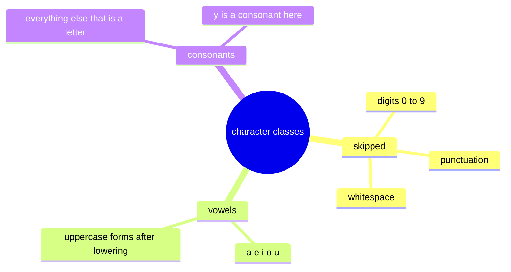
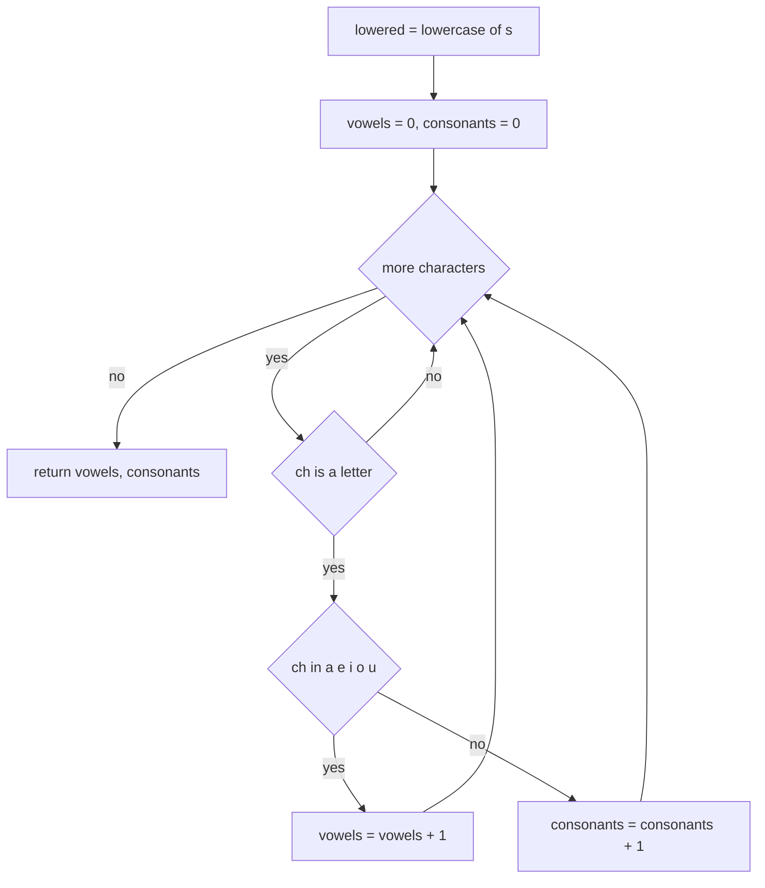
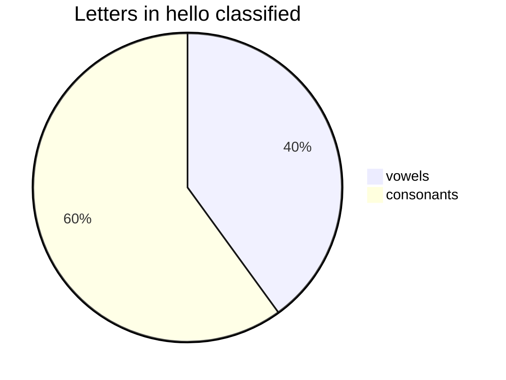
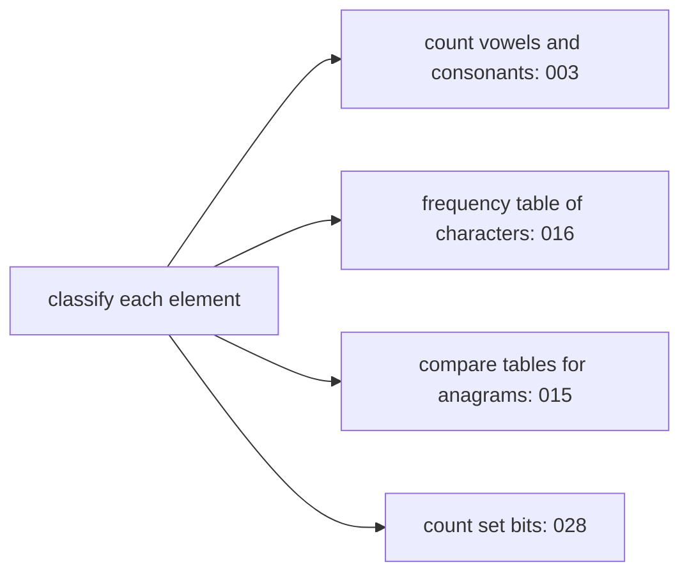

# 003 — Count vowels and consonants in a string.

> **Tier:** Beginner · **CTCI chapter:** Ch 1 — Arrays and Strings
> **Task spec:** [003-count-vowels-and-consonants-in-a-string.md](../../../tasks/beginner/003-count-vowels-and-consonants-in-a-string.md)
> **Solutions:** [Python](../../../solutions/python/beginner/003-count-vowels-and-consonants-in-a-string/solution.py) ·
> [Java](../../../solutions/java/beginner/003-count-vowels-and-consonants-in-a-string/Solution.java) ·
> [JavaScript](../../../solutions/javascript/beginner/003-count-vowels-and-consonants-in-a-string/solution.js) ·
> [C#](../../../solutions/csharp/beginner/003-count-vowels-and-consonants-in-a-string/Solution.cs)

## 1. Problem restatement

**Input:** a single string `s`, possibly empty.

**Output:** two counts in a fixed order — the number of **vowels** first, then the number of
**consonants**. Concretely the four solutions return a tuple (Python), a two-element array
(Java, C#), or a two-element array (JavaScript).

The classification rules that the solution files actually implement are worth spelling out,
because the one-line task spec leaves them open:

- Only **letters** are counted; digits, spaces and punctuation are skipped, not counted as
  consonants.
- The string is **lowercased first**, so `AEIOU` contributes five vowels.
- The vowel set is exactly `a`, `e`, `i`, `o`, `u`. It is not `aeiouy`, so `y` is classified as a
  consonant in every solution.
- Everything that is a letter and not in that set is a consonant.

| Call | Result | Why |
| --- | --- | --- |
| `count_vowels_and_consonants("hello")` | `(2, 3)` | `e`, `o` are vowels; `h`, `l`, `l` are consonants |
| `count_vowels_and_consonants("")` | `(0, 0)` | the loop body never runs |
| `count_vowels_and_consonants("AEIOU")` | `(5, 0)` | lowercasing maps `AEIOU` onto the vowel set |
| `count_vowels_and_consonants("hi! 42")` | `(1, 1)` | `h` consonant, `i` vowel, `!` and ` ` and `4` and `2` skipped |

Python asserts all four rows; Java, JavaScript and C# assert the first three — the fourth row is
the one that pins down the "skip non-letters" rule, and it is only executable in the Python file.
Still, the Java, JavaScript and C# bodies implement exactly the same skipping (`Character.isLetter`,
`/[a-z]/`, `char.IsLetter`), so the behaviour matches.

## 2. Intuition

The naive idea is to build a table of the ten vowels and scan the string looking every character
up in it, counting whatever you find and assuming everything else is a consonant:

```text
for each character ch in s do
    if ch is in vowels then
        vowels ← vowels + 1
    else
        consonants ← consonants + 1
    end
end
```

That version is wrong for real input. `"hi! 42"` contains two digits, a space and a punctuation
mark; a two-way split would report `(1, 5)` instead of `(1, 1)` because it would fold all four
non-letters into the consonant bucket. Counting digits as consonants is the single most common
bug in this exercise, and it is exactly what the `skip` branch guards against.

The key insight is that this is really a **three-way classification**, not a two-way one:
each character is either a vowel, a consonant, or **not a letter at all** — and the third bucket
is discarded. Once you see the third bucket, the algorithm becomes a single pass with one
membership test and a "is this a letter?" guard. The guard is the interesting part, because each
language implements it differently:

| Language | Letter test | Vowel test |
| --- | --- | --- |
| Python | `ch.isalpha()` | `ch in "aeiou"` |
| Java | `Character.isLetter(c)` | `"aeiou".indexOf(c) >= 0` |
| JavaScript | `/[a-z]/.test(ch)` | `"aeiou".includes(ch)` |
| C# | `char.IsLetter(c)` | `"aeiou".IndexOf(c) >= 0` |



Case folding happens before classification in all four solutions, which is why `"AEIOU"` returns
five vowels instead of zero: the loop iterates over a lowercased copy of the input (`s.lower()`,
`toLowerCase()`, `toLowerCase()`, `ToLowerInvariant()`).

## 3. Algorithm

1. Initialise `vowels ← 0` and `consonants ← 0`.
2. Lowercase the input once, before the loop.
3. For each character of the lowercased string:
   - if it is not a letter, skip it;
   - else if it belongs to `{a, e, i, o, u}`, increment `vowels`;
   - else increment `consonants`.
4. Return `(vowels, consonants)` — vowels first.

```text
procedure count_vowels_and_consonants(s)
    vowels ← 0
    consonants ← 0
    lowered ← lowercase(s)
    for each ch in lowered do
        if not is_letter(ch) then
            continue
        end
        if ch in {a, e, i, o, u} then
            vowels ← vowels + 1
        else
            consonants ← consonants + 1
        end
    end
    return {vowels, consonants}
end
```

Two details matter for equivalence with the shipped code. First, the lowercase pass is hoisted out
of the loop — lowercasing once costs a single allocation and `n` characters of work, whereas
lowercasing inside the loop would repeat that work per character. Second, the vowel set is tested
*after* the letter guard, so a digit never reaches the vowel test; the order of the two branches
is observable.



The loop has no early exit: a vowel count cannot be known until the last character has been
classified, so every character is inspected exactly once.

## 4. Worked example

Trace `count_vowels_and_consonants("hi! 42")`, one of the asserted rows. The lowercased string is
`"hi! 42"` — unchanged, since it contains no uppercase letters — and `n = 6`.

| Step | Character | Is a letter? | In `{a, e, i, o, u}`? | `vowels` | `consonants` |
| --- | --- | --- | --- | --- | --- |
| start | — | — | — | 0 | 0 |
| 1 | `h` | yes | no | 0 | 1 |
| 2 | `i` | yes | yes | 1 | 1 |
| 3 | `!` | no — skipped | — | 1 | 1 |
| 4 | ` ` | no — skipped | — | 1 | 1 |
| 5 | `4` | no — skipped | — | 1 | 1 |
| 6 | `2` | no — skipped | — | 1 | 1 |

The loop ends and the function returns `(1, 1)`. Four of the six characters were discarded, which
is why the "skip" branch carries half the weight of this exercise.

Now trace the asserted uppercase row, `count_vowels_and_consonants("AEIOU")`: the lowercase pass
turns it into `"aeiou"`, and all five characters fall into the vowel branch, giving `(5, 0)`. Had
the solution not lowercased, every character would have missed the `aeiou` set and the answer
would have been `(0, 5)` — a silent, plausible-looking wrong answer.



The same picture for `"hello"`: after classification, 2 of the 5 letters are vowels and 3 are
consonants, matching the asserted `(2, 3)`.

## 5. Complexity

Let `n` be the length of `s`.

| Measure | Bound | Why it holds |
| --- | --- | --- |
| Time, best | O(n) | every character must be classified; there is no early exit. Only an empty string finishes in O(1) |
| Time, average | O(n) | one pass, constant work per character (one letter test, one membership test) |
| Time, worst | O(n) | membership in a five-character set costs a bounded number of comparisons, so total work is `c · n` |
| Space, counters | O(1) | two integers |
| Space, extra | O(n) | the lowercased copy: `lower()`, `toLowerCase()`, `toLowerCase()` and `ToLowerInvariant()` all allocate a new string |
| Space if you fold case per character | O(1) | comparing `ch` against both cases of the vowels removes the copy entirely |

That last row is the honest optimisation: the counters are O(1) and the only linear extra memory
is the lowercased string, which exists purely for convenience. A version that upper- or
lowercases each character on the fly (or compares against `"aeiouAEIOU"`) keeps the same time
bound and drops the extra space to O(1) — a good thing to volunteer in an interview, since the
shipped solutions deliberately favour clarity.

## 6. Pitfalls and edge cases

- **Empty string.** The loop never runs, so the result is `(0, 0)`. All four solutions assert it.
- **Digits and punctuation are skipped, not counted.** `"hi! 42"` returns `(1, 1)`; counting `4`
  and `2` as consonants would return `(1, 3)`. This is the single most common wrong answer.
- **Uppercase input.** `"AEIOU"` returns `(5, 0)` only because of the lowercase pass; forgetting it
  silently swaps the counts to `(0, 5)`.
- **`y` is a consonant.** The vowel set is exactly `aeiou`, so `"rhythm"` yields zero vowels in
  every solution. Spell this out before an interviewer asks.
- **Accented letters diverge between languages.** Python's `isalpha()`, Java's
  `Character.isLetter()` and C#'s `char.IsLetter()` are Unicode-aware, so `é` counts as a
  consonant, while the JavaScript guard `/[a-z]/` is ASCII-only and skips it. The four files agree
  on ASCII and disagree on non-ASCII input; document the convention you are claiming.
- **Locale-sensitive lowercasing.** C# calls `ToLowerInvariant()` (locale-independent), while
  Java's no-argument `toLowerCase()` uses the default locale. For a handful of characters these can
  differ, and the classification follows the lowercased character.
- **Surrogate pairs.** Java and C# iterate UTF-16 code units, so an astral character is two
  iterations; JavaScript's `for ... of` iterates code points, so it is one iteration. Emoji are not
  letters in any of the four, so both counted and skipped versions end up equal — but the iteration
  counts differ if you instrument the loop.
- **Return shape.** Callers must know the order is vowels first. A tuple in Python compares equal
  only to a tuple; in Java and C# a two-element array is compared element-wise (the Java test uses
  `Arrays.equals`), not by reference.
- **Combining marks.** `e` followed by a combining accent is two code points; the accent is not a
  letter and is skipped, so the letter is still counted once. A naive "count code points" version
  would double-count if the mark were classified as a letter.

## 7. Variants and follow-ups

- **Count everything, not just vowels.** A general frequency table over the whole alphabet is
  [016-count-occurrences-of-each-character-in-a-string.md](../../../tasks/beginner/016-count-occurrences-of-each-character-in-a-string.md);
  the "skip or count" decision becomes "increment a bucket indexed by the character".
- **Compare two such tables.** Anagrams need equality of frequency tables rather than a single
  reduced count:
  [015-check-if-two-strings-are-anagrams.md](../../../tasks/beginner/015-check-if-two-strings-are-anagrams.md).
- **Same loop, different predicate.** The palindrome predicate
  [002-check-if-a-string-is-a-palindrome.md](../../../tasks/beginner/002-check-if-a-string-is-a-palindrome.md)
  is the letter test plus a mirrored comparison; "ignore case and punctuation" palindromes reuse
  this task's letter guard verbatim.
- **Counting on arrays instead of strings.** The same partition-and-count shape appears wherever a
  stream is split into classes, for example counting set bits in
  [028-count-number-of-set-bits-in-an-integer.md](../../../tasks/beginner/028-count-number-of-set-bits-in-an-integer.md).



That family of problems is why the three-way classification pattern is worth internalising early:
the accumulator changes, the shape does not.

## 8. Check yourself

1. `count_vowels_and_consonants("hi! 42")` returns `(1, 1)`. What would a two-way split that treats
   "not a vowel" as "consonant" return, and why is it wrong?

<details><summary>Show answer</summary>

It would return `(1, 5)`: `h`, `!`, ` `, `4` and `2` would all land in the consonant bucket. It is
wrong because the task counts letters; digits, spaces and punctuation are not consonants.

</details>

2. Why does the code lowercase the string before the loop instead of inside it?

<details><summary>Show answer</summary>

Lowercasing once costs one allocation and one pass; doing it per character would allocate a new
one-character string on every iteration — the same O(n²) trap as appending to an immutable string.
The folded copy also makes the vowel set a simple five-character list.

</details>

3. Is `y` a vowel in these solutions? What about `é`?

<details><summary>Show answer</summary>

`y` is a consonant: the vowel set is exactly `aeiou`. `é` is Unicode-aware-letter in Python, Java
and C#, so it is counted as a consonant there, but the JavaScript guard `/[a-z]/` is ASCII-only and
skips it. The four files agree on ASCII input only.

</details>

4. What is the extra space of the shipped solution, and how would you remove it?

<details><summary>Show answer</summary>

O(n) for the lowercased copy. You keep the same O(n) time by testing each character against both
cases — for example comparing against `"aeiouAEIOU"` instead of `"aeiou"` — which leaves the two
counters as the only extra storage, i.e. O(1).

</details>

5. Why is there no best-case shortcut for this task, unlike the palindrome check?

<details><summary>Show answer</summary>

Because the answer is a total over all characters: a vowel can appear anywhere, including the last
position, so no prefix can settle the count. Every character must be visited once, which makes the
best case O(n) for any non-empty input.

</details>
