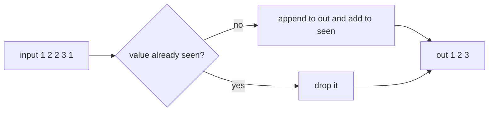
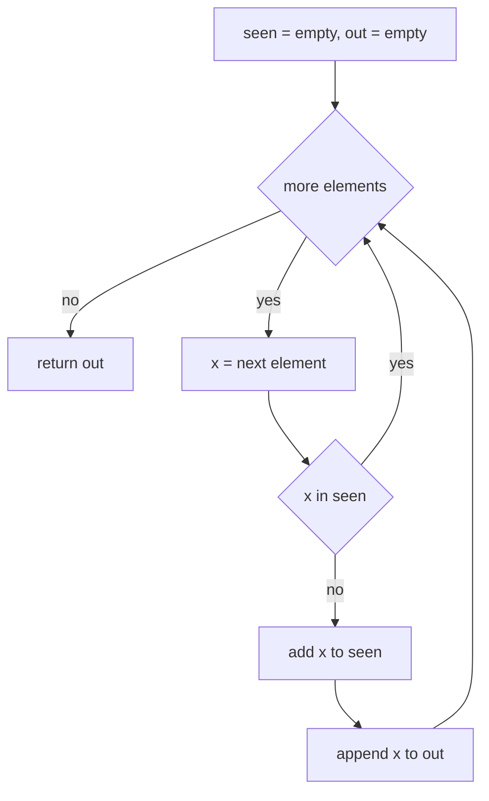
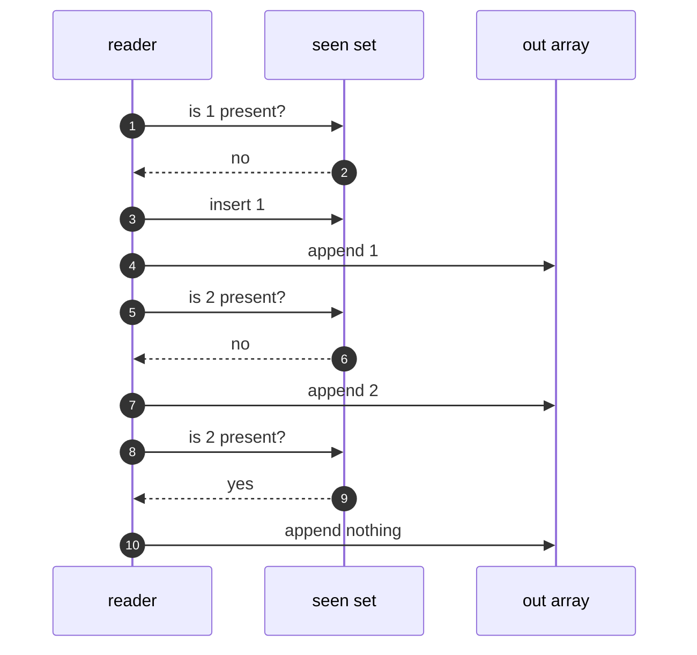
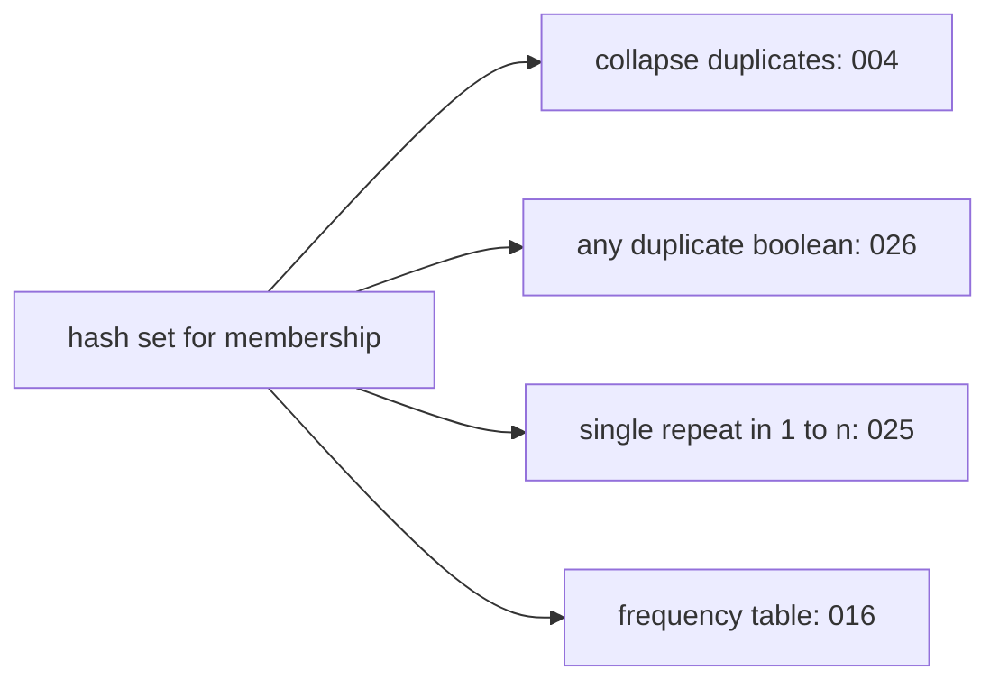

# 004 — Remove duplicates from an array (create new array).

> **Tier:** Beginner · **CTCI chapter:** Ch 1 — Arrays and Strings
> **Task spec:** [004-remove-duplicates-from-an-array-create-new-array.md](../../../tasks/beginner/004-remove-duplicates-from-an-array-create-new-array.md)
> **Solutions:** [Python](../../../solutions/python/beginner/004-remove-duplicates-from-an-array-create-new-array/solution.py) ·
> [Java](../../../solutions/java/beginner/004-remove-duplicates-from-an-array-create-new-array/Solution.java) ·
> [JavaScript](../../../solutions/javascript/beginner/004-remove-duplicates-from-an-array-create-new-array/solution.js) ·
> [C#](../../../solutions/csharp/beginner/004-remove-duplicates-from-an-array-create-new-array/Solution.cs)

## 1. Problem restatement

**Input:** an array `items` of `n` elements. The Python file is generic (it is exercised with both
`[1, 2, 2, 3, 1]` and `["a", "b", "a"]`), while the Java, JavaScript and C# files are typed to
integers.

**Output:** a **new** array holding the values that appeared in `items`, in the order of their
**first occurrence**, with later copies dropped. The input array is left untouched, and the
returned array is shorter than or equal in length to the input.

| Call | Result | Why |
| --- | --- | --- |
| `remove_duplicates([1, 2, 2, 3, 1])` | `[1, 2, 3]` | `2` and `1` reappear later, so only their first copies survive |
| `remove_duplicates([])` | `[]` | nothing to keep |
| `remove_duplicates([5, 5, 5])` | `[5]` | one distinct value |
| `remove_duplicates(["a", "b", "a"])` | `["a", "b"]` | order follows first occurrence, not sorted order |

All four solutions assert the first three rows — Python asserts the fourth as well, using strings
rather than integers.

The "create new array" part of the title is a real constraint, not decoration: the solution must
not compact the caller's array in place, because the caller still owns the original ordering.

## 2. Intuition

The naive idea is a nested loop: for each element, scan the output built so far and append only if
the element is not there yet.

```text
out ← empty
for each x in items do
    found ← false
    for each y in out do
        if x equals y then
            found ← true
        end
    end
    if not found then
        append x to out
    end
end
```

This is correct and needs no hashing, but the inner scan grows with the output, so the total work
is proportional to `1 + 2 + ... + n`, i.e. **O(n²)** — quadratic, and hopeless on an input of any
real size.

The key insight is that "have I seen this value before?" is a *membership* question, and
membership is exactly what a hash-based set answers in expected O(1). Keep one set of already-seen
values alongside the output array:

- If `x` is **not** in the set, this is its first occurrence: add `x` to the set and append `x` to
  the output.
- If `x` **is** in the set, it is a duplicate: skip it.

The second insight is about **order**. Dropping duplicates is easy with a set alone — but a set
does not promise to remember where each value first appeared. Each solution keeps the first-seen
order explicitly:

- Python keeps a `set` for membership and appends to a separate list, so the output order is
  independent of set iteration order.
- JavaScript does the same with a `Set` and a plain array.
- Java collects into a `LinkedHashSet`, which iterates in insertion order, and copies that out.
- C# uses `HashSet<int>.Add`, whose boolean return value *is* the "was it new?" test, and appends
  to a `List<int>`.



Notice that the output keeps the *first* copy, not the last: `[1, 2, 2, 3, 1]` yields `[1, 2, 3]`,
with the leading `1` deciding the position of `1` in the result.

## 3. Algorithm

1. Create an empty membership set `seen`.
2. Create an empty output array `out`.
3. For each element `x` of `items` in order:
   - if `x` is not in `seen`: add `x` to `seen` and append `x` to `out`;
   - otherwise do nothing.
4. Return `out`.

```text
procedure remove_duplicates(items)
    seen ← empty set
    out ← empty array
    for each x in items do
        if x not in seen then
            add x to seen
            append x to out
        end
    end
    return out
end
```

The C# file folds the two statements of the "insert" branch into one by using the boolean result
of `HashSet.Add` — the call both tests membership and inserts, and it returns `false` when the
value was already present:

```text
procedure remove_duplicates_using_add_result(items)
    seen ← empty set
    out ← empty list
    for each x in items do
        if add x to seen returns true then
            append x to out
        end
    end
    return out as an array
end
```

Both formulations are the same single pass; the difference is that the second one performs one hash
lookup instead of a `contains` followed by an `add`.



Every element is examined exactly once and, in the worst case, two hash operations happen for it
(one membership probe, one insertion). Duplicates cost a single failed probe.

## 4. Worked example

Trace `remove_duplicates([1, 2, 2, 3, 1])`:

| Step | `x` | `x in seen`? | Action | `seen` after | `out` after |
| --- | --- | --- | --- | --- | --- |
| start | — | — | initialise | `{}` | `[]` |
| 1 | 1 | no | add and append | `{1}` | `[1]` |
| 2 | 2 | no | add and append | `{1, 2}` | `[1, 2]` |
| 3 | 2 | yes | skip | `{1, 2}` | `[1, 2]` |
| 4 | 3 | no | add and append | `{1, 2, 3}` | `[1, 2, 3]` |
| 5 | 1 | yes | skip | `{1, 2, 3}` | `[1, 2, 3]` |

Five elements are read, three are kept, two hash probes fail. The result `[1, 2, 3]` is exactly the
asserted value, and the final order is the order in which the values were first seen — not the
order the set happens to enumerate.

Compare with the third asserted row, `remove_duplicates([5, 5, 5])`: the first `5` is inserted, and
the next two probes find it, so `out` ends as `[5]`. And `remove_duplicates([])` never enters the
loop at all, returning the empty array.



## 5. Complexity

Let `n` be the number of elements in `items` and `d` the number of distinct values (`d <= n`).

| Measure | Bound | Why it holds |
| --- | --- | --- |
| Time, best | O(n) | every element must be read at least once, even when the array has no duplicates |
| Time, average | O(n) | `n` expected-O(1) hash probes plus `n` appends |
| Time, worst | O(n) under normal hashing | a pathological hash function can degrade a probe to O(n), giving O(n²); the solutions rely on the standard library's hashing and do not defend against adversarial keys |
| Space, output | O(d) | one slot per distinct value |
| Space, extra | O(d) | the `seen` set holds at most `d` entries; the two-loop alternative uses O(1) extra |
| Nested-loop alternative | O(n²) time, O(d) output, O(1) extra | no hashing at all, so no adversarial-hash risk, but quadratic comparisons |
| Sort-then-compact alternative | O(n log n) time | needs a mutable copy or a sorted output, and it changes the order unless you re-map the indices |

The hash version is the practical choice: linear expected time, linear memory. The nested-loop
version is only preferable when the values have no usable hash (custom objects without a good
equality/hash pair) or when `n` is tiny and constant factors dominate.

## 6. Pitfalls and edge cases

- **Empty array.** The loop never runs and the output is empty. All four solutions assert it, so
  returning `null` here is a bug.
- **All elements equal.** `[5, 5, 5]` collapses to a single element; the second and third probes
  are the only work after the first insertion.
- **Order is first occurrence, not sorted order or last occurrence.** `[1, 2, 2, 3, 1]` gives
  `[1, 2, 3]`. Sorting the result would give the same answer here by coincidence, but
  `remove_duplicates([3, 1, 3, 2])` must give `[3, 1, 2]` — sorting would break it.
- **Rely on insertion order explicitly.** Java's `LinkedHashSet` iterates in insertion order, but a
  plain `HashSet` would scramble it; Python's `set` and JavaScript's `Set` are used only for
  membership, and the output order comes from the separately built array. Getting this backwards
  is the most common way to pass the assertions on small inputs and fail on large ones.
- **Rely on `Add`'s return value in C#.** `HashSet<int>.Add` returns `false` for a value that is
  already present — that single call replaces a `Contains` plus an `Add`. Calling `Add`
  unconditionally and then appending would duplicate.
- **Empty output type.** Returning an empty array (not `null`) keeps callers loop-free; the Java
  and C# asserts compare against a zero-length array.
- **Unhashable or expensive keys.** Python raises `TypeError` for unhashable elements (a `list`
  inside the input), and JavaScript's `Set` compares objects by reference, so two structurally
  equal objects are still distinct — the same is true of Java's default `equals` and C#'s default
  comparer. Deduplicating records by *content* needs a key function or a custom comparer.
- **`NaN` and signed zero in JavaScript.** `Set` uses SameValueZero, so `NaN` equals `NaN` (one
  survivor) and `-0` collapses into `+0`. That differs from `===`, which reports `NaN !== NaN`.
- **Typed input.** The Java, JavaScript and C# files accept integers only, so swapping them to
  strings requires changing the signature; the Python file already works for any hashable type.
- **Memory versus in-place.** Keeping a set of `d` values is the price of linear time. If the array
  is mutable and the caller does not need the original, sorting it in place and compacting gives
  O(n log n) time with O(1) extra space — but the output order changes.

## 7. Variants and follow-ups

- **Just the boolean.** [026-check-if-array-contains-any-duplicates-boolean.md](../../../tasks/beginner/026-check-if-array-contains-any-duplicates-boolean.md)
  is the same membership set with the output dropped and the first "already seen" hit returned
  immediately — a nice early-exit variant of this loop.
- **Find the single repeated value.** [025-find-duplicate-element-when-exactly-one-number-repeats-1-n.md](../../../tasks/beginner/025-find-duplicate-element-when-exactly-one-number-repeats-1-n.md)
  exploits the `1..n` range to find the repeat with O(1) extra space instead of a set.
- **Remove by index instead of by value.** [024-remove-element-at-index-from-array-in-place.md](../../../tasks/beginner/024-remove-element-at-index-from-array-in-place.md)
  shows the in-place compaction step that this task deliberately avoids.
- **Counting occurrences instead of collapsing them.** [016-count-occurrences-of-each-character-in-a-string.md](../../../tasks/beginner/016-count-occurrences-of-each-character-in-a-string.md)
  keeps the frequency in the same hash table that this task uses as a membership test.
- **Merge without duplicates.** [020-merge-two-sorted-arrays-into-a-sorted-array.md](../../../tasks/beginner/020-merge-two-sorted-arrays-into-a-sorted-array.md)
  combines the two-pointer walk with a "did the last emitted element equal this one?" check.



## 8. Check yourself

1. Why does the naive nested loop cost O(n²) and what exactly replaces the inner scan?

<details><summary>Show answer</summary>

The inner scan walks the whole output array for every input element, so the total number of
comparisons is `1 + 2 + ... + n` in the worst case. The hash-based membership set replaces that
scan with one expected-O(1) probe, turning the total into O(n).

</details>

2. `remove_duplicates([3, 1, 3, 2])` — what is the result, and which of the four solutions would
   get it wrong if they forgot about ordering?

<details><summary>Show answer</summary>

`[3, 1, 2]`, following first occurrences. A solution that iterated a plain `HashSet` (Java) or a
sorted collection would return a different order — `[1, 2, 3]`, for instance. Python and
JavaScript are safe because the order comes from the separately built output array; Java relies on
`LinkedHashSet`.

</details>

3. What does `HashSet<T>.Add` return in C#, and why does the C# solution care?

<details><summary>Show answer</summary>

It returns `true` when the value was not present (and was inserted) and `false` when it was already
there. The C# solution uses that single call as both the membership test and the insertion, so it
skips appending on `false`.

</details>

4. What is the worst-case time of the hash approach, and when does that matter?

<details><summary>Show answer</summary>

O(n²) if the hash function degenerates and every probe walks a long collision chain. Standard
library hashing of integers or strings makes this practically unreachable; it matters when keys
come from an untrusted source and were chosen to collide (a hash-flooding attack), or when the
element type has a poor user-written hash.

</details>

5. The task title says "create new array". What behaviour becomes a bug if you ignore it?

<details><summary>Show answer</summary>

Overwriting the caller's array (compacting in place) mutates data the caller still owns and may
reorder it. The four solutions all build a fresh output and leave `items` untouched, so callers can
keep using the original array — including its duplicates.

</details>
