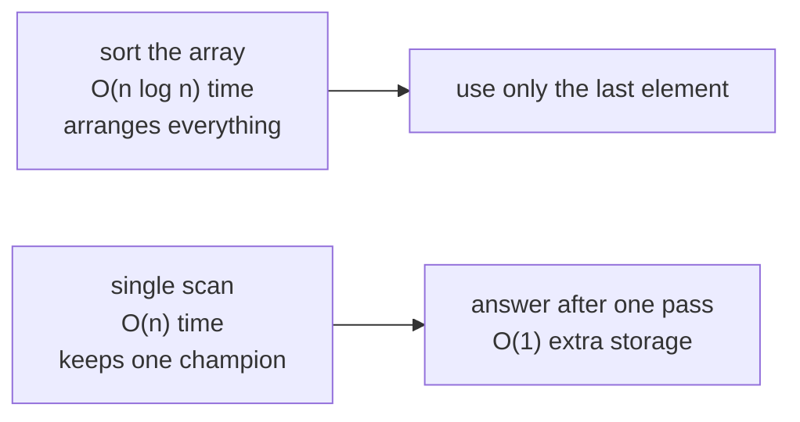
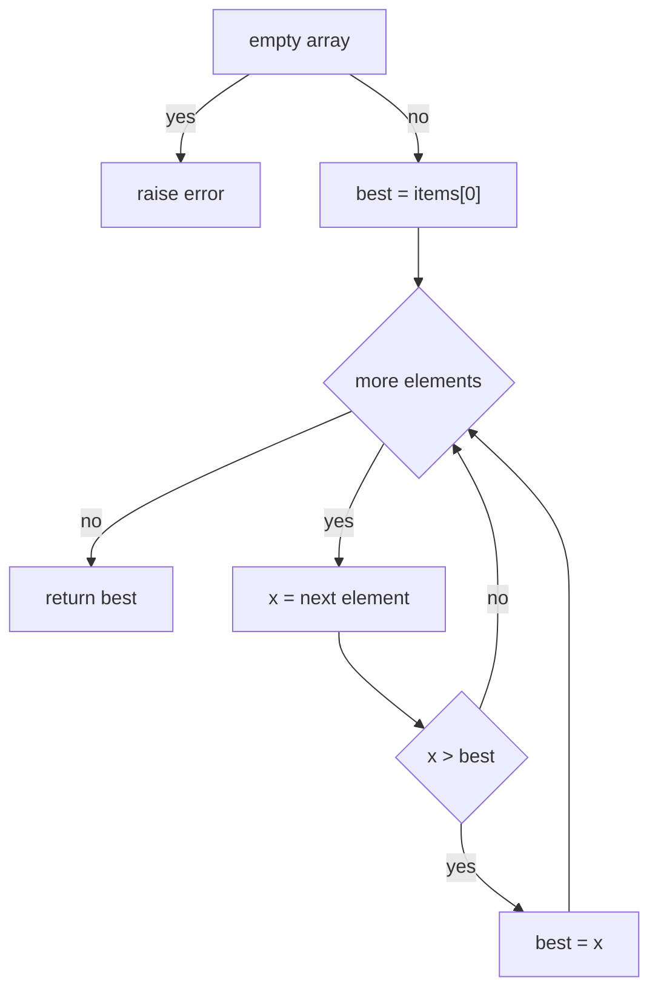
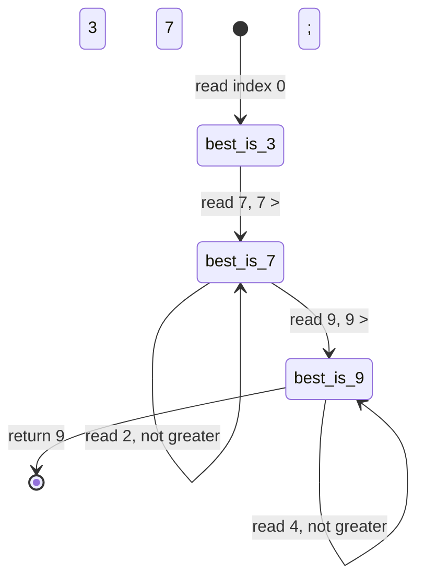
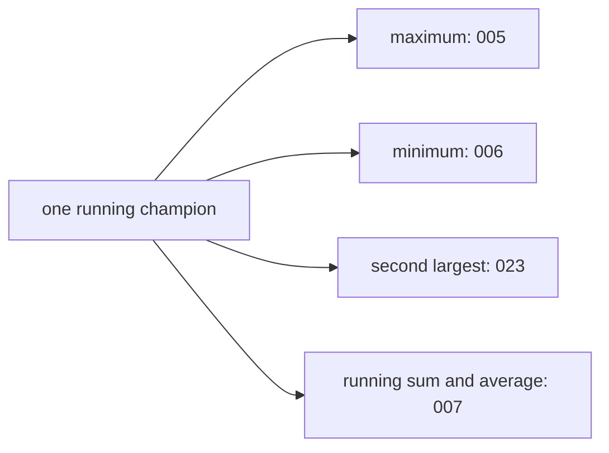

# 005 — Find maximum value in an int array.

> **Tier:** Beginner · **CTCI chapter:** Ch 1 — Arrays and Strings
> **Task spec:** [005-find-maximum-value-in-an-int-array.md](../../../tasks/beginner/005-find-maximum-value-in-an-int-array.md)
> **Solutions:** [Python](../../../solutions/python/beginner/005-find-maximum-value-in-an-int-array/solution.py) ·
> [Java](../../../solutions/java/beginner/005-find-maximum-value-in-an-int-array/Solution.java) ·
> [JavaScript](../../../solutions/javascript/beginner/005-find-maximum-value-in-an-int-array/solution.js) ·
> [C#](../../../solutions/csharp/beginner/005-find-maximum-value-in-an-int-array/Solution.cs)

## 1. Problem restatement

**Input:** an array `items` of `n` integers. The array may be empty.

**Output:** the largest value in the array. There is no requirement to report *where* it is — the
answer is the value itself, so ties are indistinguishable in the result.

**Empty input is an error, not a value.** Python raises `ValueError("empty array")`, Java raises
`IllegalArgumentException("empty array")`, JavaScript throws `Error("empty array")` and C# throws
`ArgumentException("empty array")`. Returning `0`, `null` or a minimum sentinel would silently
invent an answer for an input that has none.

| Call | Result | Why |
| --- | --- | --- |
| `max_value([3, 7, 2, 9, 4])` | `9` | the fourth element beats every candidate before and after it |
| `max_value([-5, -1, -3])` | `-1` | all negatives: the largest is the least negative |
| `max_value([42])` | `42` | the only element is the maximum of one candidate |
| `max_value([])` | raises | no candidate exists |

All three non-empty rows are asserted in all four solution files; the raising behaviour is visible
in the guard clause each file opens with.

## 2. Intuition

The obvious idea is to sort the array and take the last element. That is correct, and it is the
wrong tool: sorting computes a total order for the whole array and then discards all but one
element of that order, costing O(n log n) time for an answer that needs a single pass. It also
either mutates the caller's array (in-place sort) or copies it (sorted copy), which the task never
asked for.

A second tempting shortcut is to try to derive the maximum from aggregate statistics. It cannot be
done: the maximum is not a function of the sum, the average or the count, because those aggregates
lose the pairing between large values and their signs. `[-5, -1, -3]` and `[3, 1, 5]` can be made to
agree on every aggregate while having completely different maxima.

The key insight is that the maximum can be maintained **incrementally**: after reading the first
`k` elements you can keep a single number that is the maximum of those `k`, and the maximum of the
first `k + 1` elements is either that number or the newly read element. That invariant needs one
comparison per element and one variable of storage, so the whole problem collapses to one linear
sweep — no sorting, no second array, no bookkeeping of the other `n - 1` values.



The initial candidate deserves a word of its own. The solutions take `best = items[0]`, the first
element itself, rather than a symbolic sentinel such as `0` or the smallest representable integer.
Starting from `items[0]` is correct for *every* input shape, including arrays that are entirely
negative, and it makes the empty case fail loudly at the guard clause instead of returning a
sentinel that looks like a legitimate answer.

## 3. Algorithm

1. If the array is empty, raise an error — there is no maximum.
2. Set `best` to the first element.
3. For each remaining element `x`: if `x` is strictly greater than `best`, set `best` to `x`.
4. Return `best`.

```text
procedure max_value(items)
    if length(items) = 0 then
        raise error "empty array"
    end
    best ← items[0]
    for i ← 1 to length(items) - 1 do
        if items[i] > best then
            best ← items[i]
        end
    end
    return best
end
```

The Python file implements exactly this loop by iterating the slice `items[1:]`. The Java,
JavaScript and C# files iterate the **whole** array instead, which is also correct: on the first
iteration the comparison is `items[0] > best` with `best` already set to `items[0]`, so the
condition is `false` and nothing changes. The two spellings differ only by that one provably-false
comparison.



The strict comparison `>` matters even though the maximum value does not change: with `>`, the
first occurrence of a repeated maximum is kept; with `>=`, the last one is. Since only the value is
returned, both give `9` for `[3, 7, 2, 9, 4]` — but the moment you also report the index, the
choice becomes observable.

## 4. Worked example

Trace `max_value([3, 7, 2, 9, 4])`. The guard passes, `best` starts at `3`, and the loop runs over
indices `1` to `4`.

| Step | Index | `x` | Test `x > best` | `best` after |
| --- | --- | --- | --- | --- |
| start | — | — | — | 3 |
| 1 | 1 | 7 | `7 > 3` true | 7 |
| 2 | 2 | 2 | `2 > 7` false | 7 |
| 3 | 3 | 9 | `9 > 7` true | 9 |
| 4 | 4 | 4 | `4 > 9` false | 9 |

Four comparisons, two updates, and the answer `9`. Reading the table left to right, `best` is the
maximum of the prefix processed so far at every row — that is the invariant from section 2 holding
in practice.



Now trace the all-negative row, `max_value([-5, -1, -3])`: `best` starts at `-5`; `-1 > -5` is true,
so `best` becomes `-1`; `-3 > -1` is false, so `best` stays. The answer is `-1`. A solution that
initialised `best` to `0` — a very common mistake — would return `0` here, a value that is not even
in the array.

And `max_value([42])`: the loop body never executes, so the function returns `items[0]` after zero
comparisons. That is why initialising from the first element, rather than from a sentinel, gives
the right answer with no special case.

## 5. Complexity

Let `n` be the number of elements in `items`.

| Measure | Bound | Why it holds |
| --- | --- | --- |
| Time, best | O(n) | every element must be inspected: the maximum can be anywhere, including last |
| Time, average | O(n) | one comparison per element after the first |
| Time, worst | O(n) | constant work per element, so `c · n` total |
| Comparisons, Python | `n - 1` for `n >= 1` | the loop runs over `items[1:]`, so index `0` is never compared |
| Comparisons, Java / JavaScript / C# | `n` | the loop runs over the whole array; the first comparison is `items[0] > items[0]` and is always false |
| Space, working variables | O(1) | `best` plus a loop index or iterator |
| Space, Python | O(n) extra | the slice `items[1:]` allocates a shallow copy of `n - 1` references |
| Space, Java / JavaScript / C# | O(1) extra | the three files iterate the original array without copying it |
| Sorting alternative | O(n log n) time, O(n) space for a copy | computes the full order and throws almost all of it away |

The asymptotic answer is a single linear pass with constant storage — which is optimal, since any
algorithm must read every element at least once. The surviving difference between the four files is
Python's slice: an idiomatic one-liner in the loop header that quietly costs a second array. It does
not change any bound, but it is the kind of detail worth naming out loud.

## 6. Pitfalls and edge cases

- **Empty array.** Raises in all four solutions (`ValueError`, `IllegalArgumentException`, `Error`,
  `ArgumentException`). Returning a sentinel instead hides the caller's bug behind a plausible
  number.
- **All-negative arrays.** `[-5, -1, -3]` returns `-1` and is asserted everywhere. Initialising
  `best` to `0` breaks exactly here, because `0` is greater than every element and is not in the
  array.
- **Single element.** `[42]` returns `42` with zero comparisons in Python and one self-comparison in
  the other three. The guard clause is what stops the empty case from reaching `items[0]`.
- **Ties.** Only the value is returned, so `[9, 9]` and `[9]` are indistinguishable. If you switch
  to reporting an index, strict `>` keeps the first maximum and `>=` keeps the last; pick one and
  document it.
- **Sentinel initialisation is not equivalent.** `Integer.MIN_VALUE` / `int.MinValue` happens to be
  correct for a *non-empty* int array, but it makes the empty case return that sentinel rather than
  raising, so it trades a loud failure for a silent one. It is also wrong the moment the element
  type widens beyond the sentinel's range.
- **Overflow.** Comparisons are overflow-free for any integer type. Arithmetic is not: the classic
  "arithmetic maximum" `(a + b + |a - b|) / 2` can overflow, and `Math.abs` of the most negative
  value overflows in Java. Do not use arithmetic to compare.
- **JavaScript numbers are doubles.** A JS array can hold values above `2^53`, where consecutive
  integers are no longer representable; the comparison still works on the stored doubles, but the
  value you print may not be the integer the caller passed in. Java, C# and Python integers do not
  have that limitation.
- **Floating-point `NaN`, if the caller widens the type.** `NaN > best` is `false` for every
  comparison, so `NaN` can never become the champion; an array whose only "large" value is `NaN`
  returns some finite element. That is defensible but must be documented.
- **Do not mutate the input.** Sorting the caller's array to take the last element changes data the
  caller still owns; all four solutions leave `items` untouched.

## 7. Variants and follow-ups

- **Minimum instead of maximum.** [006-find-minimum-value-in-an-int-array.md](../../../tasks/beginner/006-find-minimum-value-in-an-int-array.md)
  is the same sweep with the comparison flipped — and with a nastier sentinel trap, since a
  positive sentinel is what breaks all-positive arrays there.
- **Two champions.** [023-find-second-largest-element-in-an-array.md](../../../tasks/beginner/023-find-second-largest-element-in-an-array.md)
  keeps `best` and `second` in the same single pass, which is where the tie-breaking rules stop
  being cosmetic.
- **Another single-pass accumulator.** [007-compute-sum-and-average-of-array-elements.md](../../../tasks/beginner/007-compute-sum-and-average-of-array-elements.md)
  shows the same loop shape with an exact-arithmetic accumulator and the overflow discussion that
  comes with it.
- **A different predicate over adjacent elements.** [019-check-if-array-is-sorted-ascending.md](../../../tasks/beginner/019-check-if-array-is-sorted-ascending.md)
  compares neighbours rather than keeping a running champion, and can exit early.
- **Library shortcuts.** Python's `max()`, Java's `IntStream.max()`, C#'s `Enumerable.Max()` and
  JavaScript's `Math.max(...items)` all implement this loop. The JavaScript spread is the one to
  watch: passing a very large array as an argument list can exceed the engine's argument limit and
  throw a `RangeError`, so reduce instead of spreading for big inputs.



## 8. Check yourself

1. Why is `best = items[0]` better than `best = 0` even though sum-style problems often start at
   zero?

<details><summary>Show answer</summary>

Because `0` is not a neutral element for maximum: it is a *candidate value* that may beat every real
element. For `[-5, -1, -3]`, starting at `0` returns `0`, which is not in the array. Starting from
`items[0]` makes the first element the initial candidate, which is correct for any sign pattern.
(`0` *is* neutral for sum, which is why the two idioms differ.)

</details>

2. How many comparisons does each implementation perform on an array of length `n`?

<details><summary>Show answer</summary>

Python performs `n - 1`: it iterates `items[1:]`, so the first element is never compared. Java,
JavaScript and C# perform `n`: they iterate the whole array, so the first iteration compares
`items[0]` with itself and is always false. Both are linear and both correct.

</details>

3. Does the Python version really use O(1) extra space?

<details><summary>Show answer</summary>

No. `items[1:]` allocates a shallow copy of the remaining `n - 1` references, so Python's variant
uses O(n) extra space even though the algorithm needs only one variable. The Java, JavaScript and
C# files iterate the array directly and stay at O(1).

</details>

4. What is the answer for `max_value([])`, and why is raising better than returning a value?

<details><summary>Show answer</summary>

It raises. No element exists, so no maximum exists; returning `0`, `null` or the smallest
representable integer would be an invented answer that silently propagates through arithmetic
downstream. A guard clause turns a caller's mistake into an immediate failure.

</details>

5. When would sorting the array be the better choice despite the worse complexity?

<details><summary>Show answer</summary>

When the order is needed anyway — for example, "find the top three", "find the median", or a
sequence of maximum queries on the same data. Sorting once at O(n log n) then answering each query
in O(1) beats repeated O(n) scans. For a single maximum query on unsorted data, the linear scan wins.

</details>
