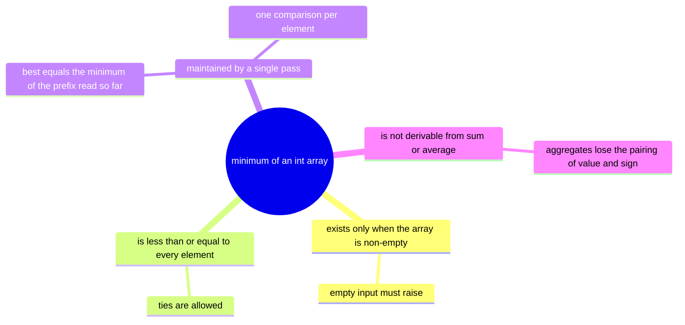
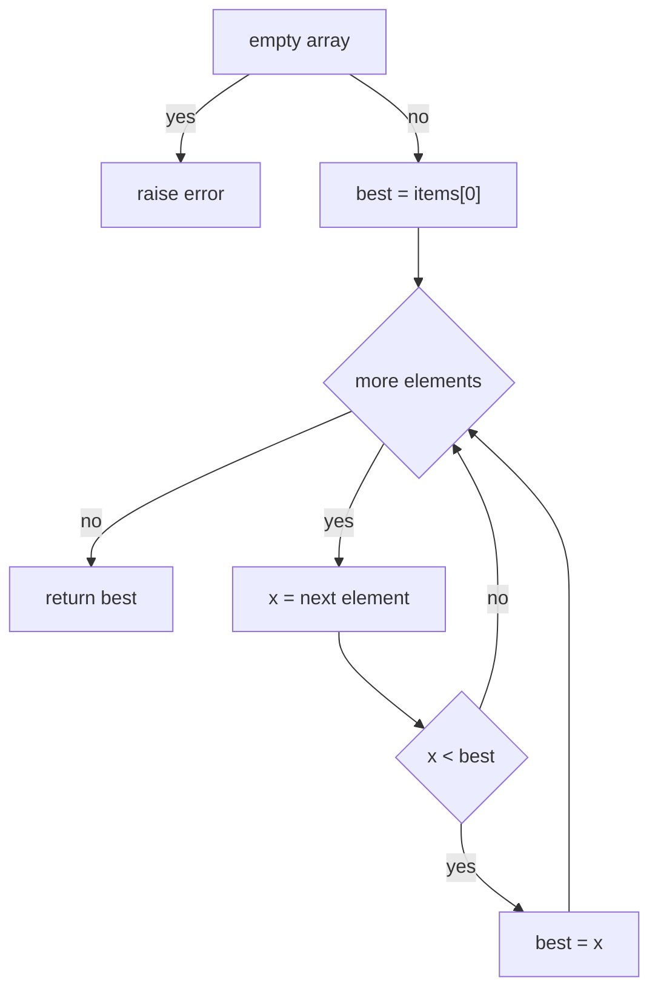
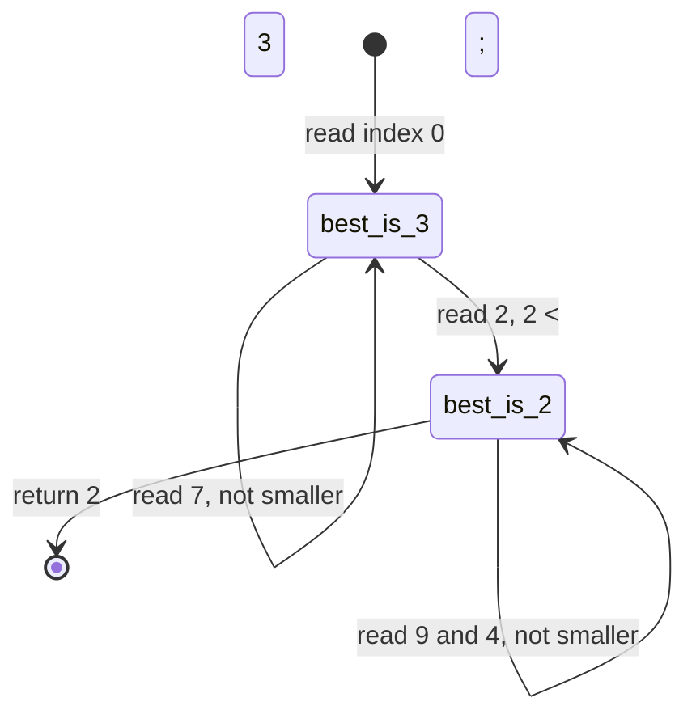
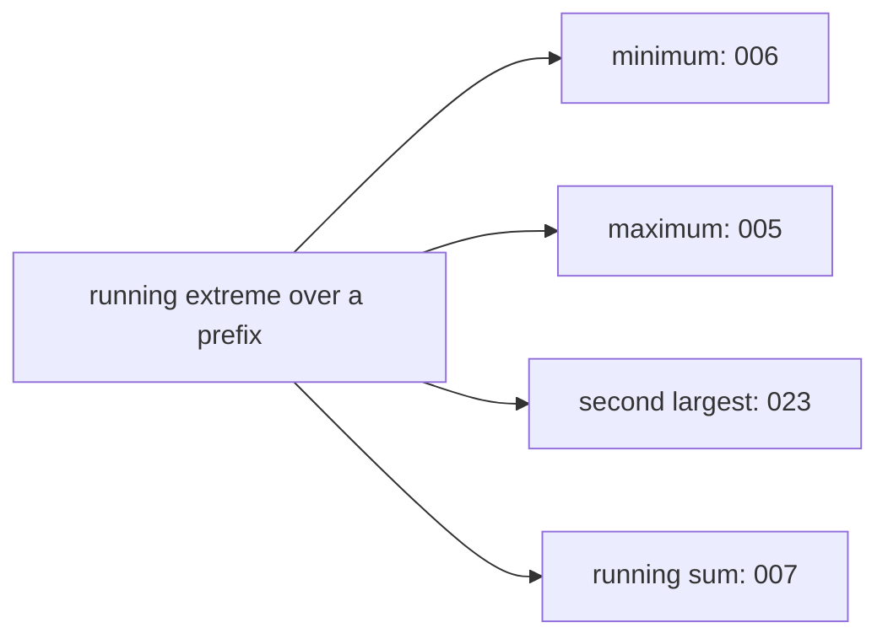

# 006 — Find minimum value in an int array.

> **Tier:** Beginner · **CTCI chapter:** Ch 1 — Arrays and Strings
> **Task spec:** [006-find-minimum-value-in-an-int-array.md](../../../tasks/beginner/006-find-minimum-value-in-an-int-array.md)
> **Solutions:** [Python](../../../solutions/python/beginner/006-find-minimum-value-in-an-int-array/solution.py) ·
> [Java](../../../solutions/java/beginner/006-find-minimum-value-in-an-int-array/Solution.java) ·
> [JavaScript](../../../solutions/javascript/beginner/006-find-minimum-value-in-an-int-array/solution.js) ·
> [C#](../../../solutions/csharp/beginner/006-find-minimum-value-in-an-int-array/Solution.cs)

## 1. Problem restatement

**Input:** an array `items` of `n` integers, possibly empty.

**Output:** the smallest value in the array. Position is not part of the answer, so repeated minima
are indistinguishable.

Like the maximum task, the empty array is an **error**: Python raises `ValueError("empty array")`,
Java raises `IllegalArgumentException("empty array")`, JavaScript throws `Error("empty array")` and
C# throws `ArgumentException("empty array")`. There is no "identity" value for minimum that could be
returned honestly.

| Call | Result | Why |
| --- | --- | --- |
| `min_value([3, 7, 2, 9, 4])` | `2` | `2` wins against every later candidate, including `9` and `4` |
| `min_value([-5, -1, -3])` | `-5` | the smallest element happens to be the first one |
| `min_value([42])` | `42` | one candidate, no comparisons needed |
| `min_value([])` | raises | the set of candidates is empty |

The first three rows are asserted in all four solution files. The fourth is enforced by the guard
clause that opens each of them.

## 2. Intuition

A minimum is a **global** property: an element can only be declared the smallest after every other
element has been ruled out, because any unread element might be smaller. That is the difference
between this task and the palindrome check of task 002, where a single mismatch ended the question
early — here there is no early exit that preserves correctness.

The first idea is usually "sort the array and take the first element", or "compare every element
with every other one". Sorting costs O(n log n) and reorders the caller's data; the pairwise version
costs O(n²). Both are more than needed, because a minimum does not require any ordering — only a
comparison that survives the whole scan.

The key insight is the **prefix invariant** again, with the comparison inverted: keep one candidate
`best` that is the minimum of the elements read so far. When the next element arrives, `best` is
either that element (if it is smaller) or unchanged. At the end of the sweep, `best` is the minimum
of the whole array, because every element has had exactly one chance to replace it.



The initial candidate is again `items[0]`, the first element, and here that choice is even more
important than it was for the maximum. A positive sentinel such as `0` — and `0` is the natural
guess for someone who has written sum accumulators all day — makes `min_value([3, 7, 2])` return `0`,
a value that never appeared in the input.

## 3. Algorithm

1. If the array is empty, raise an error — there is no minimum.
2. Set `best` to the first element.
3. For each remaining element `x`: if `x` is strictly less than `best`, set `best` to `x`.
4. Return `best`.

```text
procedure min_value(items)
    if length(items) = 0 then
        raise error "empty array"
    end
    best ← items[0]
    for i ← 1 to length(items) - 1 do
        if items[i] < best then
            best ← items[i]
        end
    end
    return best
end
```

The Python file loops over the slice `items[1:]`, so the first element is never compared. The other
three files loop over the entire array; their first iteration tests `items[0] < items[0]`, which is
false, so the outcome is identical and only the comparison count differs.



Changing `<` to `<=` does not change the returned value but does change which occurrence wins: with
`<`, the first minimum is kept; with `<=`, the last minimum replaces it. That distinction only
becomes visible if you extend the function to return the index.

## 4. Worked example

Trace `min_value([3, 7, 2, 9, 4])`. The guard passes, `best` starts at `3`, and indices `1` through
`4` are visited in order.

| Step | Index | `x` | Test `x < best` | `best` after |
| --- | --- | --- | --- | --- |
| start | — | — | — | 3 |
| 1 | 1 | 7 | `7 < 3` false | 3 |
| 2 | 2 | 2 | `2 < 3` true | 2 |
| 3 | 3 | 9 | `9 < 2` false | 2 |
| 4 | 4 | 4 | `4 < 2` false | 2 |

Four comparisons, exactly one update, answer `2`. Note the shape of the trace: once a small value is
found early, most remaining comparisons fail. If the array were sorted ascending, `best` would never
be updated after the first comparison — but the algorithm cannot rely on that, and it never looks at
the array's shape.



Now the all-negative row, `min_value([-5, -1, -3])`: `best` is `-5` from the start; `-1 < -5` is
false and `-3 < -5` is false, so no update ever happens and the answer is `-5`. This is the row that
exposes the `0` sentinel: starting from `0` would give `0`, and starting from the "largest possible
integer" sentinel `Integer.MAX_VALUE` would give the right answer for this array but the wrong
behaviour for `min_value([])` — it would return `2147483647` instead of raising.

Finally `min_value([42])`: zero iterations in Python, one self-comparison in Java, JavaScript and
C#, answer `42` in all four.

## 5. Complexity

Let `n` be the number of elements in `items`.

| Measure | Bound | Why it holds |
| --- | --- | --- |
| Time, best | O(n) | no early exit is possible: an unread element may always be smaller |
| Time, average | O(n) | one comparison per element after the first |
| Time, worst | O(n) | constant work per element, so `c · n` total |
| Comparisons, Python | `n - 1` for `n >= 1` | the loop covers `items[1:]` only |
| Comparisons, Java / JavaScript / C# | `n` | the whole array is iterated, so index `0` is compared with itself once |
| Space, working variables | O(1) | `best` plus an index or iterator |
| Space, Python | O(n) extra | the `items[1:]` slice is a shallow copy of `n - 1` references |
| Space, Java / JavaScript / C# | O(1) extra | no copy of the input array |
| Sorting alternative | O(n log n) time, O(n) space for a copy | produces every order statistic when only the first is needed |

Linear time with constant working storage is optimal here: any correct algorithm must read all `n`
elements, because skipping one could skip the minimum. The only remaining differences are the
Python slice allocation and the single redundant comparison in the C-family loops.

## 6. Pitfalls and edge cases

- **Empty array.** Must raise, and all four files do. This is the case where a sentinel
  initialisation is most tempting and most damaging: `Integer.MAX_VALUE` or `int.MaxValue` as the
  initial `best` yields a technically-determined but meaningless number for an empty input.
- **All-positive arrays.** `[3, 7, 2, 9, 4]` returns `2`, asserted everywhere. Initialising `best` to
  `0` returns `0` — a value that is not in the array — and the bug is invisible on inputs that
  contain a negative number, which is why the assertion pairs a mixed array with an all-negative one.
- **All-negative arrays.** `[-5, -1, -3]` returns `-5`; here a positive sentinel breaks and a
  `MAX_VALUE` sentinel would coincidentally work. Only `items[0]` is correct in both sign regimes.
- **Single element.** Returns `items[0]`; the guard clause is what keeps the empty case away from
  that index.
- **Ties.** `[2, 5, 2]` returns `2` regardless of `<` versus `<=`. If the index matters, `<` keeps the
  first minimum and `<=` keeps the last — choose deliberately and document it.
- **Comparison direction.** Flipping the operator to `>` silently converts the function into a
  maximum finder; this is the most frequent copy-paste error between tasks 005 and 006, and the
  assertions catch it only because the two example arrays have different extremes.
- **Do not sort the caller's array.** Sorting in place to read the first element mutates data the
  caller owns; the four solutions leave `items` untouched.
- **Type width.** Java, C# and Python integers have fixed or arbitrary precision; JavaScript numbers
  are doubles, so integers above `2^53` are stored rounded. Comparisons on the rounded values still
  produce *a* minimum, but it need not be the true minimum of the original integers.
- **Floating-point `NaN`.** `NaN < best` is false for every candidate, so a `NaN` can never become
  the champion; if the element type is widened to floats, decide explicitly whether `NaN` propagates
  or is ignored.
- **Streaming data.** If the array arrives in pieces, the same running variable works — but you must
  seed it from the first arriving element, not from a sentinel, and refuse to answer before anything
  has arrived.

## 7. Variants and follow-ups

- **Maximum instead of minimum.** [005-find-maximum-value-in-an-int-array.md](../../../tasks/beginner/005-find-maximum-value-in-an-int-array.md)
  is the mirrored sweep; the two files are otherwise structurally identical, which is exactly why
  the differing sentinel traps are worth remembering.
- **Two running candidates.** [023-find-second-largest-element-in-an-array.md](../../../tasks/beginner/023-find-second-largest-element-in-an-array.md)
  generalises the invariant to "the best and the runner-up of the prefix", and there the tie rules
  become part of the contract.
- **A second accumulator in the same pass.**
  [007-compute-sum-and-average-of-array-elements.md](../../../tasks/beginner/007-compute-sum-and-average-of-array-elements.md)
  keeps a sum alongside a count; the same `items[1:]`-style seeding question appears there as the
  `0` neutral element.
- **Comparing neighbours instead of a champion.**
  [019-check-if-array-is-sorted-ascending.md](../../../tasks/beginner/019-check-if-array-is-sorted-ascending.md)
  answers a question about order with a different predicate and, unlike this task, can exit early.
- **Divide and conquer.** Splitting the array in half, taking the minimum of each half and returning
  the smaller of the two is a correctness-equivalent alternative with the same O(n) time and O(log n)
  recursion depth — the shape used by tournament-style reductions and by parallel map-reduce
  versions.



## 8. Check yourself

1. `min_value([3, 7, 2, 9, 4])` returns `2`. What does a `best = 0` initialisation return, and why is
   the bug not caught by the `[-5, -1, -3]` assertion?

<details><summary>Show answer</summary>

It returns `0`. With a `0` seed, the comparison `-5 < 0` is true, so `best` becomes `-5` and the
all-negative assertion still passes — the mistake only shows on arrays whose elements are all
positive, such as `[3, 7, 2, 9, 4]`.

</details>

2. Why does `Integer.MAX_VALUE` as the seed produce the right answer for `[-5, -1, -3]` yet still
   count as a bug?

<details><summary>Show answer</summary>

Because every candidate is smaller than `MAX_VALUE`, the first comparison replaces it and the sweep
proceeds correctly for any non-empty array. The bug is in the empty case: with a sentinel there is
nothing to raise on, so `min_value([])` would return `2147483647` instead of failing. The guard
clause plus `items[0]` keeps both cases honest.

</details>

3. Can the minimum be found without reading every element?

<details><summary>Show answer</summary>

No. Any element you skip could be the smallest, so no correct algorithm can do better than O(n)
comparisons in the worst case. There is no analogue of the palindrome early exit here.

</details>

4. When is `min_value` better than sorting the array?

<details><summary>Show answer</summary>

Whenever only the minimum is needed: one linear pass with O(1) working storage versus O(n log n)
time plus either a copy or mutation of the caller's array. Sorting wins only when you need several
order statistics from the same data — the median, the top three, or a schedule of range queries.

</details>

5. What changes if the question is "return the index of the minimum" instead of its value?

<details><summary>Show answer</summary>

You must fix a tie rule: strict `<` keeps the first occurrence, `<=` keeps the last. The extra state
is one index variable, the complexity is unchanged, and the empty array still has to raise because
there is no index to return either.

</details>
