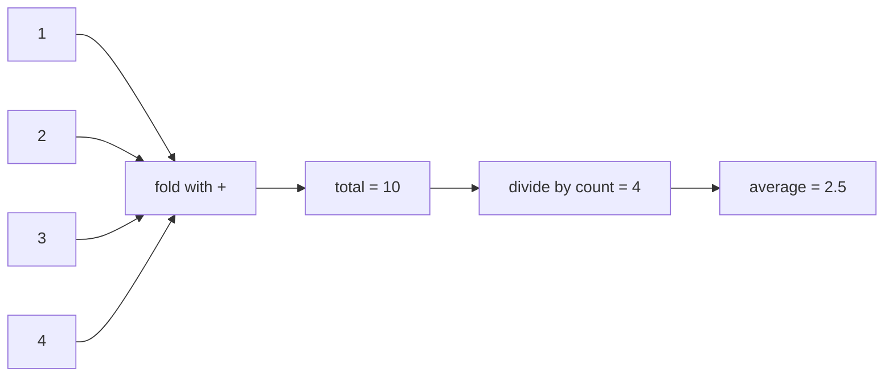
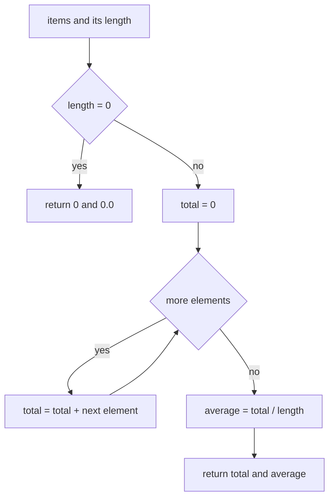
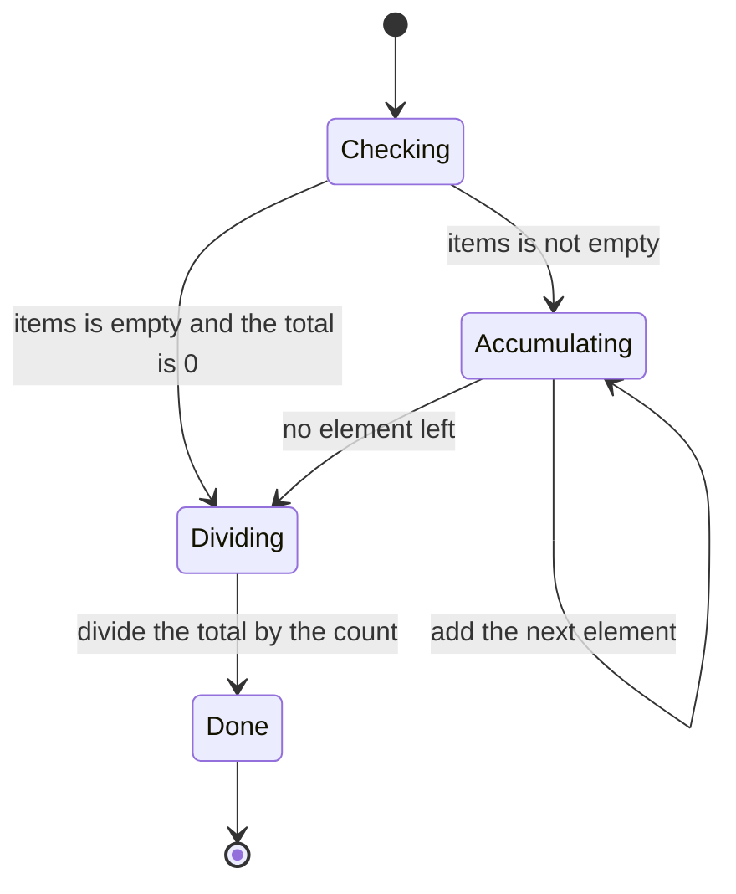
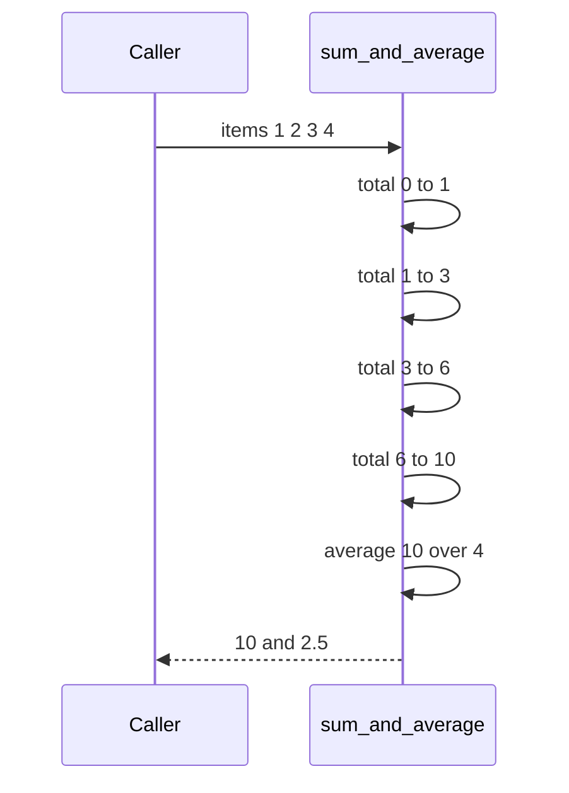

# 007 — Compute sum and average of array elements.

> **Tier:** Beginner · **CTCI chapter:** Ch 1 — Arrays and Strings
> **Task spec:** [007-compute-sum-and-average-of-array-elements.md](../../../tasks/beginner/007-compute-sum-and-average-of-array-elements.md)
> **Solutions:** [Python](../../../solutions/python/beginner/007-compute-sum-and-average-of-array-elements/solution.py) ·
> [Java](../../../solutions/java/beginner/007-compute-sum-and-average-of-array-elements/Solution.java) ·
> [JavaScript](../../../solutions/javascript/beginner/007-compute-sum-and-average-of-array-elements/solution.js) ·
> [C#](../../../solutions/csharp/beginner/007-compute-sum-and-average-of-array-elements/Solution.cs)

## 1. Problem restatement

**Input:** an array of numbers — `items`. Java, JavaScript and C# take an `int[]`, Python takes
any sequence of integers. The array may be empty and may hold negative values.

**Output:** a pair `(sum, average)` where `sum` is the total of every element and `average` is
`sum / count`. For an **empty** array all four solutions return `(0, 0)`: the empty total is
`0`, and the average is declared `0` instead of `NaN` or an error.

The spec is a single line ("Compute sum and average of array elements."), so the contract is
fixed by the assertions the solution files ship with:

| Call | Result | Why |
| --- | --- | --- |
| `sum_and_average([1, 2, 3, 4])` | `(10, 2.5)` | the only row with a fractional average |
| `sum_and_average([])` | `(0, 0.0)` | the guard clause, not a division |
| `sum_and_average([5])` | `(5, 5.0)` | one element: the average equals the element |

Python returns a tuple, JavaScript returns a two-slot array, and Java and C# return a
`double[]` of length two — the same two numbers in every case. The Python row
`sum_and_average([1, 2, 3, 4]) == (10, 2.5)` and the Java/C# row
`r[0] == 10 && r[1] == 2.5` are the ones that pin the shape of the result.

## 2. Intuition

The naive idea is mostly right and slightly wrong. Summing needs every element, so a loop is
unavoidable:

```text
total ← 0
for each x in items do
    total ← total + x
end
average ← total / length(items)
```

Two traps live in that sketch.

The first is the **empty array**: `total / 0` is an undefined operation. In floating point it
does not raise — it quietly produces `NaN` (or `-NaN`). The solutions therefore branch before
dividing; that branch is why the empty row returns a clean `(0, 0)`.

The second is the **type of the accumulator**. Java's `total / items.length` on two `int`
values truncates towards zero, so `[1, 2]` would average to `1` instead of `1.5`. Java, C# and
JavaScript therefore accumulate into a floating-point value (`double total = 0` in Java and C#,
a JS number is already a double) and only Python leans on its arbitrary-precision `int` plus
true division.

The key insight is that **average is not scanned, it is derived**. The array is visited exactly
once to fold its elements into a single accumulator, and the division is a constant-time
afterthought on the finished total. Nothing about the average influences which elements you
read, so a second pass over the data would buy nothing.



The fold is associative and commutative: `((1 + 2) + 3) + 4` and `(1 + 2) + (3 + 4)` agree.
That is the property that lets the loop process elements in any order, and — as section 7
shows — it is also what makes a streaming (one element at a time) version possible.

## 3. Algorithm

The shape implemented by all four solutions:

1. If the array is empty, return the pair `(0, 0)` immediately.
2. Otherwise start an accumulator at zero: `total ← 0`. In Java and C# the accumulator is a
   `double` so that the later division is exact in the fractional part.
3. Walk the array once, adding each element to the accumulator.
4. Divide the accumulator by the element count to get the average.
5. Return the accumulator and the average together.

```text
procedure sum_and_average(items)
    if length(items) = 0 then
        return (0, 0.0)
    end
    total ← 0
    for each x in items do
        total ← total + x
    end
    average ← total / length(items)
    return (total, average)
end
```

Steps 2 and 3 are the fold; step 4 is the only place where the *count* matters. The Python
solution spells the fold as the built-in `sum(items)` and JavaScript spells it as
`items.reduce((a, b) => a + b, 0)`; both are still a single linear pass, just expressed as a
library call. The Java and C# versions write the loop out because they must control the
accumulator type.



The same run seen as a two-state machine — accumulating while elements remain, dividing once
they are exhausted:



## 4. Worked example

Trace `sum_and_average([1, 2, 3, 4])`. The array is not empty, so the guard is skipped and the
loop runs four times:

| Step | element | `total` before | `total` after |
| --- | --- | --- | --- |
| 1 | 1 | 0 | 1 |
| 2 | 2 | 1 | 3 |
| 3 | 3 | 3 | 6 |
| 4 | 4 | 6 | 10 |
| 5 | — | 10 | average `10 / 4 = 2.5` |

The loop ends when the cursor passes the last element; the average is computed once, from the
final total and the length `4`.



The second row of the assertion table takes the other branch: `items` is empty, `length(items)`
is `0`, and the procedure returns before the loop and before the division. That early return is
what keeps `0 / 0` out of the code. Note what the trace does *not* contain: any second loop.
The whole computation is one cursor and one accumulator.

## 5. Complexity

Let `n` be the number of elements.

| Measure | Bound | Why it holds |
| --- | --- | --- |
| Time, best | O(n) | every element can change the total, so `n - 1` elements never suffice |
| Time, average | O(n) | one addition and one cursor step per element |
| Time, worst | O(n) | the fold is `n` additions; the empty case is the only O(1) run |
| Space, extra | O(1) | two scalars (`total`, `average`) and one cursor, whatever `n` is |
| Space, output | O(1) | the answer is exactly two numbers, not an array |
| Naive recompute-per-element | O(n²) | re-summing the whole array for each element |

The only non-constant work outside the loop is the single division, which costs the same for
`n = 1` and `n = 10⁶`. Python's built-in `sum` and JavaScript's `reduce` do not change the
asymptotics: both still touch each element once, with a smaller constant factor than a
hand-written Python or JS loop.

## 6. Pitfalls and edge cases

- **Empty array.** Unhandled, it divides by zero: a crash in languages with integer division
  checks and a silent `NaN` in IEEE-754 floating point. All four solutions assert the empty
  row, so `(0, 0)` — not `NaN`, not an exception — is the expected answer.
- **Single element.** `[5]` gives `(5, 5.0)`. Note that Python prints this as `5.0`, a float,
  because `/` is true division even when the division is exact.
- **Integer division.** In Java and C#, `int / int` truncates. The solutions sidestep it by
  accumulating into a `double`, so the division is a floating-point one. A version that keeps
  an `int` total silently reports `1` for `[1, 2]` instead of `1.5`.
- **Negative values.** Nothing special: the fold handles them, and the average of
  `[-1, 7]` is `3.0`. Only the *empty* case is special-cased.
- **Precision.** The Java, JavaScript and C# accumulators are IEEE-754 doubles. Sums beyond
  `2⁵³` stop being exact and the average inherits the error; Python's `int` total is exact and
  only the final division is floating point. No solution claims to be exactly rounded.
- **Overflow.** Adding many large `int` values into a 32-bit accumulator overflows; the
  Java/C# versions promote to `double` on the first addition, which is why they do not
  overflow here. The trade-off is precision, not range.
- **Input shape.** No solution validates that `items` is non-null or numeric. A `null`/
  `undefined` array throws before the guard can run; that is out of scope for the task.
- **Read-only.** Nothing is written back into the array, so callers keep their data. Contrast
  with the in-place tasks (022, 024) where mutation is the point.

## 7. Variants and follow-ups

- **Keep the running total instead of the array.** If callers feed values one at a time, the
  same fold computes a running average with two extra scalars. The sliding-window maximum in
  [092-max-over-sliding-window-using-deque.md](../../../tasks/beginner/092-max-over-sliding-window-using-deque.md)
  solves the harder version of that problem, where the window moves and the aggregate must be
  repaired when an element leaves.
- **Other aggregates over the same pass.** Maximum
  ([005-find-maximum-value-in-an-int-array.md](../../../tasks/beginner/005-find-maximum-value-in-an-int-array.md))
  and minimum
  ([006-find-minimum-value-in-an-int-array.md](../../../tasks/beginner/006-find-minimum-value-in-an-int-array.md))
  are the same one-cursor, one-accumulator shape with `max`/`min` instead of `+`.
- **Counting rather than summing.** When the aggregate is a frequency table the accumulator
  becomes a map — see
  [048-find-most-frequent-element-in-array.md](../../../tasks/beginner/048-find-most-frequent-element-in-array.md)
  and, for strings,
  [016-count-occurrences-of-each-character-in-a-string.md](../../../tasks/beginner/016-count-occurrences-of-each-character-in-a-string.md).
- **Searching the same array.** The unsorted scan in
  [008-find-the-index-of-a-target-in-an-unsorted-array-linear-search.md](../../../tasks/beginner/008-find-the-index-of-a-target-in-an-unsorted-array-linear-search.md)
  is the sibling of this fold: same traversal, different accumulator.
- **Chapter context.** The chapter walkthrough in
  [Arrays and Strings](../../ctci/01-arrays-and-strings.md) places the prefix-sum/fold family
  next to the in-place index gymnastics of Ch 1.

## 8. Check yourself

1. Why do all four solutions special-case the empty array instead of letting the division run?

<details><summary>Show answer</summary>

Because `0 / 0` has no numeric answer. In floating point it yields `NaN` without raising, so
`sum_and_average([])` would return `(0, NaN)`; languages with integer division would throw.
The guard converts "divide by zero" into the documented `(0, 0)` result, and the assertions
in every solution file require `0`.

</details>

2. Both the one-pass fold and a "sum the array again for every element" loop visit elements in
   order — why are their complexities different?

<details><summary>Show answer</summary>

Because complexity counts *operations*, not traversals. The fold performs one addition per
element, so `n` additions. Re-summing inside an outer loop performs `n + (n-1) + ... + 1`
additions, which is quadratic. The array is read-only in both versions; the difference is how
many times the same element is re-read.

</details>

3. What does `sum_and_average([1, 2, 3, 4])` return in Java, where the function returns a
   `double[]`?

<details><summary>Show answer</summary>

A two-element array with `r[0] == 10` and `r[1] == 2.5`. The `10` is stored as a `double`, so
the assertion compares `r[0] == 10` after automatic promotion. The pairing with `r[1] == 2.5`
is exactly the check the solution's `main` performs.

</details>

4. A caller needs the average of a stream of a million readings but cannot buffer them. What
   changes in the algorithm?

<details><summary>Show answer</summary>

Almost nothing: keep `total` and `count` as the stream arrives and divide once at the end. The
extra space stays O(1) and the time stays O(1) per reading. Only the *timing* of the division
changes — it moves out of the loop, which this algorithm already does.

</details>

5. Why does the Java version use `double total = 0` when every element is an `int`?

<details><summary>Show answer</summary>

Two reasons. The division `total / items.length` must be a floating-point division to produce
`2.5` rather than the truncated `2`, and a `double` accumulator promotes each `int` as it is
added, avoiding 32-bit overflow on large arrays. Python gets the same effect from true
division, and JavaScript from the fact that every number is already a double.

</details>
