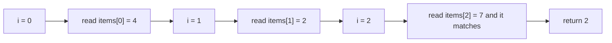
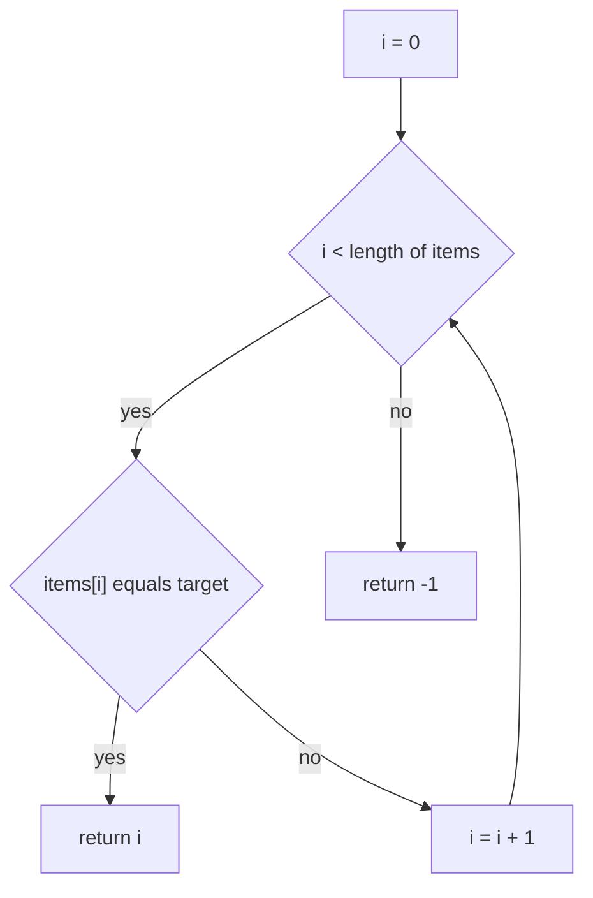
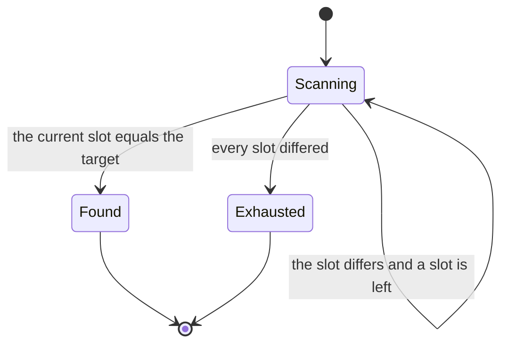
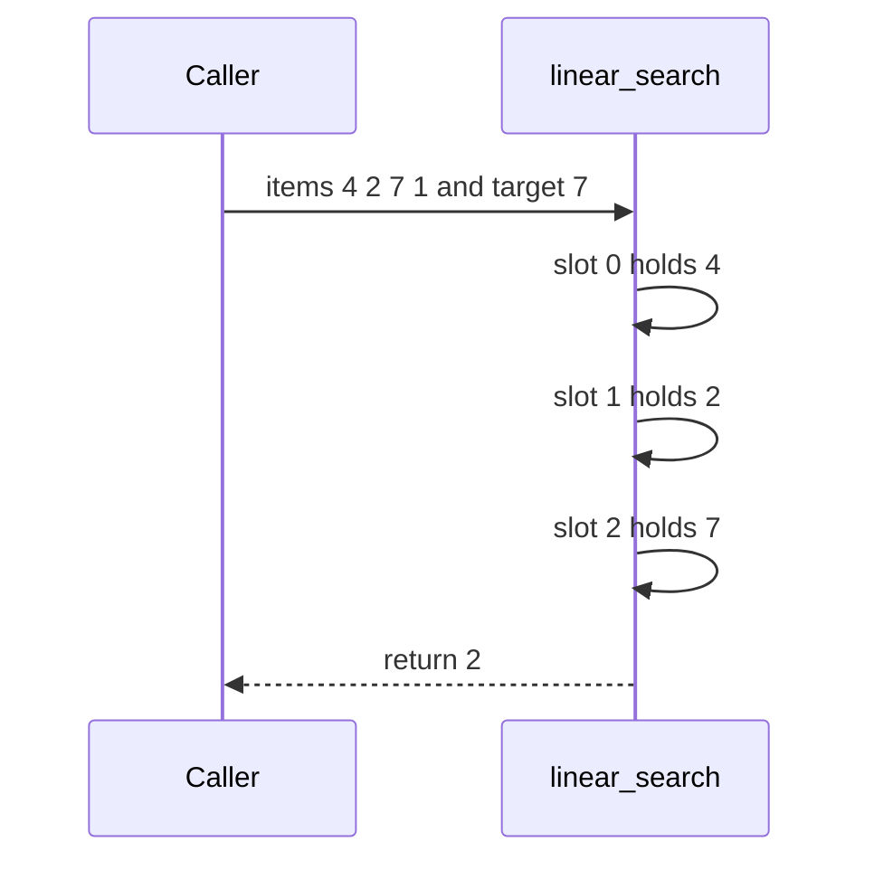

# 008 — Find the index of a target in an unsorted array (linear search).

> **Tier:** Beginner · **CTCI chapter:** Ch 10 — Sorting and Searching
> **Task spec:** [008-find-the-index-of-a-target-in-an-unsorted-array-linear-search.md](../../../tasks/beginner/008-find-the-index-of-a-target-in-an-unsorted-array-linear-search.md)
> **Solutions:** [Python](../../../solutions/python/beginner/008-find-the-index-of-a-target-in-an-unsorted-array-linear-search/solution.py) ·
> [Java](../../../solutions/java/beginner/008-find-the-index-of-a-target-in-an-unsorted-array-linear-search/Solution.java) ·
> [JavaScript](../../../solutions/javascript/beginner/008-find-the-index-of-a-target-in-an-unsorted-array-linear-search/solution.js) ·
> [C#](../../../solutions/csharp/beginner/008-find-the-index-of-a-target-in-an-unsorted-array-linear-search/Solution.cs)

## 1. Problem restatement

**Input:** an array of integers `items` in *arbitrary* order, plus a `target` value. The array
may be empty and may contain repeated values.

**Output:** the index of the **first** occurrence of `target`, or `-1` when the target is
absent. No exception and no `null` for the missing case — `-1` is the sentinel, which is safe
because every valid result is a non-negative index.

The spec is one line ("Find the index of a target in an unsorted array (linear search)."), so
the contract comes from the assertions in the solution files:

| Call | Result | Why |
| --- | --- | --- |
| `linear_search([4, 2, 7, 1], 7)` | `2` | the scan stops at the first hit |
| `linear_search([4, 2, 7, 1], 9)` | `-1` | the whole array is inspected, then give up |
| `linear_search([], 1)` | `-1` | nothing to inspect; the loop body never runs |
| `linear_search([5, 5, 5], 5)` | `0` | duplicates: **first** index wins, not the last |

The duplicate row is the one worth remembering. It is asserted explicitly in the Python and
Java files (`"duplicates -> first"`), and it fixes the tie-breaking rule that a later
"find any occurrence" or "find last occurrence" task would have to change.

## 2. Intuition

The naive idea that works here *is* the naive idea — that is the point of the exercise. With no
ordering to exploit there is no value you can read that lets you skip a region of the array: a
missing value could be hiding anywhere, so a correct search must look at every slot before it
may answer `-1`. That makes a left-to-right scan not just simple but **optimal in the worst
case**.

What separates a good scan from a bad one is when it stops:

- Stop at the first hit, because the contract asks for the *first* index. Continuing would
  either waste work or — if the loop kept overwriting the answer — return the last index and
  break the `[5, 5, 5]` assertion.
- Give up only after the cursor leaves the array, because only then is absence proven.

The key insight is that the answer is a **position**, and the loop variable already *is* that
position. There is no accumulator, no second data structure and no post-processing: the moment
`items[i]` equals `target`, `i` is the answer, and the procedure hands it straight back.



Two costs bound the whole algorithm. A **hit** costs the distance from index `0` to the first
match; a **miss** costs exactly `n` comparisons. Both are visible in the trace of section 4,
and the second one is why "linear" describes the absent case rather than the typical one.

## 3. Algorithm

The shape implemented by all four solutions:

1. Start the cursor at `i ← 0`.
2. While `i` is still inside the array, compare `items[i]` with `target`.
3. If it matches, return `i` immediately — the scan is over.
4. Otherwise advance the cursor by one and repeat.
5. If the cursor reaches the length of the array, no slot matched, so return `-1`.

```text
procedure linear_search(items, target)
    for i ← 0 to length(items) - 1 do
        if items[i] = target then
            return i
        end
    end
    return -1
end
```

The Python version spells the same walk as `for i, x in enumerate(items)` and the JavaScript,
Java and C# versions keep an explicit index — in all four cases the loop is a single
left-to-right sweep with an early return. There is no bookkeeping to do between iterations;
the only state in the loop is the cursor itself.



Read as a machine, the search has exactly three resting states:



`Found` and `Exhausted` are both terminal, but they leave through different doors: `Found`
returns the cursor's value, `Exhausted` returns the sentinel `-1`.

## 4. Worked example

Trace `linear_search([4, 2, 7, 1], 7)`.

| Step | `i` | `items[i]` | equals `7`? | action |
| --- | --- | --- | --- | --- |
| 1 | 0 | 4 | no | advance |
| 2 | 1 | 2 | no | advance |
| 3 | 2 | 7 | **yes** | return `2` |

Three comparisons out of a possible four. The fourth slot (`1`) is never read, which is the
whole benefit of the early return; on the input `[4, 2, 7, 9]` with `target = 5`, by contrast,
the loop performs all four comparisons and then falls out of the array.



For the duplicate input `[5, 5, 5]` with `target = 5`, step 1 already matches and the answer is
`0`: the scan never reaches slots 1 and 2. That single comparison is also the best case of the
complexity table below, and it is the reason a caller that needs the *last* occurrence cannot
reuse this code unchanged.

## 5. Complexity

Let `n` be the length of the array.

| Measure | Bound | Why it holds |
| --- | --- | --- |
| Time, best | O(1) | the target sits at index `0`; one comparison answers |
| Time, average | O(n) | a random hit lands a constant fraction of the way in, so about `n / 2` comparisons |
| Time, worst | O(n) | when the target is absent every one of the `n` slots must be inspected |
| Space, extra | O(1) | one cursor, no auxiliary structure, no copy of the array |
| Binary search on sorted input (task 075) | O(log n) | only available after paying O(n log n) to sort |

`n / 2` and `n` differ by a factor of two, not an order of magnitude, so both collapse to O(n).
The interesting comparison is with the sorted sibling: if the caller plans many searches,
sorting once (O(n log n)) and then binary searching each query (O(log n)) beats repeated
linear scans once the number of queries is large enough to amortise the sort. For a single
query on unsorted data, the linear scan is the optimal answer — no algorithm can return `-1`
correctly without reading every element.

## 6. Pitfalls and edge cases

- **Empty array.** The loop condition `i < length(items)` is false at once and the answer is
  `-1`. Python, Java, JavaScript and C# all assert this case.
- **Absent target.** Every slot is compared before the sentinel is returned. A version that
  forgot the trailing `return -1` would fall off the end of the function, which is an error in
  Java and C# and `undefined` in JavaScript.
- **Duplicates.** The answer is the **first** index (`0` for `[5, 5, 5]`), because the match
  returns immediately instead of remembering the latest hit. Swapping the early return for an
  assignment would silently change the contract.
- **Sentinel choice.** `-1` is unambiguous only because valid indices are non-negative. A
  version returning `0` for "not found" would be indistinguishable from a genuine hit at slot 0.
- **Comparison semantics.** The four solutions compare integers with `==` / `===` / `=`, which
  is exact. For objects or floats this stops being true — in JavaScript `NaN === NaN` is
  `false`, so a `NaN` in the array can never be found, and `==` would coerce types where `===`
  does not.
- **Unsorted is the precondition.** The algorithm is correct on sorted input too, but if the
  caller believes the array is sorted and later swaps this call for a binary search, the
  invariant must be re-checked — see
  [019-check-if-array-is-sorted-ascending.md](../../../tasks/beginner/019-check-if-array-is-sorted-ascending.md).
- **No mutation.** Nothing is written back, so the caller's array keeps its order. A sentinel
  variant (below) would temporarily disturb it and must restore it.
- **Input validation.** A `null`/`undefined` array throws before the first comparison; the
  solutions do not guard it and do not claim to.

## 7. Variants and follow-ups

- **Sorted input, same question.** [075-binary-search-iterative-on-sorted-array.md](../../../tasks/beginner/075-binary-search-iterative-on-sorted-array.md)
  replaces the linear sweep with a halving probe and answers in O(log n); with repeated values
  the first-index rule needs the extra work of
  [077-find-first-occurrence-of-target-in-sorted-array-with-duplicates.md](../../../tasks/beginner/077-find-first-occurrence-of-target-in-sorted-array-with-duplicates.md).
- **Sentinel variants.** Appending a copy of `target` at the end of the array removes the
  per-iteration bounds check, because the loop is then guaranteed to stop at a match; the
  caller's array must be restored afterwards. Same O(n) time, a smaller constant, and a
  mutation the plain version avoids.
- **The same sweep with a different accumulator.** Finding a maximum
  ([005-find-maximum-value-in-an-int-array.md](../../../tasks/beginner/005-find-maximum-value-in-an-int-array.md))
  and summing ([007-compute-sum-and-average-of-array-elements.md](../../../tasks/beginner/007-compute-sum-and-average-of-array-elements.md))
  walk the array exactly like this, only without the early exit.
- **Scanning inside text.** [046-implement-substring-search-naive.md](../../../tasks/beginner/046-implement-substring-search-naive.md)
  is the nested-loop version of the same idea: for every start position, compare forward.
- **Chapter context.** [Sorting and Searching](../../ctci/10-sorting-and-searching.md) puts the
  linear scan and the binary search side by side and explains when sorting first is worth it.

## 8. Check yourself

1. Why is a linear scan optimal for a single query on unsorted data?

<details><summary>Show answer</summary>

Because absence can only be proven by elimination. If any slot went unread, the target could
have been sitting there, so no algorithm can return `-1` in fewer than `n` comparisons in the
worst case. Linear search achieves exactly that bound, so it is worst-case optimal — not just
convenient.

</details>

2. The array `[5, 5, 5]` contains the target at three indices. Which one does the solution
   return, and what in the code decides it?

<details><summary>Show answer</summary>

`0`. The `if` branch executes `return i` rather than recording `i` and continuing, so the scan
terminates at the first match. The Java assertion is labelled `"duplicates -> first"` to make
the rule explicit.

</details>

3. What is the best case of `linear_search`, and does it help asymptotically?

<details><summary>Show answer</summary>

O(1): when `items[0]` already equals the target, one comparison ends the procedure. It is a
real O(1) run, not a constant factor on top of O(n) — but it says nothing about the worst case,
which stays O(n) because the absent-target path must read everything.

</details>

4. When is it worth sorting the array before searching it?

<details><summary>Show answer</summary>

When the same array is searched many times. The sort costs O(n log n) once; afterwards each
query costs O(log n) instead of O(n). For a single query the sort is pure overhead — it is
strictly more work than one scan.

</details>

5. Why is `-1` used as the "not found" marker instead of `0` or `length(items)`?

<details><summary>Show answer</summary>

Because `0` is a valid index (the first element) and `length(items)` is one past the end but
still confusingly close to a real index. `-1` can never be returned by a successful search, so
the caller can distinguish "found at index `i`" from "not found" with a single comparison.

</details>
