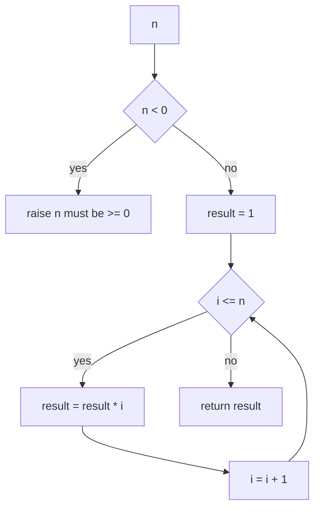
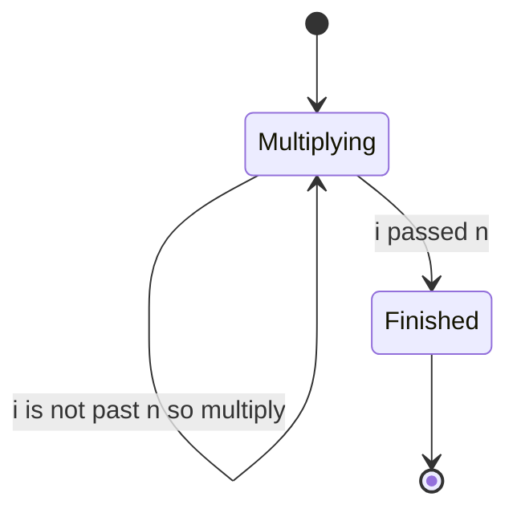
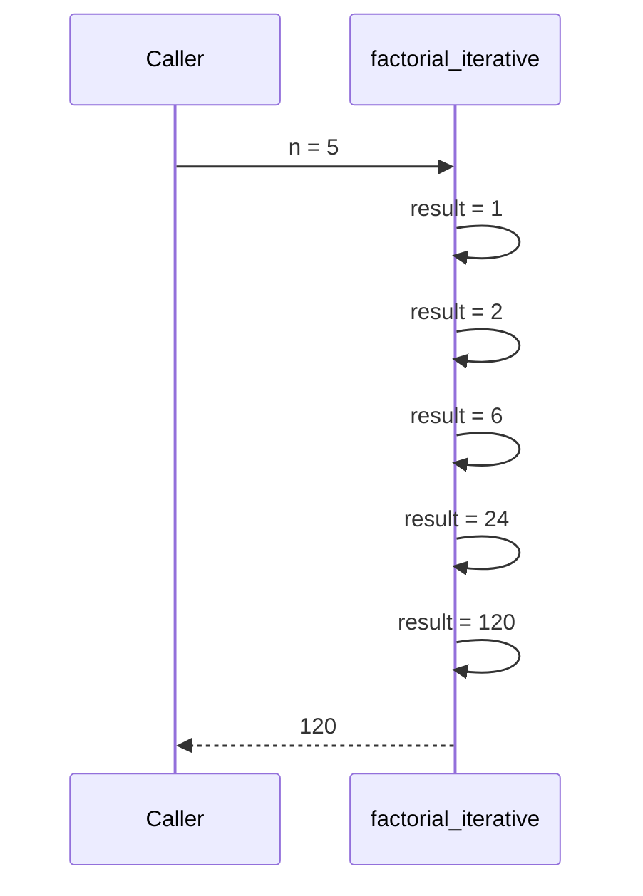

# 009 — Implement iterative factorial.

> **Tier:** Beginner · **CTCI chapter:** Ch 8 — Recursion and Dynamic Programming
> **Task spec:** [009-implement-iterative-factorial.md](../../../tasks/beginner/009-implement-iterative-factorial.md)
> **Solutions:** [Python](../../../solutions/python/beginner/009-implement-iterative-factorial/solution.py) ·
> [Java](../../../solutions/java/beginner/009-implement-iterative-factorial/Solution.java) ·
> [JavaScript](../../../solutions/javascript/beginner/009-implement-iterative-factorial/solution.js) ·
> [C#](../../../solutions/csharp/beginner/009-implement-iterative-factorial/Solution.cs)

## 1. Problem restatement

**Input:** a non-negative integer `n`. The Java, JavaScript and C# entry points take an `int`;
Python accepts any integer, and the negative case is rejected explicitly.

**Output:** `n!` — the product of every integer from `1` to `n`, with `0! = 1` and `1! = 1`.

The spec is one line ("Implement iterative factorial."), so the exact contract comes from the
assertions in the solution files:

| Call | Result | Why |
| --- | --- | --- |
| `factorial_iterative(0)` | `1` | the empty product, not `0` |
| `factorial_iterative(1)` | `1` | the loop body never runs; the identity survives |
| `factorial_iterative(5)` | `120` | `1 · 2 · 3 · 4 · 5` |
| `factorial_iterative(10)` | `3628800` | the last value asserted by Python and JavaScript |
| `factorial_iterative(20)` | `2432902008176640000` | asserted by Java, JavaScript and C# |
| `factorial_iterative(25)` | `15511210043330985984000000` | asserted only by C# |
| `factorial_iterative(-1)` | raises / throws | `"n must be >= 0"` |

The four files do **not** share a result type: Java returns a `long`, JavaScript a `BigInt`
(`120n`, compared with `assert.strictEqual`), and C#/Python return arbitrary-precision
integers. The reason is the next row nobody asserts — see the overflow column in section 6.

## 2. Intuition

The naive idea is to treat factorial as a recursion (`n! = n · (n-1)!`) and let the language
call stack do the loop. It is correct, but it costs `n` stack frames and it hides a fact that
matters here: the product has exactly `n - 1` multiplications, and they can be performed
left-to-right with **one** variable. That is the iterative solution.

The second naive idea is to seed the accumulator with `1` and loop from `1`:

```text
result ← 1
for i ← 1 to n do
    result ← result * i
end
```

This is correct too, and multiplying by `1` on the first iteration is harmless. The solutions
start at `2` instead, which is a one-iteration saving and, more importantly, makes the base
cases obvious: for `n = 0` and `n = 1` the range `2..n` is empty, so the loop never executes
and the identity is returned. **No special case for `0!` is needed**, because the accumulator
already holds the multiplicative identity.

The key insight is that `1` is not a magic base case — it is the **identity element** for
multiplication, the value that leaves a product unchanged. Seeding with it means the loop
covers every input uniformly, and that is exactly why `factorial_iterative(0)` and
`factorial_iterative(1)` need no branch in any of the four files.


The other half of the insight is numeric, not structural: factorial grows faster than any
fixed-width integer. `int` overflows at `13!`, `long` at `21!`, and a JavaScript number stops
being exact well before `20!` — which is precisely why three of the four files reach for a
wider or arbitrary-precision type instead of a 32-bit or 64-bit counter.

## 3. Algorithm

The shape implemented by all four solutions:

1. If `n < 0`, reject the input with an error saying `n must be >= 0`.
2. Initialise the accumulator to the multiplicative identity: `result ← 1`.
3. Walk `i` from `2` up to `n` inclusive, multiplying the accumulator by `i` each time.
4. Return the accumulator.

```text
procedure factorial_iterative(n)
    if n < 0 then
        raise error with message n must be >= 0
    end
    result ← 1
    for i ← 2 to n do
        result ← result * i
    end
    return result
end
```

Step 2 is what makes steps 3 and 4 cover the base cases without help. The loop bound `2` also
avoids multiplying by the identity, but that is cosmetic; correctness comes from the seed.

The type of `result` is the only real difference between the four files:

- Python starts at the integer `1` and never overflows because Python integers are unbounded.
- Java uses a `long` accumulator, which is exact up to `20!` — the largest value its tests
  assert.
- JavaScript uses a `BigInt` accumulator (`1n`) and coerces the loop counter with `BigInt(n)`
  because `BigInt` and `number` cannot be mixed in an arithmetic expression.
- C# uses `BigInteger.One`, whose test goes one step further and asserts `25!`.



The loop is a plain counter machine with no branching inside, which is why the state diagram
below has only two states — multiplying and finished:



## 4. Worked example

Trace `factorial_iterative(5)`. The loop runs for `i = 2, 3, 4, 5` — four multiplications, one
fewer than `n`.

| Step | `i` | `result` before | `result` after |
| --- | --- | --- | --- |
| start | — | — | 1 |
| 1 | 2 | 1 | 2 |
| 2 | 3 | 2 | 6 |
| 3 | 4 | 6 | 24 |
| 4 | 5 | 24 | 120 |
| exit | 6 | 120 | — loop condition fails, return 120 |



The two boundary runs are the interesting ones. For `n = 0` and `n = 1` the initial value of
`i` is already past `n`, so the table would contain only the `start` row and the exit row, and
the returned value is the seed `1`. For `n = 13` the same four-step pattern overflows a 32-bit
accumulator; the iterative shape is unchanged, only the type of `result` differs.

## 5. Complexity

Let `n` be the argument.

| Measure | Bound | Why it holds |
| --- | --- | --- |
| Time, best | O(1) | `n = 0` and `n = 1` skip the loop entirely |
| Time, average | O(n) | `n - 1` multiplications, one per loop iteration |
| Time, worst | O(n) | the same `n - 1` multiplications, plus one comparison per iteration |
| Space, extra | O(1) | one accumulator and one counter, whatever `n` is |
| Recursive version (task 010) | O(n) time, O(n) stack | same multiplications, `n` frames of call stack |

The time bound counts **multiplications**, not machine words. For fixed-width integers a
multiplication is O(1), so the loop is genuinely linear. Once the accumulator is an
arbitrary-precision integer (Python, C# `BigInteger`, JavaScript `BigInt`) the operands grow
with `n`, and each multiplication costs more than the last; the solutions make no claim about
that beyond choosing a type that does not lose digits. The space statement is different for
task 010: the recursive formulation keeps a stack of `n` pending multiplications, which is the
practical reason to prefer this iterative version.

## 6. Pitfalls and edge cases

- **Negative input.** All four files raise or throw with the same message
  (`n must be >= 0`) before touching the accumulator. Returning `1` for `-1` — which the empty
  loop would do if the guard were dropped — is wrong and untested behaviour.
- **Zero and one.** Both return `1`. This is the one place where factorial disagrees with
  intuition ("multiplying nothing" is `1`, not `0`), and Python, Java and C# assert it.
- **Overflow.** `13! = 6227020800` exceeds a signed 32-bit `int`; `21!` exceeds a signed 64-bit
  `long`. Java's test stops at `20!` for exactly that reason, and C# demonstrates the fix by
  asserting `25!` on a `BigInteger`.
- **JavaScript number precision.** A plain JS number is a double: `20!` is larger than `2⁵³`,
  so it would silently lose low-order digits. The JS solution uses `BigInt` throughout — the
  file's own comment notes that plain numbers are not safe past `20!`.
- **Mixing `BigInt` and `number`.** In JavaScript `1n * 2` throws a `TypeError`; that is why the
  loop upper bound is coerced once with `BigInt(n)` rather than compared against a number.
  The test also compares against `120n`, not `120`, because `strictEqual` distinguishes them.
- **Non-integer arguments.** Nothing validates that `n` is an integer. In Java the parameter is
  already typed `int`; Python would happily run a float through the range and fail there.
- **Recursion depth (task 010).** The recursive sibling is O(n) stack; on a small fixed stack,
  large `n` can exhaust it. The iterative version has no such limit.
- **Factorials are not cached.** Nothing here reuses previous results; task 013 memoises
  Fibonacci, but a factorial has only one path, so there is nothing to reuse.

## 7. Variants and follow-ups

- **The recursive twin.** [010-implement-recursive-factorial.md](../../../tasks/beginner/010-implement-recursive-factorial.md)
  is the same computation expressed as `n · f(n-1)`. Same multiplications, O(n) stack instead
  of O(1) extra space.
- **Factorials as a precomputed table.** Combinatorics tasks such as
  [379-implement-combinatorics-ncr-modulo-prime-precompute-factorials.md](../../../tasks/intermediate/379-implement-combinatorics-ncr-modulo-prime-precompute-factorials.md)
  build `0! .. n!` once and index into it, trading memory for O(1) lookups per query. In a
  fixed-width language the table doubles as an overflow fence.
- **Rolling accumulators instead of closed forms.** The two-variable Fibonacci walk in
  [011-generate-first-n-fibonacci-numbers-iterative.md](../../../tasks/beginner/011-generate-first-n-fibonacci-numbers-iterative.md)
  is the same "keep the smallest possible state" idea applied to a recurrence with two terms.
- **Choosing the accumulator type.** The width problem here is the same one that
  [013-compute-nth-fibonacci-with-memoization.md](../../../tasks/beginner/013-compute-nth-fibonacci-with-memoization.md)
  meets at `fib(50)` = `12586269025`: the algorithm is simple, the numeric type is the
  engineering decision.
- **Chapter context.** [Recursion and DP](../../ctci/08-recursion-and-dp.md) develops the
  recursion/fold duality and the base-case discipline used here.

## 8. Check yourself

1. Why do the solutions not need an explicit `if n = 0 then return 1` branch?

<details><summary>Show answer</summary>

Because the accumulator is seeded with the multiplicative identity `1` and the loop runs over
`2..n`. For `n = 0` and `n = 1` that range is empty, so the loop body never executes and the
seed is returned unchanged. The base case is a consequence of the seed, not a separate case.

</details>

2. How many multiplications does `factorial_iterative(n)` perform, for `n ≥ 2`?

<details><summary>Show answer</summary>

Exactly `n - 1`, one per loop iteration for `i = 2, 3, ..., n`. Starting the loop at `1` would
perform `n` multiplications, one of them multiplying by the identity — same result, one extra
step.

</details>

3. Why does the Java solution use `long` while C# uses `BigInteger`?

<details><summary>Show answer</summary>

Because their tests assert different inputs. `long` is exact up to `20! = 2432902008176640000`,
which is the largest value Java asserts; `21!` would overflow a signed 64-bit `long`. C#'s test
additionally asserts `25! = 15511210043330985984000000`, which only an arbitrary-precision
type can hold, so it uses `BigInteger`.

</details>

4. What happens in JavaScript if the accumulator were an ordinary number instead of `1n`?

<details><summary>Show answer</summary>

The value would still be computed, but `20!` is about `2.43 × 10¹⁸`, larger than `2⁵³`, so the
low-order digits could no longer be represented exactly. The `assert.strictEqual(..., 120n)`
comparisons in the JS file are BigInt comparisons, and mixing `BigInt` with `number` in an
arithmetic expression throws — which is why the bound is coerced with `BigInt(n)`.

</details>

5. Which is better for large `n`, this version or the recursive one, and why?

<details><summary>Show answer</summary>

This one, when memory is the concern. Both perform `n - 1` multiplications, but recursion holds
`n` pending frames (each storing its own `n` and the pending product) while the loop holds a
single accumulator and counter. The iterative version is O(1) extra space; the recursive one is
O(n) stack depth.

</details>
