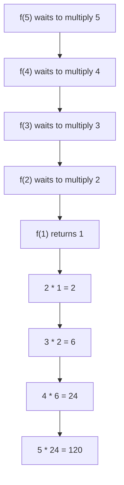
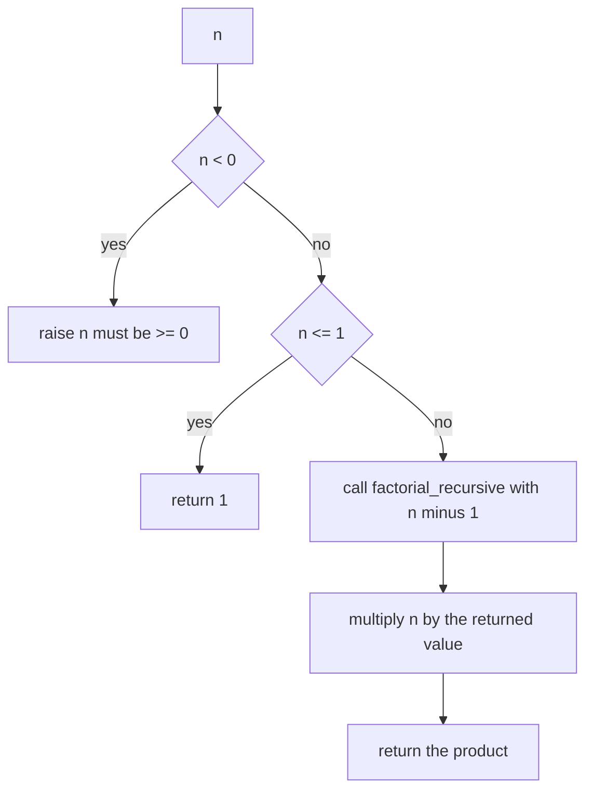
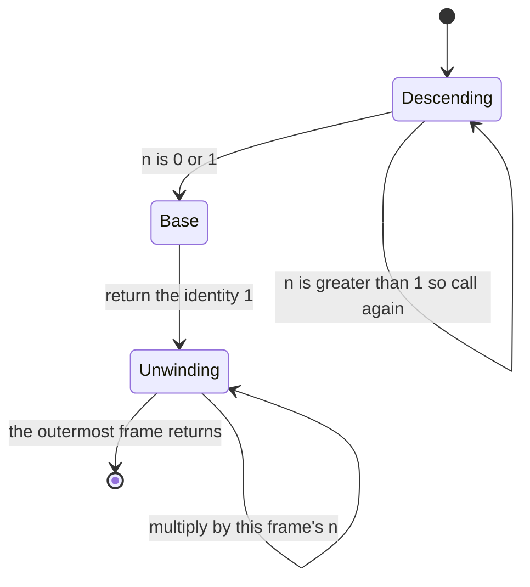
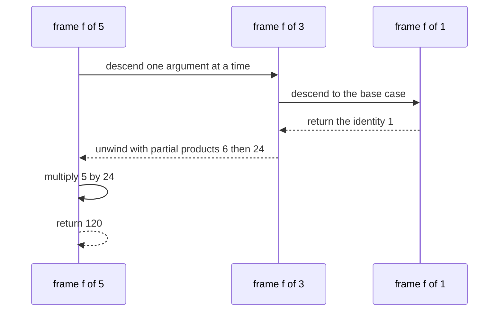

# 010 — Implement recursive factorial.

> **Tier:** Beginner · **CTCI chapter:** Ch 8 — Recursion and Dynamic Programming
> **Task spec:** [010-implement-recursive-factorial.md](../../../tasks/beginner/010-implement-recursive-factorial.md)
> **Solutions:** [Python](../../../solutions/python/beginner/010-implement-recursive-factorial/solution.py) ·
> [Java](../../../solutions/java/beginner/010-implement-recursive-factorial/Solution.java) ·
> [JavaScript](../../../solutions/javascript/beginner/010-implement-recursive-factorial/solution.js) ·
> [C#](../../../solutions/csharp/beginner/010-implement-recursive-factorial/Solution.cs)

## 1. Problem restatement

**Input:** a non-negative integer `n`.

**Output:** `n!` — the product `1 · 2 · ... · n`, with `0! = 1` and `1! = 1`. The computation
must be expressed **recursively**: the function calls itself on a smaller argument, and the
base case is answered directly.

The spec is one line ("Implement recursive factorial."), so the contract is fixed by the
assertions in the solution files:

| Call | Result | Why |
| --- | --- | --- |
| `factorial_recursive(0)` | `1` | base case; also the empty product |
| `factorial_recursive(1)` | `1` | base case; `n <= 1` covers both zeros and ones |
| `factorial_recursive(5)` | `120` | five frames, one pending multiplication each |
| `factorial_recursive(10)` | `3628800` | asserted by Python and JavaScript |
| `factorial_recursive(20)` | `2432902008176640000` | asserted by Java and C# |
| `factorial_recursive(-1)` | raises / throws | `"n must be >= 0"` |

The types match the iterative sibling exactly: a `long` in Java, a `BigInt` in JavaScript
(`120n` in the assertions), and arbitrary-precision integers in Python and C# — because the
recursive and iterative versions multiply the very same numbers.

## 2. Intuition

The naive idea is a loop, which is task 009. The recursive idea follows the definition

```text
n! = n · (n - 1)!
```

directly: peel one factor off the top and hand the smaller problem to a fresh call. The
unavoidable question is where the peeling stops, and the careless answer — "stop at `n = 0`" —
misses that `1!` is equally base-line. The solutions all use the same single comparison,
`n <= 1`, which answers `1` for both `0` and `1` without a second branch.

The key insight is that a recursive factorial does not *build* the product on the way down. The
descending calls only stack up **pending multiplications**: each frame holds its own `n` and
waits for the answer to `f(n-1)`. All the arithmetic happens on the way back **up**, after the
base case returns the identity `1`. Recursion here is a way to postpone work, not a way to
split it — there is exactly one path from `n` to the base case, with no branching and nothing
to reuse.



Because each frame stays alive until its child returns, the call stack holds `n` frames at the
deepest point. That is the entire cost difference from the iterative version: same
multiplications, O(n) memory instead of O(1).

## 3. Algorithm

The shape implemented by all four solutions:

1. If `n < 0`, reject the input with an error saying `n must be >= 0`.
2. If `n <= 1`, return `1` — the identity, which is also `0!` and `1!`.
3. Otherwise return `n` multiplied by the recursive call on `n - 1`.

```text
procedure factorial_recursive(n)
    if n < 0 then
        raise error with message n must be >= 0
    end
    if n <= 1 then
        return 1
    end
    return n * factorial_recursive(n - 1)
end
```

Steps 1 and 2 are the two conditions that must be tested in this order: the guard has to run
before the recursion, otherwise a negative argument would descend forever instead of raising.
All four files write steps 2 and 3 as a single conditional expression — a ternary in Java, C#
and JavaScript, an inline if-expression in Python — with the recursive call in the final
branch, so only the negative guard is written as a statement.

The multiply on the way back is the only arithmetic, and it is the reason the function cannot
be a plain accumulator loop without keeping a stack: at the moment frame `f(k)` resumes, it
multiplies `k` by the finished value of `f(k-1)`.





The two phases are what the state diagram makes explicit: **descending** while frames pile up,
**unwinding** while they pop and multiply. No multiplication happens in the descending phase.

## 4. Worked example

Trace `factorial_recursive(5)`. Rows 1-4 are the descent, rows 5-9 the ascent.

| Step | Frame | `n` | Action | Value returned so far |
| --- | --- | --- | --- | --- |
| 1 | `f(5)` | 5 | call `f(4)` | — |
| 2 | `f(4)` | 4 | call `f(3)` | — |
| 3 | `f(3)` | 3 | call `f(2)` | — |
| 4 | `f(2)` | 2 | call `f(1)` | — |
| 5 | `f(1)` | 1 | base case | `1` |
| 6 | `f(2)` | 2 | resume: `2 · 1` | `2` |
| 7 | `f(3)` | 3 | resume: `3 · 2` | `6` |
| 8 | `f(4)` | 4 | resume: `4 · 6` | `24` |
| 9 | `f(5)` | 5 | resume: `5 · 24` | `120` |

Steps 1-4 perform no arithmetic at all. The multiplication appears only after the base case has
produced the identity, which is why the intermediate products (`1`, `2`, `6`, `24`) are the
partial factorials, in increasing order.



For `n = 0` the table collapses to a single row: `n <= 1` is true immediately, so the first
call *is* the base case, no frame is stacked and no multiplication happens. `n = 1` behaves
identically — that shared fate is the reason the solutions test `n <= 1` rather than
`n = 0`.

## 5. Complexity

Let `n` be the argument.

| Measure | Bound | Why it holds |
| --- | --- | --- |
| Time, best | O(1) | `n = 0` or `n = 1`: one comparison, one return |
| Time, average | O(n) | `n - 1` recursive calls, each doing one multiplication on the way back |
| Time, worst | O(n) | the same `n - 1` calls plus the per-frame guard; no branching to duplicate work |
| Space, extra | O(n) | the call stack: `n` frames alive at the deepest point |
| Iterative version (task 009) | O(n) time, O(1) space | identical product, one accumulator instead of a stack |

Factorial recursion is the well-behaved case: each call makes **one** recursive call, so there
is no exponential blow-up such as the naive Fibonacci of task 012 — whose two-way branching
recomputes the same subproblems. Here the call tree is a single path, so the recursion adds
stack depth but not repeated work. None of the four languages eliminates the tail position
here in any case, because the recursive call is not in tail position: it is multiplied by `n`
after it returns, so the frame must stay on the stack.

## 6. Pitfalls and edge cases

- **Negative input.** The guard must run before the recursion. All four files raise/throw
  `n must be >= 0`; without it, a negative `n` would recurse forever instead of failing fast.
- **Base case written as `n = 0`.** Testing only zero would send `n = 1` into the recursive
  branch, and the next call would be `f(0)` — still correct, but it converts an O(1) run into a
  two-frame one. The solutions use `n <= 1`, which covers both.
- **`0!` again.** The identity is the answer for both base cases; returning `0` would collapse
  every product to zero after the ascent.
- **Stack depth.** With `n` frames at the deepest point, a large `n` can exhaust the stack —
  a crash, not a wrong answer. Java's default thread stack and JavaScript's engine limits
  differ, so "how large is safe" is platform-specific; task 009 avoids the question entirely.
- **No tail-call elimination.** The recursive call is followed by a multiplication, so no
  mainstream Java, C#, Python or JavaScript implementation can turn the descent into a loop.
- **Numeric type.** Java returns a `long`, exact up to `20!`; the asserted value is exactly
  that. C# and Python use arbitrary-precision integers and JavaScript uses `BigInt` — a plain
  JS number would lose precision well before `20!`.
- **Mixing `BigInt` and `number`.** In JavaScript `BigInt(n) * factorialRecursive(n - 1)`
  coerces the argument once; comparing `n <= 1` against a number is fine, but multiplying a
  `BigInt` by a `number` throws a `TypeError`, so the coercion is not optional.
- **Double guarding is harmless but noisy.** Every frame re-checks `n < 0`, which is an extra
  comparison per frame. A wrapper that validates once and recurses would be marginally cheaper,
  at the cost of an extra function.
- **Input type.** Nothing validates that `n` is an integer; Java's `int` parameter already
  excludes fractions, Python would fail inside the arithmetic instead.

## 7. Variants and follow-ups

- **The iterative twin.** [009-implement-iterative-factorial.md](../../../tasks/beginner/009-implement-iterative-factorial.md)
  performs the same `n - 1` multiplications with O(1) extra space; the tutorial there explains
  the identity seed that also answers the base cases here.
- **Recursion that reconverges.** [012-compute-nth-fibonacci-using-recursion.md](../../../tasks/beginner/012-compute-nth-fibonacci-using-recursion.md)
  makes *two* recursive calls per node, so the same subproblems are solved many times. That
  contrast is the whole motivation for
  [013-compute-nth-fibonacci-with-memoization.md](../../../tasks/beginner/013-compute-nth-fibonacci-with-memoization.md).
- **Recursion plus counting.** [125-climbing-stairs-dp-count-ways.md](../../../tasks/beginner/125-climbing-stairs-dp-count-ways.md)
  is a one-path recurrence like this one — the count of ways, expressed as a recursion first
  and a rolling pair of variables afterwards.
- **Widening arithmetic.** Combinatorics such as
  [379-implement-combinatorics-ncr-modulo-prime-precompute-factorials.md](../../../tasks/intermediate/379-implement-combinatorics-ncr-modulo-prime-precompute-factorials.md)
  needs many factorials, which is a case for precomputing a table rather than recursing per
  query.
- **Chapter context.** [Recursion and DP](../../ctci/08-recursion-and-dp.md) covers base-case
  discipline and how the same recurrence flips between a loop and a call stack.

## 8. Check yourself

1. Where does the multiplication happen — while descending, or while unwinding — and why does
   that distinction matter?

<details><summary>Show answer</summary>

While unwinding. Each descending frame only records its own `n` and calls again; the product
`n · f(n-1)` can be formed only after `f(n-1)` has returned its value. That is why the stack
must hold every frame, and why the intermediate results `1, 2, 6, 24, 120` appear in increasing
order on the way back up.

</details>

2. Why is `n <= 1` used instead of `n = 0` as the base case?

<details><summary>Show answer</summary>

Because both `0!` and `1!` equal `1`. Testing `n = 0` alone would make `f(1)` recurse into
`f(0)` — still the right answer, but one wasted frame and one wasted multiplication for every
call on `1`. `n <= 1` answers both immediately and also protects against a negative argument
reaching the base case, though the explicit guard raises first.

</details>

3. How many recursive calls does `factorial_recursive(n)` make for `n ≥ 2`?

<details><summary>Show answer</summary>

`n - 1` nested calls beyond the original — `f(n)` calls `f(n-1)`, down to `f(1)`. That is `n`
frames in total at the deepest point, which is exactly the O(n) space bound.

</details>

4. Why is this recursion linear while the recursive Fibonacci of task 012 is exponential?

<details><summary>Show answer</summary>

Because of branching. Factorial makes one recursive call per frame, so the call tree is a
single path of length `n` and each subproblem is visited once. Naive Fibonacci calls itself
twice per node, so its call tree has exponentially many nodes even though the *value* only
depends on `n`; many of those nodes recompute the same `fib(k)`.

</details>

5. Could a compiler turn this into a loop automatically?

<details><summary>Show answer</summary>

Not for the code as written. The recursive call is not in tail position — its result is
multiplied by `n` after it returns, so the frame must survive. The explicit iterative version
(task 009) performs exactly that transformation by hand, holding the partial product in a
variable instead of a stack slot.

</details>
