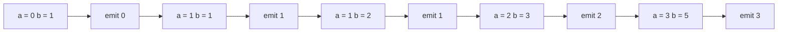
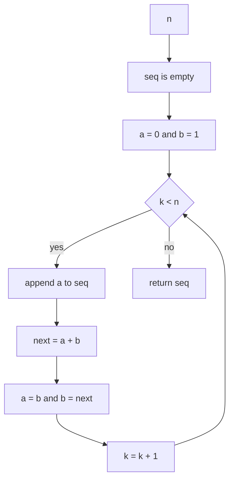
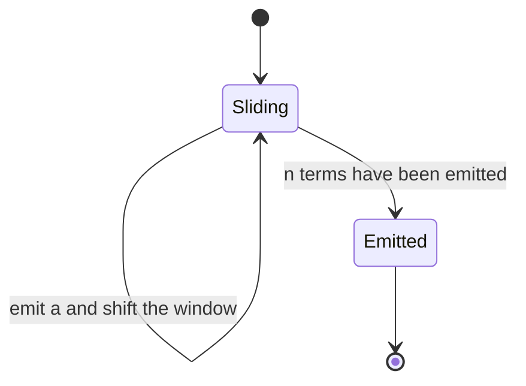
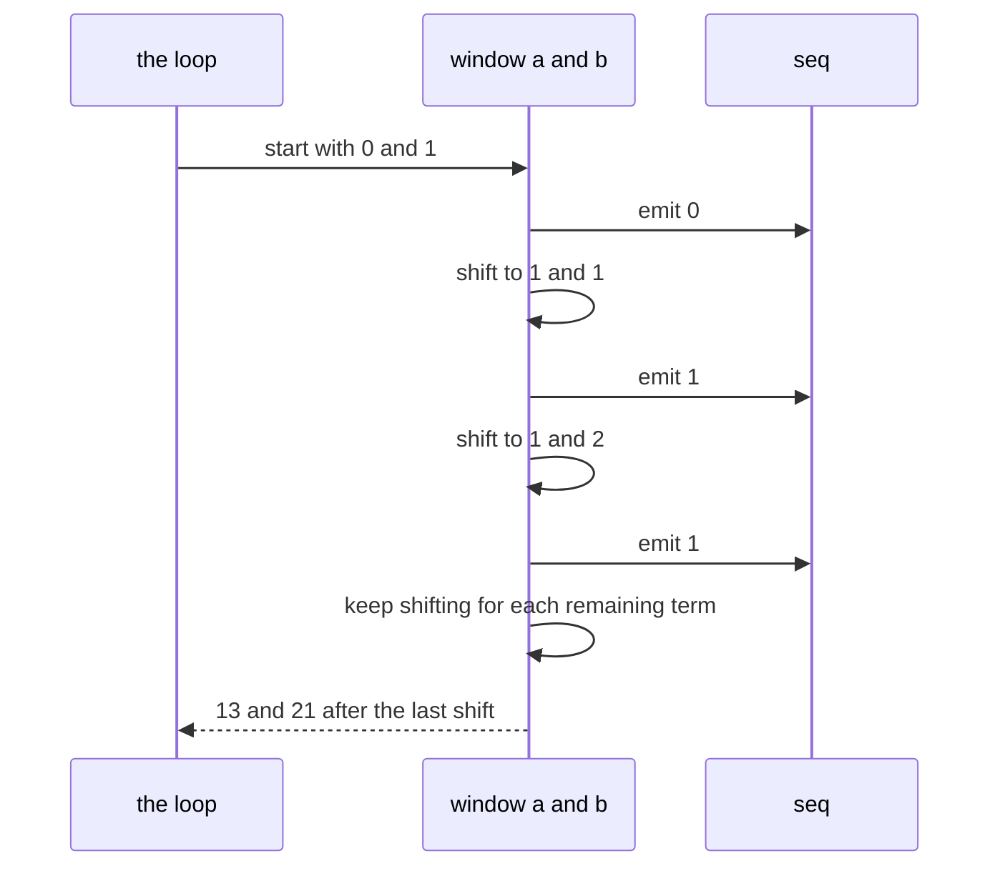

# 011 — Generate first N Fibonacci numbers (iterative).

> **Tier:** Beginner · **CTCI chapter:** Ch 8 — Recursion and Dynamic Programming
> **Task spec:** [011-generate-first-n-fibonacci-numbers-iterative.md](../../../tasks/beginner/011-generate-first-n-fibonacci-numbers-iterative.md)
> **Solutions:** [Python](../../../solutions/python/beginner/011-generate-first-n-fibonacci-numbers-iterative/solution.py) ·
> [Java](../../../solutions/java/beginner/011-generate-first-n-fibonacci-numbers-iterative/Solution.java) ·
> [JavaScript](../../../solutions/javascript/beginner/011-generate-first-n-fibonacci-numbers-iterative/solution.js) ·
> [C#](../../../solutions/csharp/beginner/011-generate-first-n-fibonacci-numbers-iterative/Solution.cs)

## 1. Problem restatement

**Input:** a count `n` — how many terms of the sequence to produce. `n` may be `0`.

**Output:** the first `n` Fibonacci numbers as a sequence, starting at `0`. The first terms are
`0, 1, 1, 2, 3, 5, 8, 13, ...`, so the result of a call with `n` terms is the list
`F(0) .. F(n-1)`.

The spec is one line ("Generate first N Fibonacci numbers (iterative)."), so the contract comes
from the assertions in the solution files:

| Call | Result | Why |
| --- | --- | --- |
| `fib_sequence(0)` | `[]` | asked for nothing, produce nothing |
| `fib_sequence(1)` | `[0]` | the sequence starts at `0`, not `1` |
| `fib_sequence(8)` | `[0, 1, 1, 2, 3, 5, 8, 13]` | the asserted reference case in all four files |

Python returns a list, JavaScript an array, Java an `int[]` and C# a `long[]` — in every case a
sequence **of length `n`**, so "the first N numbers" is meant literally and the output is
exactly `n` elements long. Java and C# even allocate the result up front at length `n`.

## 2. Intuition

The naive idea is to compute each term with a recursive `nth Fibonacci` function:

```text
for k ← 0 to n - 1 do
    seq[k] ← fib(k)
end
```

It produces the right numbers and it is a catastrophe: the naive recursive `fib` of task 012
has an exponential call tree, so each term recomputes everything the previous term already
knew. Generating `n` terms this way is far worse than O(n).

The second naive idea is to keep the whole sequence and index into it. Correct, and what any
memoised version does, but it is not needed for *generating* terms in order: extend the
sequence only from its **two most recent** values.

The key insight is that the recurrence `F(k) = F(k-1) + F(k-2)` mentions exactly two
neighbours, so two variables are enough to walk the whole sequence. Everything older is dead —
it has already been emitted into the output and will never be read again. The loop therefore
keeps a *sliding window* of width two and shifts it right by one step per term.



The ordering inside the loop is what makes the first term come out as `0` rather than `1`: the
solutions **emit `a` first and advance afterwards**. At the start `a = 0, b = 1`, so the first
emitted value is `0`; after the shift `a` holds what used to be `b`, and the window has moved
one place to the right. Emitting after the shift instead would produce `1, 1, 2, 3, ...` and
break the `fib_sequence(1) = [0]` assertion.

## 3. Algorithm

The shape implemented by all four solutions:

1. Create an output container of length `n` (or an empty growable one, in Python and
   JavaScript).
2. Initialise the window: `a ← 0`, `b ← 1`.
3. Repeat `n` times:
   1. emit `a` into the output;
   2. compute the next value as `a + b`;
   3. slide the window: `a ← b`, then `b ← next`.
4. Return the output.

```text
procedure fib_sequence(n)
    seq ← empty sequence
    a ← 0
    b ← 1
    for k ← 0 to n - 1 do
        append a to seq
        next ← a + b
        a ← b
        b ← next
    end
    return seq
end
```

Step 3.2 is the recurrence, step 3.3 is the slide. Note that `next` has to be stored in a
temporary before `a` is overwritten — the Java and C# files spell that out explicitly, while
Python and JavaScript use the tuple/array destructuring form (`a, b = b, a + b`), which
evaluates the right-hand side first and therefore performs the same two assignments without a
named temporary.

The output type is the only difference between the files: Python grows a list, JavaScript grows
an array, and Java/C# preallocate because their arrays are fixed at `n` elements. Java's
elements are 32-bit `int`s and C#'s are 64-bit `long`s, which is a range decision, not an
algorithmic one — see the overflow bullet in section 6.



Seen as a machine, the two-variable window has a single repeating state:



## 4. Worked example

Trace `fib_sequence(8)`. Each row is one iteration; the last row is the state after the final
shift, which is never emitted because the loop has already produced its eight values.

| Iteration | `a` | `b` | emitted | `seq` so far |
| --- | --- | --- | --- | --- |
| 1 | 0 | 1 | 0 | `[0]` |
| 2 | 1 | 1 | 1 | `[0, 1]` |
| 3 | 1 | 2 | 1 | `[0, 1, 1]` |
| 4 | 2 | 3 | 2 | `[0, 1, 1, 2]` |
| 5 | 3 | 5 | 3 | `[0, 1, 1, 2, 3]` |
| 6 | 5 | 8 | 5 | `[0, 1, 1, 2, 3, 5]` |
| 7 | 8 | 13 | 8 | `[..., 8]` |
| 8 | 13 | 21 | 13 | `[0, 1, 1, 2, 3, 5, 8, 13]` |

Eight iterations, eight emitted values, and the final `b` (`21`) is one term beyond what was
requested. That is the mark of a generator style: the window is always one step ahead of the
output because the next value is needed to slide `a`.



The boundary cases fall out of the same loop. For `n = 0` the range `0 .. n-1` is empty, so
nothing is emitted and the answer is the empty sequence. For `n = 1` exactly one iteration runs
and `0` is emitted before the shift — the assertion that catches an emit-after-shift bug.

## 5. Complexity

Let `n` be the number of terms requested.

| Measure | Bound | Why it holds |
| --- | --- | --- |
| Time, best | O(1) | `n = 0` builds nothing and returns immediately |
| Time, average | O(n) | one addition and two assignments per term |
| Time, worst | O(n) | `n` iterations, constant work each |
| Space, output | O(n) | the sequence itself is `n` values and is the requested result |
| Space, extra | O(1) | only `a`, `b` and `next` beyond the output |
| Per-term recursive `fib` (task 012) | O(2ⁿ) per term | each term recomputes the whole exponential call tree |
| Store-everything variant | O(n) extra | a table of all previous terms, revisited by indexing |

The important contrast is the third versus the fifth row: emitting `n` terms is inherently
O(n) in the output, but the *working* memory does not grow with `n`. Storing all previous terms
in a table would still be O(n) time and O(n) space — the same asymptotics, a worse constant and
a worse memory profile. Only the memoised single-value version of task 013 needs that table,
because there the lookups are not in order.

## 6. Pitfalls and edge cases

- **Zero terms.** `fib_sequence(0)` returns an empty sequence; the loop body never runs. All
  four files assert it — Java and C# by checking that the allocated array has length `0`.
- **One term.** The answer is `[0]`. The first term of the sequence is `0`, and an
  emit-after-shift loop would wrongly return `[1]`.
- **Emit before advance.** This is the single ordering rule of the algorithm. Getting it
  backwards shifts the whole output by one term and breaks both boundary assertions.
- **Two-term seed.** `a = 0, b = 1` encodes `F(0)` and `F(1)`. Seeding `1, 1` produces the
  shifted sequence `1, 1, 2, 3, ...`, which is the same recurrence with a different starting
  point — a common off-by-one in reported answers.
- **Overflow.** A 32-bit `int` element (Java) stops being exact once a term passes
  `2³¹ - 1`; C# widens the element to `long`, which pushes the ceiling to `2⁶³ - 1`; Python
  and JavaScript have no such limit for these sizes. No assertion in the files reaches those
  indices, but the type of the container decides how far the sequence stays trustworthy.
- **Negative `n`.** Undefined by the task and unasserted by the files, and the languages differ:
  Java and C# allocate the result array up front, so a negative `n` throws before any term is
  produced, while Python and JavaScript simply return an empty sequence because their loops
  never run. If the caller can pass a negative count, validate it at the boundary.
- **The final `b` is discarded.** After the last iteration the window holds one term more than
  requested. That is not a bug; it is how the recurrence stays self-contained.
- **No mutation of input.** `n` is a scalar, so nothing else can be disturbed, and the returned
  container is fresh in every language.

## 7. Variants and follow-ups

- **Only the nth term.** If the sequence is not wanted, the same window answers in O(n) time
  and O(1) space by dropping the output — the pure version is
  [012-compute-nth-fibonacci-using-recursion.md](../../../tasks/beginner/012-compute-nth-fibonacci-using-recursion.md),
  written recursively and deliberately exponential, and the practical one is
  [013-compute-nth-fibonacci-with-memoization.md](../../../tasks/beginner/013-compute-nth-fibonacci-with-memoization.md).
- **Rolling state in other guises.** [125-climbing-stairs-dp-count-ways.md](../../../tasks/beginner/125-climbing-stairs-dp-count-ways.md)
  has the same two-term recurrence, and the deque-based
  [092-max-over-sliding-window-using-deque.md](../../../tasks/beginner/092-max-over-sliding-window-using-deque.md)
  generalises the "window of width two" idea to width `k`.
- **Sequence as an iterator.** A generator that yields terms instead of filling an array keeps
  the O(1) working set and never materialises the whole output; the memoised sibling shows the
  opposite trade-off, paying O(n) memory to avoid recomputation.
- **Tables and widths.** Where the numbers must stay exact, the container type is the
  decision — see the widening arithmetic discussion in
  [009-implement-iterative-factorial.md](../../../tasks/beginner/009-implement-iterative-factorial.md).
- **Chapter context.** [Recursion and DP](../../ctci/08-recursion-and-dp.md) contrasts bottom-up
  generation like this one with top-down recursion and shows when the extra state is worth it.

## 8. Check yourself

1. Why does the loop emit `a` before advancing the window?

<details><summary>Show answer</summary>

Because `a` always holds the term about to be produced. Starting from `a = 0, b = 1`, the first
emitted value must be `0` — emitting after the shift would give `1` and break the
`fib_sequence(1) = [0]` assertion. The emission and the advance are therefore ordered: emit,
compute `a + b`, then slide.

</details>

2. How much working memory does `fib_sequence(1000)` need, beyond the result?

<details><summary>Show answer</summary>

O(1): two window variables plus the temporary for `a + b`. The output is 1000 elements, so total
memory is O(n) — but nothing in the computation grows with `n`. That is the difference from a
table of all previous terms, which would need O(n) extra space for lookups the in-order walk
never performs.

</details>

3. Why is calling the recursive `fib` once per term a bad way to generate the sequence?

<details><summary>Show answer</summary>

Because the naive recursion of task 012 is O(2ⁿ) per call — it rebuilds an exponential call tree
that recomputes the same small terms over and over. Doing that `n` times wastes everything
computed for the previous term. The iterative walk reuses the two values it already has, so the
whole sequence costs O(n) additions.

</details>

4. `fib_sequence(2)` returns `[0, 1]`. Which iteration produces the `1`, and what are `a` and
   `b` when the loop exits?

<details><summary>Show answer</summary>

The second iteration emits `a`, which is `1` after the first shift. On exit the loop has run
twice, so the window holds `a = 1` and `b = 2` — one term past the requested output, discarded
because nothing else is emitted.

</details>

5. Why do Java and C# allocate the result array before the loop while Python and JavaScript
   grow a list?

<details><summary>Show answer</summary>

Because Java arrays and C# arrays have a fixed length fixed at creation, so the length `n` must
be known up front — which also means a negative `n` throws immediately. Python lists and
JavaScript arrays are growable, so appending per term is natural and a negative `n` degrades
silently to the empty output.

</details>
