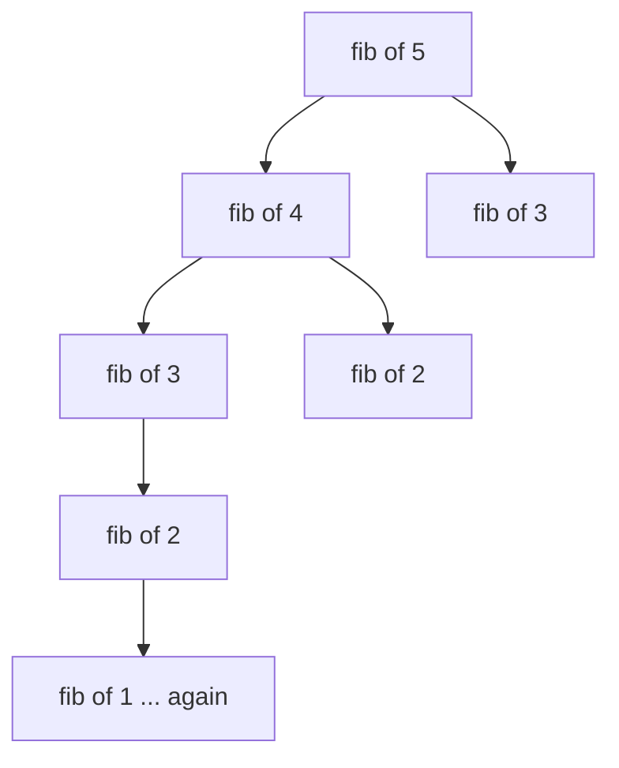
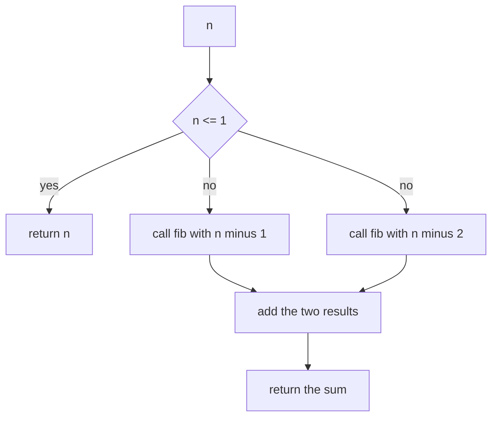
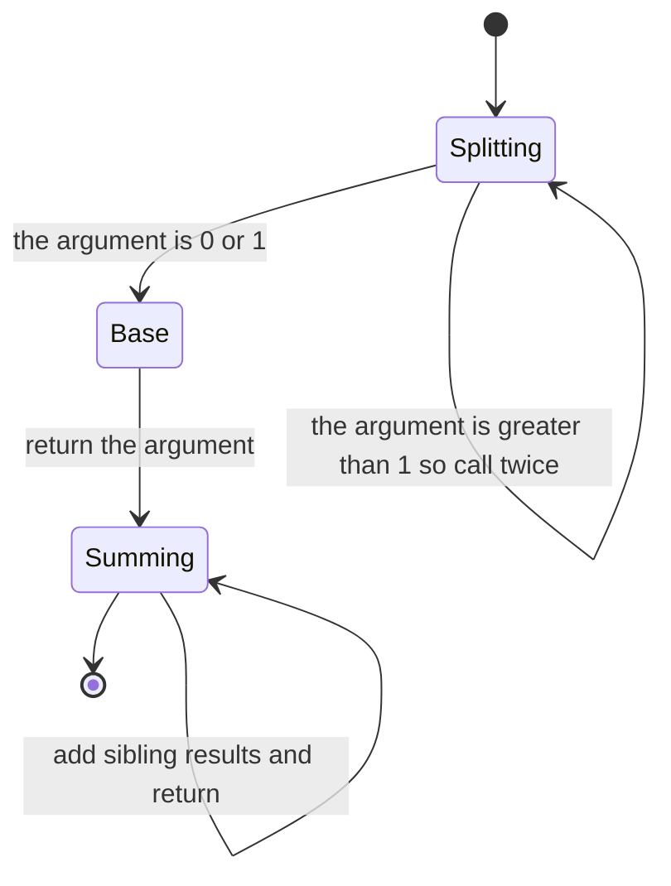
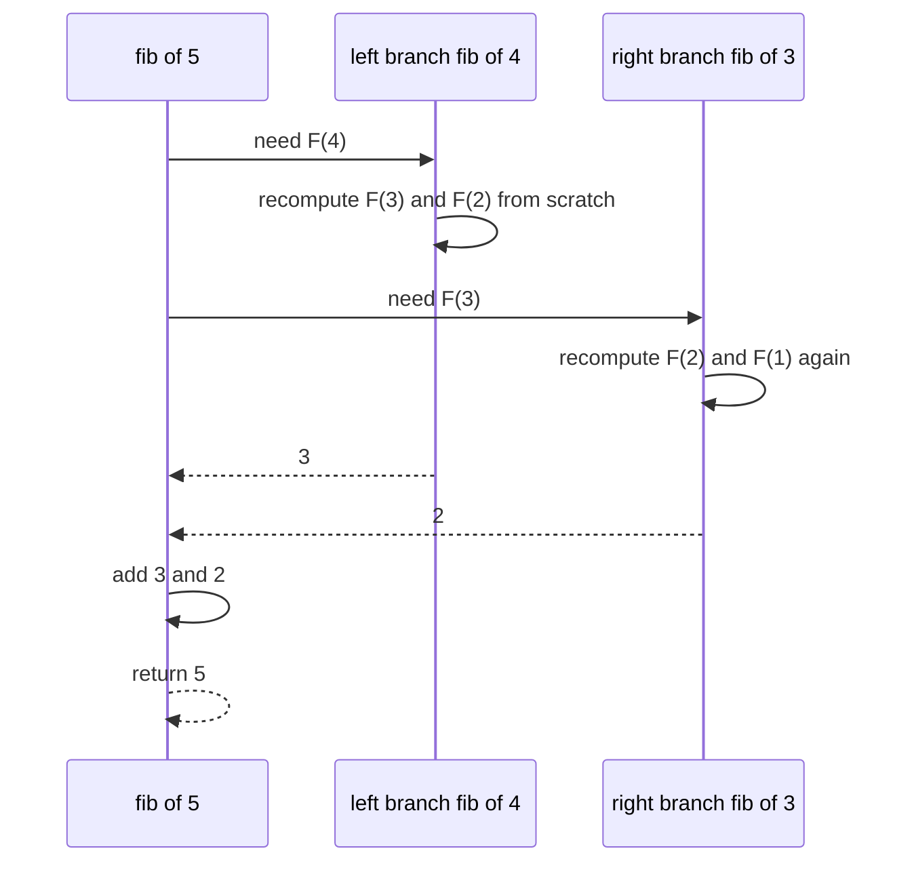

# 012 — Compute nth Fibonacci using recursion.

> **Tier:** Beginner · **CTCI chapter:** Ch 8 — Recursion and Dynamic Programming
> **Task spec:** [012-compute-nth-fibonacci-using-recursion.md](../../../tasks/beginner/012-compute-nth-fibonacci-using-recursion.md)
> **Solutions:** [Python](../../../solutions/python/beginner/012-compute-nth-fibonacci-using-recursion/solution.py) ·
> [Java](../../../solutions/java/beginner/012-compute-nth-fibonacci-using-recursion/Solution.java) ·
> [JavaScript](../../../solutions/javascript/beginner/012-compute-nth-fibonacci-using-recursion/solution.js) ·
> [C#](../../../solutions/csharp/beginner/012-compute-nth-fibonacci-using-recursion/Solution.cs)

## 1. Problem restatement

**Input:** an index `n`.

**Output:** the `n`-th Fibonacci number, `F(n)`, where `F(0) = 0`, `F(1) = 1` and
`F(n) = F(n-1) + F(n-2)`. The recursion must be the direct, **naive** translation of that
definition — none of the four files caches anything.

The spec is one line ("Compute nth Fibonacci using recursion."), and the solution docstrings add
the intent explicitly (`O(2^n) - intentionally naive; see task 013 for memoization`). The
contract is fixed by the assertions:

| Call | Result | Why |
| --- | --- | --- |
| `fib(0)` | `0` | base case; the argument itself is returned |
| `fib(1)` | `1` | base case; the same one-liner answers both seeds |
| `fib(10)` | `55` | asserted by JavaScript and C# |
| `fib(20)` | `6765` | asserted by all four files |
| `fib(i) for i in 0..7` | `[0, 1, 1, 2, 3, 5, 8, 13]` | Python checks the whole prefix of the sequence |

Java and C# declare the return type `long`, JavaScript returns a plain number (not a `BigInt`
— unlike tasks 009, 010 and 013), and Python returns an unbounded integer. The largest value
any assertion reaches is `6765`, well inside every one of those ranges.

## 2. Intuition

The naive idea is the definition itself:

```text
if n <= 1 then
    return n
end
return fib(n - 1) + fib(n - 2)
```

It is short, obviously correct, and it is the example every algorithms course uses to introduce
exponential blow-up. The reason is **branching**: each call spawns *two* sub-calls, so the work
multiplies instead of adding. `fib(n)` needs `fib(n-1)` and `fib(n-2)`; the `fib(n-1)` branch
needs `fib(n-2)` again — the same subproblem, computed from scratch a second time. That
duplication repeats at every level.

The key insight is that the *number of distinct subproblems* is only `n + 1`, but the number of
*calls* is exponential, because the recursion tree re-derives the same values over and over.
Recursion depth, by contrast, is only `n`: the longest path always peels one argument at a
time. So the naive version burns time, not stack — and the fix (task 013) is to remember
answers, not to restructure the recursion.



The picture already contains the bug: `fib of 3` appears twice, `fib of 2` appears three times
in the complete tree of the worked example below. Each duplicate is a full recomputation.

A second reading of the same recurrence is that it is a two-term recurrence like the loop of
task 011 — which is why the same values can be produced iteratively with two variables and no
recursion at all. The recursive form is instructive precisely *because* it exposes the overlap
that the iterative form silently avoids.

## 3. Algorithm

The shape implemented by all four solutions:

1. If `n <= 1`, return `n`. This single comparison covers both seeds: `F(0) = 0`, `F(1) = 1`.
2. Otherwise return the sum of two recursive calls, on `n - 1` and `n - 2`.
3. Nothing is cached, recorded or threaded through the calls — the recursion carries no extra
   state at all.

```text
procedure fib(n)
    if n <= 1 then
        return n
    end
    return fib(n - 1) + fib(n - 2)
end
```

Note how the base case is written: returning `n` rather than a constant works because `F(1)`
happens to equal `1`. That is neat, and it also means a **negative** `n` is returned unchanged
instead of raising — see section 6.

There is no accumulator and no loop, so the "algorithm" is entirely the shape of the call tree.
The Java, JavaScript and C# files write the body as one conditional expression whose branches
are `n` and `fib(n - 1) + fib(n - 2)`; Python writes the same two statements with `if` and a
second `return`.



The recursion has a single interesting state — "waiting for two children" — which is why the
machine view below has no distinct unwinding state: every frame sums two numbers that are
already known when it resumes.



## 4. Worked example

The complete call tree of `fib(5)`. Every node is one function call; leaves are the base-case
calls that return immediately.

| Depth 1 | Depth 2 | Depth 3 | Depth 4 | Depth 5 |
| --- | --- | --- | --- | --- |
| `fib(5)` | `fib(4)`, `fib(3)` | `fib(3)`, `fib(2)`, `fib(2)`, `fib(1)` | `fib(2)`, `fib(1)`, `fib(1)`, `fib(0)`, `fib(1)`, `fib(0)` | `fib(1)`, `fib(0)` |

Counting the calls with each argument across the whole tree shows the duplication directly:

| Argument | Times called | Comment |
| --- | --- | --- |
| 5 | 1 | the root |
| 4 | 1 | only reachable from 5 |
| 3 | 2 | once under `fib(4)`, once under `fib(5)` |
| 2 | 3 | referenced by every `fib(3)` and by `fib(4)` |
| 1 | 5 | base case, reached from every `fib(2)` and one `fib(3)` |
| 0 | 3 | base case, reached only from the three `fib(2)` calls |

Fifteen calls in total for a five-step recurrence, of which eight are base cases and seven do
arithmetic. Seven arithmetic nodes each add two numbers, and the arguments `3`, `2`, `1` and `0`
are each visited several times — the duplication the section 2 picture predicted.

The unwinding is then trivial: both base cases return, each `fib(2)` adds `1 + 0 = 1`, each
`fib(3)` adds `1 + 1 = 2`, `fib(4)` adds `2 + 1 = 3`, and the root adds `3 + 2 = 5`.



## 5. Complexity

Let `n` be the argument.

| Measure | Bound | Why it holds |
| --- | --- | --- |
| Time, best | O(1) | `n = 0` or `n = 1` returns on the first comparison |
| Time, average | O(2ⁿ) | two recursive calls per internal node, as the docstring states |
| Time, worst | O(2ⁿ) | the call tree satisfies `T(n) = T(n-1) + T(n-2) + 1`, which grows like the Fibonacci numbers themselves |
| Space, stack | O(n) | the deepest path peels one argument per frame, so depth is `n` |
| Space, extra | O(1) | no cache, no accumulator, no allocation |
| Memoised version (task 013) | O(n) time, O(n) space | each distinct argument solved once |
| Iterative generation (task 011) | O(n) time, O(1) space | a two-variable window, no recursion at all |

The exponential bound is not a constant-factor complaint: on `fib(20)` the tree has thousands
of calls where a memoised version needs twenty-one, and the gap doubles roughly every step
after that. Two independent fixes exist — remember the answers (task 013) or abandon the
recursion (task 011) — and the reason this task keeps the naive form is that the overlap it
exposes is the whole lesson of the chapter.

The space bound deserves a note: the recursion *depth* is only `n`, because the two branches
are evaluated one after the other and the first one's frames are released before the second one
starts. The exponential factor lives in time, not in memory.

## 6. Pitfalls and edge cases

- **Base case covers two seeds.** `n <= 1` returns `n` itself: `0` for `n = 0`, `1` for
  `n = 1`. Writing `n = 0` alone would recurse into `n = -1`, whose `n <= 1` then returns `-1`.
- **Negative arguments are silently accepted.** Because the base case returns the argument,
  `fib(-1)` evaluates to `-1` and `fib(-5)` to `-5` — no error, no assertion. The factorial
  tasks (009, 010) reject negatives explicitly; this task does not, and the files do not claim
  to.
- **Duplicated work is the point, not a bug.** Every argument below the root is called several
  times; `fib(2)` is called three times inside `fib(5)` alone. The docstring says the version is
  intentionally naive so that task 013 has something to improve.
- **Time explodes, stack does not.** The call tree is exponential while the deepest path is only
  `n` frames long, so a naive Fibonacci on a large `n` is killed by the clock long before the
  stack is in danger.
- **Numeric width.** Java and C# return `long`, exact until a term exceeds `2⁶³ - 1`; JavaScript
  returns an ordinary number, i.e. a double, exact only while a term stays below `2⁵³`. The
  largest asserted term, `6765`, is far below both ceilings — but the JavaScript file here does
  *not* use `BigInt`, unlike the Fibonacci files of tasks 011 and 013.
- **No memoisation state is threaded.** The four signatures take only `n`, so there is nowhere
  to keep a cache even if the caller wanted one; adding one changes the signature or needs a
  module-level table (task 013 shows the explicit-cache form).
- **Recomputing a whole sequence.** Calling `fib` once per index, as task 011 warns, multiplies
  the exponential cost by `n`; if the sequence is wanted, generate it iteratively.

## 7. Variants and follow-ups

- **The fix.** [013-compute-nth-fibonacci-with-memoization.md](../../../tasks/beginner/013-compute-nth-fibonacci-with-memoization.md)
  keeps the recursive shape but stores each answer, turning the exponential tree into `n + 1`
  distinct computations.
- **The other fix.** [011-generate-first-n-fibonacci-numbers-iterative.md](../../../tasks/beginner/011-generate-first-n-fibonacci-numbers-iterative.md)
  keeps only the two most recent terms and computes the same values in a loop with O(1) extra
  space.
- **Recursion without overlap.** [010-implement-recursive-factorial.md](../../../tasks/beginner/010-implement-recursive-factorial.md)
  makes a single recursive call per frame, so it is linear despite being recursive — the
  contrast with this task is exactly the branching factor.
- **Generalisable memoisation.** [159-implement-function-memoizer-decorator-or-equivalent.md](../../../tasks/beginner/159-implement-function-memoizer-decorator-or-equivalent.md)
  wraps any pure function in a cache, and [128-implement-basic-memoization-wrapper.md](../../../tasks/beginner/128-implement-basic-memoization-wrapper.md)
  shows the minimal version of that wrapper.
- **Same recurrence, different question.** [125-climbing-stairs-dp-count-ways.md](../../../tasks/beginner/125-climbing-stairs-dp-count-ways.md)
  satisfies `ways(n) = ways(n-1) + ways(n-2)` with different seeds and has the same
  naive-versus-memoised split.
- **Chapter context.** [Recursion and DP](../../ctci/08-recursion-and-dp.md) uses this
  recurrence as the canonical illustration of overlapping subproblems.

## 8. Check yourself

1. How many distinct subproblems does `fib(n)` depend on, and how many calls does the naive
   recursion make?

<details><summary>Show answer</summary>

`n + 1` distinct subproblems: `F(0)` through `F(n)`. The naive recursion makes exponentially
many calls, because each argument is re-derived by several branches — in the worked example,
`fib(2)` is called three times and `fib(1)` five times. The mismatch between "distinct inputs"
and "calls" is exactly what memoisation removes.

</details>

2. Why is the recursion *depth* linear even though the number of calls is exponential?

<details><summary>Show answer</summary>

Because depth follows a single path, and every path peels one argument at a time down to `0`
or `1`, giving at most `n + 1` live frames. The exponential factor comes from the *number of
paths*, not their length: the two branches are evaluated one after the other, and the first
branch's frames are gone before the second branch starts.

</details>

3. What does `fib(-3)` return here, and why is that different from the factorial tasks?

<details><summary>Show answer</summary>

It returns `-3`, because the base case is written as "return `n` when `n <= 1`". Negative
arguments are not validated in this task and no assertion covers them. The factorial solutions
(009, 010) explicitly raise `n must be >= 0` before doing any work, so an invalid input there
fails loudly instead of returning nonsense.

</details>

4. `fib(20)` is asserted as `6765`. Roughly what happens to the work if you ask for `fib(40)`
   instead?

<details><summary>Show answer</summary>

The call tree roughly doubles with every extra step — the recurrence `T(n) = T(n-1) + T(n-2)`
grows like the Fibonacci numbers themselves — so the work grows by a factor around
`φ²⁰` for twenty more steps, i.e. it becomes astronomically larger. That is why the naive
version is unusable past the small inputs it is asserted on.

</details>

5. Which is better, the memoised recursion of task 013 or the iterative loop of task 011?

<details><summary>Show answer</summary>

For a single `F(n)`, the loop wins on memory: O(n) time with O(1) extra space, against
O(n) time with O(n) cache for the memoised version. The memoised recursion is better when many
different indices are queried from a shared cache — the values are already computed and each
new query costs O(1).

</details>
