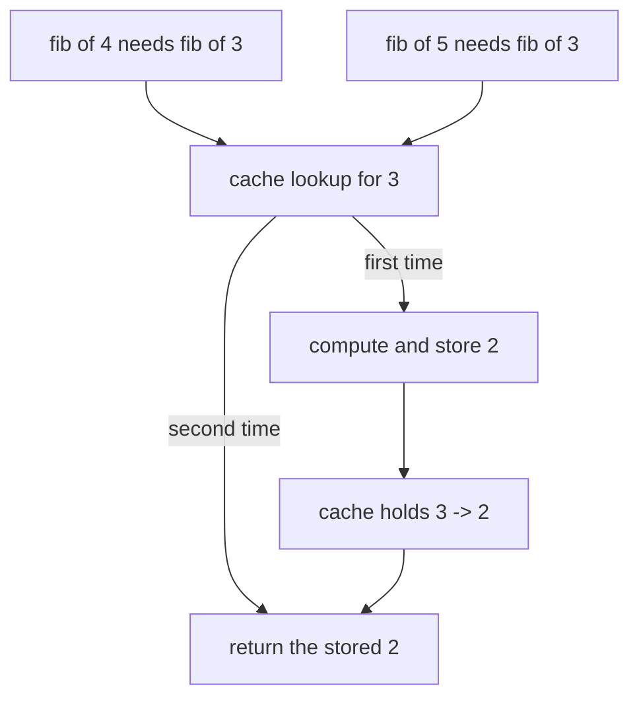
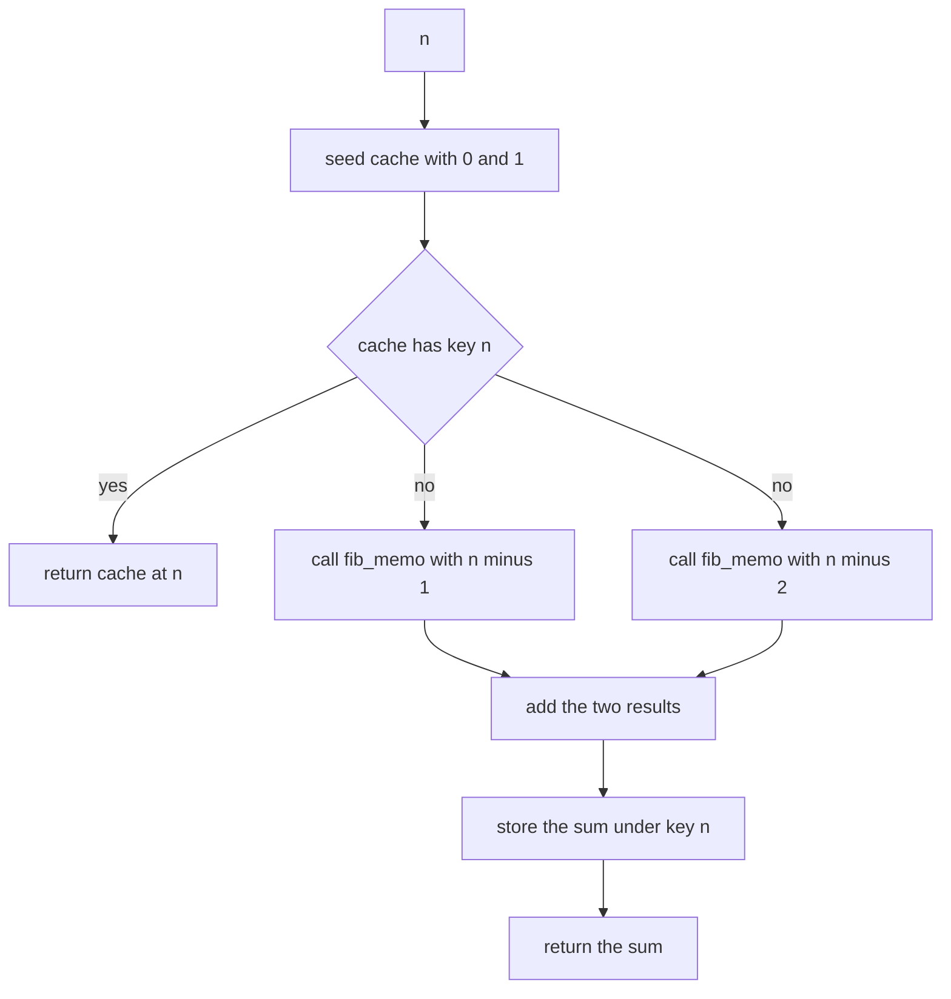
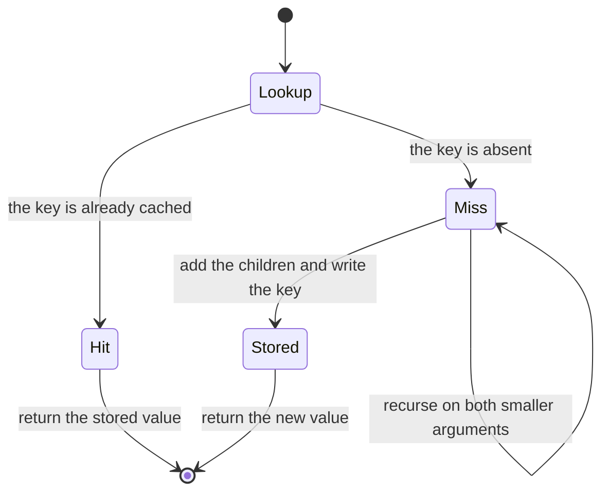
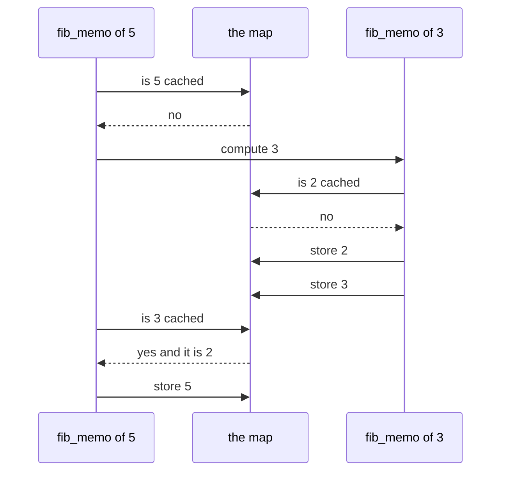

# 013 — Compute nth Fibonacci with memoization.

> **Tier:** Beginner · **CTCI chapter:** Ch 8 — Recursion and Dynamic Programming
> **Task spec:** [013-compute-nth-fibonacci-with-memoization.md](../../../tasks/beginner/013-compute-nth-fibonacci-with-memoization.md)
> **Solutions:** [Python](../../../solutions/python/beginner/013-compute-nth-fibonacci-with-memoization/solution.py) ·
> [Java](../../../solutions/java/beginner/013-compute-nth-fibonacci-with-memoization/Solution.java) ·
> [JavaScript](../../../solutions/javascript/beginner/013-compute-nth-fibonacci-with-memoization/solution.js) ·
> [C#](../../../solutions/csharp/beginner/013-compute-nth-fibonacci-with-memoization/Solution.cs)

## 1. Problem restatement

**Input:** an index `n`.

**Output:** `F(n)` — the same value as task 012, computed by the same two-way recursion, but
with each answer stored the first time it is produced so that no argument is solved twice.

The spec is one line ("Compute nth Fibonacci with memoization."), and the Python docstring
states the cost (`O(n) time / O(n) space using an explicit cache`). The contract is fixed by the
assertions:

| Call | Result | Why |
| --- | --- | --- |
| `fib_memo(0)` | `0` | served straight from the seeded cache, no recursion |
| `fib_memo(1)` | `1` | the second seeded entry |
| `fib_memo(10)` | `55` | asserted by Python |
| `fib_memo(50)` | `12586269025` | asserted by Python, Java and C# — impossible for task 012 |
| `fib_memo(90)` | `2880067194370816120` | asserted by JavaScript with `BigInt` |

The `50` row is the headline: the naive recursion of task 012 is O(2ⁿ), so it cannot reach
`F(50)` in practice, while the memoised one reaches it with `51` distinct computations.

## 2. Intuition

Task 012 showed where the cost comes from: the recursion tree contains the same argument many
times, and every occurrence recomputes from scratch. The fix is the smallest possible change —
before solving, **look the answer up**; after solving, **store it**.

The trick is to make the lookup table serve double duty. Instead of a separate base-case branch
(`if n <= 1 then return n`), the four solutions *seed* the cache with `F(0)` and `F(1)` and let
the lookup itself be the base case:

```text
if cache contains n then
    return cache[n]
end
```

Because `0` and `1` are present from the start, recursion can never descend past them. There is
exactly one stopping condition in the whole function, and it is also the fast path for repeated
subproblems — the same `if`.

The key insight is that memoisation converts a tree into a **left-leaning chain**. The first
exploration of `fib(n-1)` recursively fills in every value down to `1`; when the second call
`fib(n-2)` arrives, its answer is already in the cache and the "tree" node becomes an O(1)
lookup. The number of real computations therefore drops from exponential to `n + 1` — one per
distinct argument.



Note that the cached value is written **after** the two recursive calls return. Computing it
requires both children, so nothing can be stored on the way down; the cache fills in
post-order, smallest argument first.

## 3. Algorithm

The shape implemented by all four solutions:

1. At the entry point, create a cache and seed it with the two base cases: `cache[0] ← 0`,
   `cache[1] ← 1`.
2. If `n` is already a key in the cache, return its value immediately. This is both the base
   case and the memoisation hit.
3. Otherwise recurse on `n - 1` and `n - 2`, passing **the same cache** to both calls.
4. Add the two results, store the sum under the key `n`, and return it.

```text
procedure fib_memo_entry(n)
    cache ← new map
    cache[0] ← 0
    cache[1] ← 1
    return fib_memo(n, cache)
end

procedure fib_memo(n, cache)
    if cache has key n then
        return cache[n]
    end
    value ← fib_memo(n - 1, cache) + fib_memo(n - 2, cache)
    cache[n] ← value
    return value
end
```

Step 3 is where a subtle bug lives: both recursive calls must receive the *same* map instance.
Creating a fresh cache inside the recursive call, or copying it, would restore the exponential
work while still allocating memory — the worst of both worlds.

The four files differ only in how they spell steps 2 and 4:

- Python stores the cache in a default argument, `fib_memo(n, cache=None)`, building the seeded
  dictionary on the first call, and tests membership with `n in cache`.
- Java uses a `HashMap<Integer, Long>` and tests `cache.get(n) != null`. The boxed `Long` is
  what makes the null test safe — see the pitfalls.
- C# uses `Dictionary<int, long>` with `TryGetValue`, which distinguishes "absent" from
  "present and equal to zero" without boxing.
- JavaScript uses a `Map` with `BigInt` values and tests with `cache.has(n)`.





## 4. Worked example

Trace `fib_memo(5)`. The entry call seeds the cache with `0 -> 0` and `1 -> 1`; the table shows
the cache after each completed computation.

| Step | Call | Cache state | Action |
| --- | --- | --- | --- |
| 1 | `fib(5)` | `{0, 1}` | key `5` missing, descend |
| 2 | `fib(4)` | `{0, 1}` | key `4` missing, descend |
| 3 | `fib(3)` | `{0, 1}` | key `3` missing, descend |
| 4 | `fib(2)` | `{0, 1}` | key `2` missing, descend |
| 5 | `fib(1)` | `{0, 1}` | **hit**, return `1` |
| 6 | `fib(0)` | `{0, 1}` | **hit**, return `0` |
| 7 | `fib(2)` resumes | `{0, 1, 2 -> 1}` | add and store |
| 8 | `fib(3)` resumes | `{0, 1, 2 -> 1, 3 -> 2}` | add and store |
| 9 | `fib(4)` resumes | `{..., 4 -> 3}` | add and store |
| 10 | `fib(3)` from the right branch | `{..., 4 -> 3}` | **hit**, return `2` without recursion |
| 11 | `fib(5)` resumes | `{..., 5 -> 5}` | add `3 + 2` and store |

Eleven steps instead of task 012's fifteen calls — and the gap widens with `n`, because the
saving grows while the extra work stays constant. Step 10 is the decisive one: the second visit
to argument `3` costs a single lookup.



Notice that the entry point is called once and the cache dies with it: there is no module-level
table, so a second top-level call to `fib_memo(50)` starts with an empty cache again. The state
is per call, which is why the worked example always begins from `{0, 1}`.

## 5. Complexity

Let `n` be the argument.

| Measure | Bound | Why it holds |
| --- | --- | --- |
| Time, best | O(1) | `n = 0` or `n = 1` is a cache hit on the seeded entry |
| Time, average | O(n) | at most `n + 1` distinct keys, each computed once and looked up O(1) times |
| Time, worst | O(n) | the same bound: every argument from `2` to `n` is stored exactly once |
| Space, cache | O(n) | up to `n + 1` entries, one per distinct argument |
| Space, stack | O(n) | the deepest path still peels one argument per frame |
| Naive recursion (task 012) | O(2ⁿ) time, O(n) stack | identical code without the lookup and the store |
| Iterative window (task 011) | O(n) time, O(1) extra space | same values, but only two variables of state |

The cache lookup must be O(1) for the bound to hold, and that is what the four chosen
structures give: a Python dict, a Java `HashMap`, a C# `Dictionary` and a JavaScript `Map` are
all hash tables with expected constant-time access. The space is O(n) and, unlike the time
bound, it is *unavoidable in this formulation* — the recursion needs the table to stop
recomputing, whereas the iterative version of task 011 needs only the two most recent values
because it visits arguments in increasing order and can discard the rest.

## 6. Pitfalls and edge cases

- **The lookup is the base case.** The seeded keys `0` and `1` are the only thing that stops
  the recursion. Remove the seeding and `fib_memo(0)` recurses into `-1` and `-2`, which are
  also missing, and the call never terminates.
- **Negative arguments recurse forever.** No file validates `n`. Unlike the factorial tasks
  (009, 010) which raise, and unlike task 012 which returns the argument itself for `n <= 1`,
  this version would descend indefinitely on a negative input — the base cases are keys, and
  `-1` is not one of them.
- **`0` as a "missing" marker.** `F(0) = 0`, so a cache that signals absence with a zero
  value is broken. The solutions avoid it three different ways: `n in cache` (Python),
  `cache.get(n) != null` on a boxed `Long` (Java), `TryGetValue` (C#) and `has` (JavaScript).
- **Store after computing, not before.** Writing a placeholder before the recursive calls
  would hand the children a wrong value — and, for Fibonacci, a zero.
- **One shared cache.** Both recursive calls must receive the same instance. A copy per call
  silently restores exponential time while still consuming memory.
- **The cache is per top-level call.** Every entry point builds a fresh, seeded table, so
  nothing is reused between separate calls. A module-level cache would make repeated queries
  cheaper, at the cost of unbounded state and no isolation between callers.
- **Numeric width.** Python is exact for any size; Java and C# use 64-bit `long`, exact until a
  term exceeds `2⁶³ - 1`; JavaScript uses `BigInt` throughout, which is why it can assert
  `fib_memo(90) == 2880067194370816120n` while the others stop at `fib_memo(50)`.
- **Stack depth still grows with `n`.** Memoisation removes duplicated work, not the depth of
  the deepest chain: `fib_memo(50)` holds 50 frames at once.
- **The `50` assertion is the point.** If a refactor accidentally drops the lookup, every
  test still passes except `fib_memo(50)`, which effectively never finishes. That single row is
  the regression guard for the whole task.

## 7. Variants and follow-ups

- **The problem it fixes.** [012-compute-nth-fibonacci-using-recursion.md](../../../tasks/beginner/012-compute-nth-fibonacci-using-recursion.md)
  is the same code with neither the lookup nor the store, and the tutorial there counts the
  duplicated calls this version eliminates.
- **Dropping the table.** [011-generate-first-n-fibonacci-numbers-iterative.md](../../../tasks/beginner/011-generate-first-n-fibonacci-numbers-iterative.md)
  computes in increasing order and keeps only two values, so it matches this task's time bound
  with O(1) extra space.
- **Memoisation as a reusable wrapper.** [128-implement-basic-memoization-wrapper.md](../../../tasks/beginner/128-implement-basic-memoization-wrapper.md)
  and [159-implement-function-memoizer-decorator-or-equivalent.md](../../../tasks/beginner/159-implement-function-memoizer-decorator-or-equivalent.md)
  generalise steps 2 and 4 into a function-agnostic cache, so the recursion body stays as
  naive as task 012.
- **The same recurrence as counting.** [125-climbing-stairs-dp-count-ways.md](../../../tasks/beginner/125-climbing-stairs-dp-count-ways.md)
  is `ways(n) = ways(n-1) + ways(n-2)` with different seeds; the overlapping-subproblems
  diagnosis and the fix are identical.
- **Where the table idea leads.** Precomputed factorial or binomial tables
  ([379-implement-combinatorics-ncr-modulo-prime-precompute-factorials.md](../../../tasks/intermediate/379-implement-combinatorics-ncr-modulo-prime-precompute-factorials.md))
  are the same trade — pay O(n) memory once, answer each query in O(1).
- **Chapter context.** [Recursion and DP](../../ctci/08-recursion-and-dp.md) presents
  memoisation as the bridge from naive recursion to bottom-up dynamic programming.

## 8. Check yourself

1. Why do the solutions not need an explicit `if n <= 1 then return n` base case?

<details><summary>Show answer</summary>

Because the cache is seeded with `0 -> 0` and `1 -> 1` before any recursion happens. The lookup
test `cache has key n` is then true for both seeds, so the recursion never descends below `1`.
The lookup serves as the base case *and* as the memoisation hit — one condition instead of two.

</details>

2. Why must the value be stored *after* the two recursive calls return?

<details><summary>Show answer</summary>

Because `F(n)` is the sum of `F(n-1)` and `F(n-2)`; until both children return, the value is
unknown. Writing a placeholder first would hand one child a wrong answer, and writing a final
value on the way down is impossible. The cache therefore fills in post-order, starting with the
smallest arguments.

</details>

3. Java's lookup uses `cache.get(n) != null`. Why is that safe here, and where would the same
   pattern fail?

<details><summary>Show answer</summary>

Safe because the map is `HashMap<Integer, Long>`: values are boxed objects, so a missing key
yields `null` while a stored value is never null. It would fail for a primitive-holding
structure with a `0` sentinel, because `F(0)` *is* `0` — treating zero as "absent" would
recompute the seed forever. C#'s `TryGetValue` and JavaScript's `Map.has` avoid the ambiguity
entirely, and Python's `n in cache` tests the key, not the value.

</details>

4. What happens if `fib_memo(50)` is called twice in a row?

<details><summary>Show answer</summary>

The whole computation runs twice. Each top-level call builds its own seeded cache, uses it for
its own recursion, and discards it on return. Persisting the table between calls would make the
second call O(1), but that state is not part of this task's contract.

</details>

5. Memoisation makes the time O(n). What is the most it can save compared with task 012's
   recursion, and what does it cost?

<details><summary>Show answer</summary>

It removes the exponential factor: instead of an exponential number of calls, each of the
`n + 1` distinct arguments is computed exactly once, so the time falls from O(2ⁿ) to O(n). The
cost is O(n) memory for the cache (plus the O(n) stack that both versions share) — the
iterative version of task 011 pays O(1) extra space instead, but it cannot answer an arbitrary
index on demand from a shared table.

</details>
