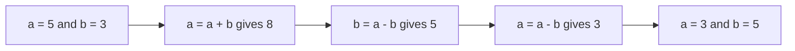
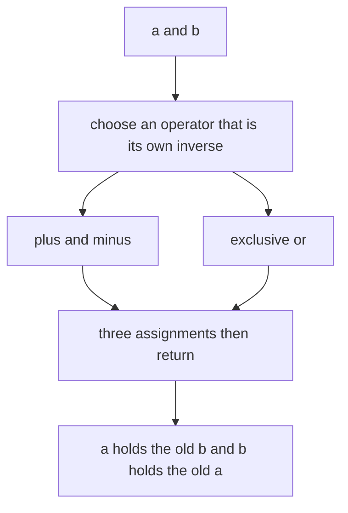
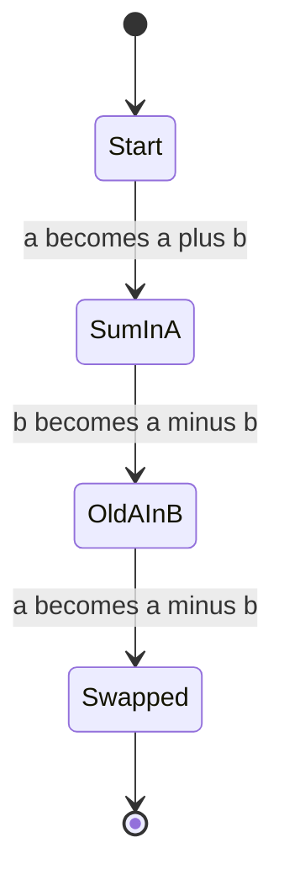
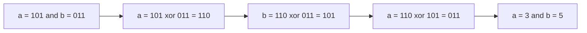

# 014 — Swap two variables without a temporary variable.

> **Tier:** Beginner · **CTCI chapter:** Ch 5 — Bit Manipulation
> **Task spec:** [014-swap-two-variables-without-a-temporary-variable.md](../../../tasks/beginner/014-swap-two-variables-without-a-temporary-variable.md)
> **Solutions:** [Python](../../../solutions/python/beginner/014-swap-two-variables-without-a-temporary-variable/solution.py) ·
> [Java](../../../solutions/java/beginner/014-swap-two-variables-without-a-temporary-variable/Solution.java) ·
> [JavaScript](../../../solutions/javascript/beginner/014-swap-two-variables-without-a-temporary-variable/solution.js) ·
> [C#](../../../solutions/csharp/beginner/014-swap-two-variables-without-a-temporary-variable/Solution.cs)

## 1. Problem restatement

**Input:** two integer values, `a` and `b`.

**Output:** the same two values in the opposite slots — `(b, a)` — computed **without** a third
variable holding one of them. The Python docstring names the two tricks the four files
implement: `arithmetic and XOR (note: XOR requires integers)`.

The spec is one line ("Swap two variables without a temporary variable."), so the contract is
fixed by the assertions in the solution files:

| Call | Result | Why |
| --- | --- | --- |
| `swap_arithmetic(5, 3)` | `(3, 5)` | the canonical case, asserted by all four files |
| `swap_xor(5, 3)` | `(3, 5)` | the same answer from bit operations |
| `swap_arithmetic(-1, 7)` | `(7, -1)` | signed values; subtraction handles them |
| `swap_xor(0, 42)` | `(42, 0)` | zero is a legitimate operand, not a sentinel |

Every file exposes **two** functions rather than one, and both are asserted on the pair
`(5, 3)`. Since the languages pass integers by value, each function swaps its own local copies
and returns the pair — Java and C# return an `int[]`, JavaScript and Python return a two-element
array or tuple. The caller's variables are not touched.

## 2. Intuition

The naive way to swap is a third variable:

```text
temp ← a
a ← b
b ← temp
```

It is clear, it is O(1), and it is what production code should use. The exercise asks for
something else: exploit an operation that is **its own inverse** so that the information in `a`
and `b` can be shuffled through the two slots without ever parking it in a third one.

Two operations have the property that applying them twice returns the original value:

- **Addition/subtraction.** `x + y - y = x`. Storing the sum in `a` keeps `b` recoverable:
  `b_new = (a + b) - b = a`. Then `a_new = (a + b) - a = b`. Both originals are recoverable from
  the sum and one of the operands, so nothing extra is needed.
- **Exclusive or.** `x ^ y ^ y = x`, because `x ^ x = 0` and `x ^ 0 = x`. Each operand is the
  other's "mask": `b_new = (a ^ b) ^ b = a`, and then `a_new = (a ^ b) ^ a = b`.

The key insight is that the pair `(a, b)` is never *moved* — it is **transformed in place**. The
arithmetic version temporarily stores `a + b` in `a`, which is a lossy-looking intermediate (you
cannot tell `a` from `8` alone) but is exactly recoverable because `b` is still sitting next to
it. The XOR version does the same thing bit by bit, column by column.



The XOR version is the one worth understanding at bit level, because it shows *why* nothing is
lost: `a ^ b` is a per-bit "difference" mask, and xoring it again with either operand restores
the other one. That is also why XOR cannot work on fractions — a `float` has no per-bit
exclusive-or.

## 3. Algorithm

### The arithmetic route

1. Replace `a` with the sum: `a ← a + b`.
2. Recover the original `a` into `b`: `b ← a - b`.
3. Recover the original `b` into `a`: `a ← a - b`.
4. Return the pair `(a, b)`.

```text
procedure swap_arithmetic(a, b)
    a ← a + b
    b ← a - b
    a ← a - b
    return (a, b)
end
```

### The XOR route

1. Store the bit difference: `a ← a XOR b`.
2. Cancel `b` out of it to get the original `a`: `b ← a XOR b`.
3. Cancel the new `b` out of it to get the original `b`: `a ← a XOR b`.
4. Return the pair `(a, b)`.

```text
procedure swap_xor(a, b)
    a ← a XOR b
    b ← a XOR b
    a ← a XOR b
    return (a, b)
end
```

The two procedures have the same three-line skeleton and differ only in the operator. In the
XOR route, step 1 builds the mask, and steps 2 and 3 unmask each operand in turn — which is why
the trick is also used for reversible transforms such as the simple cipher of task 163.



The arithmetic route can be seen as a machine with four distinct states, one per assignment:



## 4. Worked example

`swap_arithmetic(5, 3)`, tracked as a table of assignments:

| Step | Statement | `a` | `b` | Comment |
| --- | --- | --- | --- | --- |
| start | — | 5 | 3 | |
| 1 | `a ← a + b` | 8 | 3 | the sum is parked in `a`; `b` still holds 3 |
| 2 | `b ← a - b` | 8 | 5 | `8 - 3` recovers the old `a` |
| 3 | `a ← a - b` | 3 | 5 | `8 - 5` recovers the old `b` |

Every intermediate is derivable from the two slots, and no value is stored twice: the pair
`(8, 3)` determines both originals, `(8, 5)` determines both, and the last state is the swap.

`swap_xor(5, 3)` at bit level. With `5 = 101₂` and `3 = 011₂`:

| Step | Expression | `a` (binary) | `a` (decimal) | `b` (binary) | `b` (decimal) |
| --- | --- | --- | --- | --- | --- |
| start | — | `101` | 5 | `011` | 3 |
| 1 | `a ← a XOR b` | `110` | 6 | `011` | 3 |
| 2 | `b ← a XOR b` | `110` | 6 | `101` | 5 |
| 3 | `a ← a XOR b` | `011` | 3 | `101` | 5 |

Each of the three columns in step 1 is the per-bit difference of the operands; steps 2 and 3
xor it with the remaining operand, which restores the other one bit by bit.



The signed case `(-1, 7)` behaves the same in the arithmetic route: `-1 + 7 = 6`, `6 - 7 = -1`
lands in `b`, `6 - (-1) = 7` lands in `a`. The XOR route shares this property because both
Python integers and machine integers are represented in two's complement.

## 5. Complexity

| Measure | Bound | Why it holds |
| --- | --- | --- |
| Time, both routes | O(1) | exactly three assignments and three operations, whatever the values |
| Space, extra | O(1) | no temporary variable — that is the whole point |
| Space, classic route | O(1) | one temporary of the same type; asymptotically identical |
| Operations per swap | 3 | arithmetic: one addition, two subtractions; XOR: three exclusive ors |
| Register count on a CPU | 3 reads and writes | the compiler's temporary is still needed internally |

The honest comparison is not asymptotic — every variant is O(1) in time and space. The
difference is a **constant**: the classic route keeps one extra value alive for a moment, the
two tricks keep none. In practice a compiler allocates registers for the classic route anyway
(step 1 of the arithmetic trick also needs somewhere to put the sum), which is why the
subtraction-free XOR form is the one that occasionally appears in hand-tuned low-level code.
The cost is readability, not cycles.

## 6. Pitfalls and edge cases

- **Fixed-width overflow.** The identity `a + b` holds over the integers, but in `int`
  arithmetic the intermediate `a + b` can leave the type's range. Java and C# (`unchecked`, the
  default) wrap modulo `2³²` and the two subtractions unwind the wrap exactly; a C# `checked`
  context would throw `OverflowException` instead. Python's unbounded integers cannot overflow.
- **Aliasing.** If the two names refer to the same storage, `a ← a XOR b` zeroes it. The same
  happens with `a ← a + b` followed by `b ← a - b`. The trick is only valid for two distinct
  variables, and the four files assume distinct arguments.
- **XOR needs integers.** The Python docstring states it outright. Python raises `TypeError` on
  `^` with floats, and JavaScript's `^` coerces both operands to signed 32-bit integers, so
  values outside that range (or fractional ones) are mangled rather than rejected.
- **Floating-point arithmetic.** The subtraction route does not raise on floats, but it relies
  on `a + b` being reversible by subtraction; with rounding, the recovered values may differ
  from the originals. Stick to integers.
- **Zero is an ordinary value.** `swap_xor(0, 42)` gives `(42, 0)` — the assertion exists
  precisely because zero is easy to special-case by accident when testing "did it work".
- **Negatives.** Both routes are asserted on signed inputs (`(-1, 7)`); two's complement makes
  XOR behave as it does for positives, and subtraction handles signs naturally.
- **Nothing is mutated in the caller.** All four languages pass integers by value, so the
  result is observable only through the returned pair. A version that "swaps the caller's
  array elements" needs an index-based in-place swap instead (task 022, task 024).
- **Readability.** In production code the temporary variable or a destructuring assignment is
  strictly better: it is obvious, branch-free and optimised by the compiler. The tricks are
  interview material for the bit-manipulation chapter, and the tutorial says so.
- **Debugging.** The intermediate states (`a = 8`) are not meaningful values of the original
  problem, so a debugger inspecting mid-swap sees a nonsense state.

## 7. Variants and follow-ups

- **XOR as a reversible transform.** [163-implement-basic-encryption-decryption-with-xor.md](../../../tasks/beginner/163-implement-basic-encryption-decryption-with-xor.md)
  uses the same "apply twice and you are back" property to encrypt and decrypt with one operator.
- **Other bit tricks.** [028-count-number-of-set-bits-in-an-integer.md](../../../tasks/beginner/028-count-number-of-set-bits-in-an-integer.md)
  and [029-check-if-integer-is-power-of-two.md](../../../tasks/beginner/029-check-if-integer-is-power-of-two.md)
  are the neighbours of this task in Ch 5: masking, shifting and xoring to inspect a value's bits.
- **Swapping inside an array.** The two-pointer walks of
  [021-rotate-array-right-by-k-positions-create-new-array.md](../../../tasks/beginner/021-rotate-array-right-by-k-positions-create-new-array.md)
  and [022-rotate-array-in-place-by-k-positions.md](../../../tasks/beginner/022-rotate-array-in-place-by-k-positions.md)
  exchange elements in place; there the temporary is a slot, not a variable, and the classic
  three-step swap is the readable choice.
- **When the temporary is free.** [001-reverse-a-string.md](../../../tasks/beginner/001-reverse-a-string.md)
  swaps mirrored characters in place — the same operation on array slots, where an explicit
  temporary costs nothing and clarifies the code.
- **Chapter context.** [Bit Manipulation](../../ctci/05-bit-manipulation.md) develops the
  identities used here (`x ^ x = 0`, `x ^ 0 = x`) and the two's-complement reasoning behind the
  signed cases.

## 8. Check yourself

1. Why does storing `a + b` in `a` not lose information?

<details><summary>Show answer</summary>

Because `b` is still available. The pair of live values after step 1 is `(a + b, b)`, and both
originals are recoverable from it: subtract `b` to get `a`, subtract `a` to get `b`. The sum is
lossy only if you forget the other operand — and the other operand is exactly what the next
step uses.

</details>

2. Which identities make the XOR route work?

<details><summary>Show answer</summary>

`x ^ x = 0` and `x ^ 0 = x`, together with associativity and commutativity. So
`(a ^ b) ^ b = a ^ (b ^ b) = a ^ 0 = a`, which is step 2; the same argument gives `b` in
step 3. In short: exclusive or is its own inverse, so every operand masks and unmasks the other.

</details>

3. What does `swap_xor` do when both parameters hold the same variable — or the same value at
   the same storage location?

<details><summary>Show answer</summary>

It zeroes it. Step 1 computes `a ^ a = 0`; steps 2 and 3 then xor zero with zero and the result
stays `0`. The trick requires two *distinct* storage locations, which is a subtlety the plain
temporary-variable swap does not have.

</details>

4. Is the arithmetic route safe for `a = 2147483647` and `b = 1` in Java?

<details><summary>Show answer</summary>

The intermediate `a + b` overflows a 32-bit `int`, wrapping modulo `2³²`. Because both following
operations are subtractions of the same wrapped quantity, the wrap unwinds and the pair still
ends up swapped. That is relying on wrap-around behaviour, though — in a language or context
that traps on overflow (for example C# inside a `checked` block) the same expression throws.

</details>

5. Both routes are O(1) — so why does this task exist?

<details><summary>Show answer</summary>

Because the point is the technique, not the complexity. The exercise entrenches two identities
that recur throughout bit manipulation — addition/subtraction reversibility and
`x ^ y ^ y = x` — and forces you to reason about intermediate states, aliasing and type widths.
For real code the temporary variable or a destructuring assignment is clearer and the compiler
optimises it to the same instructions.

</details>
