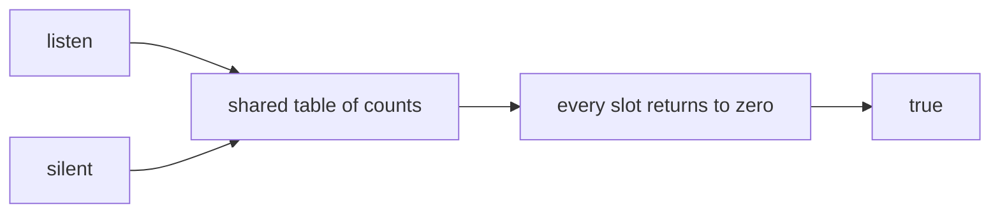
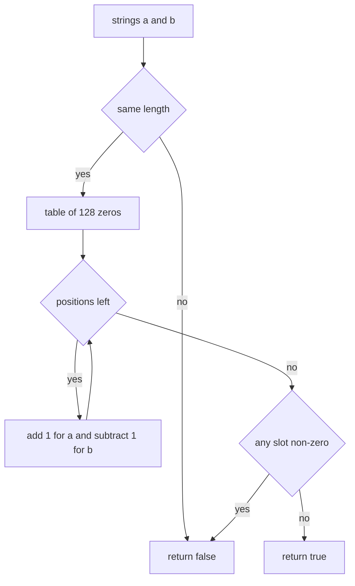
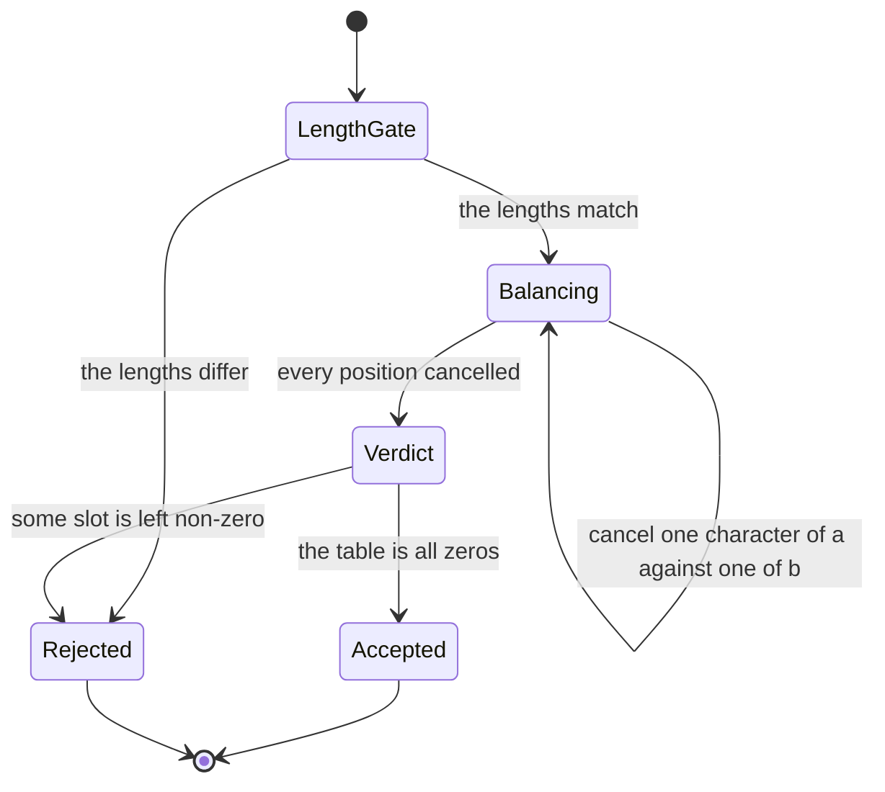
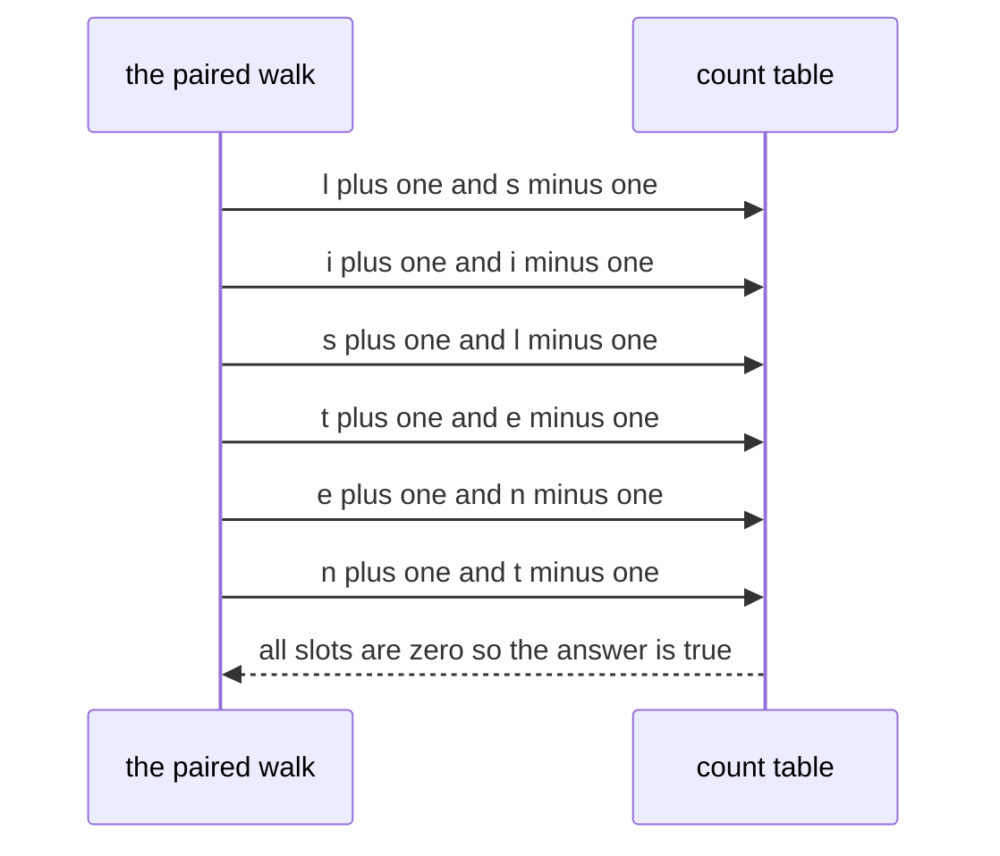

# 015 — Check if two strings are anagrams.

> **Tier:** Beginner · **CTCI chapter:** Ch 1 — Arrays and Strings
> **Task spec:** [015-check-if-two-strings-are-anagrams.md](../../../tasks/beginner/015-check-if-two-strings-are-anagrams.md)
> **Solutions:** [Python](../../../solutions/python/beginner/015-check-if-two-strings-are-anagrams/solution.py) ·
> [Java](../../../solutions/java/beginner/015-check-if-two-strings-are-anagrams/Solution.java) ·
> [JavaScript](../../../solutions/javascript/beginner/015-check-if-two-strings-are-anagrams/solution.js) ·
> [C#](../../../solutions/csharp/beginner/015-check-if-two-strings-are-anagrams/Solution.cs)

## 1. Problem restatement

**Input:** two strings, `a` and `b`. They may be empty, of different lengths, or contain
characters in any order.

**Output:** `true` when one is a permutation of the other — that is, when both contain exactly
the same characters with the same multiplicities — and `false` otherwise.

The spec is one line ("Check if two strings are anagrams."), so the contract is fixed by the
assertions in the solution files:

| Call | Result | Why |
| --- | --- | --- |
| `are_anagrams("listen", "silent")` | `true` | same six letters, different order |
| `are_anagrams("", "")` | `true` | the empty string is a permutation of itself |
| `are_anagrams("hello", "world")` | `false` | same length, different letters |
| `are_anagrams("abc", "ab")` | `false` | different lengths, rejected up front |

Python answers with `Counter(a) == Counter(b)`. Java, JavaScript and C# reject unequal lengths
immediately, then build **one** counting array (`int[128]`) that is incremented for every
character of `a` and decremented for every character of `b`; the strings are anagrams exactly
when every entry ends at zero. The JavaScript file indexes the table with `charCodeAt`, the
Java and C# files with `charAt` / the `char` indexer — all three are UTF-16 code units.

## 2. Intuition

The naive idea is to compare the strings directly, one position at a time. That answers the
wrong question: anagrams are *not* position-wise equal, they are equal **as multisets**. Sorting
both strings turns that into a position-wise comparison, and that is a legitimate approach —
`O(n log n)` time, and correct for any alphabet.

A cheaper idea is to compare **signatures** instead of strings. Build a table of character
counts for each string and compare the two tables. It is O(n) time, but it needs two tables and
a full comparison pass over both.

The key insight that makes the shipped solutions nicer is that the two tables can be folded
into one. Increment a slot for each character of `a` and decrement it for each character of
`b`; a character belongs to `a` more often exactly when its slot ends positive, and to `b` more
often when it ends negative. **Anagrams are precisely the case where nothing is left over**, so
one table plus a check for all-zeros replaces two tables plus an equality check:



The length check in front is not just an optimisation, it is part of the invariant: with equal
lengths, the increment and decrement loops run the same number of times, so the table's total
is exactly zero and any imbalance must come from a *mismatched letter*. Without the check,
`"abc"` versus `"ab"` would leave `c` at `+1` and the all-zeros test would still answer `false`
— correct, but only after doing the work the length check avoids in one comparison.

## 3. Algorithm

The shape implemented by Java, JavaScript and C#:

1. If the two lengths differ, return `false` — different lengths can never be permutations of
   each other.
2. Create a counting table of 128 integers, all zero, indexed by character code.
3. Walk the strings' positions together: increment the slot for the character of `a` and
   decrement the slot for the character of `b`.
4. Scan the table; if any slot is non-zero, return `false`.
5. Otherwise every character balanced out, so return `true`.

```text
procedure are_anagrams(a, b)
    if length(a) is not length(b) then
        return false
    end
    count ← table of 128 integers all set to 0
    for i ← 0 to length(a) - 1 do
        count[a[i]] ← count[a[i]] + 1
        count[b[i]] ← count[b[i]] - 1
    end
    for each slot in count do
        if slot is not 0 then
            return false
        end
    end
    return true
end
```

The Python solution reaches the same conclusion without the table, because its standard library
already builds a signature: `Counter(a) == Counter(b)` compares two multisets and is `true`
exactly when the counts agree. It also has no length check, because the signatures of strings
of different lengths can never be equal — the comparison fails on its own.

The three explicit-table versions share their structure exactly; only the accessor differs
(`a.charAt(i)` in Java, `a.charCodeAt(i)` in JavaScript, `a[i]` in C#). That shared index is
also where their common limitation lives: a character code of `128` or more would index past
the end of the table — see section 6.



Read as a machine, the procedure has a single balancing phase followed by a single verdict:



## 4. Worked example

Trace `are_anagrams("listen", "silent")`. Both are six characters, so the length gate passes.
The table below shows only the slots that are touched, after each position is processed.

| Position | `a[i]` | `b[i]` | Table after this position |
| --- | --- | --- | --- |
| 0 | `l` | `s` | `l = 1`, `s = -1` |
| 1 | `i` | `i` | `l = 1`, `s = -1`, `i = 0` |
| 2 | `s` | `l` | `l = 0`, `s = 0`, `i = 0` |
| 3 | `t` | `e` | `t = 1`, `e = -1`, others `0` |
| 4 | `e` | `n` | `t = 1`, `e = 0`, `n = -1` |
| 5 | `n` | `t` | every slot is `0` |

After position 5 the table is all zeros, so the answer is `true`. Note that positions 1 and 4
cancel each other out (`i` against `i`, then `e` against `e`): the algorithm does not care at
all whether the characters line up, only that every `+1` finds a matching `-1`.



The two rejection cases take different paths. `"abc"` versus `"ab"` fails at the length gate
before the table is even allocated. `"hello"` versus `"world"` passes the gate and then leaves
`h = 1`, `e = 1`, `l = 1`, `w = -1`, `r = -1`, `d = -1` behind — five non-zero slots, so the
verdict is `false` on the first one the scan meets.

## 5. Complexity

Let `n` be the length of the strings and `k` the number of distinct characters.

| Measure | Bound | Why it holds |
| --- | --- | --- |
| Time, best | O(1) | unequal lengths are rejected by one comparison |
| Time, average | O(n) | one paired walk over `n` positions, then one scan of the table |
| Time, worst | O(n) | the paired walk is `n` increments and `n` decrements; the table scan is 128 steps, a constant |
| Space, table versions | O(1) | a fixed `int[128]`, independent of `n` |
| Space, Python `Counter` | O(k) | one entry per distinct character of each string; `k ≤ min(n, alphabet)` |
| Sort-and-compare alternative | O(n log n) time, O(n) space | sorting both strings, then comparing position by position |
| Two-table counting alternative | O(n) time, O(k) space | same asymptotics with an extra table and an equality pass |

The table-based versions are O(1) in space because 128 is a constant — the table size does not
grow with the input. That is a real advantage over sorting, which must materialise copies of
both strings (or mutate the caller's data) and pays a logarithmic factor. The Python version
trades that constant-space property for arbitrary-alphabet support, at O(k) memory.

## 6. Pitfalls and edge cases

- **Unequal lengths.** Rejected in O(1) by Java, JavaScript and C#; Python lets the multiset
  comparison answer it. Both behaviours satisfy the `"abc"` versus `"ab"` assertion, but only
  the explicit gate avoids the table work.
- **The empty string.** `""` is an anagram of `""` — vacuously true, since both multisets are
  empty. Python and Java assert it explicitly; an implementation that special-cased "no input
  means no answer" would be wrong.
- **Case sensitivity.** Nothing folds case, so `"Listen"` and `"silent"` are **not** anagrams
  here. If the caller wants case-insensitive behaviour, normalise both strings before the
  check — and document it, because it changes the answer.
- **Whitespace and punctuation.** Spaces are characters like any other: `"eleven plus two"` and
  `"twelve plus one"` match only if the spaces match. No trimming happens.
- **The 128-slot assumption.** The Java, JavaScript and C# tables cover ASCII only. A character
  with a code unit of `128` or more indexes outside the array — a runtime error, not a wrong
  answer. Python's `Counter` is alphabet-agnostic and is the general solution here.
- **Surrogate pairs.** Java and JavaScript index UTF-16 code units, so an emoji is two units
  and lands outside the 128 range anyway; a widened table would still treat each half
  separately. Neither implementation claims to handle grapheme clusters.
- **Duplicates are required, not forbidden.** `"aab"` and `"aba"` are anagrams; the table ends
  with `a = 0`, `b = 0`. Counting, not set membership, is what makes this work.
- **A single shared table.** Both increments and decrements must target the *same* array. Two
  separate tables would need a comparison pass and answer the same question more slowly.
- **Strings are not modified.** Nothing is sorted or rewritten in place, so the caller's values
  survive the call — unlike the in-place tasks of Ch 1 such as task 022.

## 7. Variants and follow-ups

- **Counting characters for its own sake.** [016-count-occurrences-of-each-character-in-a-string.md](../../../tasks/beginner/016-count-occurrences-of-each-character-in-a-string.md)
  returns the table itself instead of testing it; the anagram check is that table with a second
  string subtracted and a verdict attached.
- **Grouping instead of testing.** [233-group-anagrams-hashmap-with-sorted-key.md](../../../tasks/intermediate/233-group-anagrams-hashmap-with-sorted-key.md)
  uses the sorted string as a hash key, and
  [234-group-anagrams-count-signature-as-key.md](../../../tasks/intermediate/234-group-anagrams-count-signature-as-key.md)
  uses the count signature — the same two families as here, applied to a whole list.
- **Signature arithmetic on letters.** Assigning a distinct prime to each letter and comparing
  products also decides anagram equality, because prime factorisations are unique. It avoids a
  counting pass but overflows quickly, so it is a curiosity rather than an improvement.
- **Other character-level predicates.** [003-count-vowels-and-consonants-in-a-string.md](../../../tasks/beginner/003-count-vowels-and-consonants-in-a-string.md)
  and [002-check-if-a-string-is-a-palindrome.md](../../../tasks/beginner/002-check-if-a-string-is-a-palindrome.md)
  visit the same characters with different questions; the palindrome check is the mirror-image
  comparison that this task deliberately does **not** perform.
- **Chapter context.** [Arrays and Strings](../../ctci/01-arrays-and-strings.md) develops the
  "hash the content, not the position" habit that this check and the grouping tasks share.

## 8. Check yourself

1. Why can one table replace the two-table comparison?

<details><summary>Show answer</summary>

Because the two problems are the same subtraction. A character's count in `a` minus its count
in `b` is computed on the fly: `+1` for `a`'s character, `-1` for `b`'s. The multisets are equal
exactly when every slot of that difference table is zero, so the comparison pass over two
tables collapses into a single scan of one.

</details>

2. What does `are_anagrams("", "")` return, and what would a length-first implementation do?

<details><summary>Show answer</summary>

`true` — two empty multisets are equal, and the length check sees `0 == 0` so it proceeds
through a walk of zero positions and a table that is still all zeros. Python and Java both
assert this row.

</details>

3. Is `are_anagrams("Listen", "silent")` true?

<details><summary>Show answer</summary>

No. No solution normalises case, and the uppercase `L` is a different character from the
lowercase `l`, so the counts differ. Case-insensitive matching would require folding both
strings first, which changes the contract and is not asserted anywhere.

</details>

4. What happens if the string contains `"é"` or an emoji, in the Java version?

<details><summary>Show answer</summary>

The table has 128 slots, and `é` has a code unit of `233`, so indexing the table throws an
array-index error rather than returning `false`. Python's `Counter`-based version handles these
characters correctly; the fixed-ASCII tables are a deliberate simplification of the three
explicit-table languages.

</details>

5. When would sorting both strings be the better approach?

<details><summary>Show answer</summary>

When the alphabet is large or unbounded (arbitrary Unicode) and you want a simple, obviously
correct comparison — sorting is `O(n log n)` and handles any character set without assuming a
table size. It also produces a canonical key, which is what the grouping task 233 needs. For
ASCII and a single equality test, the O(n) counting table wins.

</details>
