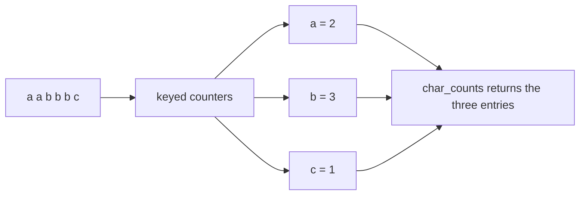
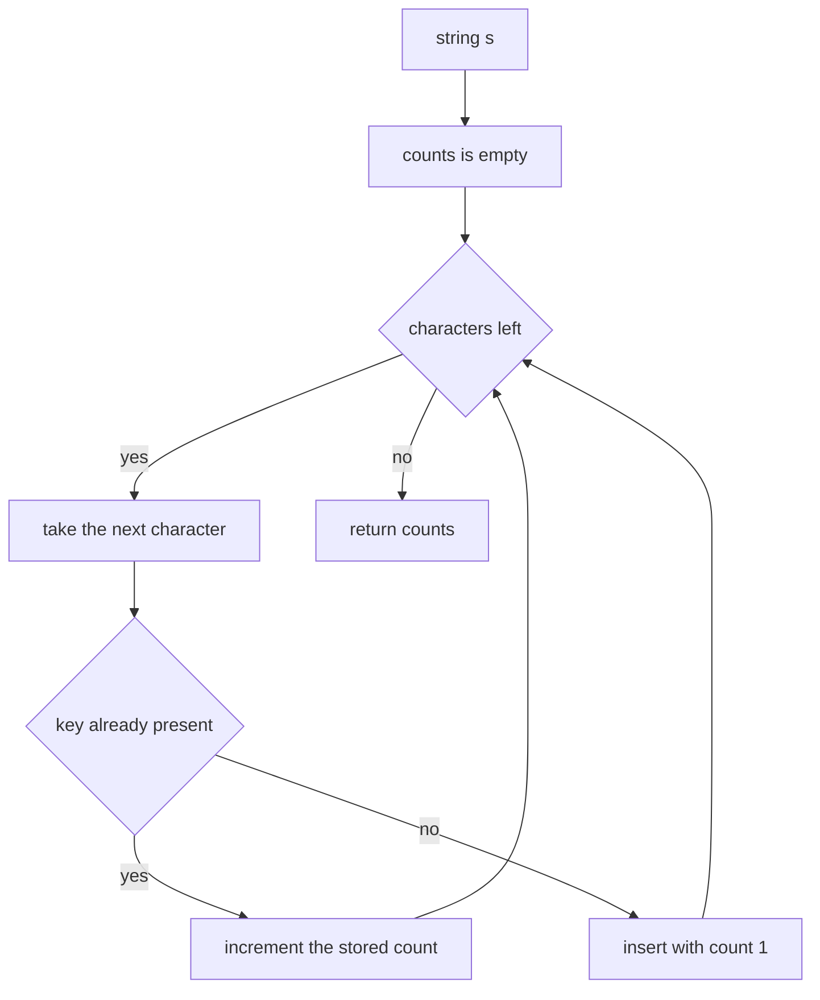
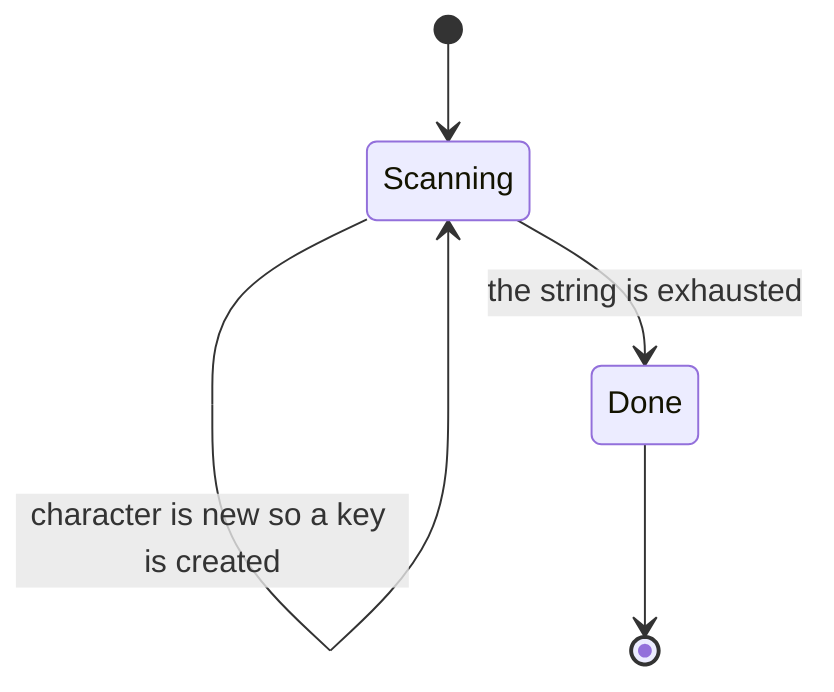
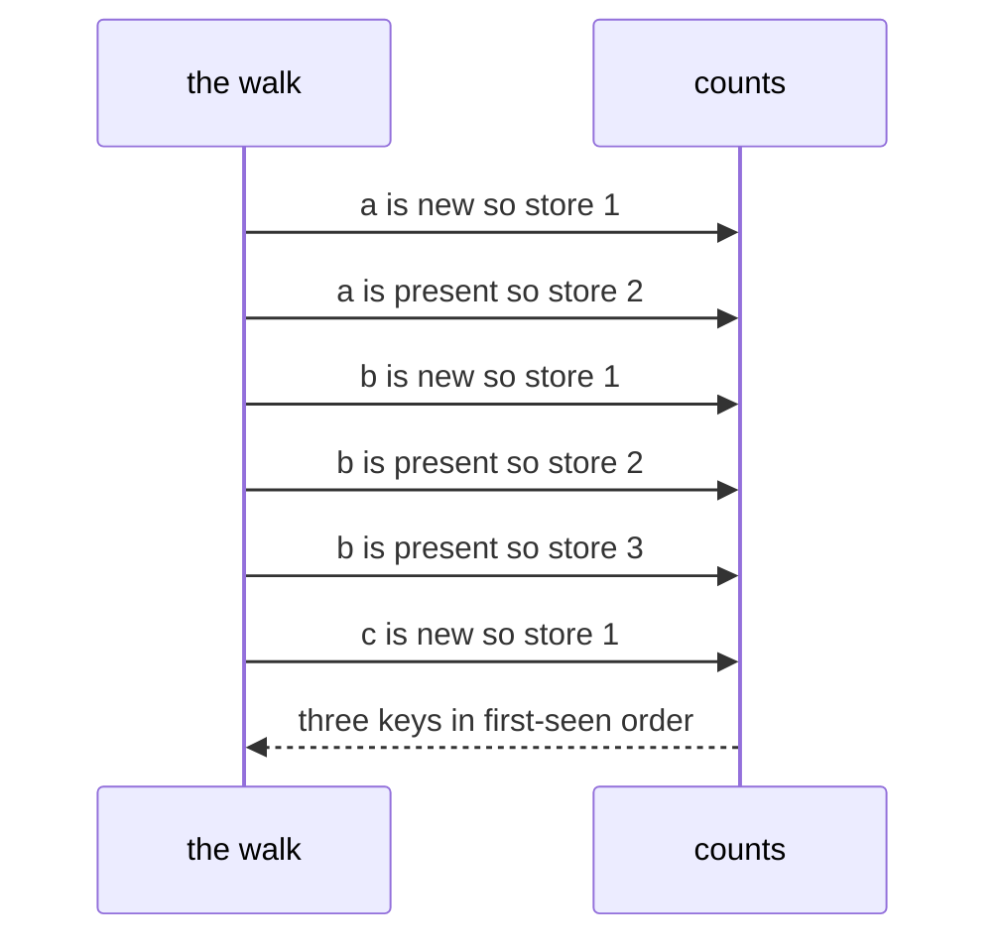

# 016 — Count occurrences of each character in a string.

> **Tier:** Beginner · **CTCI chapter:** Ch 1 — Arrays and Strings
> **Task spec:** [016-count-occurrences-of-each-character-in-a-string.md](../../../tasks/beginner/016-count-occurrences-of-each-character-in-a-string.md)
> **Solutions:** [Python](../../../solutions/python/beginner/016-count-occurrences-of-each-character-in-a-string/solution.py) ·
> [Java](../../../solutions/java/beginner/016-count-occurrences-of-each-character-in-a-string/Solution.java) ·
> [JavaScript](../../../solutions/javascript/beginner/016-count-occurrences-of-each-character-in-a-string/solution.js) ·
> [C#](../../../solutions/csharp/beginner/016-count-occurrences-of-each-character-in-a-string/Solution.cs)

## 1. Problem restatement

**Input:** a string `s`. It may be empty and may repeat characters any number of times.

**Output:** a map from character to count, containing **one entry per distinct character that
actually occurs**. Characters that never appear are absent, not present with a count of zero.

The spec is one line ("Count occurrences of each character in a string."), so the contract is
fixed by the assertions in the solution files:

| Call | Result | Why |
| --- | --- | --- |
| `char_counts("aabbbc")` | `{a: 2, b: 3, c: 1}` | three distinct characters, repeated |
| `char_counts("")` | `{}` | the empty map, not a map of zeros |
| `char_counts("zzz")` | `{z: 3}` | one key with the full count |

Python returns a plain `dict` built from `Counter(s)`; Java returns a `LinkedHashMap<Character,
Integer>`; JavaScript returns a plain object built with `Object.fromEntries` over a `Map`; C#
returns a `Dictionary<char, int>`. The *keys are the characters that occur*, which is the
difference from the fixed 128-slot table of task 015 — this version supports any alphabet.

## 2. Intuition

Counting has two naive shapes. The first is a **nested scan**: for every position, walk the
whole string again and count matches. Correct, and O(n²) — every position re-examines the whole
input to answer a question it could have answered once, in place.

The second naive shape is to count with a **sorted copy**: sort the characters, then walk the
run-lengths. That is O(n log n), and it destroys the original order and needs a copy of the
input.

Both are unnecessary. Counting is a **folding** operation over keyed slots: one pass, and for
each character either create its slot or bump it.

The key insight is the choice of keying structure. Task 015 could index a fixed 128-slot array
because it only needed a verdict about ASCII. Here the output itself must name the characters,
so the alphabet cannot be assumed bounded: a *map* keyed by character is the honest structure,
and it costs one entry per character that actually occurs — `O(k)` memory for `k` distinct
characters, not 128 slots for a string that may hold two.



The other decision is what the *unit* of counting is. Python's `Counter(s)` iterates code
points, JavaScript's `for ... of` also iterates code points, while Java's `s.toCharArray()` and
C#'s `foreach (var c in s)` iterate UTF-16 code units. For ASCII input all four agree; for
astral characters the first two produce one key per emoji and the last two produce two keys per
surrogate pair. The tutorial returns to this in section 6 because it is the one place where the
four files genuinely disagree.

## 3. Algorithm

The shape implemented by all four solutions:

1. Create an empty map from character to integer count.
2. Walk the string one character at a time.
3. For the current character: look up its count, defaulting to zero, add one, and store it back.
4. After the walk, return the map. Characters never encountered are simply not keys.

```text
procedure char_counts(s)
    counts ← empty map from character to integer
    for each ch in s do
        previous ← counts[ch] if the key exists else 0
        counts[ch] ← previous + 1
    end
    return counts
end
```

Step 3 is the only interesting line, and the four files each phrase it in their library's
idiom:

- Python delegates the whole loop to `Counter(s)` and converts the result to a plain `dict`.
- Java uses `counts.merge(c, 1, Integer::sum)`, which looks the slot up once and either inserts
  `1` or adds to the existing value.
- JavaScript uses `counts.set(ch, (counts.get(ch) ?? 0) + 1)` — the nullish default supplies the
  zero for a first sighting.
- C# uses `counts.TryGetValue(c, out var n)` followed by `counts[c] = n + 1`, which fetches the
  old value and writes the new one without a second hash lookup.

An idiom that reads the map *twice* (`if has key then counts[k] = counts[k] + 1 else counts[k]
= 1`) is correct but performs two lookups on the hot path; every solution here avoids it.





## 4. Worked example

Trace `char_counts("aabbbc")`. Each row is one character of the input.

| Position | Character | Key present before? | Map after this position |
| --- | --- | --- | --- |
| 0 | `a` | no | `{a: 1}` |
| 1 | `a` | yes | `{a: 2}` |
| 2 | `b` | no | `{a: 2, b: 1}` |
| 3 | `b` | yes | `{a: 2, b: 2}` |
| 4 | `b` | yes | `{a: 2, b: 3}` |
| 5 | `c` | no | `{a: 2, b: 3, c: 1}` |

Three characters create a key; three characters increment an existing one. The map has exactly
`3` entries at the end even though the string has `6` characters — the distinction between
"number of characters" and "number of distinct characters" is what `O(n)` time and `O(k)` space
express.



The boundary rows fall out immediately. For the empty string the walk performs zero iterations
and the returned map is empty — the assertion `char_counts("") == {}` and the Java/C# checks
that the result `isEmpty()` / has `Count == 0`. For `"zzz"` the same key is incremented three
times and the answer is the single entry `{z: 3}`; the count is not capped at `1`, which is what
separates this from a set-membership scan.

## 5. Complexity

Let `n` be the length of the string and `k` the number of distinct characters in it.

| Measure | Bound | Why it holds |
| --- | --- | --- |
| Time, best | O(1) | the empty string performs no iterations |
| Time, average | O(n) | one hash-table operation per character, expected O(1) each |
| Time, worst | O(n) | same bound in practice; a pathological hash distribution would degrade the per-character cost |
| Space, result | O(k) | exactly one entry per distinct character, `k ≤ n` |
| Space, extra | O(1) | the cursor over the string |
| Nested-scan alternative | O(n²) time, O(k) space | re-counting the rest of the string at every position |
| Sort-and-run-lengths alternative | O(n log n) time, O(n) space | needs a sorted copy of the input |

The result is O(k), which is O(1) for a fixed-size alphabet and O(n) in the worst case of a
string with all-distinct characters. The comparison worth remembering is with the nested scan:
O(n²) — quadratic — versus O(n) here, from the same amount of information, because the fold
remembers what it has already seen instead of rediscovering it.

## 6. Pitfalls and edge cases

- **Empty string.** The answer is an empty map, not `null` and not a map of zeros. Python and
  JavaScript assert the empty result directly (`{}`), Java and C# assert the emptiness of the
  returned structure.
- **Never-seen characters are absent.** The map contains only characters that occur. A version
  that pre-filled an entry for every possible character would allocate the whole alphabet for a
  two-character string and would break the `{}` assertion.
- **Counts are not capped.** `"zzz"` gives `3`, not `1`; this is a counter, not a set.
- **Key order is a property of the container, not the algorithm.** Java's `LinkedHashMap`
  preserves first-seen order; Python's `dict` (and `Counter`) preserve insertion order; C#'s
  `Dictionary<char, int>` makes **no** ordering promise, so consumers must not rely on it.
- **JavaScript object keys reorder digits.** `Object.fromEntries(map)` yields an object whose
  integer-like keys are enumerated in ascending numeric order before other string keys, so a
  string containing digits may not report them in first-seen order even though the underlying
  `Map` did. The assertion compares objects by content, so the test is unaffected.
- **Unit of iteration differs between the files.** Python iterates code points
  (`Counter(s)`), JavaScript iterates code points (`for ... of`), while Java's
  `s.toCharArray()` and C#'s `foreach` over a `string` iterate UTF-16 code units. For an emoji,
  Python and JavaScript produce one key, Java and C# produce two surrogate keys. For ASCII —
  which is all the assertions use — the four agree exactly.
- **Case and whitespace are characters.** `"Aa"` has two keys, and a space gets an entry just
  like a letter. No normalisation happens.
- **Hash-table assumption.** The O(n) bound assumes expected O(1) lookups in a dict, `HashMap`,
  `Map` or `Dictionary`. All four standard containers provide that; the bound is not a
  worst-case guarantee against adversarial hash collisions.
- **No mutation of the input.** The string is read-only in all four languages; the returned
  structure is fresh, so the caller's data is untouched.

## 7. Variants and follow-ups

- **The verdict instead of the table.** [015-check-if-two-strings-are-anagrams.md](../../../tasks/beginner/015-check-if-two-strings-are-anagrams.md)
  builds a difference table and returns a boolean; it is this counting pass followed by an
  all-zeros test.
- **The maximum of the counts.** [048-find-most-frequent-element-in-array.md](../../../tasks/beginner/048-find-most-frequent-element-in-array.md)
  keeps the same map and adds a running best, which turns the count table into an answer.
- **The first count that stays at one.** [047-find-first-non-repeating-character-in-a-string.md](../../../tasks/beginner/047-find-first-non-repeating-character-in-a-string.md)
  needs the counts *in position order*, so it cannot simply read the map's ordering — it keeps
  the first occurrence index alongside.
- **Fixed-alphabet counting.** [089-implement-simple-frequency-histogram-integers.md](../../../tasks/beginner/089-implement-simple-frequency-histogram-integers.md)
  counts integers with the same fold, but the keys are bounded so an array can replace the map —
  the constant-space trick used by task 015.
- **Chapter context.** [Arrays and Strings](../../ctci/01-arrays-and-strings.md) treats the
  character-count map as the workhorse of Ch 1 string questions, from anagram checks to
  duplicate detection and permutations.

## 8. Check yourself

1. Why is the map-based count O(n) while the nested scan is O(n²)?

<details><summary>Show answer</summary>

The nested scan answers "how many times does this character occur?" from scratch for every
position, re-reading the rest of the string each time — `n` questions, each costing up to `n`
comparisons. The fold answers every question once: a character is seen exactly once, and its
slot is updated in expected O(1). Same information, one pass instead of a quadratic number of
comparisons.

</details>

2. What is the result for `"aabbbc"` and how many entries does it have?

<details><summary>Show answer</summary>

`{a: 2, b: 3, c: 1}` — three entries for a six-character string. The entry count is the number
of *distinct* characters, which is the `k` in the O(k) space bound.

</details>

3. Why should a caller not depend on the order of the returned keys in C#?

<details><summary>Show answer</summary>

Because `Dictionary<char, int>` does not promise any enumeration order — the order can change
with insertions and removals, and it is an implementation detail. Java's `LinkedHashMap` and
Python's `dict` do preserve first-seen/insertion order, so relying on ordering is a
language-specific assumption rather than part of this task's contract.

</details>

4. `char_counts("")` returns an empty map. Why is that better than a map holding a count of
   zero for every character?

<details><summary>Show answer</summary>

Because the contract is "one entry per character that occurs". Pre-filling zeros would make the
result size depend on the alphabet instead of the input, allocate needlessly for short strings,
and contradict the assertions (`{}` in Python and JavaScript, an empty structure in Java and
C#). Absence already encodes "never seen", with no extra state.

</details>

5. What is the space cost, and when does it become O(n) rather than O(1)?

<details><summary>Show answer</summary>

`O(k)` for `k` distinct characters. With a fixed alphabet the map is bounded by the alphabet
size and behaves as O(1); when every character of the string is distinct — the worst case,
`k = n` — the map grows linearly with the input.

</details>
