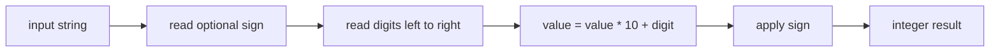
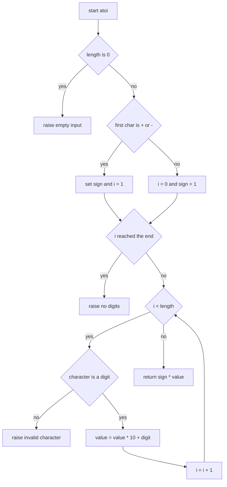
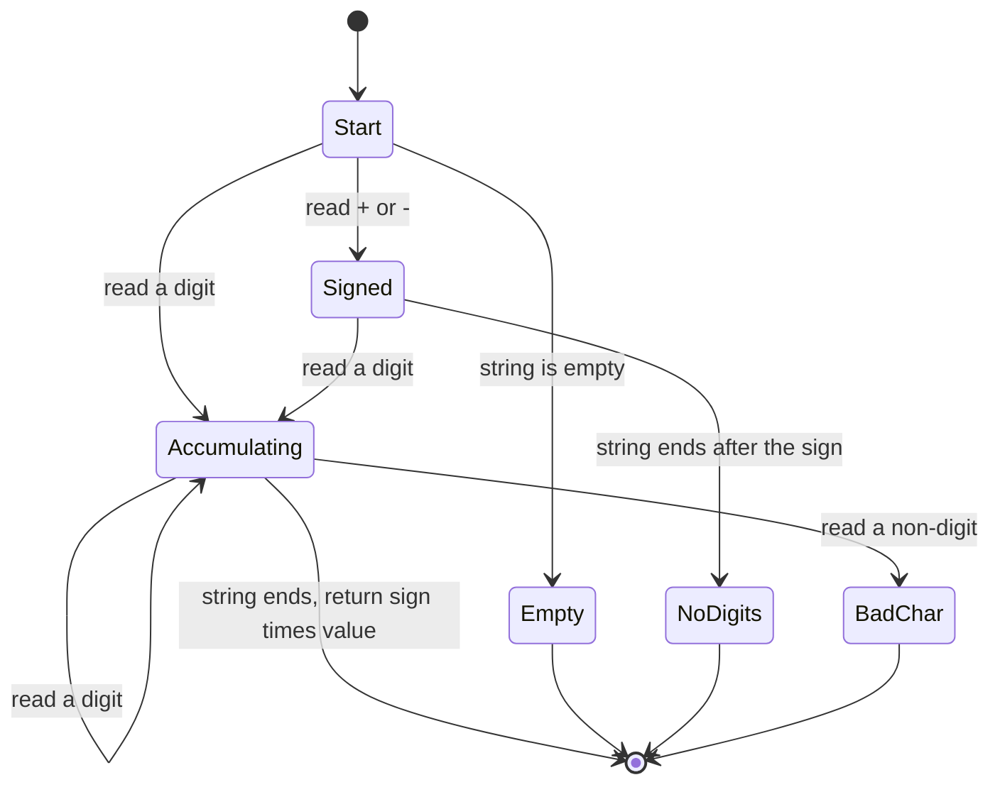
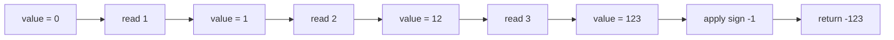

# 017 — Convert string to integer (atoi) basic.

> **Tier:** Beginner · **CTCI chapter:** Ch 1 — Arrays and Strings
> **Task spec:** [017-convert-string-to-integer-atoi-basic.md](../../../tasks/beginner/017-convert-string-to-integer-atoi-basic.md)
> **Solutions:** [Python](../../../solutions/python/beginner/017-convert-string-to-integer-atoi-basic/solution.py) ·
> [Java](../../../solutions/java/beginner/017-convert-string-to-integer-atoi-basic/Solution.java) ·
> [JavaScript](../../../solutions/javascript/beginner/017-convert-string-to-integer-atoi-basic/solution.js) ·
> [C#](../../../solutions/csharp/beginner/017-convert-string-to-integer-atoi-basic/Solution.cs)

## 1. Problem restatement

**Input:** a string `s` that is supposed to hold a decimal integer. The four solution files
implement `atoi(s)` — the "ASCII to integer" conversion — with a deliberately small contract:

- an optional leading `+` or `-` is accepted;
- after that sign every remaining character must be a decimal digit;
- the digits are converted in base 10 and the sign is applied to the result.

Anything else is an error, and the spec is pinned down by the assertions and error paths the
solution files actually ship:

| Call | Result | Why |
| --- | --- | --- |
| `atoi("42")` | `42` | the plain case: two digits, no sign |
| `atoi("-123")` | `-123` | a leading `-` flips the sign after conversion |
| `atoi("+7")` | `7` | an explicit `+` is accepted and means positive |
| `atoi("0")` | `0` | a single zero digit (asserted by the Python file) |
| `atoi("")` | raises | "empty input" in all four languages |
| `atoi("+")` | raises | "no digits" — a sign with nothing after it |
| `atoi("12a")` | raises | "invalid char" — the `a` is not a digit |

The task is *basic* on purpose. There is no whitespace skipping, no stop-at-first-non-digit
behaviour, and **no overflow detection**: the value is accumulated in a plain 32-bit `int` in
Java, JavaScript and C#, so a digit string long enough to leave the `int` range has no defined
answer in this task. That is a real limitation, and it is the reason task 030 (which does clamp)
looks the way it does.

## 2. Intuition

The naive idea is to let the platform do it: `Integer.parseInt(s)`, `Number(s)`, `parseInt`, or
`int(s)`. That is what production code should use, and it is exactly what an interview asks you
*not* to use, because the whole point is to show the arithmetic behind base conversion.

The second naive idea — build a number out of the string by multiplying with the right power of
ten — is:

```text
value ← 0
for i ← 0 to length(s) - 1 do
    value ← value + digit(s[i]) * power(10, length(s) - 1 - i)
end
```

This needs `power`, and it walks two directions at once. The insight that fixes it is Horner's
rule: a decimal string is a polynomial in 10 and can be evaluated left to right.

    "123"  =  ((1 · 10) + 2) · 10 + 3

So the accumulator only ever needs one operation per character: **multiply by ten and add the
next digit.** Old digits automatically shift one place to the left each time a new one arrives,
which is precisely what "appending a digit" means in base 10.

The second half of the insight is that a sign is not part of the digits. Detect it once, convert
the digits as a positive number, and apply the sign at the very end. That is what all four
solutions do, which is why `atoi("-123")` returns `-123` and not the result of some negate-as-you-go
scheme.



## 3. Algorithm

The four solutions are structurally identical; only the "is this a digit?" test differs.

1. Let `n` be the length of `s`. If `n` is 0, raise the empty-input error.
2. Start at index `i = 0` with `sign = 1`.
3. If `s[0]` is `+` or `-`, set `sign` accordingly and move to `i = 1`.
4. If `i` has reached `n`, raise the no-digits error — a bare sign is not a number.
5. Walk `i` from `1` (or `0`) to `n - 1`:
   - reject the character unless it is in `0`..`9`;
   - otherwise set `value = value * 10 + (code(s[i]) - code("0"))`.
6. Return `sign * value`.

```text
procedure atoi(s)
    if length(s) = 0 then
        raise error "empty input"
    end
    i ← 0
    sign ← 1
    if s[0] = "+" or s[0] = "-" then
        if s[0] = "-" then
            sign ← -1
        end
        i ← 1
    end
    if i = length(s) then
        raise error "no digits"
    end
    value ← 0
    while i < length(s) do
        digit ← code(s[i]) - code("0")
        if digit < 0 or digit > 9 then
            raise error "invalid character"
        end
        value ← value * 10 + digit
        i ← i + 1
    end
    return sign * value
end
```

Note the order of the two checks in the loop: the character is validated *before* it is folded
into `value`, so an invalid character can never contribute a bogus digit. The digit test is
written as arithmetic (`c - '0'` in Java and C#, `charCodeAt(i) - 48` in JavaScript,
`ord(s[i]) - ord("0")` in Python) rather than as a library call, which keeps the conversion
visible.



The scanner as a three-state machine makes the error paths explicit:



## 4. Worked example

Trace `atoi("-123")`. The sign is consumed first, so the accumulator sees only `1`, `2`, `3`:

| Step | `i` | `s[i]` | digit | `sign` | `value` before | `value` after |
| --- | --- | --- | --- | --- | --- | --- |
| sign | 0 | `-` | — | `-1` | — | 0 |
| 1 | 1 | `1` | 1 | `-1` | 0 | 1 |
| 2 | 2 | `2` | 2 | `-1` | 1 | 12 |
| 3 | 3 | `3` | 3 | `-1` | 12 | 123 |
| return | — | — | — | `-1` | 123 | `-123` |

Three loop iterations for four characters: the sign was absorbed by the pre-loop step, which is
why the loop bound is `n` and not `n - 1`.



The error path is just as mechanical. For `s = "+"`:

| Step | `i` | observation | outcome |
| --- | --- | --- | --- |
| length check | — | `length("+") = 1`, not 0 | continue |
| sign check | 0 | `s[0]` is `+` | `sign = 1`, `i = 1` |
| digits check | 1 | `i = length(s)` | raise "no digits" |

And for `s = "12a"` the failure happens inside the loop at `i = 2`, *after* `value` has already
become 12 — a reminder that the function is not transactional: it throws away all the work it has
done. That is fine here because the caller gets an exception instead of a partial number, but it
is the reason the "invalid character" message carries the offending character in every language.

## 5. Complexity

Let `n` be the length of `s`.

| Measure | Bound | Why it holds |
| --- | --- | --- |
| Time, best | O(1) | an empty string or a bare sign is rejected before the loop starts |
| Time, average | O(n) | one character is examined per iteration; the loop body is constant work |
| Time, worst | O(n) | every character is validated and folded exactly once |
| Space, extra | O(1) | only `i`, `sign` and `value` are live; the input is read, never copied |
| Recursion depth | O(1) | the loop is iterative in all four solutions |
| Alternative: powers of ten | O(n) | the same asymptotics, but needs a `power` helper and a second index |
| Alternative: library parse | O(n) | what `Integer.parseInt` does internally — and what the task forbids |

Note that the space bound is genuinely constant: hashing the characters is never needed, because
the digit test is a range comparison on the code point, not a lookup. The one thing the loop does
not do is guard against overflow, so the bound on `value` is whatever the host `int` type
provides — 2³¹ − 1 in Java, C# and JavaScript's bitwise world, and unbounded in Python.

## 6. Pitfalls and edge cases

- **Empty string.** `atoi("")` raises "empty input" in all four files; returning `0` here is the
  classic C bug this task is trying to avoid.
- **Bare sign.** `atoi("+")` and `atoi("-")` hit the `i == length(s)` check and raise "no digits".
  Python's version asserts this path indirectly through the `i == len(s)` branch.
- **Leading zeros.** `atoi("007")` returns `7`. Leading zeros are just multiply-by-ten no-ops;
  nothing in the contract preserves them.
- **Non-digit characters.** Java and C# use `c < '0' || c > '9'`, JavaScript uses
  `charCodeAt(i) - 48` and checks the range, Python uses `s[i].isdigit()`.
- **`isdigit` is broader than ASCII.** Python's `str.isdigit()` accepts some Unicode digits for
  which `ord(s[i]) - ord("0")` is not the numeric value, so `atoi` on such input folds a wrong
  digit rather than raising. The other three languages are strictly ASCII here; treat this as a
  Python-only curiosity, not a guarantee.
- **Internal whitespace and trailing spaces.** `" 42"` and `"42 "` both raise. There is no
  trimming anywhere in the four files.
- **Overflow.** Nothing checks it. A nineteen-digit input silently wraps in Java, C# and
  JavaScript. If the interview asks about it, that is task 030's clamping behaviour, not this
  task's.
- **Sign of zero.** `atoi("-0")` returns `0` (and in Java `0 == -0`), because the sign is applied
  by multiplication after the digits are read.

## 7. Variants and follow-ups

- **The other direction.** [018-convert-integer-to-string.md](../../../tasks/beginner/018-convert-integer-to-string.md)
  is the mirror image: repeated `% 10` peels digits off the right and a reversal puts them back in
  order. Doing both together is how
  [030-reverse-digits-of-an-integer.md](../../../tasks/beginner/030-reverse-digits-of-an-integer.md)
  works.
- **Accumulator arithmetic with a twist.** The same `value = value * 10 + value % 10` fold appears
  in [031-palindrome-number-check-without-string-conversion.md](../../../tasks/beginner/031-palindrome-number-check-without-string-conversion.md),
  where the newly built number is compared against the original.
- **Sum instead of fold.** [027-find-missing-number-in-1-n-given-n-1-elements.md](../../../tasks/beginner/027-find-missing-number-in-1-n-given-n-1-elements.md)
  relies on a closed-form sum rather than a running accumulator, but the "carry the invariant
  forward one element at a time" shape is the same.
- **Where the fold is replaced entirely.** [028-count-number-of-set-bits-in-an-integer.md](../../../tasks/beginner/028-count-number-of-set-bits-in-an-integer.md)
  shows the same left-to-right single pass over the *bits* of a number instead of the characters
  of a string.
- The chapter walkthrough in [Arrays and Strings](../../ctci/01-arrays-and-strings.md) collects
  the string-indexing tasks of Ch 1, including this conversion pair.

## 8. Check yourself

1. Why does `atoi("+7")` return `7` rather than raising an error?

<details><summary>Show answer</summary>

Because the sign is optional and *checked* rather than required: step 3 consumes `+` as a sign
and leaves the digit `7` for the loop. Only a sign with **no** following digit (`"+"`, `"-"`) hits
the no-digits error, because after consuming the sign `i` has reached the end of the string.

</details>

2. Rewrite `value = value * 10 + digit` as a power-of-ten sum. Why is the running form better?

<details><summary>Show answer</summary>

The sum form is `value = Σ digit[k] * 10^(n-1-k)`, which needs a power function (or its own loop)
and re-reads the string once per digit. The running form applies Horner's rule, so every digit is
touched exactly once and no exponent is ever computed. Same O(n) time, much smaller constant, no
helper needed.

</details>

3. What does `atoi("007")` return, and what does `atoi("7 0")` do?

<details><summary>Show answer</summary>

`atoi("007")` returns `7`: three multiply-and-add steps produce 0, then 0, then 7. `atoi("7 0")`
raises the invalid-character error at index 1, because the space is not in the `0`..`9` range in
any of the four implementations. There is no trimming and no skip-whitespace rule.

</details>

4. The loop validates the character before folding it in. What would change if the order were
   reversed?

<details><summary>Show answer</summary>

Nothing observable for valid input, but for invalid input the accumulator would already have been
corrupted by the time the error is raised — and in a version that returned a partial value
instead of raising, the caller would see a number assembled from garbage. Validating first keeps
the invariant "`value` is always the correct value of the digits read so far".

</details>

5. Why is there no overflow check, and where would you put one?

<details><summary>Show answer</summary>

Because the task is explicitly the *basic* version; the four files accumulate into a native `int`
and let the host language define what happens on overflow. A robust version checks
`value > (INT_MAX - digit) / 10` (with a special case for `INT_MIN`) before each fold and returns
a sentinel — which is exactly the clamping shape used by
[030-reverse-digits-of-an-integer.md](../../../tasks/beginner/030-reverse-digits-of-an-integer.md).

</details>
