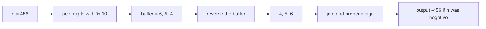
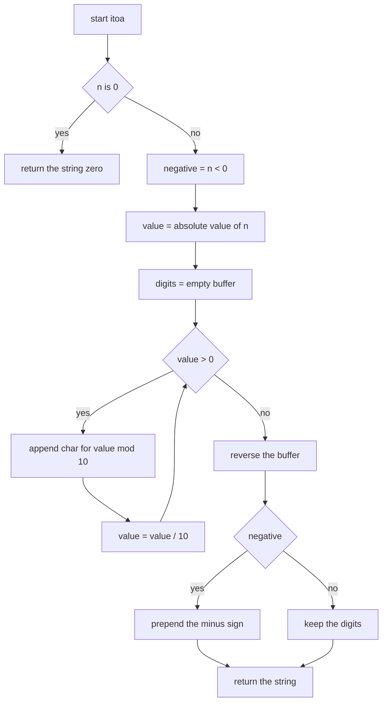
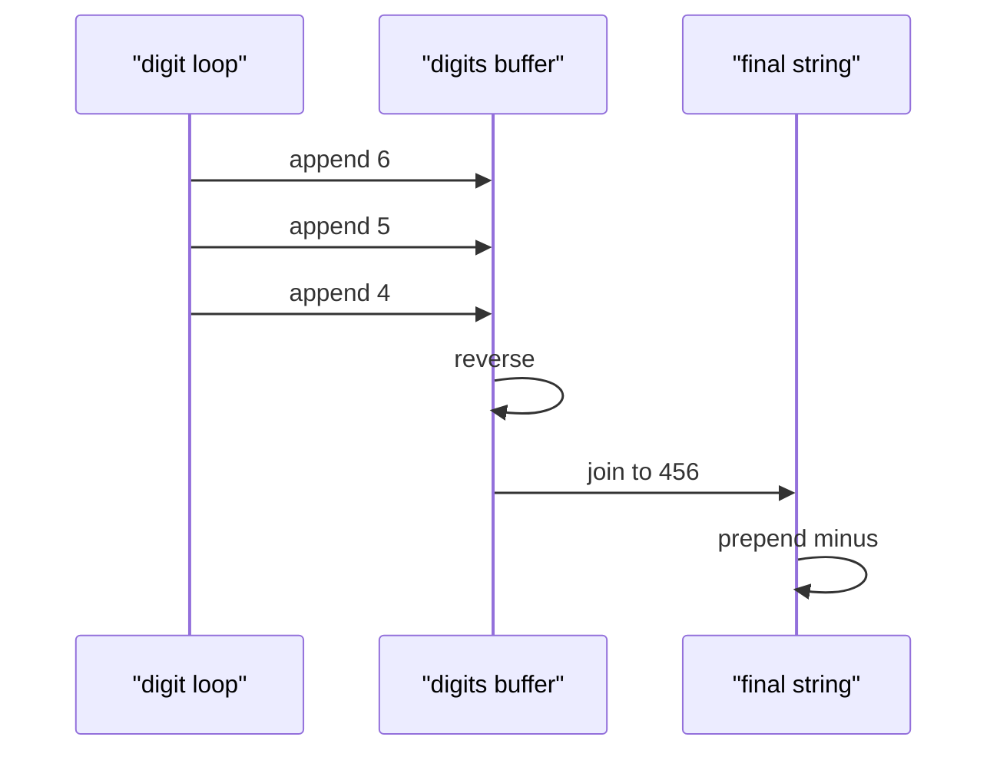

# 018 — Convert integer to string.

> **Tier:** Beginner · **CTCI chapter:** Ch 1 — Arrays and Strings
> **Task spec:** [018-convert-integer-to-string.md](../../../tasks/beginner/018-convert-integer-to-string.md)
> **Solutions:** [Python](../../../solutions/python/beginner/018-convert-integer-to-string/solution.py) ·
> [Java](../../../solutions/java/beginner/018-convert-integer-to-string/Solution.java) ·
> [JavaScript](../../../solutions/javascript/beginner/018-convert-integer-to-string/solution.js) ·
> [C#](../../../solutions/csharp/beginner/018-convert-integer-to-string/Solution.cs)

## 1. Problem restatement

**Input:** a signed integer `n`.

**Output:** the decimal string that represents it, built by hand — no `str(n)`,
`String.valueOf`, `toString`, `Integer.toString`, or template-literal interpolation. The
contract is fixed by the assertions the four files ship:

| Call | Result | Why |
| --- | --- | --- |
| `itoa(0)` | `"0"` | the special case that the loop cannot produce |
| `itoa(123)` | `"123"` | digits come out of the loop in reverse, then get flipped |
| `itoa(-456)` | `"-456"` | the sign is remembered and prepended |
| `itoa(2147483647)` | `"2147483647"` | the largest 32-bit value, ten digits |
| `itoa(-2147483648)` | `"-2147483648"` | asserted by Java and C#; the negation trap |

That last row is the interesting one. `-2147483648` is `Integer.MIN_VALUE`, and its negation does
not fit back into a 32-bit `int`. Java's file therefore widens first
(`Math.abs((long) n)`) and C#'s does the same (`Math.Abs((long)n)`). Python's integers are
arbitrary precision so `abs(n)` is already safe, and JavaScript's `Math.abs` works on doubles, so
both of those files use the plain absolute value.

## 2. Intuition

The obvious approach is to build the answer one digit at a time with string concatenation:

```text
result ← ""
while n > 0 do
    result ← digit(n % 10) + result
    n ← n / 10
end
```

It is correct but it pays twice. In Java, C# and JavaScript strings are immutable, so every
`digit + result` allocates a new string and copies the whole prefix: with `d` digits that is
`1 + 2 + ... + d` copied characters, i.e. **O(d²)** — the same trap task 001 documents for
reversal.

The key insight is that `% 10` and integer division already produce the digits, but *in the wrong
order*: the least significant digit arrives first, because that is the one arithmetic can peel off
cheapest. So there are two honest ways to finish:

1. **Collect then reverse** — push each digit onto a growable buffer (Python `list`, Java
   `StringBuilder`, JavaScript `Array`, C# `StringBuilder`), then reverse the whole buffer once.
   This is what all four files do.
2. **Prepend, but into a pre-sized buffer** — compute the digit count first and fill a `char[]`
   from the back, which avoids the reversal but needs a second pass to count digits.

Option 1 wins for a beginner task because counting digits (`log10` plus a correction, or a loop)
is more code than `reverse()`. In Python the reversal is a single `digits.reverse()`, in Java
`StringBuilder.reverse()`, in JavaScript `Array.prototype.reverse`, and in C# the file converts to
a `char[]` and calls `Array.Reverse` — four spellings of the same O(d) flip.



## 3. Algorithm

1. If `n` is `0`, return `"0"` immediately — the loop below never runs for zero.
2. Remember whether `n` is negative, then take the absolute value so the loop only sees a
   non-negative number. Widen to 64 bits first in Java and C# so `MIN_VALUE` survives.
3. While the value is greater than zero:
   - append the character `code("0") + value % 10` to a growable buffer;
   - divide `value` by ten with integer division (`//` in Python, `/` on a `long` in Java and C#,
     `Math.floor` in JavaScript).
4. Reverse the buffer.
5. Build the string from the buffer and prepend `"-"` if the sign was negative.

```text
procedure itoa(n)
    if n = 0 then
        return "0"
    end
    negative ← n < 0
    value ← absolute value of n
    digits ← empty growable buffer
    while value > 0 do
        append character(code("0") + value mod 10) to digits
        value ← value / 10
    end
    reverse digits
    result ← string built from digits
    if negative then
        return "-" + result
    end
    return result
end
```

Two details make the code portable. First, `value mod 10` must be a *non-negative* remainder: for
a negative `value` some languages return a negative remainder, which is why the sign is stripped
before the loop rather than handled inside it. Second, `code("0") + digit` assumes the ten digits
are contiguous in the character set — true for ASCII and for UTF-16, and the reason all four
implementations can use arithmetic instead of a lookup table.



## 4. Worked example

Trace `itoa(-456)`. The sign is peeled off first, so the loop works on `456`:

| Step | `value` | `value % 10` | character appended | buffer |
| --- | --- | --- | --- | --- |
| start | 456 | — | — | `[]` |
| 1 | 456 | 6 | `6` | `[6]` |
| 2 | 45 | 5 | `5` | `[6, 5]` |
| 3 | 4 | 4 | `4` | `[6, 5, 4]` |
| 4 | 0 | — | loop exits | `[6, 5, 4]` |
| reverse | — | — | — | `[4, 5, 6]` |
| join and sign | — | — | — | `"-456"` |

The buffer is the right answer backwards, and the single `reverse` fixes the whole order at once.
That is the payoff of collecting instead of prepending: three appends plus one O(d) flip, not
three O(d) string copies.



The zero case never reaches the loop, so it needs its own branch:

| `n` | enters loop? | buffer | result |
| --- | --- | --- | --- |
| `0` | no | empty | `"0"` |
| `7` | yes, once | `[7]` | `"7"` |
| `-7` | yes, once | `[7]` | `"-7"` |

## 5. Complexity

Let `d` be the number of decimal digits of `n`, which is `floor(log10(n)) + 1` for `n > 0`.

| Measure | Bound | Why it holds |
| --- | --- | --- |
| Time, best | O(1) | `n = 0` returns immediately |
| Time, average | O(d) | one division and one append per digit |
| Time, worst | O(d) | the reversal adds another `d` swaps, so the total is still linear |
| Space, output | O(d) | the result string itself |
| Space, extra | O(d) | the digit buffer; it is exactly the size of the output |
| Alternative: prepend loop | O(d²) | each `digit + result` copies the prefix built so far |
| Alternative: pre-sized fill from the back | O(d) | same time, one less pass, but needs a digit count first |

`d` is at most 10 for a 32-bit `int`, so all four implementations are effectively constant work —
which is the pragmatic reason the two-pass "count then fill backwards" variant is not worth the
extra code here. For arbitrary-precision integers (Python's `int`), the linear bound is the one
that matters.

## 6. Pitfalls and edge cases

- **Zero.** The loop condition is `value > 0`, so `0` would produce an empty buffer. Every file
  returns `"0"` before the loop.
- **`MIN_VALUE`.** `-(-2147483648)` overflows a 32-bit `int`. Java and C# widen with
  `(long)` before `Math.abs`; their assertions check the exact string `"-2147483648"`. Python and
  JavaScript have no such problem, which is why their files do not widen.
- **Negative remainders.** If you keep the sign inside the loop, languages with truncated division
  (`-456 % 10 = -6`) hand you negative digit indices. Stripping the sign first removes the whole
  class of bug.
- **Truncating division.** JavaScript has no integer division operator, so the file divides with
  `/` and then applies `Math.floor`. Forgetting the floor produces a fractional `value` and the
  loop degenerates.
- **Character arithmetic.** `code("0") + digit` relies on the digits being contiguous. It holds
  everywhere in this repository's four languages; a lookup table would be needed otherwise.
- **Sign character.** The minus is prepended as a literal string after the digits are joined; it is
  never appended to the buffer, so the reversal cannot move it.
- **Empty result for empty buffer.** The only two ways to reach the reversal with an empty buffer
  are `n = 0` (branched away) and a bug in the sign handling — a good reason to keep the early
  return.

## 7. Variants and follow-ups

- **The other direction.** [017-convert-string-to-integer-atoi-basic.md](../../../tasks/beginner/017-convert-string-to-integer-atoi-basic.md)
  folds digits with `value = value * 10 + digit`; this task unfolds them with `% 10` and `/ 10`.
  Together they are the two halves of base conversion.
- **Reverse instead of convert.** [030-reverse-digits-of-an-integer.md](../../../tasks/beginner/030-reverse-digits-of-an-integer.md)
  uses the same digit loop but *keeps* the reversed order and clamps to 32 bits instead of
  producing a string.
- **Compare instead of materialise.**
  [031-palindrome-number-check-without-string-conversion.md](../../../tasks/beginner/031-palindrome-number-check-without-string-conversion.md)
  builds the reversed number with the same loop and compares it to the original, avoiding a string
  entirely.
- **Strings that must stay in place.** The in-place habits used elsewhere in this tier —
  [024-remove-element-at-index-from-array-in-place.md](../../../tasks/beginner/024-remove-element-at-index-from-array-in-place.md) —
  are what you would need if the task demanded a caller-supplied buffer instead of a return value.
- The chapter walkthrough in [Arrays and Strings](../../ctci/01-arrays-and-strings.md) puts this
  task next to its atoi twin.

## 8. Check yourself

1. Why does every solution handle `n = 0` before the loop?

<details><summary>Show answer</summary>

Because the loop peels digits while `value > 0`. For `value = 0` that condition is false on the
first test, so the buffer stays empty and joining it yields `""` rather than `"0"`. A `do ... while`
loop would fix it too, but the explicit early return also documents the special case.

</details>

2. What breaks in Java if you write `Math.abs(n)` instead of `Math.abs((long) n)`?

<details><summary>Show answer</summary>

`Math.abs(Integer.MIN_VALUE)` returns `Integer.MIN_VALUE` unchanged, because `-(-2147483648)`
does not fit in an `int`. The digit loop would then run on a negative value, produce negative
remainders, and the assertion `itoa(Integer.MIN_VALUE).equals("-2147483648")` would fail. Widening
to `long` first gives room for the negation.

</details>

3. Why collect the digits in a buffer and reverse, instead of prepending each digit to the result?

<details><summary>Show answer</summary>

Because prepending to an immutable string copies the whole prefix every time, making the loop
O(d²). Appending to a growable buffer is amortised O(1) per digit, and one O(d) reversal at the
end restores the order — total O(d).

</details>

4. In JavaScript, why is `Math.floor` needed after `value / 10`?

<details><summary>Show answer</summary>

JavaScript numbers are doubles and `/` is floating-point division, so `456 / 10` is `45.6`. Only
`Math.floor` (or a bitwise truncation, which is unsafe above 32 bits) gives the integer quotient
the algorithm expects. Python's `//`, Java's `/` on a `long`, and C#'s `/` on a `long` already
truncate.

</details>

5. How many digits does a 32-bit `int` have at most, and what does that imply for the buffer?

<details><summary>Show answer</summary>

Ten: `2147483647` has ten digits and `-2147483648` has ten digits plus a sign. So the buffer never
exceeds ten entries, which is why the extra pass needed by the pre-sized variant buys nothing in
practice for this task.

</details>
