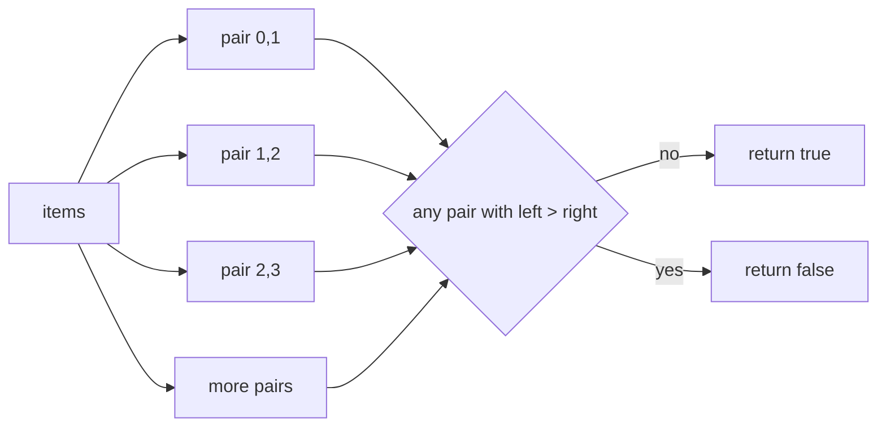
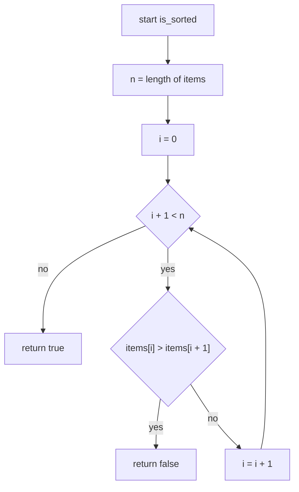
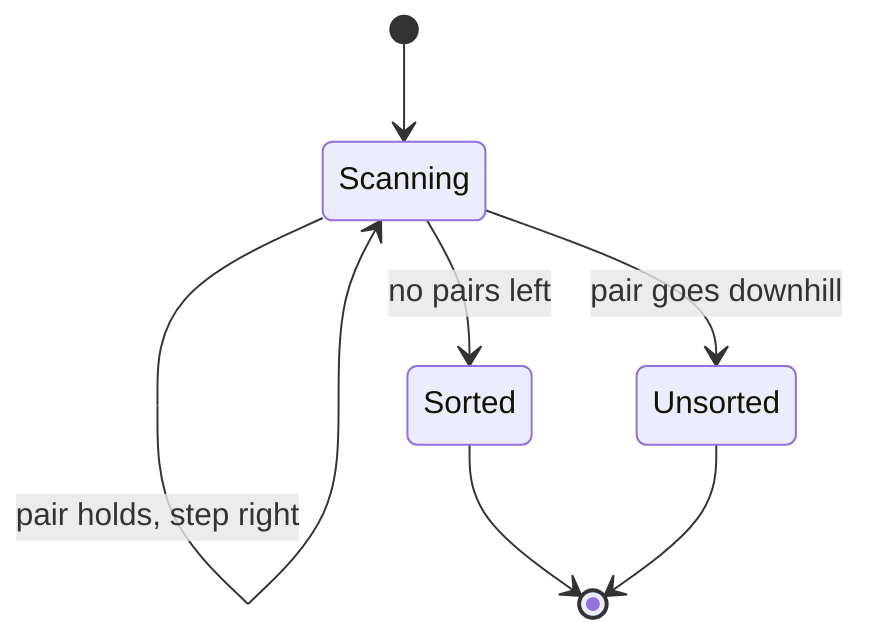
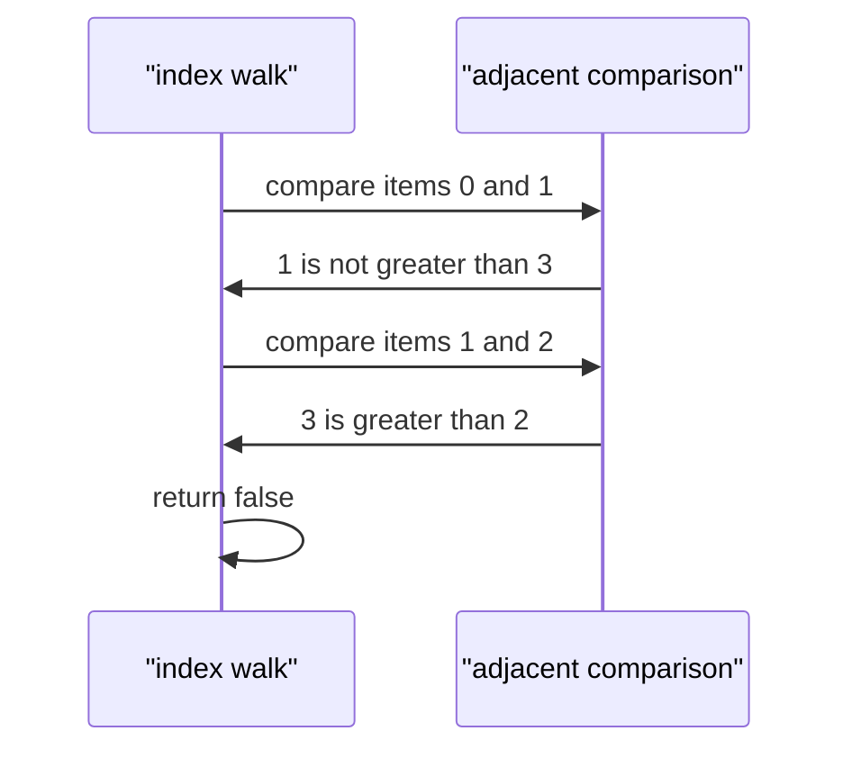

# 019 — Check if array is sorted (ascending).

> **Tier:** Beginner · **CTCI chapter:** Ch 10 — Sorting and Searching
> **Task spec:** [019-check-if-array-is-sorted-ascending.md](../../../tasks/beginner/019-check-if-array-is-sorted-ascending.md)
> **Solutions:** [Python](../../../solutions/python/beginner/019-check-if-array-is-sorted-ascending/solution.py) ·
> [Java](../../../solutions/java/beginner/019-check-if-array-is-sorted-ascending/Solution.java) ·
> [JavaScript](../../../solutions/javascript/beginner/019-check-if-array-is-sorted-ascending/solution.js) ·
> [C#](../../../solutions/csharp/beginner/019-check-if-array-is-sorted-ascending/Solution.cs)

## 1. Problem restatement

**Input:** a sequence `items` of comparable values, in any order, of any length.

**Output:** `true` if the sequence is sorted in **non-decreasing** order, `false` otherwise. The
function answers a yes/no question — it never returns an index or a repaired array, and it never
modifies the input.

"No decreasing" is the important half of the definition: equal neighbours are allowed. That is
exactly what the four solution files implement, using a strict `>` test in the loop and a
non-strict `<=` test in the Python one-liner:

| Call | Result | Why |
| --- | --- | --- |
| `is_sorted([])` | `true` | vacuously sorted: there are no adjacent pairs to violate |
| `is_sorted([1])` | `true` | a single element has no neighbour (Java asserts this row) |
| `is_sorted([1, 2, 2, 3])` | `true` | the duplicate `2` is non-decreasing, not a violation |
| `is_sorted([1, 3, 2])` | `false` | the pair `3 > 2` is a descent |
| `is_sorted([3, 2, 1])` | `false` | the very first pair already fails |

There is no second output and no error path. The only design decision the task forces is whether
"sorted" means strictly increasing or non-decreasing; the shipped assertions answer it — `[1, 2, 2, 3]`
must return `true`.

## 2. Intuition

The naive approach is to *prove* sortedness by construction: copy the array, sort the copy, and
check the copy equals the original. That is correct, and it is what many people write first. It
costs O(n log n) time for the sort and O(n) extra space for the copy — and it does all that work
even for an array that is obviously unsorted at index 0.

The insight that removes both costs is that sortedness is a **local** property. Because `≤` is
transitive, the chain

    items[0] ≤ items[1] ≤ ... ≤ items[n-1]

holds if and only if every *adjacent* pair holds. You never need to compare elements that are far
apart — the neighbours carry all the information. So the question "is this array sorted?" reduces
to "does any adjacent pair go downhill?", which is a single scan with a one-comparison body.

The second half of the insight is **early exit**. A sorted array forces you to look at all `n - 1`
pairs, but an unsorted one usually fails fast: `[3, 2, 1]` is rejected after one comparison. That
asymmetry is why the best case is O(1) while the worst is O(n).



Note what the picture omits: there is no comparison between `items[0]` and `items[3]`. That arrow
does not exist because transitivity already answers it.

## 3. Algorithm

The loop form is what Java, JavaScript and C# implement:

1. Walk `i` from `0` while `i + 1 < n`.
2. Compare `items[i]` with `items[i + 1]`.
3. If `items[i] > items[i + 1]`, return `false` immediately.
4. If the walk finishes without a descent, return `true`.

```text
procedure is_sorted(items)
    n ← length(items)
    i ← 0
    while i + 1 < n do
        if items[i] > items[i + 1] then
            return false
        end
        i ← i + 1
    end
    return true
end
```

The Python file writes the same scan as a comprehension over the `n - 1` adjacent pairs:

```text
procedure is_sorted_comprehension(items)
    pairs ← every i from 0 to length(items) - 2
    return true only if items[i] <= items[i + 1] for all of those i
end
```

The comprehension is shorter but loses the early exit: it must evaluate every pair even when the
descent is the first one. Both are O(n) worst case; only the loop version can be O(1) on a
descending input. The bound `i + 1 < n` (rather than `i < n`) is what keeps the empty and
single-element cases from ever indexing out of range.



Read as a machine, the scan has only two outcomes and no memory of the past:



## 4. Worked example

Trace `is_sorted([1, 3, 2])`. `n = 3`, so there are two pairs to consider and the second one fails:

| Step | `i` | `items[i]` | `items[i + 1]` | comparison | action |
| --- | --- | --- | --- | --- | --- |
| 1 | 0 | 1 | 3 | `1 > 3` false | step right |
| 2 | 1 | 3 | 2 | `3 > 2` true | return `false` |

The scan stops after the second comparison; the pair `1` and `2` is never examined, and neither
is anything beyond index 2. That is the early exit paying off.



The sorted case behaves differently — every pair must be cleared, so the work is maximal:

| Input | pairs compared | verdict |
| --- | --- | --- |
| `[]` | 0 | `true` (vacuous) |
| `[1]` | 0 | `true` (vacuous) |
| `[1, 2, 2, 3]` | 3 | `true` |
| `[1, 3, 2]` | 2 of 2 | `false` |
| `[3, 2, 1]` | 1 of 2 | `false` |

Rows 3 and 5 are the two extremes of the same loop: the sorted array pays for all `n - 1`
comparisons, the reversed array pays for one.

## 5. Complexity

Let `n` be the length of `items`.

| Measure | Bound | Why it holds |
| --- | --- | --- |
| Time, best | O(1) | `items[0] > items[1]` already returns `false` — as in `[3, 2, 1]` |
| Time, average | O(n) | a random array has to be scanned until its first descent |
| Time, worst | O(n) | a sorted array (or one that is sorted up to the last pair) is scanned completely |
| Space, extra | O(1) | only `i`, `n` and the two compared values are live |
| Space, input | untouched | all four files read the array; none writes to it |
| Alternative: sort a copy and compare | O(n log n) time, O(n) space | the copy is needed because sorting is destructive |
| Recursion depth | O(1) | the scan is iterative; the Python comprehension is a bounded generator |

The best case deserves emphasis, because it is a genuine O(1) and not an average-case claim: one
comparison decides `[3, 2, 1]`, `[2, 1, 3]`, and any other array whose first two elements are out
of order. In interview terms, "check sorted" is a *witness* search — return as soon as you have a
counterexample.

## 6. Pitfalls and edge cases

- **Empty array.** `[]` returns `true` in all four files. The loop bound `i + 1 < 0` is false
  immediately, and the Python comprehension iterates over an empty range. Java asserts this row.
- **Single element.** `[1]` returns `true` for the same reason: there is no pair to test. This is
  the case people over-engineer by adding an explicit `if n < 2: return true` guard; the loop
  bound already covers it.
- **Duplicates.** `[1, 2, 2, 3]` is sorted, because the test is non-strict (`items[i] > items[i + 1]`
  in the loop, `<=` in the comprehension). If the question meant *strictly* increasing, the same
  code with `>=` would reject every duplicate — decide which one the interviewer asked for.
- **Descending input.** Rejected at the first comparison, not at the end. Do not assume a `false`
  answer means a full scan happened.
- **The two indexing styles must agree.** The Python file compares `items[i] <= items[i + 1]` for
  `i` in `range(len(items) - 1)`; the others compare `items[i]` with `items[i + 1]` while
  `i + 1 < n`. Both ranges are the same `n - 1` pairs; a missing `- 1` in either form indexes one
  past the end.
- **Comparability.** All four rely on the language's native comparison. Mixing incomparable types
  throws in Python and yields `false` comparisons in JavaScript, so a JavaScript array like
  `[1, "two"]` is silently reported as *unsorted* rather than as an error.
- **Floating point.** `NaN` compares `false` against everything, so an array containing `NaN`
  reports *sorted* even though it has no meaningful order. None of the files guard against this.

## 7. Variants and follow-ups

- **Merge instead of test.** [020-merge-two-sorted-arrays-into-a-sorted-array.md](../../../tasks/beginner/020-merge-two-sorted-arrays-into-a-sorted-array.md)
  assumes the sortedness this task checks for and exploits it with a two-pointer walk.
- **One pass, two trackers.** [023-find-second-largest-element-in-an-array.md](../../../tasks/beginner/023-find-second-largest-element-in-an-array.md)
  is the same "single scan, constant state" shape with `best` and `second` instead of a verdict.
- **Rotation preserves sortedness up to one pivot.**
  [021-rotate-array-right-by-k-positions-create-new-array.md](../../../tasks/beginner/021-rotate-array-right-by-k-positions-create-new-array.md)
  and [022-rotate-array-in-place-by-k-positions.md](../../../tasks/beginner/022-rotate-array-in-place-by-k-positions.md)
  produce arrays that are sorted except at exactly one wrap point — which is precisely what a
  "find the rotation point" variation of this task would look for.
- **Sortedness as a precondition.**
  [027-find-missing-number-in-1-n-given-n-1-elements.md](../../../tasks/beginner/027-find-missing-number-in-1-n-given-n-1-elements.md)
  never even needs the order, which is a reminder that checking sortedness is only worth doing when
  a faster algorithm depends on it.
- The chapter walkthrough in [Sorting and Searching](../../ctci/10-sorting-and-searching.md)
  places this check at the front of the chapter's searching half.

## 8. Check yourself

1. Why is the empty array considered sorted rather than a special error case?

<details><summary>Show answer</summary>

Because "sorted" is defined as "no adjacent pair violates the order". With zero elements there are
zero pairs, so the condition holds vacuously. Both the loop bound `i + 1 < n` and the
`range(len(items) - 1)` comprehension agree, and all four files assert it.

</details>

2. `is_sorted([1, 2, 2, 3])` is `true`. What single character change would make the function reject
   duplicates, and what would `[1, 2, 2, 3]` then return?

<details><summary>Show answer</summary>

Change the descent test from `items[i] > items[i + 1]` to `items[i] >= items[i + 1]` (equivalently,
the comprehension's `<=` to `<`). That switches the contract from non-decreasing to strictly
increasing, and `[1, 2, 2, 3]` would return `false` because of the pair `2, 2`.

</details>

3. What is the best-case time, and on which input does it happen?

<details><summary>Show answer</summary>

O(1): the first adjacent pair is already a descent, so the function returns `false` after a single
comparison. Any array whose first two elements are out of order does it, e.g. `[3, 2, 1]` or
`[5, 1, 2, 3, 4]`.

</details>

4. Why is sorting a copy and comparing it O(n log n) rather than O(n), given the comparison itself
   is a single pass?

<details><summary>Show answer</summary>

Because the sort dominates: an array is not sorted in linear time by comparison-based sorting, the
best bound is O(n log n). The final `eq`/`SequenceEqual` pass is O(n) and irrelevant next to it.
The adjacent-pair scan skips the sort entirely.

</details>

5. Does the scan ever compare non-adjacent elements?

<details><summary>Show answer</summary>

No. It only ever touches `items[i]` and `items[i + 1]`. This is sufficient because `≤` is
transitive: if all `n - 1` adjacent pairs hold, the whole chain holds by induction, so distant
comparisons would add information that cannot change the answer.

</details>
