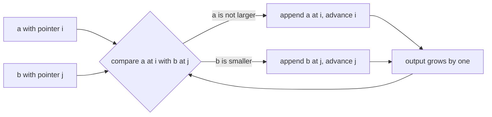
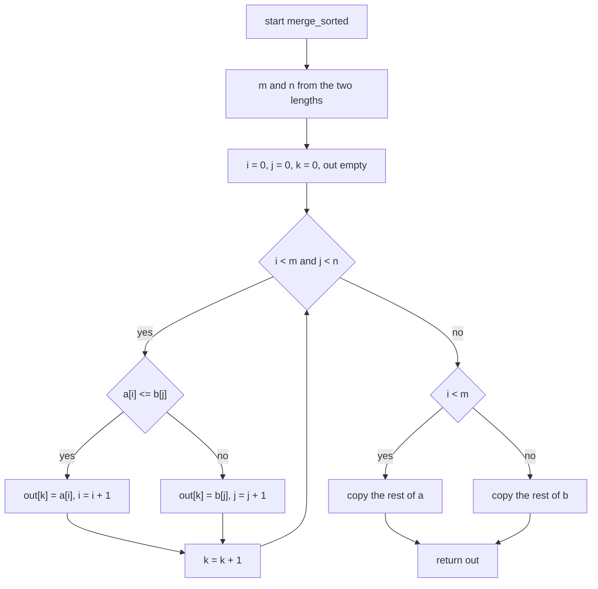
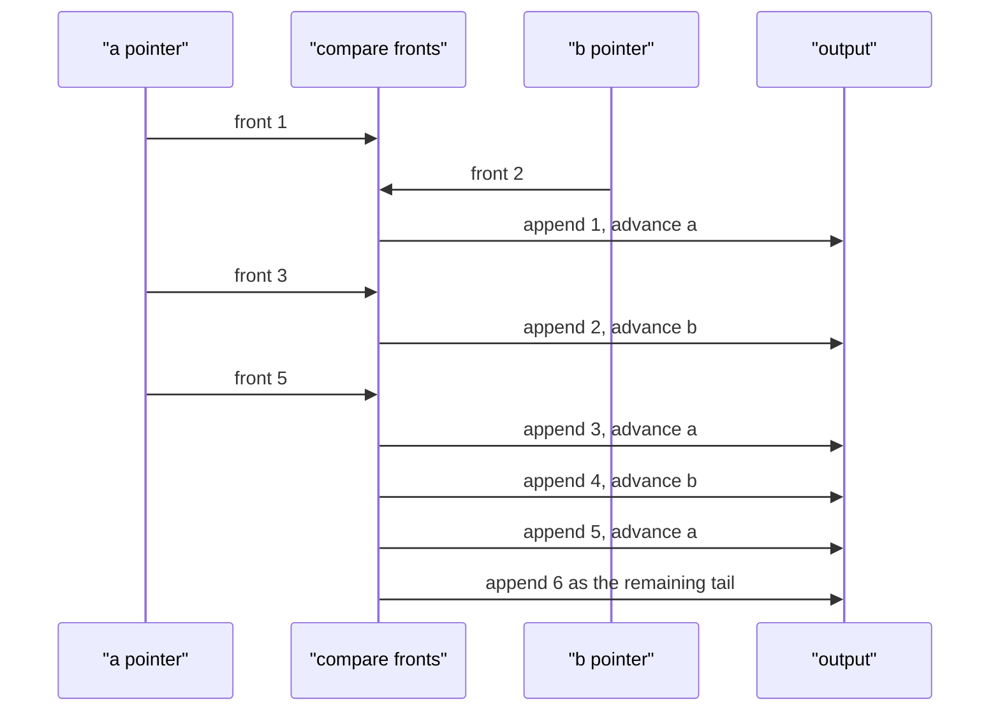

# 020 — Merge two sorted arrays into a sorted array.

> **Tier:** Beginner · **CTCI chapter:** Ch 10 — Sorting and Searching
> **Task spec:** [020-merge-two-sorted-arrays-into-a-sorted-array.md](../../../tasks/beginner/020-merge-two-sorted-arrays-into-a-sorted-array.md)
> **Solutions:** [Python](../../../solutions/python/beginner/020-merge-two-sorted-arrays-into-a-sorted-array/solution.py) ·
> [Java](../../../solutions/java/beginner/020-merge-two-sorted-arrays-into-a-sorted-array/Solution.java) ·
> [JavaScript](../../../solutions/javascript/beginner/020-merge-two-sorted-arrays-into-a-sorted-array/solution.js) ·
> [C#](../../../solutions/csharp/beginner/020-merge-two-sorted-arrays-into-a-sorted-array/Solution.cs)

## 1. Problem restatement

**Input:** two sequences `a` and `b`, each already sorted in non-decreasing order. Either may be
empty and neither may be modified.

**Output:** a new sequence of length `len(a) + len(b)` holding every element of both inputs in
non-decreasing order. Equal elements are all kept — this is a merge, not a union.

The assertions shipped by the four files define the contract:

| Call | Result | Why |
| --- | --- | --- |
| `merge_sorted([1, 3, 5], [2, 4, 6])` | `[1, 2, 3, 4, 5, 6]` | the canonical interleaving |
| `merge_sorted([], [1, 2])` | `[1, 2]` | one side exhausts immediately |
| `merge_sorted([2, 2], [2])` | `[2, 2, 2]` | ties are duplicated, never dropped |
| `merge_sorted([], [])` | `[]` | both empty (asserted by the Python file) |

All four files return a brand-new array; none writes into `a` or `b`, and none sorts anything. The
sortedness of the inputs is a *precondition*, not something the algorithm verifies — exactly the
assumption that [019-check-if-array-is-sorted-ascending.md](../../../tasks/beginner/019-check-if-array-is-sorted-ascending.md)
tests for.

## 2. Intuition

The naive approach is to concatenate and sort:

```text
out ← a followed by b
sort out
return out
```

That is correct for any inputs, but it throws away the one thing we were told: both halves are
already sorted. Comparison sorting costs O((m + n) log(m + n)) time, and the log factor is being
paid to rediscover order that is already present.

The insight is that two sorted sequences can be merged by a **two-pointer walk**. Keep one index
per input. At every step, the smallest remaining element of the merge must be the smaller of the
two *fronts* — you never need to look further into either array, because any element behind a
front is at least as large as the front. Append that smaller front, advance only the pointer that
produced it, and repeat.

Three things follow from that single paragraph:

- Each element is appended exactly once, so the walk is O(m + n).
- Ties must be broken deterministically; all four files use `a[i] <= b[j]`, so on a tie the element
  from `a` is taken first. That makes the merge **stable** with respect to the first input.
- When one side runs out, the other's remainder is already sorted, so it can be copied wholesale
  instead of compared element by element. Python does that with `extend(a[i:])`, Java and C# with
  a trailing `while`, JavaScript with a trailing `while` and `push`.



The invariant the picture encodes: **everything already in the output is ≤ every element still
waiting in either input.** That is why the algorithm can be greedy and never backtrack.

## 3. Algorithm

1. Create an empty output of capacity `m + n` (a growable list in Python and JavaScript, a
   preallocated array in Java and C#).
2. Set `i = 0`, `j = 0`, `k = 0`.
3. While both `i < m` and `j < n`:
   - if `a[i] <= b[j]`, write `a[i]` to the output, then advance `i`;
   - otherwise write `b[j]` to the output, then advance `j`;
   - advance `k` in both cases.
4. Copy whatever remains of `a` into the output, then whatever remains of `b`.
5. Return the output.

```text
procedure merge_sorted(a, b)
    m ← length(a)
    n ← length(b)
    out ← new sequence with capacity m + n
    i ← 0
    j ← 0
    k ← 0
    while i < m and j < n do
        if a[i] <= b[j] then
            out[k] ← a[i]
            i ← i + 1
        else
            out[k] ← b[j]
            j ← j + 1
        end
        k ← k + 1
    end
    while i < m do
        out[k] ← a[i]
        i ← i + 1
        k ← k + 1
    end
    while j < n do
        out[k] ← b[j]
        j ← j + 1
        k ← k + 1
    end
    return out
end
```

Step 4 is not an optimisation detail — it is what makes the loop terminate with exactly `m + n`
elements. Only one of the two trailing loops can ever execute, because the main loop exits the
moment either pointer reaches its end. Java and C# preallocate `new int[a.length + b.length]` and
fill it by index, which is why they carry the extra `k`; Python and JavaScript append to a
growing container and drop `k` entirely.



## 4. Worked example

Trace `merge_sorted([1, 3, 5], [2, 4, 6])`. Every row advances exactly one pointer:

| Step | `i` | `j` | `a[i]` | `b[j]` | comparison | written | `out` |
| --- | --- | --- | --- | --- | --- | --- | --- |
| 1 | 0 | 0 | 1 | 2 | `1 <= 2` | `a[0] = 1` | `[1]` |
| 2 | 1 | 0 | 3 | 2 | `3 <= 2` false | `b[0] = 2` | `[1, 2]` |
| 3 | 1 | 1 | 3 | 4 | `3 <= 4` | `a[1] = 3` | `[1, 2, 3]` |
| 4 | 2 | 1 | 5 | 4 | `5 <= 4` false | `b[1] = 4` | `[1, 2, 3, 4]` |
| 5 | 2 | 2 | 5 | 6 | `5 <= 6` | `a[2] = 5` | `[1, 2, 3, 4, 5]` |
| 6 | 3 | 2 | — | 6 | `i = m` | `b[2] = 6` | `[1, 2, 3, 4, 5, 6]` |

Six writes for six elements: the main loop ran five times and the trailing `copy the rest of b`
loop ran once. Note step 6 — the main loop stops the instant `i` reaches `m`, and the leftover of
`b` is appended without a single comparison.



The tie rule shows up on the duplicate input `[2, 2]` merged with `[2]`:

| Step | fronts | comparison | written | source |
| --- | --- | --- | --- | --- |
| 1 | `2` vs `2` | `2 <= 2` true | 2 | `a`, `i = 1` |
| 2 | `2` vs `2` | `2 <= 2` true | 2 | `a`, `i = 2`, `a` exhausted |
| 3 | — vs `2` | tail copy | 2 | `b` |

Three elements in, three elements out, and the `b` element comes last purely because of the `<=`
tie break.

## 5. Complexity

Let `m = len(a)` and `n = len(b)`.

| Measure | Bound | Why it holds |
| --- | --- | --- |
| Time, best | O(min(m, n)) | one input exhausts after `min(m, n)` comparisons, then the rest is a bulk copy |
| Time, average | O(m + n) | each iteration consumes exactly one element, and every element is written once |
| Time, worst | O(m + n) | the main loop plus the two trailing copies never exceed the total length |
| Space, output | O(m + n) | the result is a new sequence holding both inputs |
| Space, extra | O(1) | two indices (three in Java and C#) regardless of input size |
| Alternative: concatenate then sort | O((m + n) log(m + n)) time, O(m + n) space | ignores the sortedness precondition |
| Recursion depth | O(1) | iterative in all four files |

The extra-space column applies to the *scratch* memory, not the result: Python's `out = []` and
JavaScript's `out = []` grow to length `m + n`, but they grow by appending, so no second copy of
the data is needed beyond the output itself. Java and C# allocate exactly `m + n` slots up front,
which is the tightest possible bound and the reason their assertions compare `Arrays.equals` /
`string.Join` on a fixed-size array.

## 6. Pitfalls and edge cases

- **One side empty.** `merge_sorted([], [1, 2])` never enters the main loop and goes straight to
  the trailing copy. All four files assert this row; the Python file also asserts both sides empty.
- **Both empty.** The output is `[]`. This is the only input where the result is empty, and it
  needs no special case.
- **Duplicates across inputs.** `[2, 2]` vs `[2]` gives `[2, 2, 2]`. Because the tie break is `<=`,
  elements of `a` come first; a `<` would have flipped the order, which matters if the elements are
  records being stably merged rather than plain integers.
- **Duplicates inside one input.** Harmless: the fronts simply compare equal to each other.
- **Never lose the tail.** Forgetting the trailing copies is the classic bug — for
  `[1, 3, 5]` vs `[2, 4, 6]` it silently drops the `6` and returns a five-element answer.
- **Preallocated arrays in Java and C#.** The output is sized `a.length + b.length` and filled by
  index `k`; an off-by-one in `k` leaves a zero in the array rather than shortening it.
- **Total length assumption.** `k` reaches `m + n` exactly when the main loop plus one trailing
  loop have run, so exactly one trailing loop may execute. Writing both unconditionally is safe
  only because the second one is empty.
- **Stability is the only ordering choice.** When fronts tie, either order yields a sorted array;
  the tests pin the choice, so do not "optimise" it away.
- **Overflow of the index sum.** `m + n` in Java and C# is an `int`, so the preallocation overflows
  only for arrays larger than `Integer.MAX_VALUE` elements — impossible for real arrays, but worth
  naming if the interviewer asks about limits.

## 7. Variants and follow-ups

- **Merge into a pre-sized buffer, from the back.** Merge-two-sorted-arrays where the first array
  has trailing free slots is the same walk run right-to-left, which avoids moving the tail twice.
- **Check the precondition.**
  [019-check-if-array-is-sorted-ascending.md](../../../tasks/beginner/019-check-if-array-is-sorted-ascending.md)
  is the O(n) test that the merge silently assumes; combining them is a defensive version of this
  task.
- **Merge as a sorting subroutine.** This two-pointer step is the merge of merge sort, and it is
  the reason the chapter puts this task in [Sorting and Searching](../../ctci/10-sorting-and-searching.md)
  rather than with the array gymnastics.
- **Two pointers on a single array.**
  [022-rotate-array-in-place-by-k-positions.md](../../../tasks/beginner/022-rotate-array-in-place-by-k-positions.md)
  runs a two-pointer walk in opposite directions on one buffer, and
  [024-remove-element-at-index-from-array-in-place.md](../../../tasks/beginner/024-remove-element-at-index-from-array-in-place.md)
  shifts one range instead of merging two.
- **Picking the top two of a stream.**
  [023-find-second-largest-element-in-an-array.md](../../../tasks/beginner/023-find-second-largest-element-in-an-array.md)
  keeps two trackers with the same "only the current front matters" argument.

## 8. Check yourself

1. Why does the merge never need to compare `a[i]` with anything other than `b[j]`?

<details><summary>Show answer</summary>

Because both inputs are sorted: every element of `a` before index `i` has already been written,
and every element at or after `i` is at least `a[i]`. So the smallest unwritten element of the
whole merge is `min(a[i], b[j])`. Looking deeper into either array can only find larger values.

</details>

2. What does the tie break `a[i] <= b[j]` decide, and what changes if you write `<`?

<details><summary>Show answer</summary>

It decides the order of equal elements: with `<=` the element from `a` is emitted first, which
makes the merge stable with respect to `a`. With `<` the element from `b` goes first instead. Both
produce a correctly sorted array, but the assertion on `[2, 2]` merged with `[2]` would still pass
while a record-level stability test would fail.

</details>

3. Why is the time bound O(m + n) and not O(m · n)?

<details><summary>Show answer</summary>

Because each loop iteration advances one pointer by exactly one, and no element is ever revisited.
The main loop runs at most `min(m, n)` times, and the two trailing copies together move the
remaining `m + n - 2 · min(m, n)` elements once each. Total work is proportional to the number of
elements, not to a product.

</details>

4. Which single line, if deleted, breaks the function on `merge_sorted([1, 3, 5], [2, 4, 6])`, and
   what would the result be?

<details><summary>Show answer</summary>

The trailing copy of the leftover of `b`. Without it, the last comparison leaves `6` unread and
the function returns `[1, 2, 3, 4, 5]`. Deleting the trailing copy of `a` instead breaks the
symmetric case, e.g. `merge_sorted([1], [])`.

</details>

5. The inputs are assumed sorted. What does the algorithm do on `merge_sorted([3, 1], [2])`, and
   why is that not a bug in this task?

<details><summary>Show answer</summary>

It returns `[2, 3, 1]`, which is not sorted. The algorithm is *greedy and local*: it trusts that
`a[i]` is the smallest unwritten element of `a`, which is false when `a` is `[3, 1]`. Violating the
precondition violates the output guarantee; verifying the precondition is a separate O(m + n)
check (see task 019), and the task spec does not ask for it.

</details>
