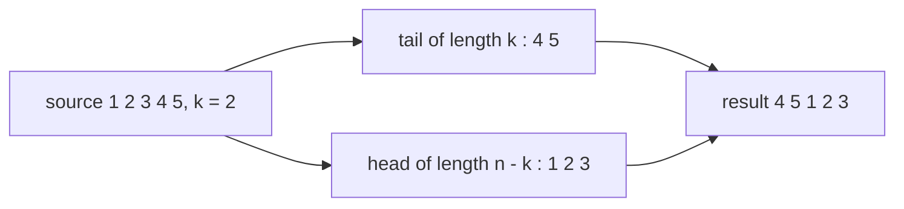
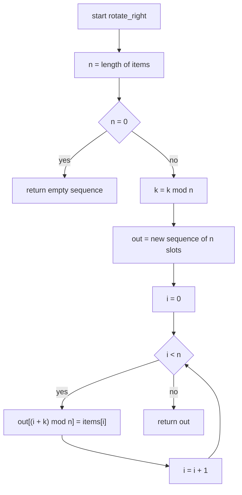
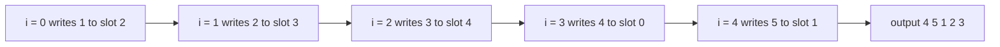

# 021 — Rotate array right by k positions (create new array).

> **Tier:** Beginner · **CTCI chapter:** Ch 1 — Arrays and Strings
> **Task spec:** [021-rotate-array-right-by-k-positions-create-new-array.md](../../../tasks/beginner/021-rotate-array-right-by-k-positions-create-new-array.md)
> **Solutions:** [Python](../../../solutions/python/beginner/021-rotate-array-right-by-k-positions-create-new-array/solution.py) ·
> [Java](../../../solutions/java/beginner/021-rotate-array-right-by-k-positions-create-new-array/Solution.java) ·
> [JavaScript](../../../solutions/javascript/beginner/021-rotate-array-right-by-k-positions-create-new-array/solution.js) ·
> [C#](../../../solutions/csharp/beginner/021-rotate-array-right-by-k-positions-create-new-array/Solution.cs)

## 1. Problem restatement

**Input:** a sequence `items` of length `n` and a non-negative integer `k`.

**Output:** a **new** sequence of the same length in which every element has moved `k` places to
the right, with the elements that fall off the right end reappearing at the left. The input is
never modified, so the caller keeps the original order as well as the rotated one.

The contract is fixed by the assertions in the four files:

| Call | Result | Why |
| --- | --- | --- |
| `rotate_right([1, 2, 3, 4, 5], 2)` | `[4, 5, 1, 2, 3]` | the last two elements wrap to the front |
| `rotate_right([1, 2], 3)` | `[2, 1]` | `3 mod 2 = 1`, so `k` wraps before anything moves |
| `rotate_right([], 5)` | `[]` | an empty array has nothing to rotate (asserted by Python) |
| `rotate_right([1, 2, 3], 0)` | `[1, 2, 3]` | zero rotation returns an equal copy, not the input |

Two details of *this* variant matter as much as the rotation itself. First, `k` can be **larger
than `n`**, and rotating by `n` is the identity, so only `k mod n` is meaningful — the second row
above asserts it. Second, this is the "create new array" half of the rotation pair: it trades O(n)
memory for the simplicity of writing straight into a fresh buffer, unlike
[022-rotate-array-in-place-by-k-positions.md](../../../tasks/beginner/022-rotate-array-in-place-by-k-positions.md),
which reuses the caller's buffer.

## 2. Intuition

The naive approach is to move elements one step at a time, right by one, `k` times:

```text
repeat k times
    last ← items[n - 1]
    for i ← n - 1 down to 1 do
        items[i] ← items[i - 1]
    end
    items[0] ← last
end
```

It works, but it is **O(n · k)** — for `k` near `n` that is quadratic, and it is `k` full passes over
data that could be moved once. Worse, `k` is usually reduced modulo `n` anyway, so the loop is
doing redundant work by construction.

The insight is that a rotation is not a sequence of shifts at all; it is a **permutation with a
closed form**. Element at index `i` ends up at

    destination(i) = (i + k) mod n

and, read the other way round, slot `d` receives the element from

    source(d) = (d - k + n) mod n

Both formulas are pure arithmetic on the index, so every element is written exactly once and the
whole rotation is a single pass. Java and C# implement the first form directly
(`out[(i + k) % items.length] = items[i]`). Python and JavaScript express the same permutation as
two slices — the last `k` elements followed by the first `n - k`:

    [ 1 2 3 4 5 ]   k = 2
    last 2: 4 5        first 3: 1 2 3
    result: 4 5 1 2 3

The slice form is the "old array copied to the new one in two pieces" reading; the modular form is
the "each element computed its own destination" reading. They produce identical output, which is
why the two styles can coexist in one repository.



## 3. Algorithm

The index-mapping form used by Java and C#:

1. If `items` is empty, return a new empty sequence immediately — `k mod 0` is undefined.
2. Reduce `k` modulo `n` so it lies in `0 .. n - 1`.
3. Allocate an output of `n` slots.
4. For each `i` from `0` to `n - 1`, write `items[i]` into slot `(i + k) mod n`.
5. Return the output.

```text
procedure rotate_right(items, k)
    n ← length(items)
    if n = 0 then
        return a new empty sequence
    end
    k ← k mod n
    out ← new sequence with n slots
    for i ← 0 to n - 1 do
        out[(i + k) mod n] ← items[i]
    end
    return out
end
```

The slice form used by Python and JavaScript is shorter because the host language does the index
arithmetic:

```text
procedure rotate_right_slices(items, k)
    n ← length(items)
    if n = 0 then
        return a new empty sequence
    end
    k ← k mod n
    if k = 0 then
        return a copy of items
    end
    return the last k elements of items followed by the first n - k elements
end
```

The `k = 0` branch exists because a slice expressed with a negation would address
`items[0 .. -1]`-style ranges; after `k ← k mod n`, `k = 0` means "the tail is the whole array and
the head is empty", so returning a copy is both correct and unambiguous. Note that both forms copy
every element: this is the variant whose whole point is the fresh output buffer.



## 4. Worked example

Trace `rotate_right([1, 2, 3, 4, 5], 2)`. `n = 5`, `k = 2`, so slot `(i + 2) mod 5` receives
`items[i]`:

| Step | `i` | `items[i]` | destination `(i + 2) mod 5` | output after the write |
| --- | --- | --- | --- | --- |
| start | — | — | — | `[_, _, _, _, _]` |
| 1 | 0 | 1 | 2 | `[_, _, 1, _, _]` |
| 2 | 1 | 2 | 3 | `[_, _, 1, 2, _]` |
| 3 | 2 | 3 | 4 | `[_, _, 1, 2, 3]` |
| 4 | 3 | 4 | 0 | `[4, _, 1, 2, 3]` |
| 5 | 4 | 5 | 1 | `[4, 5, 1, 2, 3]` |

The first three writes land in the tail of the output, and the last two — the elements that
"fall off" the right — wrap around to slots 0 and 1. That wrap is nothing more than the modulo
operation; there is no explicit moving of a tail block.



The modulo reduction is worth tracing on its own, because it is the case people forget:

| Input | `n` | `k` given | `k mod n` | result |
| --- | --- | --- | --- | --- |
| `[1, 2]` | 2 | 3 | 1 | `[2, 1]` |
| `[1, 2]` | 2 | 2 | 0 | `[1, 2]` |
| `[1, 2]` | 2 | 4 | 0 | `[1, 2]` |
| `[1, 2, 3]` | 3 | 7 | 1 | `[3, 1, 2]` |

Rotating by a multiple of `n` is the identity, so the second and third rows must return the array
unchanged — with the slice form that is exactly the `k = 0` branch.

## 5. Complexity

Let `n` be the length of `items`.

| Measure | Bound | Why it holds |
| --- | --- | --- |
| Time, best | O(n) | every element must be copied into the new array, even for `k = 0` |
| Time, average | O(n) | one modulo and one write per element |
| Time, worst | O(n) | the single loop runs exactly `n` times; `k` is reduced first, so it never multiplies the work |
| Space, output | O(n) | the returned array is the answer |
| Space, extra | O(n) | the output buffer *is* the extra space — this variant cannot be O(1) |
| Alternative: shift one step at a time | O(n · k) time, O(1) extra | correct but quadratic when `k` is not reduced |
| Alternative: three reversals in place | O(n) time, O(1) extra | see task 022 |
| Recursion depth | O(1) | no recursion anywhere in the four files |

The best case is O(n) rather than O(1) here, unlike task 019's early exit, because the output is a
full copy: even the identity rotation has to materialise `n` elements. The only way to beat that is
to stop returning a new array, which is precisely the trade task 022 makes.

## 6. Pitfalls and edge cases

- **Empty input.** `n = 0` makes `k mod n` undefined, so every file tests for it first. Python
  returns `[]`, Java and C# return `new int[0]`, JavaScript returns a fresh `[]`.
- **`k = 0`.** Returns an equal copy. The slice form needs its own branch (otherwise the head slice
  is expressed with a zero-length range); the modular form needs none, because `(i + 0) mod n = i`.
- **`k >= n`.** Reduced by `k ← k mod n` before anything else. Without that line the modular form
  still computes the right answer — `(i + 3) mod 2` is a valid index — but the slice form would
  slice past the end of the array, and in Java the destination `i + k` would be out of range
  before the modulo is even applied.
- **`k > n` combined with an unchecked index.** This is the one arithmetic bug that *does* crash:
  `out[i + k] = items[i]` without the modulo throws for `k = 3`, `n = 2`.
- **Input not modified.** All four files return a new sequence; the caller's array keeps its
  original order. Assertions compare the *result*, so an in-place implementation would pass the
  value tests but fail the contract.
- **Negative `k`.** Not part of the contract. In Java and C# a negative `k` would produce a negative
  remainder and an invalid index; the task defines `k` as a non-negative count.
- **Element identity vs equality.** The rotation is a positional move; equal values in different
  slots still trade places. Nothing in the algorithm compares elements at all — the only
  operations are indices.
- **Duplicates.** Harmless: `[1, 1, 2], k = 1` gives `[2, 1, 1]`. No deduplication happens here,
  unlike [004-remove-duplicates-from-an-array-create-new-array.md](../../../tasks/beginner/004-remove-duplicates-from-an-array-create-new-array.md).

## 7. Variants and follow-ups

- **The in-place twin.** [022-rotate-array-in-place-by-k-positions.md](../../../tasks/beginner/022-rotate-array-in-place-by-k-positions.md)
  performs the identical permutation with three reversals and O(1) extra space — the natural
  follow-up question once this version works.
- **The primitive underneath.** Rotation by `n - 1` is a reversal; the two-pointer swap loop behind
  every reversal is the subject of
  [001-reverse-a-string.md](../../../tasks/beginner/001-reverse-a-string.md), and reversal is also
  the tool used by the in-place variant.
- **Rotation as a permutation.** The same "compute the destination index from the source index"
  idea, without the wrap, appears in the compaction step of
  [024-remove-element-at-index-from-array-in-place.md](../../../tasks/beginner/024-remove-element-at-index-from-array-in-place.md),
  where each surviving element moves to `i - 1`.
- **Sortedness after a rotation.** A rotated sorted array is sorted except at one wrap point, so
  the adjacency test in
  [019-check-if-array-is-sorted-ascending.md](../../../tasks/beginner/019-check-if-array-is-sorted-ascending.md)
  fails on exactly one pair — the seed of the "search in a rotated sorted array" variations.
- The chapter walkthrough in [Arrays and Strings](../../ctci/01-arrays-and-strings.md) groups this
  task with reversal and compaction as the Ch 1 index gymnastics.

## 8. Check yourself

1. Why must `k` be reduced modulo `n` before the loop, and what happens in the Java file if it is
   not?

<details><summary>Show answer</summary>

Because rotation by `n` is the identity and only `k mod n` affects the result. In the Java file the
destination index is `(i + k) % items.length`, so the modulo is applied at every write anyway — but
without the earlier `k %= items.length` a `k` of, say, `2 · n` still works, while the slice-based
Python and JavaScript versions would slice out of range. The reduction also documents the
equivalence class of rotations.

</details>

2. `rotate_right([1, 2], 3)` returns `[2, 1]`. What are `n`, `k mod n`, and the destination of
   `items[0]`?

<details><summary>Show answer</summary>

`n = 2`, `k mod n = 1`, so `items[0] = 1` goes to slot `(0 + 1) mod 2 = 1` and `items[1] = 2` goes
to slot `(1 + 1) mod 2 = 0`. The result is `[2, 1]`.

</details>

3. Why is the best-case time O(n) instead of O(1), even for `k = 0`?

<details><summary>Show answer</summary>

Because the function's contract is to *return a new array*. Even the identity rotation has to
produce `n` elements that are distinct from the input buffer, so at least `n` writes happen. Only
an in-place variant (task 022) can return in O(1) for `k = 0`.

</details>

4. A colleague implements rotation by shifting right one step at a time, `k` times. Give the
   complexity and one input where it hurts.

<details><summary>Show answer</summary>

O(n · k) time and O(1) extra space. With `n = 100000` and `k = 99999` that is roughly 10¹⁰ element
moves, whereas the single-pass form does 100000 writes. Reducing `k` modulo `n` does not help much
there, because `k mod n` is still `n - 1`.

</details>

5. Which of the two implementations is more useful if the array contains records rather than
   numbers?

<details><summary>Show answer</summary>

They behave identically — a rotation is a positional permutation and never inspects the elements,
so both move whole records without comparing or copying fields. The preallocated-array form
(Java, C#) may be marginally cheaper because it writes each record exactly once into final
position, while the slice form also allocates two intermediate slices in Python.

</details>
