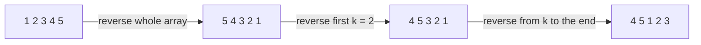
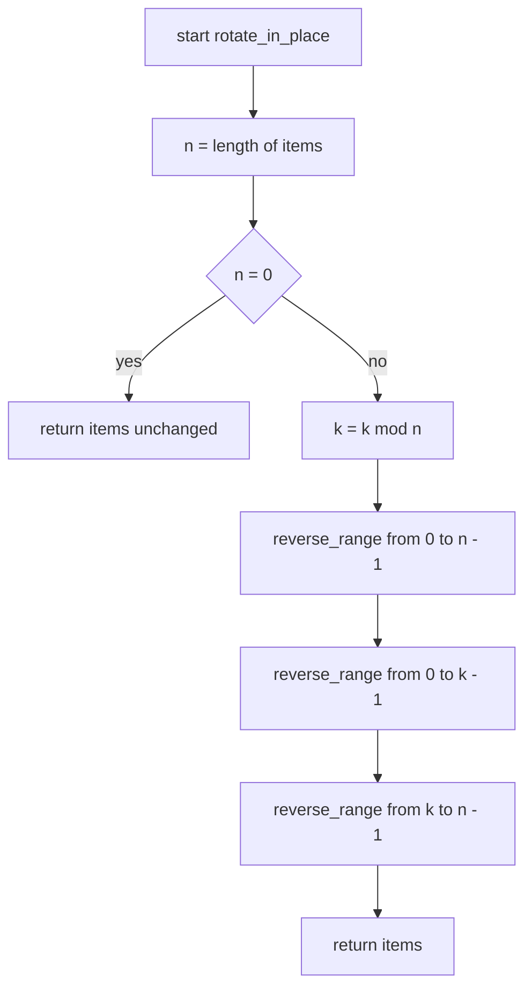
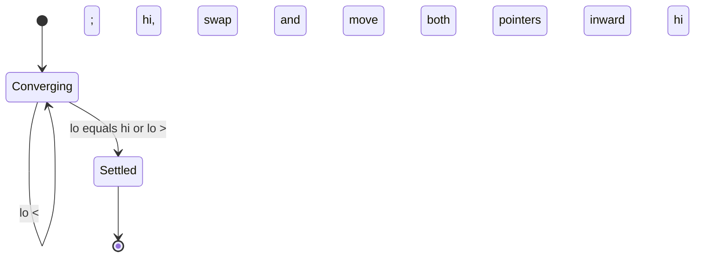
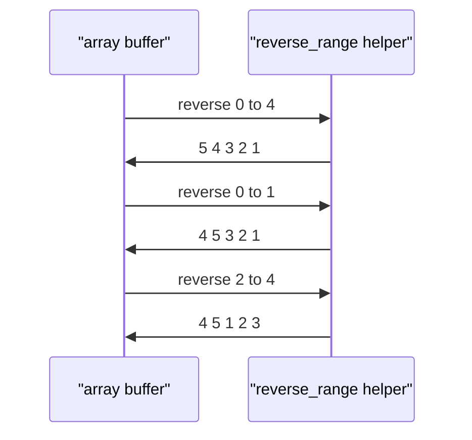

# 022 — Rotate array in-place by k positions.

> **Tier:** Beginner · **CTCI chapter:** Ch 1 — Arrays and Strings
> **Task spec:** [022-rotate-array-in-place-by-k-positions.md](../../../tasks/beginner/022-rotate-array-in-place-by-k-positions.md)
> **Solutions:** [Python](../../../solutions/python/beginner/022-rotate-array-in-place-by-k-positions/solution.py) ·
> [Java](../../../solutions/java/beginner/022-rotate-array-in-place-by-k-positions/Solution.java) ·
> [JavaScript](../../../solutions/javascript/beginner/022-rotate-array-in-place-by-k-positions/solution.js) ·
> [C#](../../../solutions/csharp/beginner/022-rotate-array-in-place-by-k-positions/Solution.cs)

## 1. Problem restatement

**Input:** a mutable sequence `items` of length `n` and a non-negative integer `k`.

**Output:** the *same* sequence, rearranged so that every element has moved `k` places to the
right with the overflow wrapping to the front. The buffer is reused — no auxiliary array is
allocated — and the function hands the buffer back so the caller can chain calls.

| Call | Result | Why |
| --- | --- | --- |
| `rotate_in_place([1, 2, 3, 4, 5], 2)` | `[4, 5, 1, 2, 3]` | identical result to the "new array" variant |
| `rotate_in_place([1], 4)` | `[1]` | `4 mod 1 = 0`; a length-one array is its own rotation |
| `rotate_in_place([1, 2], 0)` | `[1, 2]` | `k = 0` is the identity |

The four files agree on one further contract detail that the assertions do not have to spell out:
the returned value **is the same object** that was passed in. Python's file returns `items` after
mutating the list, Java and C# return the `int[]` they were given, and JavaScript returns the same
array reference. This is what makes the task "in-place" rather than merely "cheaper": the extra
space is O(1), and unlike
[021-rotate-array-right-by-k-positions-create-new-array.md](../../../tasks/beginner/021-rotate-array-right-by-k-positions-create-new-array.md)
the caller's original order is gone.

## 2. Intuition

The obvious in-place method is the one-step shift repeated `k` times: save the last element, shift
everything right by one, put the saved element at index 0. It needs no extra array, but it costs
O(n · k) time, and it moves almost every element `k` times.

A cleverer loop — the "juggling" or cycle-following algorithm — moves each element exactly once by
walking index cycles of the permutation `i → (i + k) mod n`. It is O(n) and O(1), but its
termination condition is subtle: when `gcd(n, k) > 1` the permutation splits into several disjoint
cycles, and a naive single cycle silently leaves part of the array untouched. It also needs the
greatest-common-divisor to know how many parallel cycles to walk.

The three-reversal trick gives the same O(n) time and O(1) space with none of that bookkeeping.
The insight is a small algebraic identity about reversing. Take `A B` (head of length `n - k`, tail
of length `k`) and reverse each piece, then reverse the whole thing:

    reverse(reverse(A) reverse(B)) = B A

Reversing is an involution, and the outer reversal puts the two blocks the right way round while
flipping each block's internal order back to its original direction. The right rotation we want is
exactly `B A` — the last `k` elements followed by the first `n - k`. So:

    [ 1 2 3 | 4 5 ]   reverse all   →   5 4 3 2 1
                      reverse first k → 4 5 3 2 1
                      reverse rest    → 4 5 1 2 3

Every reversal is the two-pointer swap loop from task 001, so the entire algorithm is one helper
plus three calls. Nothing is ever compared; only pairs of slots trade places.



## 3. Algorithm

1. Let `n` be the length of `items`. If `n` is 0, return `items` unchanged.
2. Reduce `k` modulo `n` so it lies in `0 .. n - 1`.
3. Reverse the whole array, indices `0 .. n - 1`.
4. Reverse the first block, indices `0 .. k - 1`.
5. Reverse the second block, indices `k .. n - 1`.
6. Return `items`.

```text
procedure rotate_in_place(items, k)
    n ← length(items)
    if n = 0 then
        return items
    end
    k ← k mod n
    reverse_range(items, 0, n - 1)
    reverse_range(items, 0, k - 1)
    reverse_range(items, k, n - 1)
    return items
end

procedure reverse_range(items, lo, hi)
    while lo < hi do
        swap items[lo] with items[hi]
        lo ← lo + 1
        hi ← hi - 1
    end
end
```

The `k = 0` case needs no branch, and that is a small piece of elegance worth verifying by hand.
With `k = 0` the three calls become `reverse(0, n - 1)`, then `reverse(0, -1)`, then
`reverse(0, n - 1)`. The middle call has `lo > hi`, so its `while` body never runs; the first and
third are the same reversal of the whole array, and applying it twice is the identity. The array
comes back exactly as it went in — which is why the Java and C# assertions for `k = 0` pass
without any special handling. The only index that can leave the valid range in this scheme is
`hi = k - 1`, and it is always accompanied by a `lo = 0`, so the empty range is deliberate rather
than accidental.



Each reversal is the same converging two-pointer machine:



## 4. Worked example

Trace `rotate_in_place([1, 2, 3, 4, 5], 2)`. `n = 5`, `k = 2`, so the block boundaries are `0`, `1`
and `2`:

| Step | Operation | Array after the step |
| --- | --- | --- |
| start | — | `[1, 2, 3, 4, 5]` |
| 1 | reverse `0 .. 4` | `[5, 4, 3, 2, 1]` |
| 2 | reverse `0 .. 1` | `[4, 5, 3, 2, 1]` |
| 3 | reverse `2 .. 4` | `[4, 5, 1, 2, 3]` |

Step 3 is the one that restores the internal order of the `1 2 3` block: after the whole-array
reversal that block sits at the right end but backwards (`3 2 1`), and reversing the range
`2 .. 4` flips it to `1 2 3` without touching the `4 5` prefix.



The degenerate cases are the same three calls with collapsed ranges:

| Input | `n` | `k mod n` | ranges reversed | result |
| --- | --- | --- | --- | --- |
| `[1]` | 1 | 0 | `0..0`, `0..-1`, `0..0` | `[1]` |
| `[1, 2]` | 2 | 0 | `0..1`, `0..-1`, `0..1` | `[1, 2]` |
| `[1, 2]` | 2 | 1 | `0..1`, `0..0`, `1..1` | `[2, 1]` |
| `[1, 2, 3, 4]` | 4 | 2 | `0..3`, `0..1`, `2..3` | `[3, 4, 1, 2]` |

Note the `0..-1` entry: it is a legal call whose loop condition is immediately false, and it is the
reason no `k = 0` branch is needed.

## 5. Complexity

Let `n` be the length of `items`.

| Measure | Bound | Why it holds |
| --- | --- | --- |
| Time, best | O(n) | the whole-array reversal always runs `n / 2` swaps |
| Time, average | O(n) | the three ranges partition the array, so the total swap count is bounded by `n` |
| Time, worst | O(n) | each index participates in at most two of the three reversals |
| Space, extra | O(1) | one temporary per swap plus two indices; no auxiliary array |
| Space, input | **modified** | the caller's buffer is rearranged in place |
| Alternative: one-step shift, `k` times | O(n · k) time, O(1) space | quadratic when `k` is not small |
| Alternative: cycle juggling | O(n) time, O(1) space | same bounds, but needs `gcd(n, k)` and cycle bookkeeping |
| Alternative: copy to a new array (task 021) | O(n) time, O(n) space | the simplest of the four, but not in place |

The time bound needs a moment's care: the three reversals together touch `n / 2 + k / 2 + (n - k) / 2 = n`
swaps in total, so the constant is one swap per element — no worse than the copying variant, and
with a smaller memory footprint. The best case is still O(n) because the first reversal is
unconditional; there is no early exit in a rotation.

## 6. Pitfalls and edge cases

- **Empty array.** `n = 0` returns immediately; without that guard `k mod 0` is a division by zero
  in Java, C# and JavaScript (it yields `NaN` in JavaScript rather than throwing, which then breaks
  the indices).
- **`k = 0`.** Handled by the collapsed middle range, not by a branch. Java's `reverse(items, 0, k - 1)`
  is called with `hi = -1`; the `while (lo < hi)` guard makes it a no-op.
- **`k >= n`.** Reduced first. `[1, 2]` with `k = 3` becomes `k = 1` and returns `[2, 1]`.
- **Length-one array.** `[1]` with `k = 4` reduces to `k = 0` and returns `[1]`; all three ranges
  are empty or single-element.
- **The same object comes back.** The function mutates and returns its argument. Code that keeps a
  reference to the "before" array will observe it changing; that is the documented behaviour here,
  and the opposite of task 021.
- **Java and C# return types.** Both return the `int[]` they received rather than `void`, so the
  test can compare the result with `Arrays.equals` / `string.Join` directly.
- **Swapping without a temporary.** Python's and JavaScript's files use tuple/destructuring swaps,
  Java and C# use a `t` temporary. In C# the `(a, b) = (b, a)` form is also available but the file
  keeps the explicit temporary for clarity.
- **Half-open ranges.** All three reversals are inclusive on both ends (`lo .. hi`), so the split
  points are `k - 1` and `k`. Writing `k` twice, or `k - 1` twice, silently duplicates or drops an
  element; the assertions on `[1, 2, 3, 4, 5]` and `[1, 2]` catch both.
- **Not a stable permutation.** The three reversals flip pairs inside each block twice, so elements
  end up in their exact rotated positions — but if a caller expects the rotation to preserve some
  secondary ordering of equal elements, note that no comparison ever happens, so equality is
  irrelevant.
- **Concurrency.** Because the array is mutated in place, a reader running concurrently will see
  intermediate states such as `[5, 4, 3, 2, 1]`. The copying variant task 021 avoids that.

## 7. Variants and follow-ups

- **The copying variant.** [021-rotate-array-right-by-k-positions-create-new-array.md](../../../tasks/beginner/021-rotate-array-right-by-k-positions-create-new-array.md)
  produces the same permutation with O(n) extra space; comparing the two is the standard
  "time vs space" interview follow-up.
- **The primitive being reused.** Reversal is the converging two-pointer swap introduced in
  [001-reverse-a-string.md](../../../tasks/beginner/001-reverse-a-string.md); here it is applied
  three times to ranges instead of once to everything.
- **Compaction instead of rotation.**
  [024-remove-element-at-index-from-array-in-place.md](../../../tasks/beginner/024-remove-element-at-index-from-array-in-place.md)
  moves elements in place with the same "reuse the caller's buffer" discipline, but shifts a range
  once rather than reversing it three times.
- **Rotations on other structures.** The three-reversal identity works on any sequence with random
  access, including a `StringBuilder` or a linked-list-to-array conversion; the chapter walkthrough
  in [Arrays and Strings](../../ctci/01-arrays-and-strings.md) collects this task with the rest of
  the index gymnastics.
- **Sortedness of the result.** A rotation of a sorted array is sorted except at the wrap point,
  which is exactly what
  [019-check-if-array-is-sorted-ascending.md](../../../tasks/beginner/019-check-if-array-is-sorted-ascending.md)
  detects on the single pair `items[k - 1] > items[k]`.

## 8. Check yourself

1. Why does `k = 0` need no special case in the three-reversal algorithm?

<details><summary>Show answer</summary>

The three calls become `reverse(0, n - 1)`, `reverse(0, -1)` and `reverse(0, n - 1)`. The middle
one has `lo > hi` so its loop body never executes, and the two outer calls are identical
reversals, which cancel because reversal is its own inverse. The array is unchanged without any
branch.

</details>

2. Which single reversal, if skipped, produces `[5, 4, 3, 2, 1]` for
   `rotate_in_place([1, 2, 3, 4, 5], 2)`, and why?

<details><summary>Show answer</summary>

Skipping the whole-array reversal and running only the two block reversals reverses each block in
place and leaves the blocks where they are: `[2, 1, 5, 4, 3]`. To get `[5, 4, 3, 2, 1]` you would
also have to swap the blocks, which the whole-array reversal is what achieves (it is the step that
moves the tail to the front, leaving both blocks reversed for the other two calls to repair).

</details>

3. How many element swaps does `rotate_in_place` perform on an array of length `n`?

<details><summary>Show answer</summary>

`floor(n / 2) + floor(k / 2) + floor((n - k) / 2)`, which is at most `n` and at least `n / 2`. On
`[1, 2, 3, 4, 5]` with `k = 2` that is `2 + 1 + 1 = 4` swaps, versus `n = 5` copies for the
new-array variant.

</details>

4. Why is the juggling algorithm (following index cycles) not used here, even though it has the
   same bounds?

<details><summary>Show answer</summary>

Because it needs extra reasoning to be correct: the permutation `i → (i + k) mod n` splits into
`gcd(n, k)` disjoint cycles, so the implementation must either compute that gcd and start a new
cycle that many times, or detect the return to the starting index. The three-reversal form has no
such case analysis — it is the same three calls for every `n` and `k`.

</details>

5. The function returns the array it was given. Why is that worth doing?

<details><summary>Show answer</summary>

It makes the function composable: `rotate(rotate(a, 2), 3)` works, and in Java and C# the tests can
write `Arrays.equals(rotateInPlace(a, 2), expected)` in one expression. Returning `void` would force
callers to keep their own reference to the buffer.

</details>
