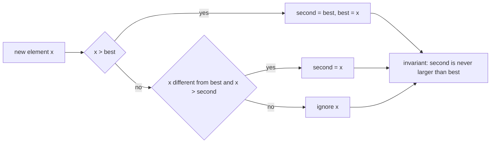
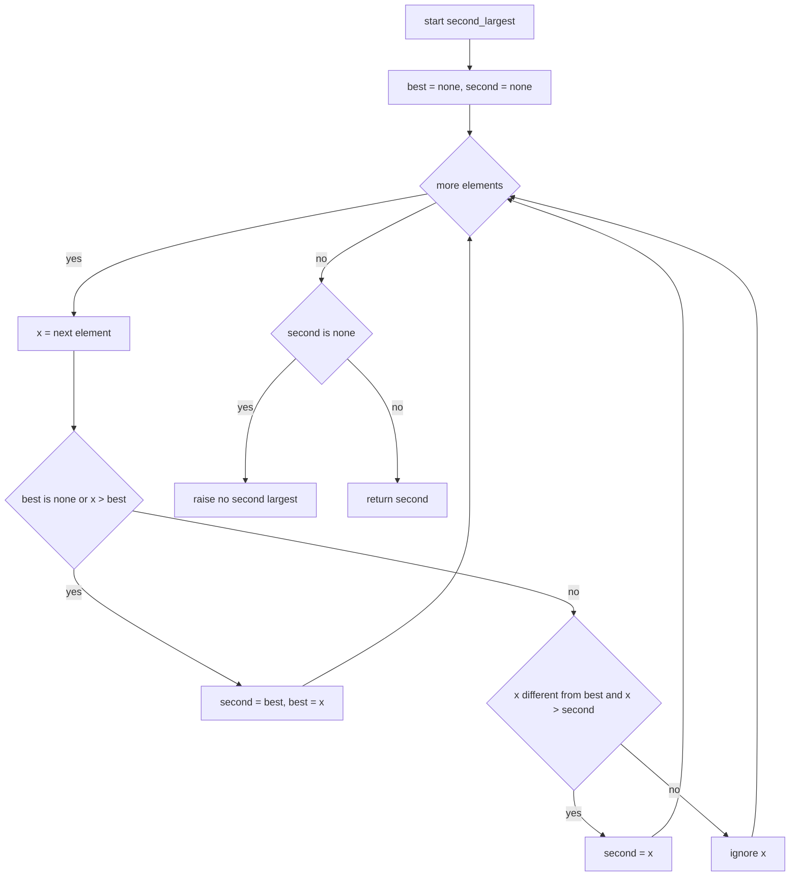
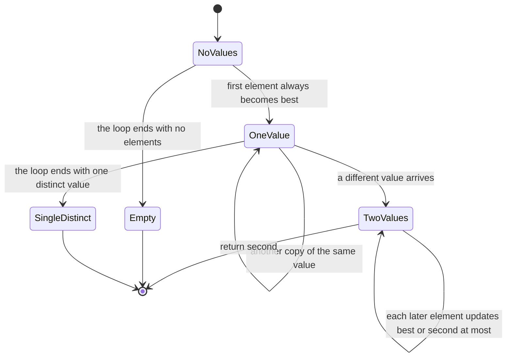
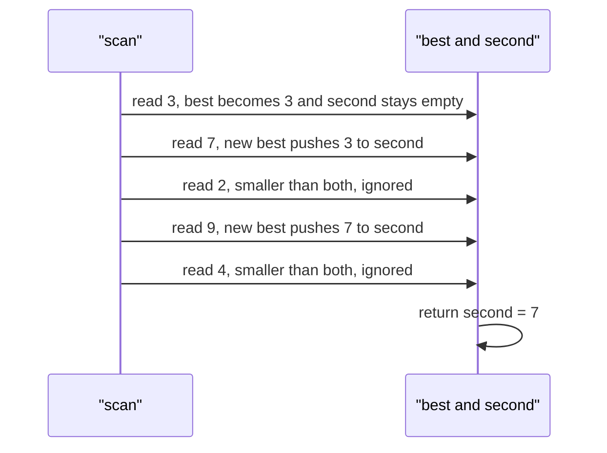

# 023 — Find second largest element in an array.

> **Tier:** Beginner · **CTCI chapter:** Ch 1 — Arrays and Strings
> **Task spec:** [023-find-second-largest-element-in-an-array.md](../../../tasks/beginner/023-find-second-largest-element-in-an-array.md)
> **Solutions:** [Python](../../../solutions/python/beginner/023-find-second-largest-element-in-an-array/solution.py) ·
> [Java](../../../solutions/java/beginner/023-find-second-largest-element-in-an-array/Solution.java) ·
> [JavaScript](../../../solutions/javascript/beginner/023-find-second-largest-element-in-an-array/solution.js) ·
> [C#](../../../solutions/csharp/beginner/023-find-second-largest-element-in-an-array/Solution.cs)

## 1. Problem restatement

**Input:** a sequence `items` of comparable values, in any order.

**Output:** the **second largest distinct** value in the sequence. Not the second element of a
sorted array — distinct. If the sequence does not contain two different values, the function
raises instead of returning something arbitrary.

| Call | Result | Why |
| --- | --- | --- |
| `second_largest([3, 7, 2, 9, 4])` | `7` | distinct values `9 > 7 > 4 > 3 > 2` |
| `second_largest([5, 5, 4])` | `4` | the duplicated `5` is the largest, not the second largest |
| `second_largest([-1, -2, -3])` | `-2` | all values are negative, so there is no "positive" shortcut |
| `second_largest([7, 7])` | raises | only one distinct value: "no second largest" |
| `second_largest([7])` | raises | fewer than two elements |
| `second_largest([])` | raises | empty input |

The duplicate row is the whole difficulty of the task. `[5, 5, 4]` contains a `5` in position 1,
and a careless implementation returns it. The four files all return `4`, which is the only answer
that survives the assertion. The all-equal case has no answer at all, so the files raise
(`ValueError` in Python, `IllegalArgumentException` in Java, `Error` in JavaScript,
`ArgumentException` in C#) rather than inventing a sentinel.

## 2. Intuition

The simplest correct approach is to sort:

```text
sorted_values ← sort items in descending order
return sorted_values[1]
```

Two problems. It costs O(n log n) time and O(n) space, and with duplicates it is outright *wrong*:
`[5, 5, 4]` sorts to `[5, 5, 4]` and index 1 is still `5`. You would then have to scan for the
first value different from the maximum, which is a third step the sorted version did not need.

A two-pass version fixes the duplicates and keeps O(n) time:

```text
best ← maximum of items
second ← largest value strictly less than best, or nothing
if second is nothing then raise
return second
```

That is O(2n) comparisons and still needs two loops. The insight that collapses it to one pass is
that the second largest is always the **largest value you have displaced**. Every time a new
element arrives:

- if it is a new maximum, then the old maximum *becomes* the second largest;
- if it is not a new maximum but beats the current second largest (and is not equal to the
  maximum), it becomes the second largest.

So two trackers, `best` and `second`, are enough, and the invariant is `second ≤ best` at all
times — with the additional rule that the two trackers never hold the same value, because
"second largest" means distinct. The `x = best` guard in the `elif` branch is what enforces it:

    elif x != best and (second is None or x > second):
        second ← x

The `None` sentinel (a nullable `Integer` in Java, `int?` in C#, `null` in JavaScript, `None` in
Python) exists because `0` is a legal value: a "start both trackers at zero" version wrongly
returns `0` for `[-1, -2, -3]` — the third assertion row exists precisely to catch that.



## 3. Algorithm

1. Initialise `best` and `second` to "no value yet" — the nullable sentinel.
2. For each element `x`:
   - if `best` is empty or `x > best`, demote: `second ← best`, then `best ← x`;
   - otherwise, if `x` differs from `best` and (`second` is empty or `x > second`), set `second ← x`.
3. After the loop, if `second` is still empty, raise "no second largest".
4. Return `second`.

```text
procedure second_largest(items)
    best ← no value
    second ← no value
    for each x in items do
        if best is empty or x > best then
            second ← best
            best ← x
        else if x ≠ best and (second is empty or x > second) then
            second ← x
        end
    end
    if second is empty then
        raise error "no second largest"
    end
    return second
end
```

Three details carry the correctness. First, the demotion happens *before* `best` is overwritten,
which is what makes the old maximum the new second largest — the ordering of those two assignments
is not interchangeable. Second, the `else if` is an `else`: when `x` is a new maximum the second
branch is skipped, which is correct because the demoted value is certainly a better candidate than
`x` itself would be. Third, the equality test `x ≠ best` handles duplicates in both directions —
it prevents `[5, 5, 4]` from setting `second = 5`, and it prevents a later `5` from replacing the
correct `4`.



Read as a machine over the *distinct values seen so far*, the number of live trackers is the
state:



The two terminal states `Empty` and `SingleDistinct` are exactly the two cases that raise
"no second largest".

## 4. Worked example

Trace `second_largest([3, 7, 2, 9, 4])`. The trackers start empty and are updated in place:

| Step | `x` | `best` before | `second` before | branch taken | `best` after | `second` after |
| --- | --- | --- | --- | --- | --- | --- |
| 1 | 3 | none | none | `best` empty | 3 | none |
| 2 | 7 | 3 | none | `7 > 3` | 7 | 3 |
| 3 | 2 | 7 | 3 | `2 ≠ 7` and `2 < 3` | 7 | 3 |
| 4 | 9 | 7 | 3 | `9 > 7` | 9 | 7 |
| 5 | 4 | 9 | 7 | `4 ≠ 9` and `4 < 7` | 9 | 7 |
| return | — | — | — | `second` is 7 | 9 | 7 |

Two elements changed the answer (steps 2 and 4) and three were examined and discarded. Note step 4:
`9` demotes `7`, and the demotion is what makes the final answer `7` rather than `3`.



The duplicate case exercises the equality guard:

| Step | `x` | `best` | `second` | branch | note |
| --- | --- | --- | --- | --- | --- |
| 1 | 5 | 5 | none | first value | `best` set |
| 2 | 5 | 5 | none | `5 > 5` false, `5 ≠ 5` false | **ignored** — this is the guard |
| 3 | 4 | 5 | 4 | `4 ≠ 5` and `4 > none` | `second` set |
| return | — | 5 | 4 | — | answer `4`, not `5` |

Without the `x ≠ best` test, step 2 would set `second = 5`, and the assertion
`second_largest([5, 5, 4]) == 4` would fail.

## 5. Complexity

Let `n` be the length of `items`.

| Measure | Bound | Why it holds |
| --- | --- | --- |
| Time, best | O(n) | every element must be examined; there is no early exit |
| Time, average | O(n) | at most two comparisons per element |
| Time, worst | O(n) | exactly one pass, `n` iterations, constant work each |
| Space, extra | O(1) | two tracker slots regardless of `n` |
| Space, input | untouched | all four files read without writing |
| Alternative: sort and index | O(n log n) time, O(n) space | and wrong on duplicates without an extra dedup scan |
| Alternative: two passes | O(n) time, O(1) space | about `2n` comparisons and two loops |
| Recursion depth | O(1) | iterative |

The two-pass version is worth knowing because it is easier to prove: find the maximum, then find
the maximum of everything strictly smaller. It has the same asymptotics and roughly double the
comparisons, which is invisible at these sizes. What makes the single-pass version worth writing is
that it needs no second traversal and generalises to "the k-th largest with a size-k heap", and
what makes it *harder* is that the sentinel and equality rules now matter.

## 6. Pitfalls and edge cases

- **Fewer than two distinct values.** `[]`, `[7]` and `[7, 7]` all raise "no second largest" — the
  `second is empty` check at the end covers all three. Returning `best`, `0` or a null pointer
  would be wrong.
- **Duplicates of the maximum.** `[5, 5, 4]` returns `4`. The guard `x ≠ best` in the `elif` branch
  is what makes the tracker hold a distinct value instead of a copy of the maximum.
- **Zero as a real value.** `[-1, -2, -3]` returns `-2`. Initialising the trackers to `0` instead of
  "no value" would return `0`, which is not even in the array. That is why every file uses a
  nullable sentinel — `Integer` in Java, `int?` in C#, `null` in JavaScript, `None` in Python.
- **All values negative.** Special case of the previous point; the comparison logic needs no
  absolute values and no sign handling.
- **Order of the two assignments.** `second ← best` must happen *before* `best ← x`. Reversing them
  makes `second` and `best` identical, and every assertion fails.
- **`elif` rather than a second `if`.** If the demotion branch also fell through to the candidate
  branch, a new maximum would immediately be compared against the just-demoted value and could
  overwrite it with something larger than it — the `else if` is load-bearing.
- **Integer overflow in the sentinel.** Java and C# use a nullable boxed type rather than
  `Integer.MAX_VALUE` so that a legitimate `MAX_VALUE` element is not mistaken for the sentinel.
- **Single element.** `[7]` raises; the loop runs once and `second` stays empty.
- **Comparability.** All four rely on the language's native ordering; mixing types throws in Python
  and produces `false` comparisons in JavaScript.
- **Stability of equal values.** If two distinct values are equal — impossible by definition — the
  question would be ambiguous. The file's answer is unambiguous: distinctness is required, so
  `[4, 4, 4, 9]` returns `4`.

## 7. Variants and follow-ups

- **Maximum only.** The `best` tracker alone is
  [005-find-maximum-value-in-an-int-array.md](../../../tasks/beginner/005-find-maximum-value-in-an-int-array.md);
  this task is that scan plus one more slot of state.
- **Second largest in a single pass over a sorted pair of inputs.**
  [020-merge-two-sorted-arrays-into-a-sorted-array.md](../../../tasks/beginner/020-merge-two-sorted-arrays-into-a-sorted-array.md)
  is the other "keep only what matters and move on" task of this tier.
- **The sortedness test.** A descending array makes `second` the element right after the maximum;
  [019-check-if-array-is-sorted-ascending.md](../../../tasks/beginner/019-check-if-array-is-sorted-ascending.md)
  is the O(n) check that certifies it.
- **Duplicates as a boolean.** [026-check-if-array-contains-any-duplicates-boolean.md](../../../tasks/beginner/026-check-if-array-contains-any-duplicates-boolean.md)
  answers the weaker question "is any value repeated?", and
  [025-find-duplicate-element-when-exactly-one-number-repeats-1-n.md](../../../tasks/beginner/025-find-duplicate-element-when-exactly-one-number-repeats-1-n.md)
  finds the repeated value when it is known to be unique.
- The chapter walkthrough in [Arrays and Strings](../../ctci/01-arrays-and-strings.md) groups this
  scan with the other single-pass trackers.

## 8. Check yourself

1. Why must `second_largest([5, 5, 4])` return `4` rather than `5`?

<details><summary>Show answer</summary>

Because the task asks for the second largest *distinct* value. `5` is the largest value, and it
appears twice; the second distinct value in descending order is `4`. The implementation enforces
this with the `x ≠ best` guard before updating `second`.

</details>

2. What goes wrong if the trackers are initialised to `0` instead of a nullable sentinel?

<details><summary>Show answer</summary>

`second_largest([-1, -2, -3])` would return `0`, because `0` would be the initial `second` and no
element ever beats it (`-1 > 0` is false). The third assertion row exists to catch exactly this.
`Integer.MIN_VALUE` is a workable substitute for a nullable type in Java and C#, but `null` is
clearer and works for every element type.

</details>

3. Why is `else if` required instead of a second `if`?

<details><summary>Show answer</summary>

When `x` is a new maximum, the first branch demotes the old `best` into `second` and stores `x` in
`best`. If the second branch then ran as well, it would compare `x` against the freshly demoted
`second` — and since `x` is larger, it would overwrite `second` with `x`, leaving both trackers
equal. The `else` keeps the demoted value intact.

</details>

4. Give the two-pass algorithm and its comparison count.

<details><summary>Show answer</summary>

Pass 1 finds `best` by scanning all `n` elements (`n - 1` comparisons). Pass 2 scans again and keeps
the largest value strictly less than `best` (`n - 1` more, plus one equality test each). That is
about `2n` comparisons, versus at most `2n` in the single-pass version too — but the single-pass
form touches each element once, which matters more for streaming data and for cache behaviour on
large arrays.

</details>

5. How would this change if the task asked for the second largest value *including* duplicates of
   the maximum, i.e. the second element of the descending sort?

<details><summary>Show answer</summary>

You would drop the `x ≠ best` guard and let `second` accept a copy of the maximum. Then
`[5, 5, 4]` returns `5`, and the only remaining raise condition is `n < 2` rather than "fewer than
two distinct values". It is a strictly weaker contract, and the shipped assertions would fail —
which is a good illustration of why the wording "second largest" has to be pinned down.

</details>
