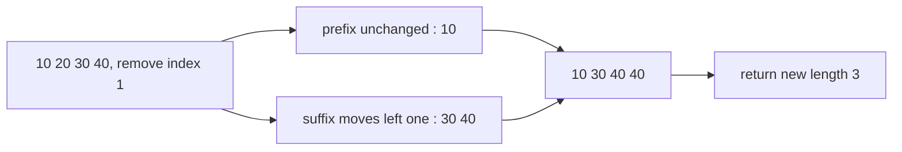
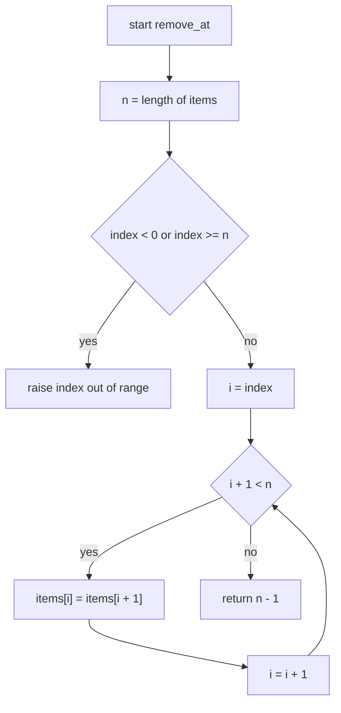
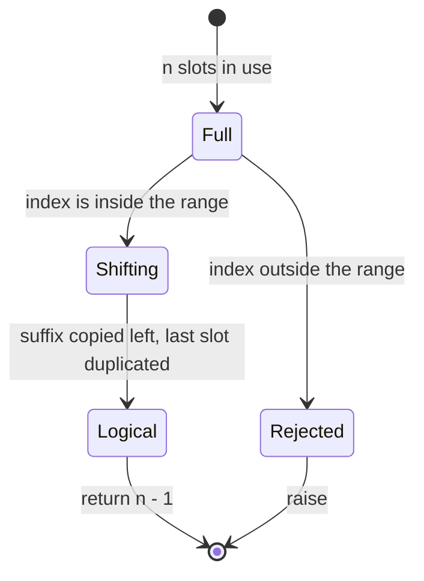
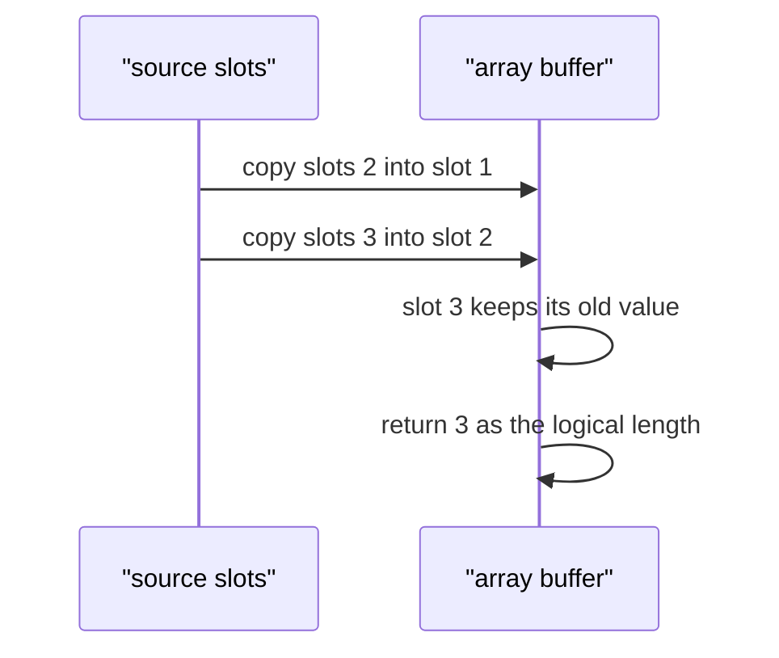

# 024 — Remove element at index from array (in-place).

> **Tier:** Beginner · **CTCI chapter:** Ch 1 — Arrays and Strings
> **Task spec:** [024-remove-element-at-index-from-array-in-place.md](../../../tasks/beginner/024-remove-element-at-index-from-array-in-place.md)
> **Solutions:** [Python](../../../solutions/python/beginner/024-remove-element-at-index-from-array-in-place/solution.py) ·
> [Java](../../../solutions/java/beginner/024-remove-element-at-index-from-array-in-place/Solution.java) ·
> [JavaScript](../../../solutions/javascript/beginner/024-remove-element-at-index-from-array-in-place/solution.js) ·
> [C#](../../../solutions/csharp/beginner/024-remove-element-at-index-from-array-in-place/Solution.cs)

## 1. Problem restatement

**Input:** a mutable sequence `items` of length `n` and an index `index` in `0 .. n - 1`.

**Output:** the sequence with the element at `index` removed, achieved by shifting the following
elements one slot to the left — no new array — together with the new **logical length** `n - 1`. An
out-of-range index raises.

| Call | Result | Why |
| --- | --- | --- |
| `remove_at([10, 20, 30, 40], 1)` | returns `3`, array becomes `[10, 30, 40, 40]` | three elements shifted; slot 3 keeps a stale copy |
| `remove_at([1], 0)` | returns `0` | the only element is removed, no shifts at all |
| `remove_at([1, 2, 3], 2)` | returns `2` | removing the last element shifts nothing |
| `remove_at([1, 2], 5)` | raises | index out of range |
| `remove_at([1, 2], -1)` | raises | negative index |

The stale tail is the part that surprises people. `[10, 20, 30, 40]` after `remove_at(..., 1)` is
physically four slots long; the array *contains* `[10, 30, 40, 40]`, and only the returned `3` says
that the last slot is no longer part of the sequence. Python's asserts read `a[:n] == [10, 30, 40]`
for exactly this reason, and Java's check reads only `a[0]`, `a[1]`, `a[2]`. That is how removal
works in a fixed-size buffer (C++ `std::vector` erase, `ArrayList.remove` under the hood): the
container's size field is the truth, not the capacity.

## 2. Intuition

The naive approach is to build a new array without the element:

```text
out ← empty
for i ← 0 to length(items) - 1 do
    if i ≠ index then
        append items[i] to out
    end
end
return out
```

This is correct, readable, and O(n) in both time and *extra space* — the "in-place" requirement is
violated, and if the caller is holding the buffer (a `byte[]` being written to a socket, say) the
new array is useless to them.

The insight is that removing one element from the middle does not require rebuilding anything. The
prefix `items[0 .. index - 1]` is already in its final place. The suffix `items[index + 1 .. n - 1]`
simply needs to move one slot left, and the relative order of the suffix does not change — each of
its elements keeps the same neighbours. So the whole operation is a **bulk shift by one over a
suffix of the array**, which is `n - 1 - index` assignments and no comparisons whatsoever.

Two consequences fall out immediately:

- The cost depends on *where* the element is: removing the last element is O(1), removing the first
  is O(n).
- The last slot becomes a duplicate of its former neighbour (the array is one element "over-full"),
  which is why the function must return the new length. The alternative — overwriting the hole with
  a sentinel — is not portable across the four languages.



## 3. Algorithm

1. Validate the index: if it is negative or at least `n`, raise an out-of-range error.
2. For `i` from `index` while `i + 1 < n`: copy `items[i + 1]` into `items[i]`.
3. Return `n - 1`, the new logical length.

```text
procedure remove_at(items, index)
    n ← length(items)
    if index < 0 or index ≥ n then
        raise error "index out of range"
    end
    i ← index
    while i + 1 < n do
        items[i] ← items[i + 1]
        i ← i + 1
    end
    return n - 1
end
```

Step 2 is written with `i + 1 < n` rather than `i < n - 1` so that the loop cannot index past the
end even for `n = 0` (which the range check has already rejected) and so that the last iteration
reads `items[n - 1]`. The direction of the copy matters: it walks **left to right**, overwriting
slot `i` with the value from slot `i + 1` *before* that slot is itself overwritten. Walking the
other way would clobber the source of the next copy. And note that `index = n - 1` makes the loop
condition false on entry, which is how removing the last element costs zero shifts.



The array is never shrunk, so the final slot keeps a duplicate. Conceptually the buffer has two
lengths, and the return value is the one that counts:



## 4. Worked example

Trace `remove_at([10, 20, 30, 40], 1)`. `n = 4`, `index = 1`, so there are three iterations:

| Step | `i` | `items[i + 1]` read | write | array after |
| --- | --- | --- | --- | --- |
| start | — | — | — | `[10, 20, 30, 40]` |
| 1 | 1 | `30` | `items[1] ← 30` | `[10, 30, 30, 40]` |
| 2 | 2 | `40` | `items[2] ← 40` | `[10, 30, 40, 40]` |
| 3 | 3 | loop exits, `i + 1 = 4` | — | `[10, 30, 40, 40]` |
| return | — | — | — | `3` |

At step 1, `20` disappears under `30` — the value being removed is overwritten in the first write,
which is why nothing needs to be saved. At step 2, `30` moves into slot 2. Slot 3 then still holds
`40`, so the buffer ends with `40 40`: one real element and one stale copy.



Deleting at the two extremes shows how the cost varies:

| Input | `index` | shifts performed | array after | returned length |
| --- | --- | --- | --- | --- |
| `[1]` | 0 | 0 | `[1]` | 0 |
| `[10, 20, 30, 40]` | 0 | 3 | `[20, 30, 40, 40]` | 3 |
| `[10, 20, 30, 40]` | 1 | 2 | `[10, 30, 40, 40]` | 3 |
| `[10, 20, 30, 40]` | 3 | 0 | `[10, 20, 30, 40]` | 3 |

The last row is the interesting one: the array is *unchanged* and the function simply declares that
the final slot is no longer in use. The second row is the worst case, with `n - 1` shifts.

## 5. Complexity

Let `n` be the length of `items` and `index` the position being removed.

| Measure | Bound | Why it holds |
| --- | --- | --- |
| Time, best | O(1) | `index = n - 1` performs no shifts, and a single-element array performs none either |
| Time, average | O(n) | a uniformly random index shifts about `n / 2` elements |
| Time, worst | O(n) | `index = 0` shifts every remaining element — `n - 1` writes |
| Space, extra | O(1) | a temporary is not even needed: the shift is a copy, not a swap |
| Space, input | **modified** | the caller's buffer is rewritten in place |
| Alternative: copy into a new array | O(n) time, O(n) extra space | correct, but the caller's buffer is untouched and unusable |
| Alternative: swap with the last element | O(1) time, O(1) space | destroys the order of the remaining elements |
| Recursion depth | O(1) | iterative |

Note the asymmetry with task 021: a rotation costs O(n) work no matter how small `k` is, whereas
removal can be free. The general rule in this tier is that *where* you touch matters as much as
how much.

## 6. Pitfalls and edge cases

- **Index out of range.** `index < 0` or `index >= n` raises `IndexError` in Python,
  `IndexOutOfBoundsException` in Java, `RangeError` in JavaScript and `IndexOutOfRangeException` in
  C#. Without the check, `[1, 2]` with `index = 5` throws an index error from inside the loop on
  some inputs and silently returns a wrong length on others.
- **Empty array.** `n = 0` means every index is out of range, so removal from an empty array
  always raises. There is no "remove nothing" path.
- **Removing the last element.** `index = n - 1` shifts nothing; the length drops by one and the
  buffer is untouched. Asserted for `[1]` with `index = 0`.
- **The stale tail.** `[10, 20, 30, 40]` after removing index 1 reads `[10, 30, 40, 40]` — four
  slots, three live. Any code that iterates the *array* rather than the returned length sees the
  duplicate. Python's assertion is written as `a[:n] == [10, 30, 40]` precisely to make the
  distinction explicit.
- **Direction of the shift.** Left-to-right copies are safe because each write consumes the value
  from the slot in front before that slot is overwritten. A right-to-left loop would overwrite
  `items[i + 1]` before it is read.
- **Returning the new length, not the element.** The function does not report which value was
  removed; if the caller needs it, the value must be captured before the first write.
- **`index` equal to `n - 1` versus `n`.** The former is legal (removes the last element), the
  latter is out of range. The boundary is easy to off-by-one: the valid range is half-open
  `0 .. n - 1`.
- **Python lists can shrink.** `del items[index]` or `items.pop(index)` would do the job in one
  call, and the file deliberately does not use them: the algorithm is implemented by hand so that
  the C-style logical-length contract is visible. The same goes for `List.RemoveAt` in C#.
- **Fixed capacity.** In Java and C# the array length is immutable, so the returned `int` is the
  only way to express the shrink — which is why the signature is `int removeAt(int[], int)` rather
  than `void`.
- **Removing repeatedly.** Because the caller tracks the logical length, a second removal must use
  the *new* length for its range check; passing the original length would allow the stale slot back
  into the sequence.

## 7. Variants and follow-ups

- **Compaction of many elements.** The same left shift applied to every element that fails a
  predicate is the filter-in-place pattern; this task is the single-index special case.
- **Shifting as the opposite of rotation.**
  [022-rotate-array-in-place-by-k-positions.md](../../../tasks/beginner/022-rotate-array-in-place-by-k-positions.md)
  reuses the caller's buffer too, but moves elements by three reversals instead of one sweep — and
  it moves all of them.
- **Building the answer instead of editing.** [021-rotate-array-right-by-k-positions-create-new-array.md](../../../tasks/beginner/021-rotate-array-right-by-k-positions-create-new-array.md)
  and [004-remove-duplicates-from-an-array-create-new-array.md](../../../tasks/beginner/004-remove-duplicates-from-an-array-create-new-array.md)
  are the "allocate a new array" answers to variations of this problem; the two questions together
  (allocate or reuse?) are the interview's real subject.
- **The two-pointer primitive.** Every in-place move in this tier — reversal, shifting, filtering —
  is built from the same pair of indices, as in
  [020-merge-two-sorted-arrays-into-a-sorted-array.md](../../../tasks/beginner/020-merge-two-sorted-arrays-into-a-sorted-array.md).
- The chapter walkthrough in [Arrays and Strings](../../ctci/01-arrays-and-strings.md) collects the
  in-place edits of Ch 1.

## 8. Check yourself

1. Why does `remove_at` return an integer instead of the removed element?

<details><summary>Show answer</summary>

Because the buffer cannot shrink: an array has a fixed capacity, so the removal is *logical*. The
returned `n - 1` is the new length the caller must use to iterate the live region; the last slot
still holds a stale copy of the element that used to be there. Returning the removed value would
answer a different question and would not let the caller know how long the sequence is now.

</details>

2. How many assignments does `remove_at(items, index)` perform on an array of length `n`?

<details><summary>Show answer</summary>

`n - 1 - index`, one per element of the suffix. It is 0 when `index = n - 1`, `n - 1` when
`index = 0`, and `floor(n / 2)` on average for a uniform index. No comparisons are performed at
all.

</details>

3. What is `[10, 20, 30, 40]` physically, right after `remove_at(a, 1)`?

<details><summary>Show answer</summary>

`[10, 30, 40, 40]` — four slots. The live part is the first three (`a[0..2]`), and the fourth is a
duplicate of the third, left over because the shift copy overwrites rather than clears. Python's
assertion `a[:3] == [10, 30, 40]` encodes exactly that.

</details>

4. Could you implement removal in O(1) time? What would you give up?

<details><summary>Show answer</summary>

Yes: move the last element into the hole and report the length as `n - 1`, which costs one
assignment. What you give up is order — the sequence is no longer a subsequence of the original, so
any code relying on the relative order of the survivors (sorted data, stable output) breaks. That
trade-off is the standard "swap-remove" used by unordered containers.

</details>

5. Why must the loop run left to right rather than right to left?

<details><summary>Show answer</summary>

Because each write reads the slot to its right: `items[i] = items[i + 1]` consumes `items[i + 1]`
before that slot is itself overwritten. Running right to left would write `items[i + 1]` first,
destroying the value the next iteration needs, and the array would fill with duplicates of the
first shifted element.

</details>
