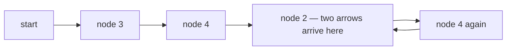
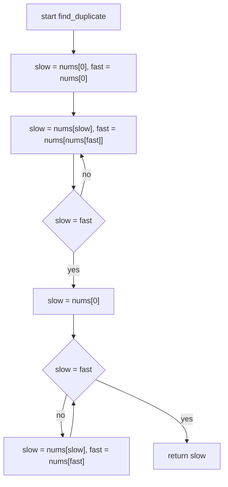
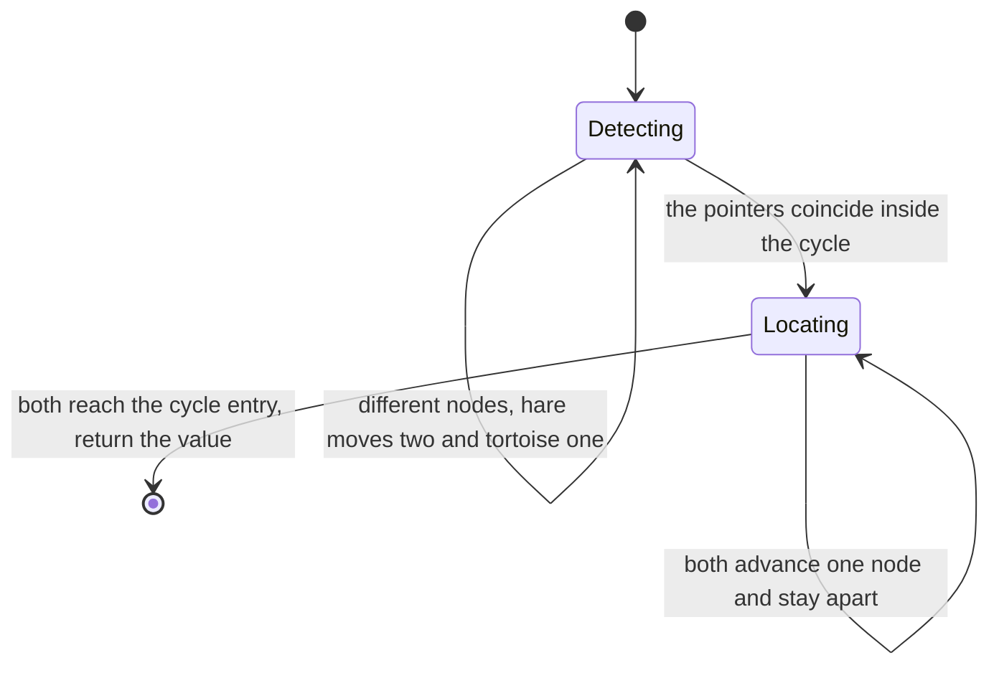
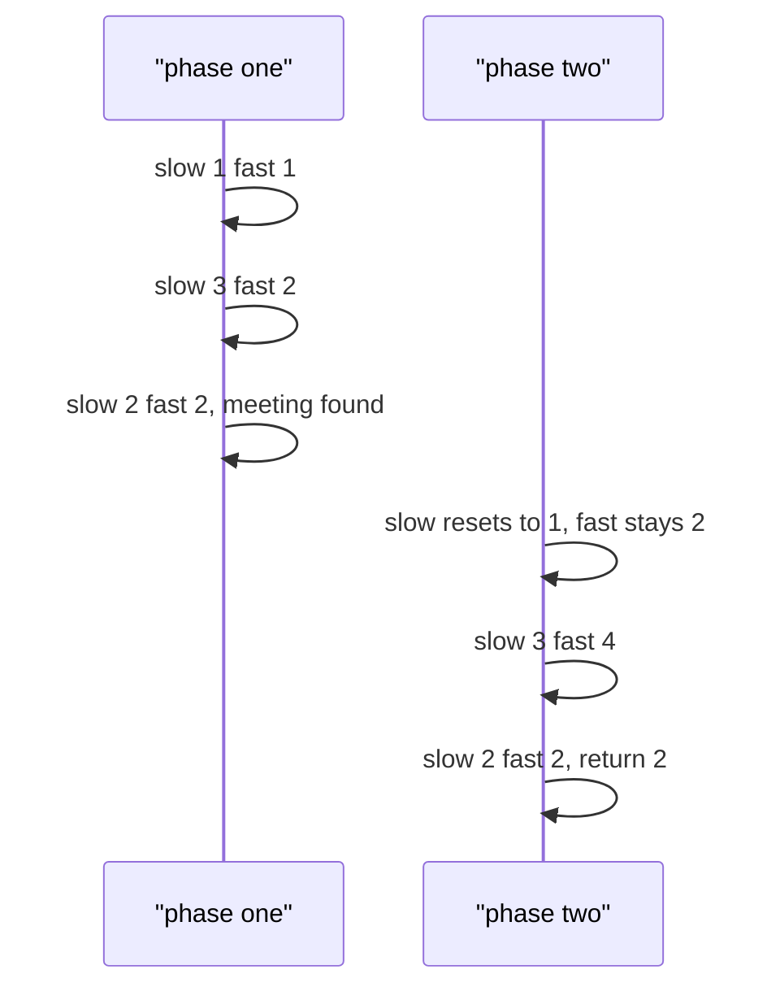

# 025 — Find duplicate element when exactly one number repeats (1..n).

> **Tier:** Beginner · **CTCI chapter:** Ch 1 — Arrays and Strings
> **Task spec:** [025-find-duplicate-element-when-exactly-one-number-repeats-1-n.md](../../../tasks/beginner/025-find-duplicate-element-when-exactly-one-number-repeats-1-n.md)
> **Solutions:** [Python](../../../solutions/python/beginner/025-find-duplicate-element-when-exactly-one-number-repeats-1-n/solution.py) ·
> [Java](../../../solutions/java/beginner/025-find-duplicate-element-when-exactly-one-number-repeats-1-n/Solution.java) ·
> [JavaScript](../../../solutions/javascript/beginner/025-find-duplicate-element-when-exactly-one-number-repeats-1-n/solution.js) ·
> [C#](../../../solutions/csharp/beginner/025-find-duplicate-element-when-exactly-one-number-repeats-1-n/Solution.cs)

## 1. Problem restatement

**Input:** a sequence `nums` of `n + 1` integers, each in the closed range `1 .. n`, in which
**exactly one** value appears twice and every other value appears once.

**Output:** that repeated value. The array must not be modified and no extra data structure may be
allocated: the solutions run in O(n) time and O(1) extra space.

| Call | Result | Why |
| --- | --- | --- |
| `find_duplicate([1, 3, 4, 2, 2])` | `2` | `n = 4`, five slots, `2` appears twice |
| `find_duplicate([3, 1, 3, 4, 2])` | `3` | the duplicate is in front of its twin this time |
| `find_duplicate([1, 1])` | `1` | the smallest legal case: `n = 1`, two slots (asserted by Python) |
| `find_duplicate([2, 2, 3, 1])` | `2` | the duplicate may be the smallest value too |

The two preconditions do the heavy lifting. There are `n + 1` slots for `n` distinct values, so by
the pigeonhole principle at least one value repeats; "exactly one value repeats twice, every other
value once" makes the answer unique. And because every value lies in `1 .. n`, **each value is a
legal index into the array itself** — that single observation is what turns a hashing problem into
a pointer-chasing problem, and it is the whole idea of the task.

## 2. Intuition

The naive approach is a hash set: walk the array, and the first time a value is already in the set,
return it. That is O(n) time but O(n) extra space, and it throws away the `1 .. n` precondition.

A second tempting idea is to sort — but sorting modifies the array (forbidden) unless you copy it,
which costs O(n) space again.

The insight comes from reading the array as a **function**. Define `f(i) = nums[i]`. Since every
`nums[i]` is in `1 .. n`, `f` maps the indices `0 .. n` into the nodes `1 .. n`. Build a graph with
one node per index and one arrow from `i` to `f(i)`. Now:

- There are `n + 1` arrows and only `n` possible destinations, so two arrows must land on the same
  node — that shared destination **is** the duplicate value.
- Starting anywhere (the solutions start at node `f(0)`) and following arrows, you cannot leave
  `1 .. n`, and the duplicated node means some node has two incoming arrows. Following arrows from
  a node in a finite set with two ways in must eventually revisit a node, and once a node repeats,
  every subsequent step repeats too: the walk is a "rho" shape — a tail leading into a cycle.

Walking that shape with two pointers is Floyd's tortoise and hare:

1. The hare advances two arrows per step, the tortoise one. Both start on the same node, so the
   hare gains one step per iteration and **must** eventually coincide with the tortoise inside the
   cycle.
2. Then reset the tortoise to the start of the walk and advance both by one arrow per step. The
   point where they meet again is exactly the cycle's entry node — the node with two incoming
   arrows, i.e. the duplicated value.

The second phase is the part worth internalising: after phase 1 the two pointers are `c` steps
apart, where `c` is the cycle length, and the distance from the reset pointer to the cycle entry is
congruent to that gap modulo `c`. Advancing both at the same speed therefore closes the gap exactly
at the entry.



The node `2` above is the only one with two incoming arrows: one from the walk that came through
`3` and `4`, and one from the tail node that pointed at `2` directly. Floyd's algorithm stops there
without ever needing to know which arrow was which.

## 3. Algorithm

1. Set `slow = nums[0]` and `fast = nums[0]`.
2. Repeat advancing `slow ← nums[slow]` and `fast ← nums[nums[fast]]` until `slow = fast`.
3. Reset `slow = nums[0]` (or, equivalently, to the walk's starting node) and keep `fast` where it
   is.
4. While `slow ≠ fast`, advance **both** by a single arrow.
5. Return `slow`.

```text
procedure find_duplicate(nums)
    slow ← nums[0]
    fast ← nums[0]
    repeat
        slow ← nums[slow]
        fast ← nums[nums[fast]]
    until slow = fast
    slow ← nums[0]
    while slow ≠ fast do
        slow ← nums[slow]
        fast ← nums[fast]
    end
    return slow
end
```

The loop in step 2 must be a "do it at least once" loop. Both pointers start on the same node, so a
pre-test `while slow ≠ fast` would be false immediately and the function would return `nums[0]`
without walking anywhere. Python writes it as `while True: ... if slow == fast: break`, and Java,
JavaScript and C# use `do { ... } while (slow != fast)` — three spellings of the same guarantee.

Step 4 is a plain equality loop: the two pointers move at the same speed, and the assertion that
they meet at the duplicate is a property of the rho shape, not of this loop's code.



The walk is in one of exactly two phases at any moment:



## 4. Worked example

Trace `find_duplicate([1, 3, 4, 2, 2])`. Index `i` points to `nums[i]`, so `nums[0] = 1` is the
entry node.

Phase 1 — the hare closes in on the tortoise:

| Step | `slow` | `fast` | note |
| --- | --- | --- | --- |
| start | 1 | 1 | both at `nums[0]` |
| 1 | `nums[1] = 3` | `nums[nums[1]] = nums[3] = 2` | hare moved two |
| 2 | `nums[3] = 2` | `nums[nums[2]] = nums[4] = 2` | both reach `2`, loop ends |

Phase 2 — the tortoise restarts, both crawl one arrow at a time:

| Step | `slow` | `fast` | note |
| --- | --- | --- | --- |
| reset | 1 | 2 | `slow = nums[0]` |
| 1 | `nums[1] = 3` | `nums[2] = 4` | still apart |
| 2 | `nums[3] = 2` | `nums[4] = 2` | both reach `2` |

They meet at node `2`, so the duplicated value is `2` — which matches the assertion.



The tiny case `[1, 1]` is worth checking by hand because it has no tail at all: `slow = fast = 1`,
then `slow = nums[1] = 1` and `fast = nums[nums[1]] = 1`, so phase 1 ends after one step; phase 2
resets `slow` to `nums[0] = 1`, which already equals `fast`, and the answer is `1`.

## 5. Complexity

Let `n` be the number of distinct values (the array has `n + 1` elements).

| Measure | Bound | Why it holds |
| --- | --- | --- |
| Time, phase 1 | O(n) | the hare enters the cycle within `n` steps and laps the tortoise within at most one cycle length |
| Time, phase 2 | O(n) | the reset pointer needs at most `n` steps to reach the cycle entry |
| Time, total | O(n) | three pointers' worth of work, no nested scanning |
| Space, extra | O(1) | two integer indices — no set, no copy, no markers |
| Space, input | untouched | the array is read through indices only; nothing is written |
| Alternative: hash set | O(n) time, O(n) extra space | simplest code, but fails the space requirement |
| Alternative: sort a copy | O(n log n) time, O(n) extra space | and the in-place version would modify the input |
| Alternative: arithmetic sum | O(n) time, O(1) extra space | `sum(nums) - n(n+1)/2` also yields the duplicate; see below |

The sum identity `sum(nums) - n · (n + 1) / 2` returns the duplicate with even less code, and it is
a legitimate answer to the same question. The solutions do not use it, for two reasons: it depends
on exact arithmetic (a 64-bit sum is needed for large `n`, where the `1 .. n` bound makes the total
about `n²/2`), and it exploits the "exactly one duplicate" counting precondition rather than the
index-value bound that makes the pointer formulation possible. Floyd's version works on any
`nums` whose values are valid indices, whatever the multiplicities imply.

## 6. Pitfalls and edge cases

- **The `do`-`while` requirement.** Both pointers must be advanced at least once before the
  equality test. Writing a pre-test loop with both starting at `nums[0]` makes them equal
  immediately, and the function returns `nums[0]` — a value that is usually not even in the array.
- **Reading `nums[nums[fast]]` safely** relies on every value being in `1 .. n`. A `0` in the array
  would send the walk to `nums[0]` (legal but a different graph) and a value of `n + 1` would index
  out of range. This precondition is the task's, and none of the files validate it.
- **Length-two array.** `[1, 1]` is the smallest legal input: `n = 1` and the array has two slots.
  Both phases terminate after a single step.
- **Duplicate at the front.** `[3, 1, 3, 4, 2]` ties the cycle entry to the tail, so the two phases
  behave differently from the first example but the same code finds `3`.
- **The value may be the minimum.** `[2, 2, 3, 1]` shows that the answer is not necessarily the
  largest or the smallest value; nothing in the pointer walk looks at magnitudes.
- **Do not start from index 1.** The walk starts at `nums[0]`, which is the tail head. Starting the
  tortoise and hare at different nodes breaks the standard phase-1 argument.
- **Do not modify the array.** Marking visited slots (for instance by negating them) is the classic
  O(1)-space alternative, but it destroys the input; the task forbids it and none of the four files
  writes to `nums`.
- **Phase 2 must advance both pointers by one.** Advancing the hare by two again, as in phase 1,
  overshoots the entry node and the equality test may never hold at the right place.
- **Values versus indices.** The result is a *value*, and the loop that finds it walks *indices*
  that happen to be values. Mixing the two roles is the usual source of confusion when reading the
  code — `nums[slow]` is "the node that the value `slow` points to".
- **All values identical is illegal input.** `[2, 2, 2, 2]` has more than one duplicate, so the
  "exactly one repeat" precondition fails; the algorithm still terminates, but the returned value is
  no longer *the* answer the contract promises.

## 7. Variants and follow-ups

- **Boolean instead of value.** [026-check-if-array-contains-any-duplicates-boolean.md](../../../tasks/beginner/026-check-if-array-contains-any-duplicates-boolean.md)
  answers the weaker question with a hash set and early exit; it does not need the `1 .. n` bound
  and therefore cannot reuse the pointer trick.
- **Scale and sum instead of pointers.** [027-find-missing-number-in-1-n-given-n-1-elements.md](../../../tasks/beginner/027-find-missing-number-in-1-n-given-n-1-elements.md)
  is the "missing" sibling: the same `1 .. n` structure, solved with the closed-form sum rather
  than with a cycle walk.
- **Cycle detection on purpose.** The same tortoise-and-hare machinery detects cycles in linked
  lists and in functional graphs; here the graph is implicit in the indices.
- **Single-pass trackers.** [023-find-second-largest-element-in-an-array.md](../../../tasks/beginner/023-find-second-largest-element-in-an-array.md)
  is another O(1)-space scan over the same kind of input, though with a much simpler invariant.
- The chapter walkthrough in [Arrays and Strings](../../ctci/01-arrays-and-strings.md) places this
  task with the other index-as-pointer constructions of Ch 1.

## 8. Check yourself

1. Why does phase 1 always terminate, given that the pointers start on the same node?

<details><summary>Show answer</summary>

Because the hare is strictly faster: it gains exactly one node per iteration on the tortoise. Once
both are inside the cycle — and the hare must enter it, since the walk cannot leave `1 .. n` — the
gap shrinks by one each step modulo the cycle length, so the hare laps the tortoise within at most
one full cycle of extra steps.

</details>

2. Why is a *do*-`while` (`repeat`/`until`) loop essential in phase 1?

<details><summary>Show answer</summary>

Both pointers are initialised to `nums[0]`, so they are equal before the first iteration. A loop
that tests `slow ≠ fast` before its body would execute zero times and the function would return
`nums[0]` as the "meeting point" — a value chosen by the caller's array layout, not by the
duplicate. The body must run at least once.

</details>

3. Name the single precondition that makes the index walk legal, and say which arithmetic version
   of this task does *not* need it.

<details><summary>Show answer</summary>

Every value must lie in `1 .. n`, so it is a valid index. The sum identity
`sum(nums) - n · (n + 1) / 2` needs no such bound — it only needs "exactly one value repeated twice,
all others once" — but it pays with a wider accumulator for large `n`.

</details>

4. How much extra memory do the four files allocate, and how does that compare with the hash-set
solution?

<details><summary>Show answer</summary>

O(1): `slow` and `fast` (plus `nums[0]` reads). The hash-set version allocates up to `n` entries
for the values it has seen, so it is O(n) space; the sorting version needs O(n) for the copy and
O(n log n) time. Floyd's algorithm is the only one of the three that satisfies both the time and
the space requirement.

</details>

5. What does the algorithm return for `[2, 2, 2, 2]`, and why is that not a counterexample?

<details><summary>Show answer</summary>

The walk goes `nums[0] = 2`, then stays on node `2` forever, so both phases meet at `2` and the
function returns `2`. That is a correct *duplicate* — but the input violates the "exactly one value
repeats" precondition, so the guarantee "'the' duplicated value" is vacuous. The precondition is
part of the contract, not something the code verifies.

</details>
