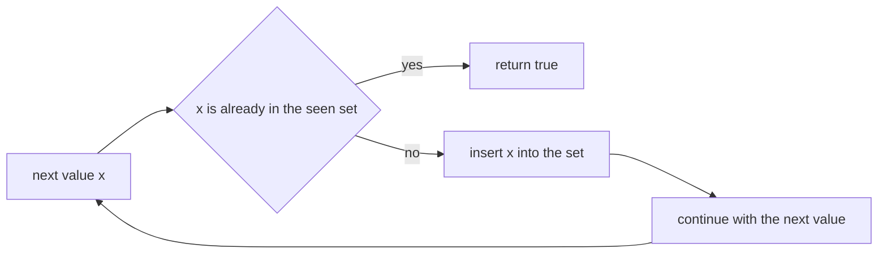
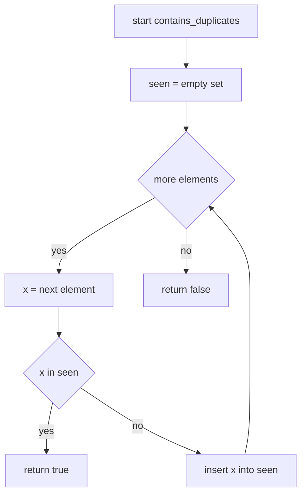
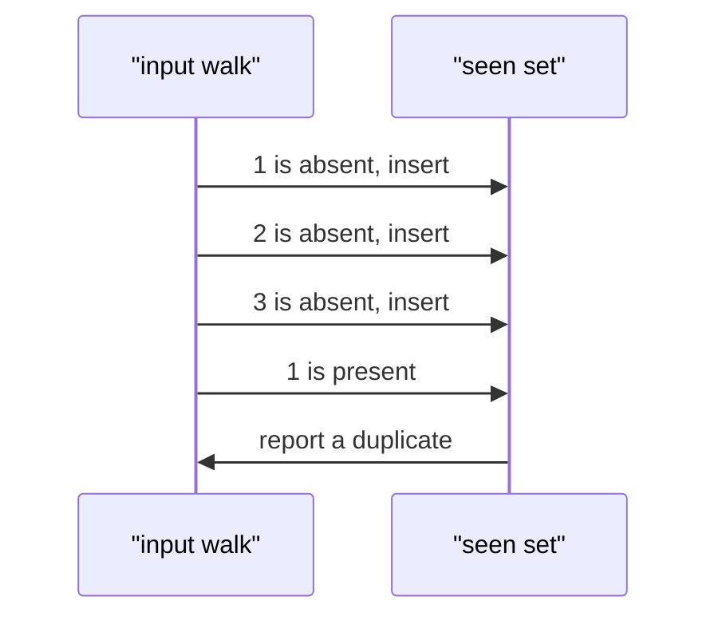

# 026 — Check if array contains any duplicates (boolean).

> **Tier:** Beginner · **CTCI chapter:** Ch 1 — Arrays and Strings
> **Task spec:** [026-check-if-array-contains-any-duplicates-boolean.md](../../../tasks/beginner/026-check-if-array-contains-any-duplicates-boolean.md)
> **Solutions:** [Python](../../../solutions/python/beginner/026-check-if-array-contains-any-duplicates-boolean/solution.py) ·
> [Java](../../../solutions/java/beginner/026-check-if-array-contains-any-duplicates-boolean/Solution.java) ·
> [JavaScript](../../../solutions/javascript/beginner/026-check-if-array-contains-any-duplicates-boolean/solution.js) ·
> [C#](../../../solutions/csharp/beginner/026-check-if-array-contains-any-duplicates-boolean/Solution.cs)

## 1. Problem restatement

**Input:** a sequence `items` of any length, holding any values. No bound on the values, no promise
about how many duplicates there are.

**Output:** `true` if at least one value occurs twice or more, `false` if every value is distinct.
The function reports only the answer — not which value repeats, and not how often.

| Call | Result | Why |
| --- | --- | --- |
| `contains_duplicates([1, 2, 3, 1])` | `true` | `1` appears twice |
| `contains_duplicates([1, 2, 3])` | `false` | all distinct |
| `contains_duplicates([])` | `false` | nothing can repeat in an empty sequence (Java asserts this row) |
| `contains_duplicates([7])` | `false` | a single value cannot repeat |
| `contains_duplicates([4, 4])` | `true` | the smallest positive case |

Contrast this with [025-find-duplicate-element-when-exactly-one-number-repeats-1-n.md](../../../tasks/beginner/025-find-duplicate-element-when-exactly-one-number-repeats-1-n.md):
there the input is promised to be `1 .. n` with exactly one repeat and the answer is *which* value
repeats, which admits Floyd's O(1)-space cycle walk. Here there is no bound and no promise, and the
question is only yes/no — so a membership structure is both the honest tool and the fast one.

## 2. Intuition

The naive approach is the pairwise scan: compare every element with every other element. That is
O(n²) comparisons, and on `[1, 2, 3, ..., 100000]` it is five billion of them. It is correct, but
it re-asks a question that has already been answered — once you have seen `1`, comparing the next
`1` against everything is pointless.

A second idea is to sort. Sorting brings equal values next to each other, so a single adjacent-pair
scan decides the question in O(n log n) time, and the scan can exit at the first equal pair. That
is a real improvement over O(n²), and it needs O(1) extra space if the input may be reordered —
but it destroys the caller's order, and it still costs a full sort for an array whose duplicate is
sitting at indices 0 and 1.

The insight with the best worst case is to replace "compare with everything" by "ask a dictionary".
Walk the array once, keeping the **set of values already seen**. For each element:

- if it is already in the set, the answer is `true` immediately — no further work is needed;
- otherwise add it and continue.

The set does the remembering that the pairwise scan re-derives, and membership testing is
(subject to hashing) constant time, so the walk is one pass. Four implementations, one per language,
differ only in how the "already present?" test and the insertion are spelled:

| Language | Structure | Idiom |
| --- | --- | --- |
| Python | `set` | `if x in seen: return True` then `seen.add(x)` |
| Java | `HashSet` | `if (!seen.add(x)) return true` — `add` returns whether the value was new |
| JavaScript | `Set` | `if (seen.has(x)) return true` then `seen.add(x)` |
| C# | `HashSet` | `if (!seen.Add(x)) return true` |

The Java and C# versions fold the membership test into the insertion call, which is the idiomatic
form: `add` returns `false` precisely when the value was already there.



The picture is deliberately one-directional: once a repeat is seen the function never comes back.
That early exit is what makes the best case O(1) even though the worst case is O(n).

## 3. Algorithm

1. Create an empty set of seen values.
2. For each element `x` of `items`:
   - if `x` is already in the set, return `true`;
   - otherwise insert `x`.
3. If the loop finishes without a repeat, return `false`.

```text
procedure contains_duplicates(items)
    seen ← empty set
    for each x in items do
        if x is a member of seen then
            return true
        end
        insert x into seen
    end
    return false
end
```

The order of the two operations inside the loop is the whole algorithm: test first, insert second.
Inserting first would leave no way to tell "new" from "repeat" without a second lookup, which is why
Java and C# rely on `add`/`Add` returning a boolean — insertion and the membership test are the same
hash-table probe. Also note that the set grows to at most `n` entries, and for a distinct input it
grows to exactly `n`: the memory is proportional to the number of *distinct* values, not to the
number of pairs that would have been compared.



## 4. Worked example

Trace `contains_duplicates([1, 2, 3, 1])`. The repeat is the last element, so the loop runs to
completion of the deciding step — the worst case for this function:

| Step | `x` | `seen` before | membership test | action | `seen` after |
| --- | --- | --- | --- | --- | --- |
| 1 | 1 | `{}` | absent | insert | `{1}` |
| 2 | 2 | `{1}` | absent | insert | `{1, 2}` |
| 3 | 3 | `{1, 2}` | absent | insert | `{1, 2, 3}` |
| 4 | 1 | `{1, 2, 3}` | **present** | return `true` | — |

Step 4 is the only step that does not insert, and it ends the function immediately. Nothing after
index 3 would have been examined even if the array were a million elements long.



The other end of the cost spectrum is an early repeat:

| Input | comparisons before returning | verdict |
| --- | --- | --- |
| `[]` | 0 | `false` |
| `[7]` | 0 insertions, 1 probe | `false` |
| `[4, 4]` | 2 probes, 1 insertion | `true` |
| `[1, 2, 3, 1]` | 4 probes, 3 insertions | `true` |
| `[1, 2, 3]` | 3 probes, 3 insertions | `false` |

`[4, 4]` returns after two probes — the O(1) best case — while the all-distinct rows must build the
entire set before answering `false`.

## 5. Complexity

Let `n` be the length of `items`.

| Measure | Bound | Why it holds |
| --- | --- | --- |
| Time, best | O(1) | a repeat in the first two positions is found in two probes |
| Time, average | O(n) | one membership probe plus (usually) one insertion per element, each constant time |
| Time, worst | O(n) | the loop runs at most `n` iterations and never revisits an element |
| Space, extra | O(d) where `d ≤ n` is the number of distinct values | the set holds every distinct value seen; `d = n` for a distinct input |
| Space, input | untouched | all four files read the sequence without writing |
| Alternative: pairwise scan | O(n²) time, O(1) space | no allocation, but quadratic |
| Alternative: sort, then adjacent scan | O(n log n) time, O(1) extra space if the input may be reordered | cheaper in memory, worse in time, and destructive |
| Recursion depth | O(1) | iterative |

The extra space is the price of the linear time, and it is the price the two-part question is really
testing: with no bound on the values (unlike task 025's `1 .. n`) there is no O(1)-space trick
available, so O(n) memory is the honest cost of asking "have I seen this before?" for arbitrary
data.

## 6. Pitfalls and edge cases

- **Empty and single-element inputs.** Both return `false`: the loop body never has a second
  occurrence to find. Java's file asserts the empty case explicitly, the others assert the
  distinct case.
- **Early return placement.** The `true` must be returned *inside* the loop; collecting a flag and
  breaking afterwards works too but wastes the early exit, which is the difference between the
  best case O(1) and O(n).
- **Test-before-insert ordering.** Reversing the two operations makes the first occurrence look
  like a duplicate. The Java and C# one-liners `if (!seen.add(x)) return true` encode the correct
  order by construction.
- **`add` returning a boolean.** `HashSet.add` in Java returns `false` when the element was already
  present; `HashSet<int>.Add` in C# does the same. Reading the return value is the whole test — a
  separate `contains` call would probe the table twice.
- **Hashing of unusual values.** In Java and C#, arrays and other reference types that do not
  override `equals`/`GetHashCode` compare by identity, so two structurally equal arrays count as
  distinct. In JavaScript, `Set` uses SameValueZero, which treats `NaN` as equal to `NaN` and `-0`
  as equal to `+0`.
- **Mutability of the seen values.** If the elements are mutable objects used as keys, mutating one
  after insertion changes its hash and makes it unfindable. The four files work with plain integers,
  where this cannot happen.
- **Unhashable elements.** In Python a `set` requires hashable elements, so an input containing a
  `list` raises `TypeError`; the other three languages have no such restriction. The task's inputs
  are integers, so this is a robustness note rather than a contract.
- **Determinism.** The answer never depends on iteration order of the set; only membership matters.
- **Counting versus detecting.** The function stops at the first repeat, so it cannot report how
  many duplicates exist — that would require processing the whole array.
- **Task 025 is not a special case of this.** A `true` answer here says nothing about *which* value
  repeated, and the O(1)-space cycle walk of task 025 cannot be reused because it needs values in
  `1 .. n`.

## 7. Variants and follow-ups

- **Return the value instead of a boolean.**
  [025-find-duplicate-element-when-exactly-one-number-repeats-1-n.md](../../../tasks/beginner/025-find-duplicate-element-when-exactly-one-number-repeats-1-n.md)
  does exactly that, at the cost of extra preconditions and a much more intricate algorithm.
- **Missing instead of repeated.**
  [027-find-missing-number-in-1-n-given-n-1-elements.md](../../../tasks/beginner/027-find-missing-number-in-1-n-given-n-1-elements.md)
  is the same "what is unusual about this sequence?" question answered arithmetically.
- **Deduplicate for real.**
  [004-remove-duplicates-from-an-array-create-new-array.md](../../../tasks/beginner/004-remove-duplicates-from-an-array-create-new-array.md)
  uses a membership structure too, but keeps the first occurrence of each value instead of stopping
  at the first repeat.
- **Second largest of a set.** [023-find-second-largest-element-in-an-array.md](../../../tasks/beginner/023-find-second-largest-element-in-an-array.md)
  has to reason explicitly about duplicate values, the same distinction this task answers as a
  boolean.
- The chapter walkthrough in [Arrays and Strings](../../ctci/01-arrays-and-strings.md) groups the
  hash-set tasks of Ch 1 together.

## 8. Check yourself

1. What is the best-case time of `contains_duplicates`, and which input achieves it?

<details><summary>Show answer</summary>

O(1): `[4, 4]` (or any array whose first two elements are equal). The first element is inserted, the
second is found in the set, and the function returns `true` after two probes — independent of the
array length.

</details>

2. Why is the worst case O(n) here, while the pairwise scan is O(n²)?

<details><summary>Show answer</summary>

Because the pairwise scan re-derives the same information: for element `i` it compares against all
`i` earlier elements, giving `n(n-1)/2` comparisons. The set version asks the hash table once per
element, so the total number of operations is linear in `n` (plus, for a distinct input, the cost
of building `n` set entries).

</details>

3. `contains_duplicates([1, 2, 3])` returns `false`. How much extra memory did that decision use?

<details><summary>Show answer</summary>

The set holds all three distinct values, so O(n) — one entry per element. This is the case where
the space cost is maximal: the answer `false` can only be given after every element has been
inserted, so the function cannot avoid building the structure.

</details>

4. What does the sort-based variant cost, and what does it give up?

<details><summary>Show answer</summary>

O(n log n) time and O(1) extra space if it may reorder the input (sort in place, then compare
adjacent pairs and return at the first equality). It gives up the input's original order, gives up
the O(n) time bound, and it cannot early-exit before the sort finishes — even when the duplicate is
in the first two slots.

</details>

5. Would Floyd's cycle detection from task 025 work on `contains_duplicates([1, 2, 3, 1])`?

<details><summary>Show answer</summary>

No. That algorithm needs every value to be a valid index into the array (`1 .. n`) and needs
"exactly one value repeated twice" to make the cycle entry unique. `[1, 2, 3, 1]` has `n = 4`, so a
value of `3` is a legal index but `4` is not, and there is no unique repeated value to point at.
The precondition is what makes the pointer walk possible, and this task deliberately does not
assume it.

</details>
