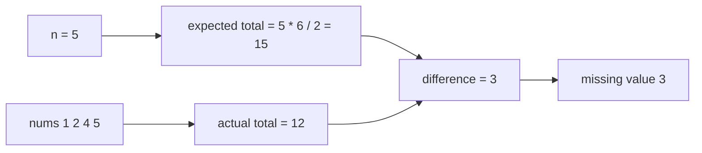
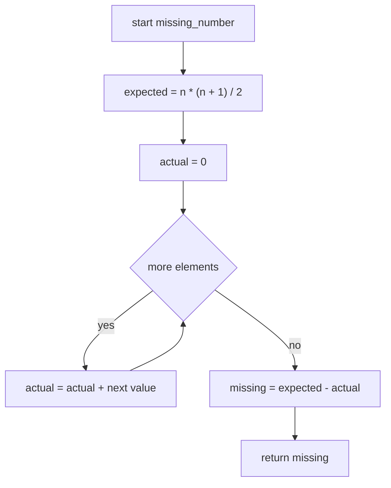
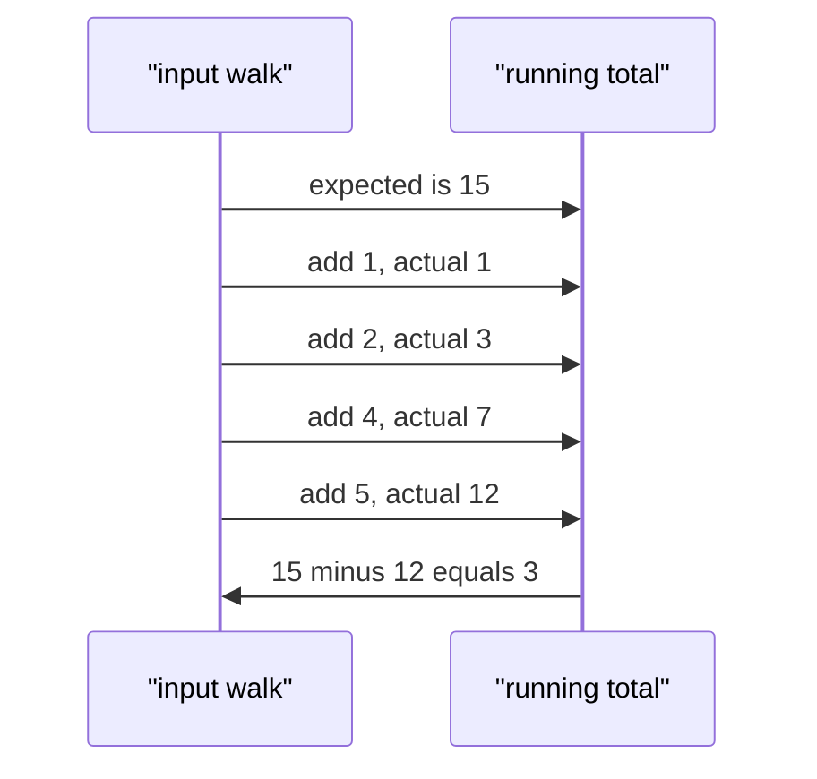

# 027 — Find missing number in 1..n given n-1 elements.

> **Tier:** Beginner · **CTCI chapter:** Ch 1 — Arrays and Strings
> **Task spec:** [027-find-missing-number-in-1-n-given-n-1-elements.md](../../../tasks/beginner/027-find-missing-number-in-1-n-given-n-1-elements.md)
> **Solutions:** [Python](../../../solutions/python/beginner/027-find-missing-number-in-1-n-given-n-1-elements/solution.py) ·
> [Java](../../../solutions/java/beginner/027-find-missing-number-in-1-n-given-n-1-elements/Solution.java) ·
> [JavaScript](../../../solutions/javascript/beginner/027-find-missing-number-in-1-n-given-n-1-elements/solution.js) ·
> [C#](../../../solutions/csharp/beginner/027-find-missing-number-in-1-n-given-n-1-elements/Solution.cs)

## 1. Problem restatement

**Input:** an integer `n` and a sequence `nums` containing exactly `n - 1` of the values `1 .. n`,
in any order and with no repetitions.

**Output:** the one value from `1 .. n` that does not appear in `nums`.

| Call | Result | Why |
| --- | --- | --- |
| `missing_number([1, 2, 4, 5], 5)` | `3` | the range is `1..5` and `3` is absent |
| `missing_number([2], 2)` | `1` | the range is `1..2` and only `2` is present |
| `missing_number([1], 2)` | `2` | the missing value can be the top of the range |
| `missing_number([], 1)` | `1` | the smallest legal case: an empty sequence and `n = 1` |

`n` is passed explicitly rather than inferred from the length, which is what lets the empty
sequence above be legal. Both endpoints of the range are reachable answers: `[2]` is missing its
minimum and `[1]` is missing its maximum, so no "assume it is in the middle" shortcut is safe.

The task is the "missing" twin of
[025-find-duplicate-element-when-exactly-one-number-repeats-1-n.md](../../../tasks/beginner/025-find-duplicate-element-when-exactly-one-number-repeats-1-n.md):
the same `1 .. n` structure, but asking which value is absent rather than which is repeated. The
shipped solutions use arithmetic rather than pointers — and this file explains why that is possible
here and not there.

## 2. Intuition

The naive approach is to check the range one value at a time:

```text
for candidate ← 1 to n do
    present ← false
    for i ← 0 to length(nums) - 1 do
        if nums[i] = candidate then
            present ← true
        end
    end
    if not present then
        return candidate
    end
end
```

That is O(n²) and re-reads the whole sequence `n` times. Sorting first improves it to O(n log n)
with an adjacent-pair scan, but a sort is a lot of machinery for one question.

The insight is that we are not asked *where* the value is missing, only *what* it is — and that a
sequence of numbers has a **total**, not just an order. Consecutive integers are the one family of
sequences whose total is known in closed form: Gauss's identity gives

    1 + 2 + ... + n = n · (n + 1) / 2

So compare the total you *should* have with the total you *do* have:

    missing = n · (n + 1) / 2 − sum(nums)

Everything else cancels. The present values contribute equally to both sides, so the difference is
exactly the absent value — no scanning, no marking, no sorting, and the sequence can arrive in any
order.

Why does this work here but not for the duplicate task? Because here the *count* is what is
preserved: `n - 1` distinct values with a gap. In task 025 the multiplicity is what varies, and a
sum there would depend on which value repeats, which the range alone does not reveal. Subtraction
detects an absence; it cannot detect a repetition of unknown magnitude without the extra
assumption that everything else appears exactly once.



## 3. Algorithm

1. Compute the expected total `n · (n + 1) / 2` in a type wide enough not to overflow.
2. Walk `nums` once, accumulating the actual total.
3. Return the difference, expected minus actual.

```text
procedure missing_number(nums, n)
    expected ← n * (n + 1) / 2
    actual ← 0
    for each x in nums do
        actual ← actual + x
    end
    return expected - actual
end
```

Two implementation details are not cosmetic. First, the multiplication must be widened **before**
the product is formed: Java and C# write `long expected = (long) n * (n + 1) / 2`, because
`n * (n + 1)` overflows a 32-bit `int` for `n = 100000` (the product is about `10^10`, well past
`2^31 − 1`). The cast applies to `n`, so the whole expression is evaluated in 64 bits. Second, the
division by two is exact for every `n` — one of `n` and `n + 1` is always even — so the order
"multiply first, divide second" is safe and `n / 2 · (n + 1)` would *not* be (it truncates for odd
`n`).

The single loop is a plain accumulator with no early exit: the total is only known after the last
element, so every input costs the same.



## 4. Worked example

Trace `missing_number([1, 2, 4, 5], 5)`. The expected total for `n = 5` is `5 · 6 / 2 = 15`:

| Step | element | `actual` before | `actual` after | note |
| --- | --- | --- | --- | --- |
| formula | — | — | — | `expected = 15` |
| 1 | 1 | 0 | 1 | |
| 2 | 2 | 1 | 3 | |
| 3 | 4 | 3 | 7 | `3` never arrives, so the running total falls behind |
| 4 | 5 | 7 | 12 | loop ends |
| return | — | 12 | — | `15 − 12 = 3` |

At every step the running total is exactly the expected total of the prefix read so far *minus* the
values skipped so far. After the loop that deficit is the answer — the missing value, seen from the
arithmetic side rather than from the array side.



The edge rows show that no position is privileged:

| `nums` | `n` | expected | actual | missing |
| --- | --- | --- | --- | --- |
| `[]` | 1 | 1 | 0 | `1` |
| `[2]` | 2 | 3 | 2 | `1` |
| `[1]` | 2 | 3 | 1 | `2` |
| `[1, 3]` | 3 | 6 | 4 | `2` |
| `[2, 3, 4, 5]` | 5 | 15 | 14 | `1` |

The first row is the one that shows why `n` is a parameter: an empty input has no length from which
to infer the range.

## 5. Complexity

Let `n` be the size of the range; the sequence has `n - 1` elements.

| Measure | Bound | Why it holds |
| --- | --- | --- |
| Time, best | O(n) | every element must be added; there is no early exit |
| Time, average | O(n) | one addition per element |
| Time, worst | O(n) | `n - 1` additions, constant work each |
| Space, extra | O(1) | two accumulators and a loop variable |
| Space, input | untouched | the sequence is read once, in place, in any order |
| Alternative: nested scan | O(n²) time, O(1) space | checks each candidate against the whole sequence |
| Alternative: sort then scan | O(n log n) time, O(1) extra if reordered | finds the gap from adjacent pairs |
| Alternative: XOR of `1..n` with the elements | O(n) time, O(1) space | same bounds, no overflow at all |
| Alternative: boolean present array | O(n) time, O(n) space | the simplest to explain, but allocates |

The XOR alternative is worth naming because it removes the only sharp edge in this solution:
`(1 xor 2 xor ... xor n) xor (all elements)` cancels every present value (anything xor itself is
zero) and leaves the missing one, with no product to overflow. It costs the same time and space,
which is why the interview answer often mentions both and picks the sum for readability.

## 6. Pitfalls and edge cases

- **Overflow of the expected total.** `n · (n + 1) / 2` exceeds `2^31 − 1` for `n ≥ 65536`, so an
  `int` accumulator wraps. Java and C# widen with `(long) n * (n + 1) / 2`; Python's integers are
  arbitrary precision; JavaScript uses doubles, which are exact for integers up to `2^53`, i.e. up
  to `n` around `1.3 · 10^8`.
- **Cast placement.** `(long) n * (n + 1)` widens the whole product, while
  `(long) (n * (n + 1))` computes the overflow first and only then widens the wrong value.
- **Divide after multiplying.** The division by two is exact for `n · (n + 1)` but not for
  `n / 2 · (n + 1)` when `n` is odd — `5 / 2` is `2` in integer arithmetic. Python's `//` has the
  same behaviour, so the shipped expression multiplies first.
- **Empty sequence.** `missing_number([], 1)` returns `1`; the loop never runs and the expected
  total is `1`. `n = 0` is not a meaningful input — there would be `-1` elements — and no file
  guards against it.
- **Both endpoints are reachable.** `[2]` with `n = 2` returns `1` and `[1]` with `n = 2` returns
  `2`; the algorithm treats them identically, which is why both rows are asserted.
- **Input order is irrelevant.** Nothing in the loop compares elements, so a shuffled sequence
  gives the same answer — this is the property that lets the algorithm skip sorting.
- **No validation of the precondition.** If `nums` contains a duplicate and is therefore missing
  two values, the difference silently reports the wrong number instead of raising. The four files
  assume `n - 1` distinct values in `1 .. n`, exactly as the task states.
- **Values out of range.** A value of `n + 1` or `0` shifts the total and corrupts the answer; the
  sum approach cannot distinguish "`3` is missing" from "`5` is present and `3` is absent" unless
  the range assumption holds.
- **Signed subtraction.** The answer is `expected − actual`, never the reverse; negative results
  are impossible for legal inputs but would be returned silently for illegal ones.
- **Floating-point accumulation.** In JavaScript the sum of `n - 1` doubles is exact only while it
  stays below `2^53`, which the range bound already guarantees for reasonable `n`.

## 7. Variants and follow-ups

- **Repeated instead of absent.** [025-find-duplicate-element-when-exactly-one-number-repeats-1-n.md](../../../tasks/beginner/025-find-duplicate-element-when-exactly-one-number-repeats-1-n.md)
  answers the companion question when the anomaly is a repetition rather than a gap — and needs
  Floyd's cycle walk instead of a sum, because a total cannot localise a repetition.
- **Yes/no version of the same idea.** [026-check-if-array-contains-any-duplicates-boolean.md](../../../tasks/beginner/026-check-if-array-contains-any-duplicates-boolean.md)
  drops the `1 .. n` bound and therefore has to use a hash set.
- **Two missing values.** The same trick does not apply: one equation, two unknowns. With the first
  missing value known to be below the average of the pair you can split the equation, which is the
  classic follow-up question.
- **Arithmetic accumulators in general.** [030-reverse-digits-of-an-integer.md](../../../tasks/beginner/030-reverse-digits-of-an-integer.md)
  and [031-palindrome-number-check-without-string-conversion.md](../../../tasks/beginner/031-palindrome-number-check-without-string-conversion.md)
  build values with the same "maintain one number across a single pass" discipline.
- The chapter walkthrough in [Arrays and Strings](../../ctci/01-arrays-and-strings.md) collects the
  `1 .. n` tasks of Ch 1 together.

## 8. Check yourself

1. Why must the cast to `long` appear in front of `n` rather than around the whole product?

<details><summary>Show answer</summary>

Because the product is where the overflow happens. `(long) n * (n + 1)` promotes `n` to 64 bits
before multiplying, so the whole expression is evaluated in `long`. `(long) (n * (n + 1))` first
computes an `int` product that has already wrapped for large `n`, and widening a wrapped value does
not recover the true total.

</details>

2. Give an input where the missing value is the maximum of the range, and one where it is the
   minimum.

<details><summary>Show answer</summary>

Maximum: `missing_number([1], 2)` returns `2`. Minimum: `missing_number([2], 2)` returns `1`. Both
are asserted by the shipped files, and both are handled by the same subtraction — there is no
special case for either end because the algorithm never looks at positions.

</details>

3. The alternative XOR solution has the same time and space complexity. What is its advantage?

<details><summary>Show answer</summary>

It cannot overflow: `a xor a = 0` cancels each present value, and every partial result is bounded by
the bit width of the values themselves, not by their sum. For large `n` that removes the need for a
widened accumulator entirely (though in Java and C# the values are still `int`, which is fine for
`n` up to `2^31`).

</details>

4. What does `missing_number([1, 2, 2, 5], 5)` return, and what does that tell you about the
   precondition?

<details><summary>Show answer</summary>

`3`: the expected total is `15` and the actual total is `12`, and the duplicate `2` costs exactly
the same as the absent `3`. So the answer is indistinguishable from the legal input `[1, 2, 4, 5]`.
The subtraction reports a *deficit*, not a verified absence — validating the input would need an
extra pass and a presence structure.

</details>

5. Why is the sequence allowed to arrive in any order?

<details><summary>Show answer</summary>

Because the algorithm only uses addition, which is commutative and associative: `sum(nums)` does not
depend on the arrangement, and neither does `n · (n + 1) / 2`. This is precisely the property that
lets the solution skip sorting, unlike the "sort then find the gap" alternative.

</details>
