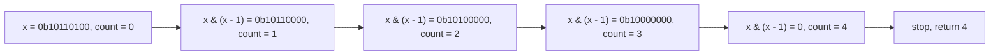
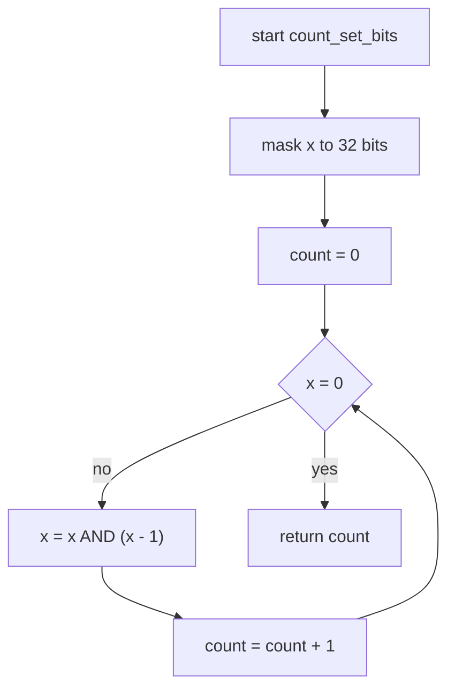
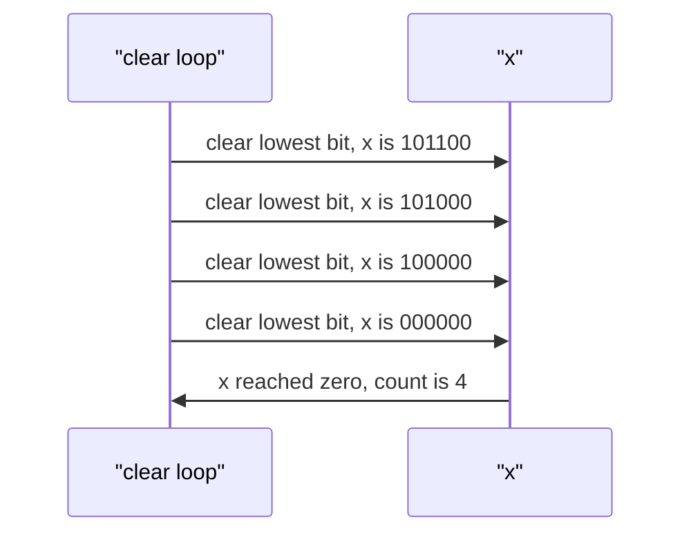

# 028 — Count number of set bits in an integer.

> **Tier:** Beginner · **CTCI chapter:** Ch 5 — Bit Manipulation
> **Task spec:** [028-count-number-of-set-bits-in-an-integer.md](../../../tasks/beginner/028-count-number-of-set-bits-in-an-integer.md)
> **Solutions:** [Python](../../../solutions/python/beginner/028-count-number-of-set-bits-in-an-integer/solution.py) ·
> [Java](../../../solutions/java/beginner/028-count-number-of-set-bits-in-an-integer/Solution.java) ·
> [JavaScript](../../../solutions/javascript/beginner/028-count-number-of-set-bits-in-an-integer/solution.js) ·
> [C#](../../../solutions/csharp/beginner/028-count-number-of-set-bits-in-an-integer/Solution.cs)

## 1. Problem restatement

**Input:** an integer `x`.

**Output:** the number of bits set to 1 in its 32-bit representation — the *population count*, or
popcount. The convention across the four files is 32-bit two's complement, so negative values are
counted in their unsigned 32-bit pattern rather than as an unbounded sign-magnitude number.

| Call | Value in binary | Result | Why |
| --- | --- | --- | --- |
| `count_set_bits(0)` | `0…0` | `0` | no bits set; the loop never runs |
| `count_set_bits(1)` | `0…001` | `1` | a single low bit |
| `count_set_bits(255)` | `1111 1111` | `8` | one full byte |
| `count_set_bits(0b101101)` | `101101` | `4` | 45 has four set bits |
| `count_set_bits(-1)` | `1111 … 1111` | `32` | asserted by Java and C#; all 32 bits are set |

That last row is the one that forces a **width convention**. Python's integers have no fixed width,
and JavaScript's bitwise operators coerce to signed 32-bit, so both files go out of their way to
match the Java and C# answer of 32: Python masks with `x &= 0xFFFFFFFF`, JavaScript normalises with
`x = x >>> 0`. Without those lines the two implementations would loop forever or disagree with the
other two.

## 2. Intuition

The straightforward method is to examine every bit position:

```text
count ← 0
for bit ← 0 to 31 do
    if x has bit number bit set then
        count ← count + 1
    end
end
return count
```

That is correct and takes exactly 32 iterations, no matter how sparse the number is.
`count_set_bits(1)` costs the same as `count_set_bits(-1)`, and for a 32-bit type the constant is
so small that this is the version most production code would write when a built-in popcount is
unavailable.

The insight that beats it is a single identity: **`x & (x - 1)` clears the lowest set bit of `x`.**

Why: subtracting one from `x` borrows through the trailing zeros, turning the lowest set bit into a
`0` and every bit below it into a `1`. The higher bits are untouched. ANDing with the original `x`
therefore keeps the untouched high bits, keeps nothing from the flipped low region, and removes the
lowest `1` — which is the only bit that changed from `1` to `0` in the shared prefix.

    x        = 0b10110100
    x - 1    = 0b10110011
    x & (x-1)= 0b10110000     ← the lowest set bit is gone, everything else is intact

So the loop "while `x` is non-zero, clear the lowest set bit and count one" runs **once per set
bit** instead of once per bit position, and the number of iterations *is* the answer. Terminating
when `x` reaches `0` is also the stopping rule: at that point there is nothing left to count.



## 3. Algorithm

1. Normalise `x` to its 32-bit unsigned pattern where the language needs it (Python: mask with
   `0xFFFFFFFF`; JavaScript: `x >>> 0`).
2. Set `count = 0`.
3. While `x` is non-zero:
   - clear the lowest set bit with `x ← x & (x - 1)`;
   - increment `count`.
4. Return `count`.

```text
procedure count_set_bits(x)
    x ← x masked to 32 bits
    count ← 0
    while x ≠ 0 do
        x ← x AND (x - 1)
        count ← count + 1
    end
    return count
end
```

Java and C# need no masking, because `int` is already exactly 32 bits of two's complement: `-1` is
`0xFFFFFFFF`, and `x & (x - 1)` walks it down through the powers of two until it hits `0` after
exactly 32 iterations. Python's `int` is arbitrary precision and a negative value has no set bits at
all in the usual representation — `x & (x - 1)` on a negative Python integer produces another
negative integer and never reaches zero, so the mask is what makes the function terminate. JavaScript
is different again: its bitwise operators truncate to 32-bit *signed*, so `x >>> 0` reinterprets the
pattern as unsigned before the loop, which makes `-1` become `4294967295` and terminate at 32.

The loop body has no branches, no table and no helper: two machine operations per set bit, and the
iteration count is bounded by the bit width, so the worst case is 32 iterations.



## 4. Worked example

Trace `count_set_bits(0b101101)` — the value `45`, whose bits are `32 + 8 + 4 + 1`:

| Step | `x` (binary) | `x - 1` | `x & (x - 1)` | `count` |
| --- | --- | --- | --- | --- |
| start | `101101` | — | — | 0 |
| 1 | `101101` | `101100` | `101100` | 1 |
| 2 | `101100` | `101011` | `101000` | 2 |
| 3 | `101000` | `100111` | `100000` | 3 |
| 4 | `100000` | `011111` | `000000` | 4 |
| loop test | `0` | — | — | stop, return 4 |

Four iterations for four set bits. Each row removes exactly one `1` and leaves every other `1` where
it was — the bit positions that survive change only in the borrow region, where the discarded bits
were zeros anyway.



The two extremes show the range of iteration counts:

| Input | binary | iterations | count |
| --- | --- | --- | --- |
| `0` | `0` | 0 | `0` |
| `1` | `1` | 1 | `1` |
| `255` | `1111 1111` | 8 | `8` |
| `0b101101` | `101101` | 4 | `4` |
| `-1` | 32 ones | 32 | `32` |

The all-ones row is the worst case: every iteration clears one bit and the loop runs the full width.
The `0` row is the best case: zero iterations, and the answer is already known.

## 5. Complexity

Let `w` be the width of the integer (32 here) and `p` the number of set bits, so `p ≤ w`.

| Measure | Bound | Why it holds |
| --- | --- | --- |
| Time, best | O(1) | `x = 0` skips the loop entirely |
| Time, average | O(p) | one iteration clears one set bit |
| Time, worst | O(w) | at most 32 iterations, each with constant work — so O(1) in the formal sense |
| Space, extra | O(1) | one counter and one temporary |
| Alternative: test all `w` positions | O(w) always | 32 iterations even for `x = 1` |
| Alternative: loop while shifting right | O(w) always | 32 iterations, and the arithmetic-shift trap on negatives |
| Alternative: built-in popcount | O(1) | `Integer.bitCount`, `Int32.PopCount` — a hardware instruction on most CPUs |

Because `w` is a constant (32), every one of these is O(1) in the formal sense; the interesting
comparison is the constant factor. On `x = 1` the position loop performs 32 tests and the
Kernighan loop performs one. On `x = -1` both perform 32. That is the entire practical case for
the trick, and it also happens to be the reason the trick appears in interviews: it shows you
understand what subtracting one does to a bit pattern.

## 6. Pitfalls and edge cases

- **Negative values in Python.** `x & (x - 1)` on a negative Python integer yields another negative
  integer and the loop never terminates; the file masks with `x &= 0xFFFFFFFF` **before** looping,
  which is also what makes `-1` return `32` like Java and C#.
- **Negative values in JavaScript.** Bitwise operators coerce to signed 32-bit, so `-1` stays `-1`
  and `x & (x - 1)` gives `-2`, `-4`, … which never equals `0`. The file's `x = x >>> 0` reinterprets
  the pattern as `4294967295`, matching the other languages.
- **Arithmetic shift right in Java and C#.** A "count by shifting" loop written as `x >>= 1` never
  terminates for negative `x`, because the sign bit is replicated forever. The fix is `x >>>= 1`
  (Java) or treating the value as `uint`; the shipped files avoid the issue by never shifting right.
- **Width convention.** The answer for `-1` is 32, not 1 and not infinity. Every file documents the
  same 32-bit view; a `BigInteger` or an unbounded convention would have to answer differently.
- **Zero.** The loop test is a pre-test `while x ≠ 0`, which is why `0` returns `0` rather than
  entering the body once. A `do`-`while` would get this wrong.
- **The temporary `x - 1`.** The identity needs the *original* `x` when the AND is formed; writing
  `x -= 1; x &= x - 1` clears two bits' worth of borrowing and gives a wrong count.
- **Bit order is irrelevant.** The identity always clears the *lowest* set bit; which positions the
  bits occupy does not change the number of iterations, only the order in which they disappear.
- **Built-in alternatives.** `Integer.bitCount` in Java and `Int32.PopCount` in .NET are constant
  time and should be used in production; the task asks for the manual algorithm. Python's
  `bin(x).count("1")` or `int.bit_count()` and JavaScript's lack of a built-in are worth mentioning
  as the pragmatic answer.
- **No overflow.** `x & (x - 1)` never grows the value, so there is nothing to guard beyond the
  width normalisation.

## 7. Variants and follow-ups

- **The identity as a predicate.** [029-check-if-integer-is-power-of-two.md](../../../tasks/beginner/029-check-if-integer-is-power-of-two.md)
  uses the same `x & (x - 1)` expression, but only checks whether it clears to zero — a power of two
  is exactly the case of one set bit.
- **Digit-wise instead of bit-wise.**
  [030-reverse-digits-of-an-integer.md](../../../tasks/beginner/030-reverse-digits-of-an-integer.md)
  and [031-palindrome-number-check-without-string-conversion.md](../../../tasks/beginner/031-palindrome-number-check-without-string-conversion.md)
  peel and rebuild a number one *decimal* digit at a time, which is the base-10 analogue of peeling
  one bit at a time.
- **Digit counts and divisibility.**
  [032-check-prime-number-naive.md](../../../tasks/beginner/032-check-prime-number-naive.md) is the
  other Ch 6 arithmetic loop, using `%` and `*` rather than bitwise operators.
- **Accumulating a closed-form quantity.**
  [027-find-missing-number-in-1-n-given-n-1-elements.md](../../../tasks/beginner/027-find-missing-number-in-1-n-given-n-1-elements.md)
  is the other "one accumulator over a single pass" task in this tier.
- The chapter walkthrough in [Bit Manipulation](../../ctci/05-bit-manipulation.md) introduces
  `x & (x - 1)`, `x ^ x`, and the masking idioms used here.

## 8. Check yourself

1. Why does `x & (x - 1)` clear exactly the lowest set bit?

<details><summary>Show answer</summary>

Subtracting one borrows through the run of trailing zeros: those zeros become ones, the lowest set
bit becomes zero, and the bits above it are unchanged. ANDing with the original keeps the unchanged
high bits and clears the flipped low region, so the net effect is that the lowest `1` disappears
and everything else stays.

</details>

2. How many iterations does the loop perform for `x = 0`, `x = 1`, and `x = -1` in Java?

<details><summary>Show answer</summary>

0, 1 and 32. `x = 0` never enters the loop; `x = 1` clears its single bit in one iteration; `-1` is
`0xFFFFFFFF` and each iteration removes one bit, so it takes the full 32. That last number is why
the four files agree on a 32-bit convention.

</details>

3. What breaks in Python without the `0xFFFFFFFF` mask?

<details><summary>Show answer</summary>

Python integers are unbounded and use a sign-magnitude-like representation, so `-1 & -2` is `-2`,
then `-2 & -3` is `-4`, and so on towards negative infinity. The loop never reaches zero, so the
function hangs. Masking with `0xFFFFFFFF` first turns any input into a non-negative 32-bit pattern
before the loop starts.

</details>

4. Compare the iteration counts of the position loop and the Kernighan loop on `x = 0b101101`.

<details><summary>Show answer</summary>

The position loop always performs 32 iterations (one per bit position, testing each). The Kernighan
loop performs 4, one per set bit, so it is 8× fewer here. On `x = -1` both perform 32, and on
`x = 0` the position loop still performs 32 while the Kernighan loop performs none.

</details>

5. A colleague writes `x = x - 1; x = x & (x - 1); count++`. Why is the count wrong?

<details><summary>Show answer</summary>

Because the decrement is applied twice: once explicitly and once inside `x - 1`. After the explicit
decrement the lowest set bit is already gone (and the trailing zeros have become ones), so the AND
removes a *second* bit — the loop clears roughly two bits per iteration and returns about half the
correct count. The identity needs the original value on both sides of the AND.

</details>
